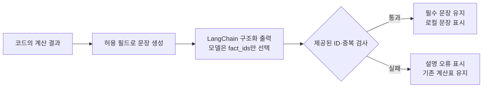

# 공통 AI 연결 인터페이스

## 두 실행 모드의 범위

| 모드 | 채팅 실행 위치 | 선택적 생성 AI | LangSmith 내보내기 |
|---|---|---|---|
| 로컬: `JOLUP_AGENT_API_URL` 미설정 | Streamlit 프로세스의 `agent.respond()` | 기존 공통 키·모델 UI와 명시적 선택 지원 | 변경하지 않은 내장 더미 기록을 별도 버튼으로 전송 |
| HTTP: `JOLUP_AGENT_API_URL=http://127.0.0.1:8001` 또는 Compose의 `http://api:8001` | FastAPI `/chat` → Agent → 도메인 도구 | **미지원**. API는 `use_llm=False`, UI의 생성 키를 전달하지 않음 | **미지원**. 서버 실행 단계는 화면에서 열람 가능 |

Compose는 `app`, `api`, `mcp`, `chroma` 4서비스를 기본 실행하도록 구성했다. HTTP 모드의 키 입력이나 모델 설정이 서버 LLM 사용을 켜지는 않는다. 아래 공통 AI 키·모델 설명은 **로컬 모드**의 기능이다. HTTP 요청 스키마·오류 계약·세션은 [모듈 연결 계약](INTERFACES.md), 실행 명령은 [실행 안내](RUN.md)를 따른다.


사용자는 화면의 **AI 설명 연결 · 선택**을 열고 **API 키** 한 칸에 키를 입력합니다. **서비스=자동 인식**을 유지하면 알려진 접두사 `sk-ant-`는 Anthropic, `sk-proj-`·`sk-svcacct-`는 OpenAI로 로컬에서 구분합니다. 키만으로 구분할 수 없는 형식은 **서비스**를 한 번 선택합니다. 키를 여러 회사에 보내 확인하지 않습니다. 화면에서 직접 고른 모델은 서비스별로 현재 세션에 기억합니다. OpenAI 키에서 Claude 키로 바꾸면 Claude에 저장한 모델을 복원하고, 처음 쓰는 서비스라면 모델 입력을 비워 기본값을 사용합니다. OpenAI로 돌아오면 이전 OpenAI 모델을 복원합니다. 같은 회사의 다른 키로 교체할 때는 모델을 유지합니다. 팀의 계산·화면 코드는 바꿀 필요가 없습니다.

**대화 답변에 AI 설명 추가**를 켠 뒤 질문할 때만 생성 API를 호출합니다. 이 선택은 아래의 의도 분류와 보조 설명 두 단계에 함께 적용됩니다. 키·서비스·모델을 바꾸는 것만으로는 API를 호출하지 않습니다. 체크를 끄면 로컬 분류·계산·검색으로 돌아갑니다. 별도의 **사용 가능한 모델 확인** 버튼은 해당 공급자의 `GET /v1/models`를 한 번 호출해 모델 ID 목록만 조회합니다. 이 버튼은 답변을 생성하거나 모델을 자동으로 선택하지 않습니다.

내부에서는 같은 `generate(system, user, config)` 호출을 공식 `langchain-openai.ChatOpenAI`와 `langchain-anthropic.ChatAnthropic`으로 연결합니다. OpenAI는 Responses API, Anthropic은 Messages API를 사용합니다. `jolup/llm.py`는 공급자 설정·오류·입력 범위를 관리하며 생성 HTTP 형식을 직접 구현하는 역할을 공식 통합 패키지로 넘겼습니다. 외부 중계 서비스 계정은 사용하지 않습니다.

`IntentDecision`과 앱용 `ExplanationSelection` Pydantic 모델을 `with_structured_output(method="json_schema")`에 전달하고 OpenAI에는 `strict=True`를 지정합니다. 일반 `generate()`의 기본 응답 스키마인 `ExplanationOutput`은 그대로 있지만, 앱의 `explain_result()`는 문장 생성 대신 `fact_ids` 선택 스키마를 사용합니다. 응답 스키마 오류·거절·잘림은 성공한 설명으로 표시하지 않습니다.

`explanation_facts()`가 허용된 계산 필드로 문장을 만들고, 모델은 `current / in_progress / plan / review / evidence / scope` 중 실제 제공된 ID만 선택합니다. 로컬 검사는 중복·없는 ID를 거부하고 필수 판정·조건·누락 안내·상담 범위를 유지합니다. 화면에는 이 문장 목록만 표시하므로 모델이 새 학점·URL·판정 문장을 작성할 수 없습니다. 다만 문장의 바탕이 되는 원문·규칙·계산의 정확성은 정답표로 별도 확인해야 합니다.



| 설정 | 값 |
|---|---|
| `api_key` | 화면 세션 또는 `JOLUP_API_KEY` 환경변수 |
| `provider` | `auto`(기본), `openai`, `anthropic` |
| `model` | 화면 값 → `JOLUP_LLM_MODEL` → 공급자 기본값 순. 기본값은 OpenAI `gpt-6-luna`, Anthropic `claude-haiku-5-5` |
| `workspace_id` | Claude 조직 전체 키에서 필요한 경우만 입력. 화면 값 또는 `ANTHROPIC_WORKSPACE_ID` 환경변수 |
| `timeout` | 기본 30초, 1~120초 |
| `max_output_tokens` | 기본 1200, 64~8192 |

모델 기본값은 2026-10-22에 확인한 공식 모델 문서 기준의 작은 작업용 선택입니다. 실제 계정 접근 권한은 별도입니다. 권한이 없거나 사용 한도에 도달하면 이유를 표시하며 다른 유료 모델로 자동 전환하거나 재호출하지 않습니다. **사용 가능한 모델 확인**으로 조회한 텍스트 모델 ID를 모델 입력란에 직접 지정할 수 있습니다. 목록에 있어도 Responses/Messages API 지원과 해당 요청의 접근 권한은 실제 질문으로 확인해야 합니다. 서비스별 모델 기억에는 공급자 이름과 모델 ID만 저장하며 이전 API 키를 복사해 저장하지 않습니다. 세션 초기화 시 모델 기억도 삭제합니다. `JOLUP_LLM_MODEL`은 화면이 비어 있을 때 적용되는 공통 환경 설정이므로, 키만으로 공급자를 전환하려면 이 환경변수는 비워 두세요.

Claude의 **단일 워크스페이스 범위 API 키**는 추가 입력 없이 사용할 수 있습니다. 조직 전체 키는 공식 API에서 `anthropic-workspace-id` 헤더를 요구하므로 화면의 **Claude 조직 키용 워크스페이스 ID · 선택** 또는 `ANTHROPIC_WORKSPACE_ID`에 사용할 워크스페이스 ID를 지정합니다. 이 헤더는 Claude 요청에만 추가되고 OpenAI에는 전송되지 않습니다. 키 접두사 인식은 인증 성공이나 사용 권한 확인을 뜻하지 않습니다. [Claude 인증·워크스페이스 안내](https://platform.claude.com/docs/en/api/overview)

## 질문 한 건의 두 단계

| 단계 | 함수 | 외부 API로 보내는 정보 | 결과와 실패 처리 |
|---|---|---|---|
| 1. 의도 분류 | `classify_intent(query, config, profile=None, previous_intent=None)` | 질문에서 발견한 **미리 정한 도메인 어휘**와 이전 의도 유형만 전송. 예: `{"signals":["졸업","괜찮"],"previous_intent":null}` | `diagnosis / planning / regulation / calendar / unsupported` 중 하나. 불명확하거나 API가 실패하면 로컬 분류 사용 |
| 2. 설명 선택 | `explain_result(query, deterministic_result, config)` | 허용 집계·진단표·학기별 합계·학교 근거와 로컬 사실 문장 목록 | 모델의 `fact_ids`를 검증해 로컬 문장을 별도 `ai_explanation`으로 표시. 실패하면 원래 계산 결과 유지 |

두 단계 모두 질문 원문·대화 전체·성적표 원문을 전송하지 않습니다. `classify_intent`는 자유로운 요약문을 만드는 대신 `ROUTING_SIGNALS`에 있는 고정 어휘만 선택하고, `profile`은 사용하지 않습니다. 도메인 신호가 없으면 분류 API를 호출하지 않습니다. 명백한 성적 조작·비밀키 요청 등은 로컬 라우터가 API 호출 전에 차단합니다.

앱의 지원 범위 내 질문 한 건은 외부 호출 **최대 2회**입니다. 모델이 도구를 무제한 선택하거나 루프를 돌지 않습니다. 각 호출의 제한 시간은 기본 30초이며 실제 응답 시간은 모델·네트워크와 로컬 계산·검색 시간에 따라 달라집니다. 화면에는 AI 분류·설명을 실제 사용한 경우와 로컬 대체 처리한 경우를 구별해 표시합니다.

`resolve_config(config)`는 키를 포함하지 않는 설정 점검 결과를 반환합니다. `detect_provider(key)`는 로컬 접두사 검사입니다. `generate`와 `explain_result`는 다음 공통 형식을 반환합니다. 예시 값은 형식을 설명하기 위한 값이며 실제 API 호출 기록이 아닙니다.

```python
{
    "ok": True, "used": True, "text": "보조 설명문",
    "provider": "openai", "model": "gpt-6-luna",
    "error": None, "error_code": None,
    "usage": {"input_tokens": 100, "output_tokens": 50},
    "elapsed_ms": 300.0,
}
```

`used=True`는 요청 결과를 검증해 사용할 수 있다는 뜻입니다. 앱의 `explain_result()`에서는 모델이 고른 ID를 검증한 뒤 로컬 문장으로 만든 `text`를 표시합니다. 자유문장을 모델에서 그대로 받았다는 뜻은 아닙니다. 실패한 요청도 공급자 과금 정책에 따라 비용이 발생할 수 있으므로 성공 여부를 비용 유무로 해석하지 않습니다. 모델이 응답을 거절하거나 토큰 한도에서 잘린 응답은 표시하지 않습니다.

`classify_intent`는 별도로 `{intent, used, error, provider, model, elapsed_ms}`를 반환합니다. 이 함수의 `used=True`는 모델 응답에서 허용된 의도 값 하나를 읽어 분류에 사용했다는 뜻입니다. 분류 전 도메인 신호가 없으면 공급자·모델·시간 필드는 생략될 수 있습니다.

## 계산 결과와 개인정보

윤석현 담당 계산 결과인 `answer`, `status`, `rows`, `totals`는 이 모듈이 수정하지 않습니다. AI 설명은 별도 필드로 표시합니다. 표시 문장은 계산 필드에서 로컬로 구성하고 해당 사례의 필수 조건을 유지합니다. 규정·일정 조회 상태를 학생의 현재 졸업 진단으로 바꾸어 설명하지 않습니다. 문장 구성 규칙·실제 API의 ID 선택·모든 사례의 기대값은 별도 시험 대상이며 모의 HTTP 시험만으로 전체 답변 품질을 검증했다고 표시하지 않습니다.

설명 단계의 `explain_result`는 질문 원문, 성적표 CSV, 학생 프로필, 이름·학번, 개별 성적, 계산 추적 행을 전송하지 않습니다. 허용된 계산 집계·진단표·학기별 계획 합계·학교 공식 URL에 연결된 일부 근거만 별도로 구성해 전송합니다. 출처 본문은 명령이 아닌 참고 데이터로 취급합니다. `generate`를 직접 호출하는 새 코드를 만들 경우 앱의 명시적 사용 선택과 같은 개인정보 경계를 지켜야 합니다.

평소 API 호출은 키와 요청·응답 본문을 파일이나 로그에 쓰지 않습니다. 앱 입력 키는 세션 메모리에 유지하며 세션 초기화 시 제거합니다. **사용자가 명시적으로 선택한 `.env` 다운로드는 예외**입니다. `jolup/env_export.py`는 현재 입력한 생성 API 키·공급자·모델을 파일 내용으로 만들며, 서버 환경의 키를 대신 읽거나 LangSmith 키를 넣지 않습니다. 다운로드 파일은 기본 공유 ZIP에 포함하지 않습니다. 프로세스 환경변수로 설정한 키나 이미 다운로드한 파일은 앱 초기화로 삭제되지 않습니다. `.env.example`은 변수 이름 안내이며 일반 Python 실행은 `.env`를 자동으로 읽지 않습니다. OpenAI 요청은 `store: false`를 보냅니다. 이는 공급자 전체 데이터 정책에 대한 보장을 의미하지 않습니다.

화면의 빈 키는 `JOLUP_API_KEY` 또는 기존 `OPENAI_API_KEY`·`ANTHROPIC_API_KEY` 환경변수로 보완할 수 있습니다. 두 공급자의 환경 키가 동시에 있고 공급자가 자동이면 서비스를 선택해야 합니다. 화면에서 명시한 서비스·모델 값이 환경 설정보다 우선합니다. Compose는 선택한 `JOLUP_*` 설정을 앱 컨테이너에 전달합니다. `.env`를 사용하는 Compose의 자체 설정 로딩과 Python 앱의 로딩 여부는 구별합니다.

프로필·성적표·키 설정이 포함된 LangGraph 상태는 외부 추적 대상이 아닙니다. 앱은 `tracing_context(enabled=False)`로 실행하므로 셸에서 LangSmith 추적을 켜 두었더라도 이 상태를 보내지 않습니다.

## 검증

**공식 LangChain 전환 후, 사실 ID 선택 계약 도입 전의 2026-10-23 실시험:** OpenAI `gpt-4.1-mini`의 정상·학점 부족·자료 누락 설명 3회와 의도 분류 1회를 확인했습니다. Pydantic 스키마 준수와 계산 결과 불변을 확인했으며, 모든 질문의 문장 정확성을 증명한 시험은 아닙니다. Claude는 공식 SDK와 모의 HTTP 경로를 시험했고 실제 계정 응답은 미검증입니다. 아래 10/22 기록은 전환 전 시험 이력으로 유지합니다. 최신 실행 상태는 [검증결과](검증결과.md)를 따릅니다.

**2026-10-22 실제 OpenAI API 시험 완료:** 사용자가 로컬 화면에 입력한 키로 모델 목록을 조회하고, 계정에서 허용된 `gpt-4.1-mini`를 지정해 정상·총학점 부족·채플 자료 누락 3개 사례를 확인했습니다. 세 사례 모두 AI 의도 분류와 보조 설명이 실제 실행됐고, 현재·예상 학점과 확인 필요 여부가 계산표에 일치했습니다. 기본 `gpt-6-luna`는 이 계정에서 접근되지 않아 성공으로 기록하지 않았습니다. **Claude 실응답은 키가 없어 미검증**이며 모의 HTTP 검증과 구분합니다.

실시험에서 이전 대화 때문에 새 진단 질문을 계획 질문으로 분류한 사례를 발견했습니다. 분류 프롬프트에 새 진단 질문과 후속 질문을 구분하는 규칙을 추가하고 같은 질문으로 재시험했습니다. 학점 단위를 ‘점’으로 표현한 경우도 프롬프트를 보완한 뒤 ‘학점’으로 출력되는 것을 확인했습니다. 이 3개 사례의 성공이 모든 질문이나 향후 모델 변경에 대한 정확성을 보장하지는 않습니다.

**사용 가능한 모델 확인**은 계정의 `GET /v1/models`를 한 번 조회합니다. 답변 생성이나 모델 자동 전환은 하지 않습니다. 조회한 모델 ID 중 텍스트 생성 모델을 선택해 모델 입력에 넣고 질문으로 확인합니다. 같은 제공자의 키를 바꾸면 모델을 유지하고, OpenAI·Claude 사이를 바꾸면 해당 제공자에 저장된 모델을 복원합니다. 계정에 지정 모델의 권한이 없는 경우 목록에서 한 번 다시 선택해야 합니다.

`tests/test_llm.py`와 `tests/test_llm_routing.py`는 `httpx.MockTransport`로 두 공급자의 헤더·본문·응답, 인증 실패, 권한·모델 오류, 사용 한도, 연결·시간 초과, 응답 거절·잘림, 개인정보 제외와 의도 분류를 검사합니다. `tests/test_app.py`는 모의 API 응답으로 화면의 같은 키 입력 칸에서 OpenAI·Claude를 전환하고 계산 결과가 유지되는지 확인합니다.

실제 검증은 사용자가 로컬 화면에 키를 입력하고 AI 사용을 켠 뒤 정상·부족·자료 누락 사례를 같은 질문으로 실행해 진행합니다. 날짜, 공급자, 모델, 사례 ID, 의도 분류 성공 여부, 설명의 계산표 일치 여부와 오류만 시험 기록에 남깁니다. 키와 요청·응답 본문은 기록하지 않습니다. 두 공급자의 실제 호환성을 주장하려면 각각 사용 가능한 키로 시험해야 하며, 한 공급자의 성공만으로 다른 공급자도 통과했다고 표시하지 않습니다.

## 공식 참고 자료

- [OpenAI 텍스트 생성과 Responses API](https://developers.openai.com/api/docs/guides/text): `instructions`, `input`, Bearer 인증 및 응답의 텍스트 블록.
- [GPT-6 Luna](https://developers.openai.com/api/docs/models/gpt-6-luna): 효율적인 작업용 모델과 지원 추론 설정.
- [Claude Messages API](https://platform.claude.com/docs/en/api/messages/create): Messages 요청 및 텍스트 블록 응답.
- [Claude Haiku 5.5 전환 안내](https://platform.claude.com/docs/en/models/haiku-5-5/migration-guide): 모델 ID, 응답 블록 유형 구분, sampling 파라미터 제거.
- [Claude API 인증 안내](https://platform.claude.com/docs/en/api/overview): 실제 구현은 공식 SDK와 `x-api-key` 인증을 사용합니다. 모델 목록 조회는 SDK와 같은 `anthropic-version: 2023-06-01`을 지정합니다. 코드에 없는 새 버전 헤더를 적용했다고 설명하지 않습니다.
- [LangChain ChatOpenAI](https://docs.langchain.com/oss/python/integrations/chat/openai), [ChatAnthropic](https://docs.langchain.com/oss/python/integrations/chat/anthropic): 현재 사용하는 공식 모델 통합.
- [LangChain 구조화 출력](https://docs.langchain.com/oss/python/langchain/structured-output): 공급자 스키마와 로컬 타입 검증의 역할.
