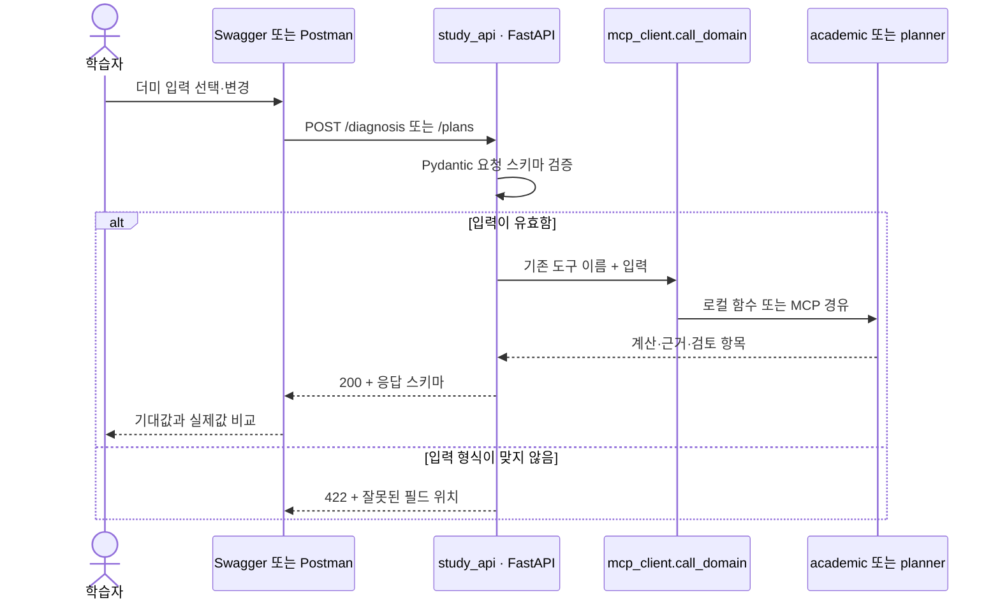

# Swagger와 Postman으로 같은 함수를 호출하며 공부하기

현재 Streamlit 화면·MCP·학사 계산은 유지하고, [study_api.py](../jolup/study_api.py)에 FastAPI 학습용 HTTP 경계를 추가했다. Swagger와 Postman은 이 API를 호출하며, API는 기존 `call_domain()`으로 계산·계획·규정·일정을 처리한다. 학사 규칙을 API에 다시 구현하지 않았다. 외부 LLM 키 없이 내장 더미로 실습한다.

## 1. 실행과 종료

Python 3.12 프로젝트 환경에서 실행한다. 의존성을 아직 갱신하지 않았다면 먼저 `python -m pip install -r requirements.lock`을 실행한다.

```bash
python -m uvicorn jolup.study_api:app --host 127.0.0.1 --port 8001 --reload --reload-dir jolup
```

Mac은 `scripts/study_api.command`, Windows는 `scripts/study_api.bat`으로 같은 개발 서버를 연다. 종료는 Control+C다. 실행 중 [Swagger UI](http://127.0.0.1:8001/docs)와 [OpenAPI JSON](http://127.0.0.1:8001/openapi.json)을 사용할 수 있다. Swagger UI 기본 자산은 CDN에서 가져오므로 처음 화면을 여는 환경에는 인터넷이 필요하다. `/health`는 API 프로세스의 응답만 확인하며 RAG·MCP까지 모두 준비됐음을 보증하지 않는다.

Docker에서는 다음 명령을 사용한다. 새 코드·의존성을 포함하도록 이미지를 다시 빌드해야 한다.

```bash
docker compose up --build -d
docker compose logs -f api
docker compose stop
```

API는 Compose 기본 4서비스(app/api/mcp/chroma)에 포함되고 호스트의 `127.0.0.1:8001`에 연결된다. 채팅은 `app → api /chat → Agent → mcp → Chroma·도메인 함수`를 사용한다. 일부 별도 UI의 도메인 직접 호출은 유지한다. 직접 Python 실행에서는 `MCP_URL`을 설정하지 않으면 같은 프로세스의 도메인 함수를 호출한다. HTTP 채팅은 외부 LLM과 LangSmith 내보내기를 지원하지 않으며 서버 실행기록만 화면에서 읽는다. 기존 로컬 채팅 기능은 [실행 안내](RUN.md)를 따른다.

## 2. Swagger에서 입력 → 계산 → 출력을 읽기

1. `GET /health`를 펼쳐 **Try it out → Execute**로 `200`, `status=ok`를 확인한다.
2. `GET /samples`로 11개 사례를 본다. `GET /samples/{sample_id}`의 Examples에서 `on_track`을 선택하거나 sample_id에 `on_track`을 입력하고 실행한다. 반환한 `profile`, `courses`, `expected`를 구별한다. 문자 그대로 `string`을 입력하면 등록된 사례가 아니므로 404가 나온다.
3. `POST /diagnosis`의 **Examples에서 사례를 선택한 뒤 Try it out → Execute**한다. 네 가지 예제 모두 실제 더미 `profile`과 `courses`가 채워진다. `expected`를 서버에 정답으로 보내지 않는다. 선택 메뉴는 입력 예제를 바꾸며 학사 규칙이나 정답을 지정하지 않는다.
4. `totals`, `projection`, `rows`, `evidence`, `meta`를 읽는다. 기본 사례는 현재 90학점과 수강 중 합격 가정 105학점이 다르다.
5. 같은 입력으로 `POST /plans`를 실행해 미래 후보·조건·미충족 항목을 읽는다. 현재 졸업요건 충족과 목표까지 준비 상태를 구분한다.
6. 진단과 계획 각각의 Examples에서 `fully_met`(미래 충족 경계 사례), `credit_shortfall`, `missing_record`를 비교한다. 기본 재학생이 현재 이미 졸업했다는 뜻으로 설명하지 않는다.
7. `POST /regulations`는 기본 `total_credits` 예제로 실행한다. 이 예제는 질문만 보내므로 선택 사항인 `profile`에 가짜 `string` 값을 채울 필요가 없다. `with_profile`은 실제 더미 프로필을 포함하고, `unverified_date`는 자료에 없는 미래 날짜를 물어 정상적인 `확인 필요` 응답을 확인한다.
8. `GET /events`에서 날짜·제목·출처를 읽는다. `POST /calendar/ics`의 기본 `approval_required` 예제에는 실제 일정과 `approved:false`가 들어 있으며 **403이 의도된 결과**다. 내보낼 내용에 동의할 때만 `explicit_approval` 예제를 선택하거나 `approved`를 `true`로 변경하고 실행한다. 이때 200과 ICS가 반환되며 외부 캘린더에는 자동 등록하지 않는다.

Swagger 요청은 지금 `/docs`를 연 서버의 주소와 포트를 사용한다. 별도 포트로 실행해도 예전 8001 서버로 요청하지 않는다. 화면을 이미 열어두었다면 새로고침해 갱신한 예제를 불러온다.

| 화면에 보이는 결과 | 뜻과 다음 행동 |
|---|---|
| `200` + `충족` / `미충족` / `확인 필요` | HTTP 요청 처리는 성공했다. 응답의 학사 판정과 근거를 읽는다. `미충족`과 `확인 필요`는 서버 오류가 아니다. |
| ICS `403` + 승인 필요 안내 | 승인 전의 정상적인 차단이다. 내용을 확인하기 전에는 승인 값을 바꾸지 않는다. |
| `404` + 알 수 없는 더미 | `/samples`에 있는 ID를 선택한다. `on_track` 등이 유효하다. |
| `422` + `errors` | 입력 형식·값 오류다. `location`에서 필드와 과목 행 위치를 찾고, `message` 안내와 요청 스키마에 맞게 수정한다. 과목 행 인덱스는 0부터 시작한다. |
| `503` + 처리 실패 안내 | 입력 오류와 별도로 로컬 MCP 또는 분야 함수의 처리 상태를 확인한다. |

필드 생략·`null`·`false`는 서로 다르다. API는 실제로 보낸 항목만 계산기에 전달하므로 생략한 확인값을 자동으로 확정하지 않는다. 예를 들어 `engineering_accreditation:false`를 지우면 공학인증 제외 설정 확인이 필요하고, `academic_warning:null`은 경고 여부 미확인을 뜻한다.



| 요청 | 먼저 읽을 코드 | 관찰할 것 |
|---|---|---|
| `/chat` | `chat_client.respond_chat` → `study_api.chat` → `agent.respond` | 혼합영역·4턴기억·현재/목표·키 미전송 |
| `/sessions/{session_id}` DELETE | `study_api.reset_session` | 해당 기억 삭제·없으면 cleared=false |
| `/diagnosis` | `study_api.diagnosis` → `academic.check_requirements` | 확정 이수·부족·자료 누락 |
| `/plans` | `study_api.plans` → `planner.plan_courses` | 학기 후보·상한·가정·재진단 |
| `/regulations` | `study_api.regulations` → `KnowledgeBase.answer` | 답변과 원문 페이지·출처 |
| `/events` | `study_api.events` → `calendar.preview_events` | 출처 있는 일정과 승인 필요 표시 |
| `/calendar/ics` | `study_api.calendar_ics` → `calendar.create_calendar_event` | 승인 없음 403, 잘못된 입력 422, 승인한 원본 일정만 ICS |

이 API는 `/samples`가 제공하는 정규화된 JSON을 학습 계약으로 사용한다. CSV 업로드·한글 상태 별칭·자동 과목 ID 생성의 모든 입력 형식을 HTTP 스키마로 제공하지는 않는다. 해당 파싱은 기존 화면과 `academic.parse_transcript`에서 담당한다.

HTTP 스키마 검사와 학사 의미 검사는 다른 단계다. 숫자 형식이 맞더라도 학과·학번·이수 기록이 지원 범위 밖이면 도메인 응답의 확인 필요 상태를 읽어야 한다. API의 200은 졸업 가능 판정이 아니라 정상적인 응답 전달을 뜻한다.

## 3. Postman에서 사례를 반복 실행하기

Postman의 Import에서 다음 두 파일을 가져오고 `졸업로드맵 로컬 · 키 없음` 환경을 선택한다. 환경 이름은 가져온 파일의 `name`을 기준으로 확인한다.

- [컬렉션](api/jolup.postman_collection.json): 더미 가져오기 → 정상·부족·누락 진단 → 계획 → 규정 → 일정·오류 → 같은 세션의 채팅·초기화까지 **21개 요청**.
- [환경](api/local.postman_environment.json): `base_url=http://127.0.0.1:8001`, `calendar_approved=false`. API 키 없음.

컬렉션은 앞 요청의 더미 응답을 다음 요청의 입력으로 연결하므로 **전체를 위에서 아래 순서로 실행**한다. 응답 상태뿐 아니라 현재·예상 학점과 누락 상태 등의 assertions를 확인한다. 개별 진단 요청부터 실행하면 앞에서 저장할 입력이 없을 수 있다. 18번은 정상 더미를 다시 받고, 19번은 `/chat` 첫 질문과 세션 ID, 20번은 같은 세션의 수강 계획, 21번은 `DELETE /sessions/{session_id}` 초기화를 확인한다.

2026-10-26 로컬 API 실측에서 **21요청·60assertion이 모두 통과**했다. [실측 보고서 · 공개 요약](검증결과.md)와 [CLI 로그 · 공개 요약](검증결과.md)를 참고한다. lexical 검색·생성AI off·일정 승인 false의 검증이며 Docker 최신 4서비스 기동이나 외부LLM 검증을 대신하지 않는다.

일정 요청에서 `calendar_approved`는 기본 `false`다. 전체 컬렉션을 실행했다는 이유만으로 승인하지 않는다. 미리보기의 날짜·제목을 확인하고 승인할 때만 이 값을 `true`로 바꾸어 ICS 요청을 실행한다. 생성 결과는 ICS 텍스트이고 외부 캘린더 계정에 등록하지 않는다.

공식 CLI가 설치된 환경에서도 로컬 JSON을 실행할 수 있다. 클라우드 로그인·공유는 이 실습의 필수 단계가 아니다.

```bash
postman collection run docs/api/jolup.postman_collection.json -e docs/api/local.postman_environment.json --no-report-events --timeout 120000
```

이번 환경의 CLI는 `.build/postman/runtime/postman-cli`에 별도로 받았으며 전역 PATH에 등록하지 않았다. 팀원은 공식 설치 안내를 따르거나 Postman 앱으로 가져온다. CLI 설치 파일 자체는 공유 ZIP에 포함하지 않는다. [공식 CLI 설치](https://learning.postman.com/docs/postman-cli/postman-cli-installation)

## 4. 코드 변경 후 명세와 시험 함께 갱신하기

```bash
python scripts/export_api_contract.py
python -m pytest tests/test_study_api.py tests/test_api_contract_export.py tests/test_chat_api.py tests/test_chat_client.py -q
```

OpenAPI·Postman JSON은 위 스크립트로 생성한다. HTTP 테스트는 코드가 제공하는 OpenAPI의 모든 POST 예제와 GET 기본값·경로 예제를 그대로 실행한다. 따라서 문서에 보이는 예제가 테스트와 따로 어긋나는지를 확인할 수 있다. 생성기 테스트는 파일 생성, Postman 요청과 명세의 경로 일치, 더미 입력 연결, 승인 기본값을 검사한다. 기존 도메인 테스트도 함께 유지하며, 실제 브라우저·CLI·전체 커버리지의 최신 검증 범위는 [검증결과](검증결과.md)를 따른다.

실행 구조·Lang 계열·프로세스 관리는 [개발도구 학습지도](개발도구_학습지도.md), 함수 내부의 호출 수와 시간은 [AppMap 검토와 로컬 분석 실습](APPMAP.md)으로 이어진다.
