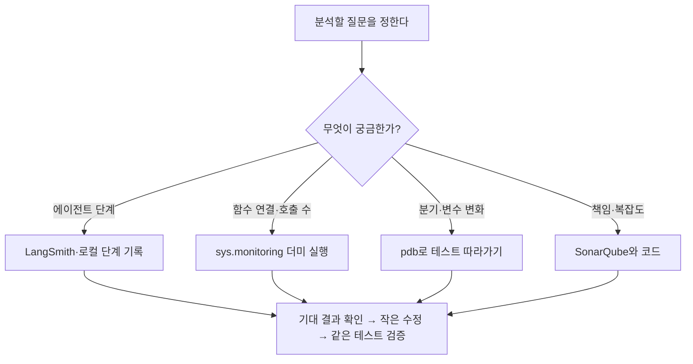
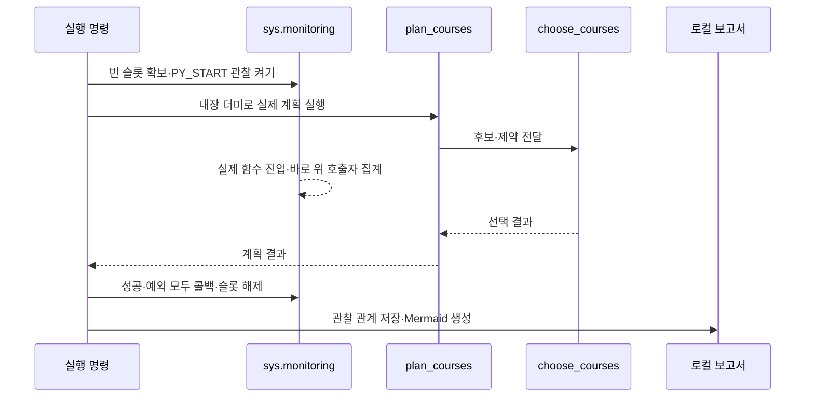

# 함수 호출을 따라 읽기: 실제 진입 관찰과 AppMap 도입 판단

이 프로젝트에는 **Python 3.12 표준 `sys.monitoring`으로 함수 진입과 호출 관계를 관찰하는 로컬 학습 도구**가 있습니다. [profile_study.py](../scripts/profile_study.py)는 내장 더미 하나의 현재 진단 또는 수강 계획을 실행하고, 관찰된 코어 함수와 직접 호출 관계를 JSON과 Mermaid 그래프로 저장합니다. cProfile 시간 통계는 별도 보조 표입니다. **AppMap 자체는 설치·연결하지 않았습니다.** 아래 도입 검토는 AppMap 실행 성공 기록이 아닙니다.

## 알고 싶은 것에 맞게 도구 고르기

| 알고 싶은 것 | 현재 적용 도구 | 한계 |
|---|---|---|
| 함수의 분기가 왜 이해하기 어려운가? | SonarQube와 테스트 | 점수만으로 좋은 설계를 판정하지 않음 |
| 질문이 진단·계획·설명 중 어디로 갔는가? | 로컬 단계 기록·선택적 LangSmith 전송 | 모든 내부 함수를 기록하지 않음 |
| 실제 내부 함수가 어떻게 연결됐는가? | `sys.monitoring` 진입·직접 호출 그래프 | 선택 사례·현재 스레드·코어 4개 모듈의 관찰 범위 |
| 어느 함수를 많이 호출했는가? | 진입 횟수·cProfile 보조 시간 표 | 누락된 시간은 별도 경고하며 추정하지 않음 |
| 변수 값이 어느 줄에서 바뀌었는가? | Python pdb 실습 | 사용자가 한 줄씩 실행하며 해석 |
| 호출·반환을 확대해 탐색하고 싶은가? | AppMap 도입 검토, 설치 보류 | 우리 전체 스택·뷰어 호환 미검증 |



이 그림은 분석 방법의 안내입니다. 실제 함수 호출 관계는 아래 명령으로 생성하는 보고서에서 확인합니다.

## 설치 없이 실행하는 함수 분석

현재 프로젝트의 Python 3.12 가상환경에서 실행합니다.

```bash
.venv/bin/python scripts/profile_study.py --action calculate --sample on_track --top 12
.venv/bin/python scripts/profile_study.py --action plan --sample on_track --top 12
```

- `calculate`는 `check_requirements()`, `plan`은 `plan_courses()`를 실행합니다.
- `--sample`은 [내장 더미](../jolup/samples.py) ID만 받습니다. 업로드 자료·임의 함수는 받지 않습니다.
- `--top`은 cProfile 보조 시간 표의 함수 수입니다. 기본12, 범위5~30입니다. **`call_observation`과 Mermaid 그래프에는 이번에 관찰한 코어 함수·직접 호출 관계를 전부 담습니다.**

출력은 `reports/profile_study/<UTC 시각>.json`과 같은 이름의 `.md`입니다. 기존 파일을 덮어쓰지 않습니다. 준비 실행1회 후 관찰 실행1회를 수행합니다.

| 항목 | 해석 |
|---|---|
| `call_observation.functions`·`call_observation.calls` | 실제 `PY_START`에서 관찰한 함수 진입 횟수와 직접 호출 관계 |
| `functions`·`calls` | cProfile의 보조 시간 통계와 그 통계에 기록된 호출 관계 |
| `primitive_calls` | cProfile 통계에서 재귀에 의한 추가 호출을 제외한 횟수 |
| `self_ms`·`cumulative_ms` | 함수 자체 시간·하위 호출 포함 시간. cumulative를 합산하지 않음 |
| `wall_ms` | 계측 구간의 전체 경과 시간 |
| `entry_observed` | 진입 함수가 `sys.monitoring` 호출 기록에 존재하는가? |
| `timing_entry_observed` | 진입 함수가 cProfile 시간 통계에 존재하는가? |
| `source_sha256` | 실행 시 코어 소스 해시. 변경 전 보고서와 구분하는 기준 |
| `functions_omitted`·`edges_omitted_between_selected_functions` | cProfile 보조 통계의 표시 한도로 생략한 수. 호출 관찰 그래프의 누락 수가 아님 |

관찰 대상은 `academic.py`, `planner.py`, `course_solver.py`, `evidence.py`입니다. 현재 스레드의 함수 위치와 호출 횟수만 기록하며 생성기의 재개를 새 호출로 세지 않습니다. 외부 라이브러리 내부 노드와 입력 인수·반환값·환경변수는 수집하지 않습니다. UI·Agent·LLM·MCP도 호출하지 않습니다. 시간은 장비·캐시·계측 비용에 영향을 받는 보조 자료이며 이 도구의 목적은 성능 보장이 아닌 **호출과 책임의 이해**입니다. [Python 프로파일러 문서](https://docs.python.org/3.12/library/profile.html)

## 계획 진입 누락을 해결한 방법과 남은 범위

현재 Python 3.12.14에서 네이티브 solver를 경유하는 계획을 cProfile로 실행하면 `plan_courses` 같은 바깥 함수가 시간 통계에 빠지는 현상을 재현했습니다. 정확한 라이브러리 내부 원인은 확정하지 않았습니다.

현재 구현은 시간 통계와 독립적인 `PY_START` 이벤트를 사용합니다. 콜백에서는 실행 코드의 파일·함수·첫 줄과 바로 위 호출자의 코드 위치만 읽습니다. `plan_courses → _select_future_courses → choose_courses`, solver 이후 `plan_courses → _plan_conclusion`을 실제로 관찰하는 테스트가 있습니다. 없는 노드·간선을 추측해 넣지 않습니다. [Python 3.12 실행 관찰 문서](https://docs.python.org/ko/3.12/library/sys.monitoring.html)

슬롯4·3 중 비어 있는 하나만 사용합니다. 모두 사용 중이면 안내하고 중단하며 다른 도구의 슬롯을 빼앗지 않습니다. 성공·예외 모두 이벤트·콜백을 해제합니다. **이번 입력에서 실행된 네 모듈의 관계**를 보여 주므로 모든 입력의 분기·외부 라이브러리·다른 스레드의 실행을 검증했다는 뜻은 아닙니다. 시간이 빠지면 `timing_entry_observed=false` 경고를 유지하고 추정값을 채우지 않습니다.



이 그림은 도구 동작 설명이며 실제 측정 그래프를 대신하지 않습니다. 실제 함수 그래프는 명령 실행 후 출력된 `.md`를 여세요. `reports/`는 작업자 로컬 기록이라 공유 ZIP에 포함하지 않습니다. 따라서 특정 작업자의 보고서 파일로 연결하지 않으며, 팀원도 같은 명령으로 자신의 코드 해시에 맞는 보고서를 생성합니다.

[전용 테스트](../tests/test_profile_study.py)는 실제 진입·solver 전후 간선, 내장 사례 제한, 슬롯 충돌·예외 정리, 다른 스레드·관찰하지 않은 호출자 제외, 원문 비수집, 시간 누락과 호출 그래프의 분리, 보고서 생성·CLI 오류를 검증합니다. 전체 수치·커버리지는 최신 [검증결과](검증결과.md)를 따릅니다.

## pdb로 값이 바뀌는 줄 확인하기

프로파일러의 시간만 보고 바꾸지 말고 먼저 테스트 하나를 따라갑니다. 다음은 이미 있는 이수 판정 테스트를 시작점에서 멈추는 예입니다.

```bash
.venv/bin/python -m pytest tests/test_academic.py -k test_zero_credit_project_is_not_three_credit_course --trace -q
```

`(Pdb)`에서 `n`은 다음 줄, `s`는 호출한 함수 안으로 진입, `r`은 현재 함수 반환까지 진행, `where`는 호출 스택, `p d['totals']`는 진단 변수 `d`가 만들어진 뒤 합계 확인, `c`는 계속 실행, `q`는 종료입니다. 먼저 “0학점 작품을 넣었는데 왜 총학점이 126이 아니라 123인가?”를 예상한 뒤 실제 값과 비교합니다. 현재 제공된 내장 더미로만 실습합니다. [Python pdb 문서](https://docs.python.org/3.12/library/pdb.html)

## AppMap을 기본 도구로 바로 넣지 않은 이유

AppMap은 함수 호출·반환과 코드 위치를 기록해 구조를 탐색하는 도구이므로 우리 학습 목적에 맞는 부분이 있습니다. 다만 현재 프로젝트의 작은 계산 경로를 읽는 데에는 표준 함수 관찰·pdb·기존 단계 기록으로 시작하는 편이 의존성이 적습니다. 우리 기능이 실제 DB·여러 HTTP 서비스를 연결하는 규모로 늘고 반복해서 전체 호출 관계를 탐색하게 되면 AppMap의 실익이 커집니다. [AppMap 동작 설명](https://appmap.io/how-it-works)

2026-10-23 확인 기준 AppMap의 문서 지원표와 최신 소스 설정 사이에도 범위 차이가 있습니다. 문서는 Python 3.8~3.12, pytest ~6를 적고, 최신 3.0.1 소스의 테스트 의존성은 pytest 7.3.2 이상 8 미만을 지정합니다. 우리 환경은 Python 3.12.14와 pytest 9.1.1입니다. FastAPI·uvicorn 연동은 공식 제공되지만 **Streamlit·LangGraph 전용 연동과 우리 전체 조합의 호환 성공을 확인한 것은 아닙니다.** 이 차이는 설치 불가능의 증거가 아니라 좁은 검증이 먼저 필요하다는 근거입니다. [Python Agent 지원 문서](https://appmap.io/docs/reference/appmap-python.html), [AppMap 소스 설정](https://github.com/getappmap/appmap-python/blob/6594576fd2230128852eda6e35ac712e646d9a5e/pyproject.toml), [3.0.1 배포 정보](https://pypi.org/project/appmap/3.0.1/)

선택 도입 시에는 다음 순서로 범위를 늘립니다. 이 절차는 **아직 실행하지 않았습니다.**

1. 앱 기본 가상환경과 분리한 개발 환경에 버전을 고정해 설치합니다.
2. 계측 대상을 `jolup.academic` 하나로 제한하고 `on_track` 더미의 코드 블록만 녹화합니다. 웹 요청·원격·pytest 자동 녹화는 끄고 시작합니다.
3. 로컬 `.appmap.json`에 진입 함수와 실제 하위 호출이 있는지, 기존 계산 결과와 테스트가 같은지 확인합니다.
4. AppMap 편집기 확장 또는 CLI 로컬 UI로 파일을 열어 코드 위치 이동과 호출 관계 탐색을 확인합니다.
5. 이 결과가 기존 cProfile·pdb보다 학습에 도움이 됐을 때만 계획 함수·HTTP 경로로 확대합니다.

AppMap의 로컬 기록·조회와 AI 기능 연결은 구분해야 합니다. 공식 설명상 기록 파일은 개발 환경에 남지만, 호스팅된 코딩 에이전트에 연결하면 선택한 맥락이 해당 제공자로 전달될 수 있습니다. 인수·반환값이 기록되는 도구이므로 기본값 그대로 원본 학생 자료를 녹화하는 방식으로 도입하지 않습니다. 현재 프로젝트는 AppMap 기록 파일 생성, 편집기 확장, CLI UI, Navie, AppMap MCP 연결을 모두 실행하지 않았습니다. [로컬 기록과 클라우드 경계](https://appmap.io/how-it-works), [AppMap CLI 로컬 UI](https://appmap.io/docs/reference/appmap-client-cli)
