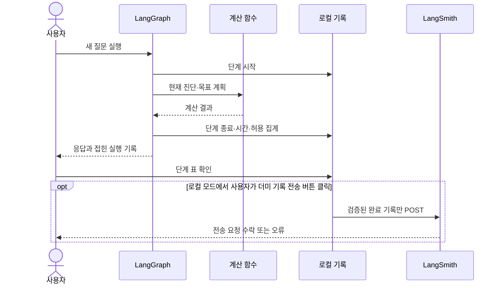

# 실행 기록으로 공부하기: 로컬 관찰과 LangSmith

**실행 모드에 따라 전송 범위가 다릅니다.** 로컬 모드는 아래의 명시적인 더미 기록 내보내기를 지원합니다. `JOLUP_AGENT_API_URL`이 설정된 HTTP/Compose 모드는 서버 실행 단계를 화면에서 읽는 것까지 지원하며 **LangSmith 전송은 지원하지 않습니다**. API 프로세스의 서명을 Streamlit에서 검증·승인하지 않고 LangSmith 키도 API로 전달하지 않습니다. HTTP 채팅의 외부 LLM 설명 역시 꺼져 있습니다. 기존 로컬 기록·내보내기 절차는 그대로 유지합니다.

LangSmith는 실행된 단계와 소요 시간, 결과를 관찰하는 데 도움을 줍니다. 이 프로젝트에는 **키 없이 보는 로컬 단계 기록**과 **선택한 더미 실행을 LangSmith에 보내는 기능**을 추가했습니다. 계산 규칙을 바꾸거나 AI를 다시 호출하는 기능이 아닙니다.

LangChain은 모델·도구 통합, LangGraph는 단계와 상태의 연결, LangSmith는 실행 관찰을 맡습니다. 현재 모델 호출은 공식 `langchain-openai.ChatOpenAI`와 `langchain-anthropic.ChatAnthropic`을 사용합니다. `jolup/llm.py`는 앱 공통 설정·오류·입력 범위를 관리하고, `IntentDecision`·`ExplanationSelection` Pydantic 모델과 공급자 JSON Schema 구조화 출력을 연결합니다. 앱의 설명은 모델이 허용된 사실 ID만 선택하면 로컬 문장을 표시하는 방식입니다. 일반 생성 함수의 `ExplanationOutput` 스키마와 구분합니다. 현재 판정·조건·자료 누락에 대한 필수 문장은 로컬에서 유지합니다. 상위 `langchain` 패키지는 설치하지 않았지만 공식 통합 패키지를 실제 사용합니다. LangGraph는 `jolup/agent.py`의 실제 `StateGraph` 실행에 사용합니다. LangSmith SDK의 `tracing_context(enabled=False)`는 원본 상태의 자동 외부 추적을 계속 차단하고, 선택한 완료 기록의 내보내기는 공식 REST API를 사용합니다. [LangGraph 개요](https://docs.langchain.com/oss/python/langgraph/overview), [LangSmith REST 추적](https://docs.langchain.com/langsmith/trace-with-api)

## 키 없이 먼저 공부하기

1. 앱의 **01 · 목표까지 준비 가능한 사례 → 사례 불러오기**를 누릅니다.
2. **대화로 확인 → 나 졸업 괜찮아?**로 새 응답을 만듭니다. AI 설명이 꺼져 있어도 학습 기록이 만들어집니다.
3. 마지막 답변 아래 **실행 과정 살펴보기**를 펼칩니다.
4. 단계·상위 단계·함수와 파일·소요 ms·실행 상태를 봅니다.
5. **살펴볼 실행 단계**에서 한 단계를 골라 허용된 집계 요약을 봅니다.

그림의 마지막 화살표는 전송 결과가 앱을 통해 표시된다는 뜻입니다. LangSmith가 계산 함수를 호출하거나 모델 답변을 생성하지 않습니다. 현재 기록 범위는 Agent의 관찰 대상 단계와 그 안에서 호출하는 주요 도구입니다. 모든 Python 함수, MILP 내부 반복, MCP 서버 내부의 모든 호출을 자동 기록하는 것은 아닙니다.

## 실제 단계에서 코드 찾기

| 실행 기록의 단계 | 읽을 파일·함수 | 확인할 질문 |
|---|---|---|
| 질문 유형 분류 | [agent.py](../jolup/agent.py), `_route()` | 진단·계획·규정·일정 중 어디로 갔는가? |
| AI 분류가 있을 때 | [llm.py](../jolup/llm.py), `classify_intent()` | 실제 모델을 사용했는가, 로컬 분류로 돌아왔는가? |
| 현재 진단 | [academic.py](../jolup/academic.py), `check_requirements()` | 현재90·수강 중15·예상105가 구별되는가? |
| 목표 계획 | [planner.py](../jolup/planner.py), `plan_courses()` | 학기별 후보·누적 전망·계획 상태가 기대값과 맞는가? |
| 규정 답변 | [rag.py](../jolup/rag.py), `KnowledgeBase.answer()` | 공개 출처와 확인 상태를 반환했는가? |
| 학사일정 조회 | [calendar.py](../jolup/calendar.py), `search_events()` | 제공된 일정 개수와 상태가 무엇인가? |
| 설명 단계 | [agent.py](../jolup/agent.py), `_explain()` | AI 사용이 꺼져 있어 설명 호출을 건너뛰었는가? |
| AI 설명이 있을 때 | [llm.py](../jolup/llm.py), `explanation_facts()`·`explain_result()` | 선택 ID가 유효한가? 필수 문장이 유지되는가? 설명 선택 호출은 성공했는가? |

표에 보이는 `source_ref`는 관찰 대상에 대해 미리 정한 함수 위치입니다. 디버거의 전체 호출 스택은 아닙니다. 직접 호출과 MCP 경로의 차이는 [mcp_client.py](../jolup/mcp_client.py)의 `call_domain()`에서 읽습니다.

`status=success`는 관찰된 예외나 허용된 오류 코드가 없는 실행이라는 뜻입니다. 학업 판정의 `미충족`·`위험`을 올바르게 반환한 함수도 실행 상태는 성공입니다. 모델 호출은 허용된 오류 코드가 있으면 오류로 표시하며, 요약의 `used`도 함께 봅니다. 부모 단계의 소요 시간에는 자식 시간이 포함되므로 모든 시간을 단순 합산하지 않습니다.

## LangSmith에 선택한 더미 기록 보내기

로컬 모드에서 LangSmith를 사용할 계정과 별도 API 키가 준비된 경우 다음 순서로 사용합니다. OpenAI·Claude 키를 재사용하지 않습니다.

**현재 `.env`에 LangSmith 키가 없어도 앱과 로컬 기록은 동작합니다.** 이 프로젝트는 LangSmith 설정을 사이드바의 세션 입력에서만 읽으며 `.env`나 Compose 환경변수로 불러오지 않습니다. 따라서 파일에 키를 추가하는 것만으로는 연결되지 않습니다. 팀원이 전송 기능도 사용하려면 앱의 LangSmith 전용 입력란에 키를 넣습니다.

현재 기능은 `POST /runs`로 실행 기록을 쓰므로 **Tracing Only 키의 권한 범위에 해당합니다.** 이 키는 저장된 기록 읽기·관리·평가 권한을 주지 않습니다. 팀원이 LangSmith 웹 화면에서 기록을 공부하려면 자신의 계정으로 해당 워크스페이스에 접근할 권한도 필요합니다. 여러 워크스페이스에 연결된 키는 대상 워크스페이스 ID를 함께 지정합니다. [공식 Tracing 키 안내](https://docs.langchain.com/langsmith/create-account-api-key#tracing-keys)

키 발급은 LangSmith의 **Settings → API Keys → API Key**에서 진행합니다. 옵션이 제공되면 실행 기록 전송용 **Tracing Only** 키를 선택하고 워크스페이스·만료일을 설정한 뒤 **Create**로 만듭니다. 기존 개인/서비스 키도 필요한 전송 권한이 있으면 사용할 수 있습니다. 키는 앱의 전용 비밀번호 입력란에 직접 넣습니다. [공식 계정·API 키 안내](https://docs.langchain.com/langsmith/create-account-api-key)

1. 사이드바 **LangSmith 학습 기록 · 선택**을 엽니다.
2. **LangSmith API 키**에 키를 직접 입력합니다. 키를 채팅이나 공유 파일에 적지 않습니다.
3. **LangSmith 프로젝트**는 기본 `jolup-study`를 사용하거나 영문·숫자·`_`·`.`·`-`로 된 이름을 입력합니다. 첫 글자는 영문 또는 숫자이며 최대80자입니다.
4. 자신의 계정과 맞는 **US/EU 리전**을 선택합니다. 여러 워크스페이스에 연결된 키는 **워크스페이스 ID**도 입력합니다.
5. 변경하지 않은 내장 더미 사례로 새 질문을 실행하고 로컬 기록을 먼저 확인합니다.
6. **이 더미 실행을 LangSmith로 보내기**를 누릅니다.
7. 앱에서 **전송 요청 수락**을 확인하면 LangSmith의 해당 프로젝트에서 표시된 실행 ID를 찾아 단계와 시간을 확인합니다.

키와 설정을 입력하는 것만으로 전송하지 않습니다. 전송 성공한 같은 실행 ID의 버튼은 중복 전송을 막습니다. 다른 사례 비교는 새 질문으로 별도 실행을 만듭니다. 전송 버튼은 원래 질문이나 LLM을 재실행하지 않습니다.

**전송 요청 수락**은 서버가 요청을 수락한 결과입니다. 앱은 클라우드에 저장된 내용을 다시 조회하지 않으므로 ‘클라우드 화면 확인 완료’와 구별합니다. 오류가 나면 일부 단계만 전송됐을 수 있으며 자동 재전송하지 않습니다. 앱 재시작 전의 기록이나 변조된 기록은 내보내기를 거부합니다.

연결 방법은 환경 변수를 일괄 활성화하는 방식 대신 완료 기록을 명시적으로 보냅니다. 일반적인 SDK 사용법과 달리 현재 프로젝트는 한 번에 한 더미 실행을 확인하는 학습 용도에 맞춰 REST `POST /runs`를 사용하며, 부모·자식 실행 ID로 관계를 유지합니다. [공식 REST 안내](https://docs.langchain.com/langsmith/trace-with-api), [프로그램으로 추적 범위 설정](https://docs.langchain.com/langsmith/trace-without-env-vars)

## 기록되는 것과 기록되지 않는 것

| 대상 | 로컬 실행 기록·LangSmith 내보내기 |
|---|---|
| 단계 이름·함수 위치·부모 자식 관계 | 허용 목록의 고정값 기록 |
| 시작·종료·소요 시간 | 기록 |
| 성공/오류·질문 유형·학업 상태 | 허용된 상태 값만 기록 |
| 학점 합계·계획 누적·solver 상태·공개 출처 ID·일정 개수 | 허용된 항목만 요약 |
| 질문 원문·대화 원문·AI 설명 문장 | 제외 |
| 성적표 행·이름·학번·프로필 원문 | 제외 |
| OpenAI·Claude·LangSmith API 키 | 실행 기록에서 제외. LangSmith 키는 전송 인증 헤더에만 사용 |
| 예외 원문·임의 자유문장·환경 메타데이터 | 제외 |
| 업로드 자료·수정한 학생 조건·내장 사례 여부 미확인 | 로컬 관찰만 가능. 외부 전송 차단 |

외부 전송 가능 여부는 사례 ID만 믿고 결정하지 않습니다. 선택한 내장 사례의 프로필과 검증된 과목 목록이 실제 입력과 같은지 확인합니다. 일부 필드만 바꾸거나 CSV를 업로드한 자료는 허용하지 않습니다. 로컬 학습 기록도 원본 전체를 저장하지 않고 허용된 요약만 보관합니다. 세션 초기화는 키·대화·로컬 기록을 제거합니다. 이미 외부로 전송한 기록을 LangSmith에서 삭제하는 동작은 아닙니다.

LangGraph 실행 전체에 대한 자동 외부 추적은 계속 꺼져 있습니다. 따라서 셸에 `LANGSMITH_TRACING=true`가 설정돼 있어도 원본 학생 상태를 자동으로 올리지 않습니다. 이 경계는 [agent.py](../jolup/agent.py)의 `respond()`와 [observability.py](../jolup/observability.py)의 내보내기 검증에서 확인합니다. [공식 민감 자료 기록 제어 안내](https://docs.langchain.com/langsmith/mask-inputs-outputs)

## 개발자가 읽을 관찰 코드

| 함수 | 책임 |
|---|---|
| `StudyRecorder(profile, courses, builtin_sample_id=...)` | 로컬 기록을 만들고 내장 더미와 실제 입력의 일치를 확인 |
| `recorder.activate()` | 현재 실행 범위에서만 관찰기를 사용 |
| `observe_call(name, function, *args, **kwargs)` | 지정한 함수의 시작·종료·상위 단계와 허용 요약 기록. 원래 반환값은 유지 |
| `recorder.finish(result)` | 완료한 기록의 사본 반환 |
| `export_study_trace(trace, config)` | 무결성과 허용 필드를 다시 확인한 뒤 명시적으로 전송 |
| `app.py`의 `_render_study_trace()` | 마지막 대화 응답의 로컬 표·요약·전송 상태 표시 |

`study_trace`에는 `schema_version, run_id, case_id, exportable, start_time, end_time, duration_ms, status, steps, summary, truncated, integrity`가 있습니다. `steps`는 단계의 ID·부모 ID·고정 이름·함수 위치·시간·상태·허용 요약입니다. 서명 검증은 현재 앱 프로세스에서 만든 원본 기록인지 확인하기 위한 장치이며 API 키를 서명에 넣지 않습니다.

## 추천 실습과 검증 범위

**첫 실습:** AI 연결을 끈 정상 사례에서 단계와 코드를 연결합니다. **두 번째:** 총학점 부족 사례로 바꿔 같은 계획 함수가 왜 위험을 반환했는지 비교합니다. **세 번째:** 채플 자료 누락에서 계획이 확인 필요로 멈추는 이유를 찾습니다. 실제 모델 설명 비교는 별도 AI 키를 연결한 뒤 새 질문으로 진행합니다.

LangSmith 관찰을 추가했다고 자동 정답 평가·학업 규정 검증·비용 대시보드까지 완성된 것은 아닙니다. 현재 기능은 단계·시간·허용 요약 관찰과 명시적 내보내기입니다. 정답 검증은 손계산 기대값과 [계산 테스트](../tests/test_academic.py), [반례 테스트](../tests/test_academic_review.py)를 사용합니다. 관찰 모듈의 보안·계층·전송 동작은 [test_observability.py](../tests/test_observability.py), Agent와의 실제 연결은 [test_study_agent.py](../tests/test_study_agent.py), 학습 화면은 [test_app_study.py](../tests/test_app_study.py), 기존 화면 회귀는 [test_app.py](../tests/test_app.py)에서 확인합니다.

실제 계정으로 전송 및 클라우드 화면 재확인 여부는 [최신 검증결과](검증결과.md)를 기준으로 봅니다. 모의 HTTP 전송 시험은 실제 LangSmith 계정 연결 시험과 다릅니다. 과거 237개 테스트 통과 기록을 새 관찰 기능까지 검증된 것으로 확대하지 않습니다.
