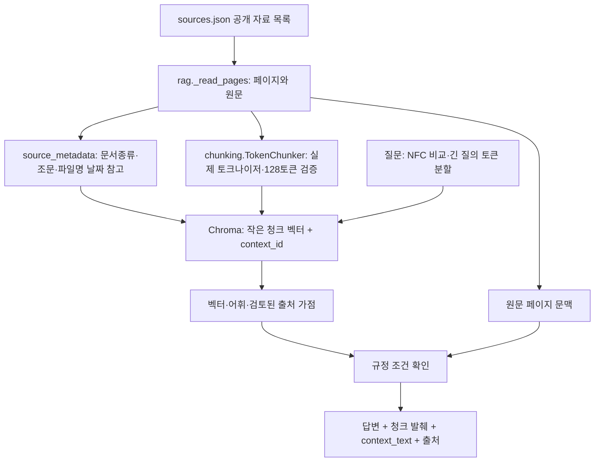

# 규정 검색 RAG — 김주미 담당

## 이 모듈이 하는 일

공개 학교 자료를 페이지 단위로 읽고, 실제 임베딩 모델의 토크나이저로 특수 토큰을 포함해 128토큰 이내로 나눈 텍스트를 Chroma에 저장합니다. 줄바꿈·문장 경계를 우선하며, 원문 페이지를 별도 문맥으로 연결해 조문 예외와 표의 머리글을 함께 읽습니다. 여러 페이지에 걸친 표를 자동으로 해석하거나 복원하는 기능은 아닙니다. 질문에는 벡터 유사도와 한국어 어휘 일치도를 함께 사용해 최대 5개 근거를 검색합니다. 학점 합산·졸업 판정·수강계획 계산은 `academic.py`와 `planner.py`가 담당합니다.

선택 이유와 대안은 [전체 아키텍처와 의사결정](아키텍처_의사결정.md)에 정리했습니다. 현재 모델의 운영 편의와 한국어 규정 검색 품질이 최적으로 검증됐다는 주장은 구별합니다.

**2026-10-23 개선 반영.** 기존 208개 중 178개 입력이 잘리던 문자 분할을 토큰 분할로 교체했습니다. 실제 공개 자료는 448개 청크로 재색인했습니다. 검색 청크와 전체 페이지 문맥을 구별하며, 긴 확장 질문도 토큰 한도 이내로 나눠 각 벡터의 평균으로 검색합니다. [청크 품질 점검](청크_품질점검.md)에 입력 잘림·검색 품질·남은 한계를 별도로 기록했습니다.

`KnowledgeBase.answer()`의 문장은 원문에 연결한 규정 설명입니다. LLM이 숫자를 생성하는 방식이 아니며, 별도의 LLM 연결 여부는 Agent/UI에서 표시합니다. 규정 검색만으로 개인의 졸업 가능 여부를 판단하지 않습니다.

## 팀원 제출본에서 합친 부분

2026-10-26 김주미 제출 ZIP의 테스트 명세를 검토하여 분해형 한글(NFD) 질문과 범위 검사를 NFC로 통일하고, 문서 종류·조문 제목·파일명 날짜 참고값·문서별 SHA256/청크 수를 추가했다. 비교용 문자열만 정규화하며 `text`·`context_text` 원문은 변경하지 않는다. 제출 `main.py`가 가져오는 `rag/` 구현 폴더는 ZIP에 없었으므로 원래 구현을 실행했다고 설명하지 않는다. 원본 코드·테스트·색인 manifest는 [기여 자료](../team_contributions/README.md)에 보존하고, 최종 구현은 이 프로젝트의 인터페이스에 맞춰 작성했다.

제출 색인은 OpenAI `text-embedding-3-small`의 134개 청크다. 같은 공개 PDF 2개임을 SHA256으로 확인했으며 기존 FastEmbed의 벡터와 섞지 않았다. 최종 기본은 API 키 없이 실행하는 로컬 임베딩을 유지한다. 제출 DB/BIN 원본은 로컬 인수 자료에 보존하고 공개 저장소에는 비교에 필요한 manifest를 포함한다. [통합 결정](팀원_통합결과.md)

## 실행

프로젝트 루트에서 가상환경을 설치한 뒤 실행합니다.

```sh
.venv/bin/python scripts/build_index.py
.venv/bin/python scripts/build_index.py --query '2024학번 컴퓨터공학과 전공심화는 몇 학점인가요?'
JOLUP_TEST_VECTOR=1 .venv/bin/python -m pytest tests/test_rag.py -q
```

최초 실행에는 공개 임베딩 모델 다운로드가 필요합니다. 캐시는 `data/models/`, 로컬 Chroma는 `data/index/chroma/`에 생성됩니다. 공개 자료만 저장하며 업로드한 학생 성적표를 받지 않습니다. 이미 받은 모델과 색인이 있으면 이를 재사용합니다.

정상 결과의 `backend`는 `chroma_fastembed`, `status`는 `ready`입니다. 자료·모델명·토크나이저·토큰 한도·분할 정책이 바뀌면 지문이 달라져 새 컬렉션을 만듭니다. 현재 `7-token-page-source-metadata` 정책은 새 출처 메타데이터를 색인 지문에 반영합니다. 토큰 분할 자체는 유지하지만 이전 정책 컬렉션의 메타데이터를 재사용하지 않습니다. 이전 컬렉션은 자동 삭제하지 않지만 현재 검색에는 선택되지 않습니다. 같은 자료를 강제로 다시 만들 때만 `--force`를 사용합니다. `CHROMA_HOST`가 있으면 `CHROMA_PORT`(기본 8000)의 외부 Chroma 서비스에 연결합니다. 이 설정이 없으면 로컬 저장소를 사용합니다.

## 팀원이 연결할 인터페이스

```python
from jolup.rag import KnowledgeBase
from jolup.settings import DEFAULT_PROFILE

kb = KnowledgeBase()
report = kb.build_index()
hits = kb.search("전공필수는 몇 학점인가요?", DEFAULT_PROFILE, k=5)
result = kb.answer("전공필수는 몇 학점인가요?", DEFAULT_PROFILE)
```

`search()`는 `source_id`, `chunk_id`, `context_id`, `text`, `file_name`, `url`, `registered_date`, `page`, `score`, `retrieval_backend`를 제공합니다. `answer()`는 `status`, `answer`, `evidence`, `meta`, `retrieval`, `warnings`, `answer_mode`를 제공합니다. JSON으로 직렬화할 수 있습니다. `answer().evidence[].text`는 검색 청크 원문이고 `context_text`는 같은 출처·페이지의 전체 원문입니다. 표의 열 이름이나 예외가 작은 청크 밖에 있을 수 있으므로 해당 문맥을 함께 확인합니다. 검색 벡터에는 작은 청크만 넣습니다.

`search()`의 상위 결과와 규정 설명에 사용한 `answer().evidence`는 항상 같지는 않습니다. 설명은 해당 규정의 검토된 원문 페이지까지 확인해 근거를 보완합니다. 이러한 인용에는 `citation_origin=source_context`가 표시됩니다. 상위 검색 결과에 없던 인용의 `score`는 `null`이며 가짜 유사도 점수를 붙이지 않습니다. 최대 5개 인용을 넘으면 근거를 버린 채 설명만 덧붙이지 않습니다.

추가 출처 필드는 다음 의미로 읽습니다. 기존 필드와 반환 순서는 유지하며 새 필드를 뒤에 추가했습니다.

| 필드 | 뜻 | 모르는 값과 주의점 |
|---|---|---|
| `document_type` | regulation / course / schedule / curriculum / other | 파일명 기준의 문서 분류이며 원문·사실정리 여부인 `source_kind`와 다름 |
| `section` | 청크에 완전히 포함된 실제 줄 시작 조문 제목 | 본문 참조·여러 조문·반복 발췌 등 모호한 경우 `null`; 조문 전체 의미를 자동 복원하지 않음 |
| `version_date_hint` | 파일명에서 읽은 유효한 날짜 참고값 | **등록일·작성일·시행일이 아님**. `registered_date`는 원래 확인값 또는 `null` 유지 |
| `retrieval.sources[]` | `source_id`, `file_name`, `sha256`, `chunk_count` | 실제 읽은 자료별 해시·생성 청크 수. 모델과 정책은 같은 retrieval 보고서의 `model`·`chunking` 확인 |

`tests/test_source_metadata.py`는 분해형 한글 동등성·타학교/타학과 범위 검사·원문 보존·오인하지 않는 조문·날짜 불명·실제 해시·HTTP 출력 계약 보존을 검사합니다. 파일 수정 시각을 문서 등록일로 바꾸지 않습니다.

## 자료와 적용 범위

`data/sources.json`이 색인 목록입니다. 파일은 `data/sources/` 아래의 PDF·TXT·MD 또는 명시적인 페이지 목록 JSON만 허용합니다. 목록에 있어도 학생 자료로 표시되었거나 허용 폴더를 벗어나거나 학교·학과·학번이 다른 파일은 제외합니다. CSV 업로드는 이 모듈의 입력이 아닙니다.

이 프로젝트는 성결대학교 2024학번 컴퓨터공학과, 일반 신입학·전공심화, 공학인증 제외 범위입니다. 다른 학교·학과·학번·이수 방식, 편입·재입학·외국인·조기졸업 예외를 확정하지 않습니다. 실제 미래 개설 시간표, 여석, 담당교수, 확인되지 않은 미래 일정, 제공하지 않은 TOEIC·장학금 기준도 `확인 필요`로 돌려줍니다.

| source_id | 역할 | 날짜·페이지 주의점 |
|---|---|---|
| school_rules | 총학점, 등록학기, 수강 한도, 성적, 채플, 학교 최종심사 | 사용자 제공 PDF. 파일명의 20260506을 등록일로 만들지 않음. 등록일 `null` |
| course_guide | 2024 컴공 영역별 기준, 교필, 재수강·중복 이수 | 공지 등록일 2026-08-07. 인용은 PDF의 실제 1부터 시작하는 페이지 번호 |
| major_notice | 2025년 변경 전필 6학점·설계 두 과목·작품심사 | 공식 공지의 사실 정리 TXT. 등록일 2025-01-20. 원문 URL 제공 |
| curriculum_year1~4 | 학년별 교육과정상 과목 | 사실 정리 TXT. 게시일 미표시이므로 등록일 `null`. 열람일과 구별 |

`official_facts` 파일은 공식 페이지 자체를 복사한 원문이 아니라 확인한 수치와 조건을 정리한 파일입니다. `source_kind`, `date_note`, 원문 URL을 그대로 내보내 사용자가 그 차이를 알 수 있게 합니다. 등록일이 없는 자료는 `retrieved_date`(열람일)로 대체 표시하지 않습니다.

안내문 PDF 1쪽은 텍스트가 없는 표지여서 OCR 검토 경고가 발생합니다. 졸업요건·계산에 쓰는 본문 페이지는 텍스트를 추출합니다. 페이지 이미지에서만 보이는 내용은 추측하여 색인하지 않습니다. 새 자료에서 본문까지 같은 경고가 생기면 원본을 열어 해당 페이지의 OCR·표 추출 품질을 확인해야 합니다.

## 검색·설명 방식

1. 모델의 토크나이저를 복제해 자르기·padding을 끈 상태로 실제 길이를 셉니다. 특수 토큰을 포함한 모델 한도 안에서 줄바꿈·문장 끝을 우선하고, 원문 문자 위치로 분할해 글자를 잃지 않습니다. 임베딩 입력 한도를 확인할 수 없으면 조용히 잘라 넣지 않고 어휘 대체 모드로 알립니다.
2. 페이지 ID로 검색 청크와 전체 원문 문맥을 연결합니다. 표의 머리글·예외는 원문 페이지에서 확인하고, 페이지를 넘는 관계를 자동으로 추정하지 않습니다.
3. `sentence-transformers/paraphrase-multilingual-MiniLM-L12-v2`를 FastEmbed로 실행합니다. 모델명은 `JOLUP_EMBED_MODEL`로 바꿀 수 있지만 변경 후 실제 모델·한국어 검색 검증을 다시 해야 합니다.
4. Chroma의 코사인 유사도와 한국어 낱말·2글자 일치도를 결합합니다. 전필은 최신 학과 공지, 영역별 학점은 해당 학번 표처럼 검토한 출처·페이지를 우선합니다.
5. 질문의 대상과 지원되는 규정 주제를 확인합니다. 자료 속 명령을 실행하지 않습니다.
6. 해당 원문에 필요한 키워드·숫자가 있는지 확인한 설명과 근거를 함께 반환합니다. 해당 학과 공지가 빠졌다면 다른 학과의 전필 숫자로 대체하지 않습니다.

설명 중 `123`, 교필 `14`, 교선 `20`, 주전공 `42`+심화 `21`=`63`, 전필 `6`, 채플 `6학기`, 일반 등록 `8학기`는 서로 다른 조건입니다. 과거 전필의 추가 학점은 전공 총합에 포함하며 권장필수를 졸업 필수로 바꾸지 않습니다. 이수 판정 자체는 계산 모듈에서 수행합니다.

## 오류와 검증

네트워크·모델·Chroma 오류 시 `lexical_fallback`과 경고를 표시합니다. 이 상태는 벡터 검색 통과가 아닙니다. `scripts/build_index.py`는 벡터 구축 실패 시 종료코드 2를 반환합니다. 명시적 `lexical` 모드는 모델 없는 환경에서도 실행하도록 기존 문자 분할을 사용하며, 토큰·벡터 검증 결과로 표시하지 않습니다. 다음 명령은 인터넷이 없어도 규정 문장·메타·범위 방어를 시험할 수 있는 명시적 어휘 검색입니다.

```sh
.venv/bin/python scripts/build_index.py --lexical --query '채플 몇 학기인가요?'
.venv/bin/python -m pytest tests/test_rag.py -q
```

테스트에는 사람이 정한 기대 답과 출처에 맞추는 규정 질문 20개, 자료 없음·위험 요청 5개, 적용 대상 오류, 원문 인용·페이지·등록일 보존, 허용 파일 경로와 학생 자료 차단, 근거 공지 누락, 5개 인용 상한이 들어 있습니다. `JOLUP_TEST_VECTOR=1` 실행은 같은 사례 전체를 실제 Chroma·모델로 수행하고 백엔드가 대체 검색이면 실패합니다. 테스트가 통과했다고 임의의 모든 질문에 답할 수 있다는 뜻은 아닙니다. 새 규정 주제는 원문·적용 범위·기대 답을 먼저 추가한 뒤 연결합니다.

자료를 바꾸거나 현재와 충돌하는 공지가 나오면 날짜만 비교해 자동으로 규칙을 덮어쓰지 않습니다. 소급 적용 여부와 해당 학번을 검토하여 출처 목록·검토한 설명·기대 정답을 함께 수정합니다.

## 코드로 읽는 순서



먼저 `tests/test_chunking.py`의 입력 보존·한도 검사를 읽고, `jolup/chunking.py`를 확인합니다. 이어 `tests/test_rag_edges.py`의 색인 버전·긴 질문·페이지 문맥 계약과 `tests/test_rag.py`의 규정 기대 답을 읽습니다. 입력 잘림 0건과 정확한 규정 답변은 별도의 검증 항목입니다. 이어 `tests/test_source_metadata.py`의 NFD 질문 실패 사례와 `jolup/source_metadata.py`의 정규화·날짜·조문 판별을 읽습니다. 새 전체 시험·커버리지 수치는 [검증결과](검증결과.md)의 측정 시점과 범위를 확인합니다.
