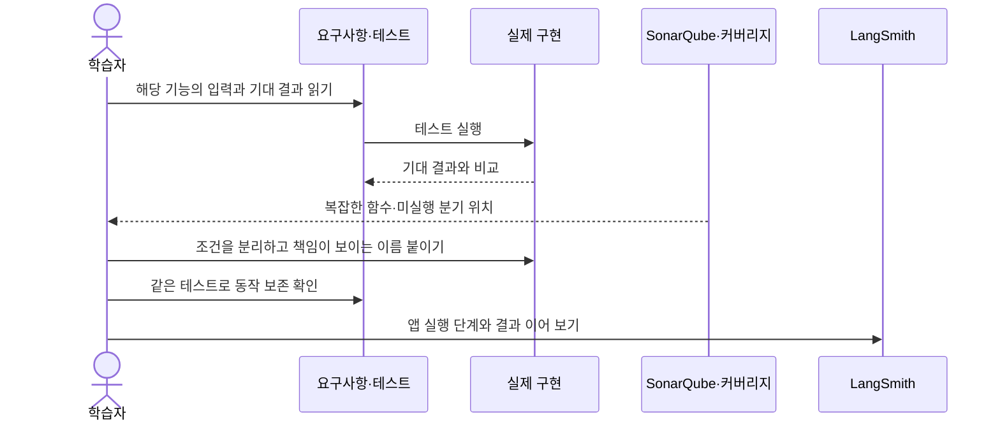

# 복잡성 분석과 테스트를 연결해 코드 읽기

> 최신 동결본의 2026-10-26 실제 분석은 **S3776 복잡도 경고0건, Sonar 커버리지100%, 중복0%**다. **Quality Gate는 ERROR**이며 새 지적12건이 남았다. 아래 ‘최신 동결본 분석’과 [검증결과](검증결과.md)에서 해당 분석 ID·범위를 확인한다. 10/23의 수치는 과거 기록으로 분리한다.

SonarQube는 코드에서 이해하기 어려운 조건문·중복·결함 후보를 찾는 데 사용한다. **2026-10-23 당시 같은 extended 프로필의 실제 전후 분석에서 공통 20개 파일의 인지 복잡도 합계는 1,319→1,194, 기존 코드의 S3776 경고는 29→20으로 확인했다.** 당시 수정본은 전체 357개 검사와 실제 벡터·MCP HTTP 검증을 통과했고, 2026-10-23 10:19에 최종 SonarQube 보고서를 수집했다. 새 분석 도구를 포함한 전체 복잡도와 남은 이슈는 [공유용 실측 요약](quality/실측요약.json)에 따로 기록했다.

| 도구 | 확인하는 것 | 이 프로젝트에서 읽을 자료 |
|---|---|---|
| pytest | 입력에 대한 실제 결과가 기대값과 일치하는가 | `tests/`와 [26개 요구사항 추적표](tdd/추적표.md) |
| coverage.py | 어떤 실행 줄과 분기를 테스트가 지나갔는가 | `reports/quality/html/index.html`, `reports/quality/coverage.xml` |
| SonarQube | 읽기 어려운 구조와 정적 분석 문제 후보가 있는가 | 로컬 분석 화면의 이슈와 코드 위치 |
| LangSmith | 질문을 처리할 때 어떤 단계·결과를 거쳤는가 | [LangSmith 학습 기록](LANGSMITH.md) |



학습할 때는 **복잡성 이슈의 함수 → 그 함수가 맡은 요구사항 → 관련 테스트 → 구현** 순서로 연결한다. 함수 길이를 줄이는 것만으로는 충분하지 않다. 학점 부족·자료 누락·수강 중 전망처럼 서로 다른 판정 조건이 이름과 테스트로 드러나는지를 확인한다. 실제 파일과 함수를 따라가는 순서는 [SonarQube 코드 읽기](SONARQUBE_코드읽기.md)에 있다. 현재 작업은 기존 기능을 검증하면서 구조를 개선하는 리팩터링이며, 과거 전체 개발이 TDD였다고 소급하지 않는다.

## 분석 범위

[sonar-project.properties](../sonar-project.properties)는 `app.py`, `jolup/`, `scripts/`를 제품 소스로, `tests/`를 테스트로 지정한다. 테스트를 제품의 복잡성·중복·커버리지 분모에 섞지 않는다. [`learning/tdd/`](../learning/tdd/README.md)는 의도적인 미구현과 단계별 중복을 보여 주는 교육 자료이므로 제품 지표에서 제외한다. 실습 자체의 21개 계약 검사는 별도로 계속 실행할 수 있다.

`.venv`, 캐시, 학교·학생 데이터, 생성 보고서, 문서, 공유 ZIP은 소스 분석 범위에서 제외한다. 학교 규정이 올바르게 적용됐는지는 정적 분석으로 결정할 수 없으며, 관련 근거와 기대 정답 테스트를 함께 확인한다. 소스와 테스트의 초기 범위가 다르면 적용 규칙과 지표도 달라진다. [SonarQube 분석 범위 공식 문서](https://docs.sonarsource.com/sonarqube-community-build/project-administration/adjusting-analysis/setting-analysis-scope/setting-initial-scope)

분석에는 프로젝트 전체를 마운트하지 않는다. [quality_check.py](../scripts/quality_check.py)가 `app.py`와 `jolup`·`scripts`·`tests` 바로 아래의 `.py` 파일, 선택한 커버리지 XML, 허용된 분석 설정만 `.build/sonar-analysis-날짜시각/`에 복사한다. 준비 전후와 실제 스캔 전후에 원본·복사본 해시를 확인한다. 새 하위 패키지가 생기면 이 복사 허용 목록과 분석 범위를 함께 검토해야 한다.

**전체 프로젝트 총계의 전후 차이를 모두 리팩터링 효과로 해석하면 안 된다.** 동결 원본을 만든 뒤 `scripts/quality_check.py`, `scripts/sonar_local.py`와 관련 테스트가 추가되었다. 이 도구도 실제 제품 소스 범위에 포함하므로 최신본의 파일·코드·복잡도 총계에는 새 도구의 영향이 있다. `stage.json`의 `source_hashes`로 공통 파일과 추가 파일을 구분하고, 공통 핵심 파일의 지표·이슈를 먼저 비교한 뒤 전체 총계를 별도로 보고한다. 수정 전 커버리지를 측정하지 않았다면 해당 값은 ‘미측정’이며 0으로 바꾸지 않는다.

## 선택형 로컬 Docker 구성

[compose.quality.yaml](../compose.quality.yaml)은 앱용 `compose.yaml`과 분리한 `jolup-quality` 스택이다. GitHub 연결 없이 로컬 코드 복사본을 분석한다.

| 설정 | 의미 |
|---|---|
| SonarQube `26.10.0.133078-community` | 이번 구성에 고정한 서버 이미지. 최신 버전이라는 뜻은 아님 |
| `127.0.0.1:9000:9000` | [로컬 분석 화면](http://127.0.0.1:9000)을 이 컴퓨터에서만 열도록 바인딩 |
| 내장 H2·부트스트랩 검사 비활성화 | 로컬 학습·평가용 구성. 공동 운영 서버로 전환하려면 별도 데이터베이스와 운영 설정이 필요 |
| `mem_limit: 4g` | 서버 컨테이너 메모리 상한 4GB. Docker 가상머신과 함께 실행하는 앱에 필요한 여유 메모리는 별도 |
| scanner `12.2.0.4256_8.1.0`, `linux/amd64` | Apple Silicon에서는 Docker의 amd64 에뮬레이션 지원이 필요. 실행 시간이 더 걸릴 수 있음 |
| `SCANNER_WORKDIR_PATH=/usr/src/.scannerwork` | 작업 ID 파일을 분석 복사본에 남겨 컨테이너 종료 후 서버 분석 완료를 검증 |
| `SONAR_TELEMETRY_ENABLE=false` | 서버의 사용 통계 전송 비활성화 설정 |
| 이름 있는 데이터 볼륨·`restart: no` | 분석 자료를 유지하며, 필요할 때 직접 시작·종료 |

이미지와 분석 도구를 처음 내려받을 때는 네트워크가 필요하다. 모델 API나 LangSmith에 연결하는 작업은 포함하지 않는다. 초기화 스크립트는 이 전용 스택과 고정된 로컬 주소를 확인하며, 다른 주소의 SonarQube 서버를 관리하는 도구가 아니다.

실제 첫 실행에서는 스캐너가 분석을 마쳐도 공식 이미지의 `/tmp` 쪽 작업 경로에 생성된 `report-task.txt`가 호스트에 남지 않아 완료 검증이 실패했다. 서버 분석 실패로 단정하지 않고, 위 작업 경로를 마운트한 `/usr/src/.scannerwork`로 지정한 뒤 재실행하여 작업 ID와 서버 분석 완료를 확인했다. 현재 구성에 이 수정이 포함되어 있다.

## 커버리지 설정

선택형 분석 의존성은 [requirements-quality.txt](../requirements-quality.txt)의 `coverage==7.16.2`다. 앱 실행 의존성을 설치한 프로젝트 가상환경에서 추가 설치한다. 이 파일은 모델 API나 LangSmith 연결을 추가하지 않는다. [공식 배포 페이지](https://pypi.org/project/coverage/7.16.2/)

[.coveragerc](../.coveragerc)는 줄·분기 커버리지와 상대 경로를 사용한다. 제품 소스 전체를 분모로 유지하며, 테스트가 실행하지 않은 `scripts/` 파일도 표시한다. 측정하지 않은 부분을 숨겨 비율을 올리지 않는다. HTML은 `reports/quality/html/`, SonarQube가 읽는 XML은 `reports/quality/coverage.xml`에 생성된다. SonarQube는 커버리지를 직접 측정하지 않고 생성된 XML을 가져온다. [Python 커버리지 연동 공식 문서](https://docs.sonarsource.com/sonarqube-community-build/analyzing-source-code/test-coverage/python-test-coverage)

MCP 테스트는 별도의 Python 서버 프로세스를 시작하므로 `patch = subprocess`로 하위 프로세스도 측정하고, `parallel = True`로 분리 저장한 자료를 `coverage combine`으로 합친다. Python 3.12의 분기 측정을 위해 `core = ctrace`를 명시했다. Mac·Linux에서 SIGTERM으로 종료하는 서버는 `sigterm = True`로 자료 저장을 돕는다. 강제 종료된 프로세스의 자료까지 저장됨을 보장하지 않으며 Windows에서는 이 신호 설정이 적용되지 않는다. [coverage.py 설정](https://coverage.readthedocs.io/en/7.16.2/config.html), [하위 프로세스 측정](https://coverage.readthedocs.io/en/7.16.2/subprocess.html)

## 처음 실행하는 순서

명령은 `app.py`가 있는 프로젝트 루트에서 실행한다. 아래는 Mac용 절차다. Windows의 Python 경로는 `.venv\Scripts\python.exe`이지만, 이 분석 운영 스크립트의 Windows 실행과 파일 권한 처리는 아직 검증하지 않았다. 먼저 앱의 가상환경 의존성을 준비하고 Docker를 실행해 둔다. 실행 중인 앱의 입력 키나 세션을 다시 설정할 필요는 없다.

**1. 선택형 측정 도구를 설치하고 전체 로컬 검사를 실행한다.**

```bash
.venv/bin/python -m pip install -r requirements-quality.txt
.venv/bin/python scripts/quality_check.py coverage
```

`coverage`는 이전 측정 초기화 → `tests` 실행 → 하위 프로세스 결과 합치기 → XML·HTML·JSON 생성을 수행한다. `reports/quality/manifest.json`의 `status: passed`, `exit_code: 0`, `tests.status: passed`를 확인한다. 일부 테스트가 건너뛰었거나 검사 중 소스가 바뀌면 완료로 처리하지 않는다. 실패 후 생성된 HTML이 있다는 이유만으로 통과로 판단하지 않는다.

기본 측정은 모델 다운로드를 차단한 상태로 실행한다. 실제 벡터 검색을 함께 측정하려면 임베딩 모델이 이미 로컬에 캐시된 환경에서 아래 명령을 사용한다. 캐시가 없다면 이 명령으로 자동 다운로드하지 않는다.

```bash
.venv/bin/python scripts/quality_check.py coverage --vector
```

**2. 전용 서버를 시작하고 준비 상태를 확인한다.**

```bash
docker compose -f compose.quality.yaml up -d sonarqube
docker compose -f compose.quality.yaml ps
docker compose -f compose.quality.yaml logs --tail=60 sonarqube
```

첫 시작은 시간이 걸릴 수 있다. 로컬 화면에서 서버 시작이 끝났는지 확인한 뒤 다음 단계를 진행한다. 컨테이너가 실행 중이라는 표시와 SonarQube 서버가 요청을 처리할 준비가 됐다는 것은 구분한다.

**3. 로컬 분석용 자격 정보를 준비한다.**

```bash
.venv/bin/python scripts/sonar_local.py bootstrap
```

`bootstrap`은 컨테이너를 시작하지 않는다. 전용 컨테이너·localhost 바인딩·서버 준비 상태를 확인하고 로컬 계정과 분석 토큰을 준비한다. 자격 정보는 `.quality/sonar.json`에 소유자만 읽고 쓸 수 있는 권한으로 저장하며 출력하거나 공유본에 넣지 않는다. OpenAI·LangSmith 키를 사용하지 않는다. 기존 자격 파일이 있으면 이를 사용하고 기본 계정으로 임의 초기화하지 않는다.

브라우저에서 `http://127.0.0.1:9000`에 로그인할 때는 자신의 `.quality/sonar.json`에 저장된 `username`과 `password` 값을 사용한다. `token`은 스캐너·API 연결용이다. 공유 ZIP에는 이 자격 파일이 없으므로 팀원은 각자의 로컬 서버에서 `bootstrap`으로 생성한다. 실제 값을 문서나 채팅에 복사하지 않는다.

**4. 두 비교 프로젝트에 같은 Python 규칙을 연결하고 확인한다.**

```bash
.venv/bin/python scripts/sonar_local.py profile
```

Quality Profile은 언어별로 실제 적용할 분석 규칙의 집합이다. 이 버전에는 `Sonar way core`, `extended`, `comprehensive`가 있으며 기본은 core다. [공식 내장 프로필 설명](https://docs.sonarsource.com/sonarqube-community-build/quality-standards-administration/managing-quality-profiles/built-in-quality-profiles)

이번 서버의 API를 직접 조회했을 때 core에는 인지 복잡성 규칙 `python:S3776`이 비활성이고, extended에는 임계값15로 활성화되어 있었다. 확인 당시 extended의 활성 규칙은266개였다. **core 분석에서 S3776 경고가 0개라고 해서 함수의 인지 복잡성 검사를 통과한 것은 아니다.** 분석 대상 규칙이 켜져 있었는지 먼저 확인해야 한다.

`profile`은 `jolup-roadmap-before`와 `jolup-roadmap` 두 프로젝트의 Python 프로필을 `Sonar way extended`로 명시 연결한다. 전역 기본값은 바꾸지 않는다. 서버 ID·버전, 정확한 프로필, S3776 활성 상태와 임계값15, 두 프로젝트의 실제 연결을 API로 다시 확인하고 `reports/quality/profile.json`에 기록한다. 규칙 부재·비활성·검증 실패는 종료 코드1이며 성공은0이다. UI에서 확인하려면 프로젝트의 **Project Settings → Quality Profiles**를 연다. [프로젝트별 프로필 공식 안내](https://docs.sonarsource.com/sonarqube-community-build/project-administration/adjusting-analysis/changing-quality-profiles)

**5. 통과한 측정과 일치하는 분석 복사본을 만든다.**

```bash
.venv/bin/python scripts/quality_check.py prepare --project jolup-roadmap
```

`reports/quality/prepared.json`에 복사본 위치와 해시가 기록된다. 소스·테스트·`.coveragerc` 또는 커버리지 XML이 측정 후 달라졌으면 준비를 거절한다. 이때는 1단계의 `coverage`를 다시 실행한다. 분석 입력을 손으로 복사하거나 오래된 XML을 끼워 넣지 않는다.

**6. 스캔과 서버 분석을 완료한 뒤 보고서를 수집한다.**

```bash
.venv/bin/python scripts/sonar_local.py scan --project jolup-roadmap
.venv/bin/python scripts/sonar_local.py report --project jolup-roadmap
```

스캐너의 정상 종료만으로 끝내지 않고 서버의 분석 작업 완료와 분석 ID에 해당하는 Quality Gate를 확인한다. `scan`과 `report`는 Gate가 `OK`이면 종료 코드 0, 분석·조회가 완료됐어도 Gate가 `ERROR`·`WARN`·`NONE`이면 2를 반환한다. 실행·검증 실패는 1이다. 코드 2일 때는 저장된 결과를 읽어 기준을 충족하지 못한 항목을 확인한다.

## 동결한 수정 전 코드와 비교하기

이 작업의 원본이 `.build/sonar-baseline`에 있는 경우 아래 명령으로 별도 프로젝트를 분석한다. 원본의 커버리지를 새로 측정하지 않은 비교이므로 `--without-coverage`를 명시한다. 팀 공유 ZIP에는 이 작업용 원본 복사본이 없으므로, ZIP 사용자에게 이 단계를 필수로 요구하지 않는다.

```bash
.venv/bin/python scripts/quality_check.py prepare --source .build/sonar-baseline --project jolup-roadmap-before --without-coverage
.venv/bin/python scripts/sonar_local.py scan --project jolup-roadmap-before
.venv/bin/python scripts/sonar_local.py report --project jolup-roadmap-before
```

수정 전 분석도 먼저 4단계의 `profile`로 두 프로젝트의 규칙 연결을 확인한 뒤 진행한다. 이후 최신본을 다시 분석할 때는 5단계의 `prepare --project jolup-roadmap`부터 수행한다. `prepared.json`은 가장 최근에 준비한 복사본을 가리킨다. 스캐너의 프로젝트와 준비 복사본의 프로젝트가 다르면 실행을 거절한다. 비교에는 같은 서버 버전·분석 프로필·S3776 임계값을 사용하고, 위에서 설명한 새 분석 도구의 소스 범위 증가를 분리해 기록한다.

## 보고서를 읽는 순서

아래 파일은 실행한 작업 폴더에 생성된다. 팀 공유 ZIP에는 자격 정보·분석 복사본·원본 보고서를 포함하지 않는다. 공유본에는 [코드 읽기 문서의 검증 요약](SONARQUBE_코드읽기.md)이 있으며 각 팀원의 측정 결과는 각자의 작업 폴더에 생긴다.

| 파일 | 먼저 확인할 내용 |
|---|---|
| `reports/quality/manifest.json` | 테스트 결과, 검사 중 입력 불변 여부, 실제 벡터 모드 여부, XML 해시 |
| `reports/quality/html/index.html` | 파일별 미실행 줄과 부분 실행 분기 |
| `reports/quality/coverage.xml`, `coverage.json` | SonarQube 입력과 측정 세부 값 |
| `reports/quality/profile.json` | 서버 버전, 연결한 Python 프로필 키·규칙 수·갱신 시각, S3776 활성 검증·임계값, 두 프로젝트 목록 |
| `reports/quality/prepared.json`, 준비 폴더의 `stage.json` | 분석할 소스 파일 목록·해시, 커버리지 포함 여부 |
| `reports/quality/scan-before.json`, `scan-after.json` | 서버 작업 완료 상태·분석 ID·해당 Quality Gate |
| `reports/quality/sonar-before.json`, `sonar-after.json` | 프로젝트·파일 지표, 전체 이슈, 열린 `python:S3776` 이슈 |
| `reports/quality/scanner-before.log`, `scanner-after.log` | 비밀값을 제거한 스캐너 실행 로그 |

수집 보고서의 `all_issues`에는 해결된 이슈도 포함될 수 있다. 열린 인지 복잡성 이슈는 `open_s3776_issues`에서 확인하되, 먼저 `profile.json`에서 해당 규칙이 활성화된 프로필을 확인한다. 없는 지표는 `null`이며 0 또는 통과로 해석하지 않는다. `scan`과 `report`의 분석 ID가 같아야 해당 측정을 함께 설명할 수 있다. 프로필을 바꾼 뒤에는 두 소스를 다시 스캔하고 이전 프로필의 결과와 섞지 않는다.

## 작업을 마치거나 다시 시작하기

분석 화면을 보지 않을 때는 서버를 멈춰 메모리를 반환한다. 아래 명령은 분석 데이터 볼륨을 삭제하지 않는다.

```bash
docker compose -f compose.quality.yaml stop sonarqube
```

다시 사용할 때는 서버를 시작하고 준비된 뒤 보고서를 열거나 다음 분석을 진행한다. 기존 데이터 볼륨과 `.quality/sonar.json`을 함께 유지해야 같은 로컬 계정·인스턴스로 이어서 사용할 수 있다.

```bash
docker compose -f compose.quality.yaml up -d sonarqube
.venv/bin/python scripts/sonar_local.py report --project jolup-roadmap
```

컨테이너와 전용 네트워크도 정리하려면 `docker compose -f compose.quality.yaml down`을 사용할 수 있다. `-v`를 붙이면 저장된 분석 데이터까지 삭제되므로 일반 종료 명령에 넣지 않는다. 기존 서버의 자격 파일만 없어졌거나 인스턴스가 달라졌다면 자동 초기화를 반복하지 말고 로컬 계정·데이터 상태를 먼저 확인한다.

## 결과를 읽고 개선하는 순서

1. **복잡한 함수 한 개를 고른다.** 경고 위치에서 함수 전체를 읽고 입력·출력·책임을 한 문장으로 적는다.
2. **관련 요구사항과 테스트를 찾는다.** 추적표에서 현재 학점, 전망 학점, 누락 자료, 일정 승인 등 그 함수가 보호하는 조건을 찾는다.
3. **미실행 분기를 해석한다.** HTML의 미실행 줄·부분 실행 분기가 정상·오류·누락 중 어떤 경우인지 확인한다. 실제 위험이 있는 경우에 기대값을 독립적으로 정한 테스트를 보완한다.
4. **의미 단위로 정리한다.** 반복 조건에 이름을 붙이거나 검증·계산·표현을 나눈다. 동일한 결과를 유지하는 변경과 실제 결함 수정을 구분한다.
5. **테스트와 분석을 다시 실행한다.** 동작 유지, 복잡성 변화, 새 결함 후보를 함께 확인한다. 경고를 지우기 위해 제품 소스를 제외하지 않는다.
6. **앱과 실행 기록을 연결한다.** 필요한 경우 더미 사례로 앱을 실행하고 LangSmith의 단계별 결과를 확인한다. 정적 분석과 실행 관찰의 결과를 서로 대체하지 않는다.

## 2026-10-26 최신 동결본 분석

전체 시험 **777/777 통과**와 연결된 커버리지 XML을 포함해 로컬 SonarQube를 다시 실행했다. 준비·분석·수집 뒤 제품·시험 Python61파일과 XML 해시가 일치했다. 분석 ID는 `bb766df6-27aa-40b1-8585-0f6eeba19368`, 서버는 `26.10.0.133078`, 프로필은 `Sonar way extended`, S3776 임계값은15다. 이번에 프로필·임계값·제외 설정·이슈 상태·인증을 변경하지 않았다.

| 확인 항목 | 실제 결과 | 의미 |
|---|---|---|
| 열린 S3776 | **0건** | 이전 `KnowledgeBase.answer()`의19점 경고를 확인한 뒤 질문 적용범위를 `_query_scope_error()`로 분리했다. 현재 분석 범위에서 임계값 초과 경고가 없다. |
| Sonar coverage·branch coverage | **100.0%·100.0%** | 검증된 coverage XML을 가져온 실제 값. 이전 coverage 없는 분석의0.0과 구분한다. |
| 중복 줄 비율 | **0.0%** | 중복 문자열 규칙 S1192의 지적 수와 다른 지표다. |
| Quality Gate | **ERROR** | `new_coverage=100.0`와 `new_duplicated_lines_density=0.0`은 통과. `new_violations=12`가 허용0을 넘어 실패했다. |
| 열린 전체 지적 | **39건** | S1192 28, S8415 5, S8786 3, S7519 2, S2068 1. 복잡도 경고0을 전체 경고0으로 바꾸지 않는다. |
| 그중 새 지적 | **12건** | 서버의 이전 버전 기준 기간에서 S1192 7건+S8415 5건. 12개의 실행 실패를 뜻하지 않는다. |
| 전체 정적 지표 | 인지 복잡도1514, 순환 복잡도1681, ncloc5214 | 새 메모리·HTTP 기능과 도구를 포함한 총계다. 예전 공통20파일 수치와 직접 비교해 리팩토링 효과라고 하지 않는다. |

남은 지적은 이번 학습 목표에서 다음처럼 해석했다.

| 규칙 | 복잡성·가시성·분석 관점의 의미와 현재 판단 |
|---|---|
| S1192 반복 리터럴28건·새7건 | 표시 문구·예제 질문·Postman 스크립트 문자열을 상수로 모으면 변경 지점을 찾기 쉬워진다. 새7건의 값 불일치나 기능 결함은 확인되지 않았다. 발표 동결본은 유지하고 이후 공통화 때 관련 회귀·새 분석을 수행한다. |
| S8415 HTTP 응답 명세5건·모두 새 지적 | 공통 `invoke()`와 `/chat`의403/422/503 예외 문서화 경고다. **현재 `app.openapi()`를 새로 생성해 `/chat`의422/503, `/calendar/ics`의403/422/503이 실제 명세에 있음을 확인**했고 공유 OpenAPI와도 일치했다. 전역 FastAPI `responses`와 개별403 선언을 사용한다. 해당 공개 명세의 누락은 재현되지 않았으나 서버 경고를 임의로 해결 처리하지 않았다. 모든 예상 밖 backend 오류까지 검증했다는 뜻은 아니다. |
| S7519 관용 표현2건 | 명시적인 dict comprehension을 `dict.fromkeys()`로 바꾸라는 제안이다. 실행 정확성 결함으로 확인되지는 않았고, 현재 읽히는 코드를 유지했다. |
| S8786 정규식3건 | 실행시간 관련 후보이며 이번 새 보안·성능 개선 범위 밖이다. 복잡도 경고와 구분해 열어 두었다. |
| S2068 자격정보 검토1건 | 해당 초기화 함수는 로컬 임의 비밀번호를 생성한다. 실제 비밀값을 검토 문서에 넣지 않았고 이슈를 임의로 닫지 않았다. 추가 보안 검토 완료라는 뜻은 아니다. |

새12건의 범위 검토에서 실제 기능 결함이나 심각한 읽기 장애는 찾지 못했다. 이는 유한한 코드·명세 검토의 결론이며 전체 무결함 선언은 아니다. **Gate 미통과는 그대로 남는다.** 전체 테스트 통과·S3776 해소·전체 Gate 통과를 각각 독립된 결과로 읽는다.

상세 근거는 작업 폴더의 `reports/quality/sonar-final-20261026.json`, `sonar-after.json`, `scan-after.json`, `sonar-issue-review-20261026.json`이다. 새 분석에는 XML SHA `df39ed9fc07939cd2a23ef1b50559605ddcd607823fe4b3aac2e41c8ee298b08`을 포함했다. 원본 보고서는 공유 ZIP에 자동 포함하지 않는다.

## 2026-10-23 과거 실행 기록

아래는 2026-10-23 10:13(Asia/Seoul)에 생성했던 당시 `reports/quality/manifest.json`과 `coverage.json`을 확인했다. `.venv/bin/python scripts/quality_check.py coverage --vector`로 실행했으며, 검사 중 소스·테스트·측정 설정의 변경은 없었다. 최종 수정본의 전체 검사·커버리지 측정과 같은 입력을 사용한 SonarQube 분석을 완료했다.

| 확인할 항목 | 당시 기록 |
|---|---|
| 최종 전체 회귀 검사 | 357/357 통과. 실패·오류·건너뜀 0개. `manifest.status=passed`, 종료 코드 0 |
| 실제 벡터 검색 | `--vector`, `vector=true`. 캐시된 임베딩 모델과 로컬 Chroma 사용 |
| 실행문 커버리지 | 2,923/3,478 = **84.04%** |
| 분기 커버리지 | 991/1,290 = **76.82%** |
| coverage.py 결합 표시값 | **82.09%**. 실행문과 분기 기회를 함께 계산한 값이며 위 두 비율과 구분 |
| 하위 프로세스 수집 | `combine.log`의 `Combined 2 files`. 실제 MCP HTTP 하위 프로세스 포함, `jolup/mcp_server.py` 실행문 43/52 = 82.69% |
| TDD 실습 재검증 | Red의 의도된 실패 21개, Green·Refactor 각각 21개 통과. 세 단계의 검사 ID 동일 |
| 측정 도구·스캐너 이미지 | coverage 도구와 scanner 이미지 설치 완료 |
| SonarQube 서버 이미지·기동 | 다운로드 완료. 서버·스캐너 실제 기동 확인 |
| 스캐너 작업 ID 수집 | 작업 폴더 설정 보완 후 수정 전 초기 분석의 서버 완료 검증 확인 |
| Python 규칙 선택 | core의 S3776 비활성 확인. extended의 활성·임계값15 확인. 두 프로젝트 명시 연결 도구 추가 |
| 수정 전·후 서버 분석 ID와 Quality Gate | 같은 extended 프로필의 최종 비교 수집 완료. 아래 표에 분석 ID와 Gate 조건 기록 |
| 공통 핵심 파일의 복잡성 변화·남은 이슈 | 공통20개 파일 인지 복잡도1,319→1,194, 기존 경고29→20 |
| 추가 분석 도구를 포함한 전체 제품 지표 | 최종 after 총 인지 복잡도 1,418·S3776 20개. 새 도구의 `_verify_hashes` 경고는 해소 확인 |

핵심 파일의 측정값은 다음과 같다. 범위에 포함된 다른 제품 파일을 제외해 전체 비율을 높이지 않았으며, 미실행 분기는 HTML에서 확인할 수 있다.

| 파일 | 실행문 | 분기 |
|---|---:|---:|
| `jolup/academic.py` | 294/316 · 93.04% | 111/130 · 85.38% |
| `jolup/planner.py` | 168/186 · 90.32% | 57/66 · 86.36% |
| `jolup/course_solver.py` | 90/93 · 96.77% | 31/34 · 91.18% |

TDD 재실습 기록은 작업 폴더의 `reports/tdd_study/20261023_093335_776152/summary.json`이다. 커버리지 원본·로그와 함께 공유 ZIP에는 넣지 않으며, 위 표와 [검증 기록](검증결과.md)에 요약을 보존한다. 수정 전 커버리지처럼 측정하지 않은 값은 실패·0점·통과 어느 것으로도 바꾸지 않는다. 서버가 설정한 ‘새 코드’ 기간의 지표와 전체 코드 지표도 구분한다.

## 2026-10-23 당시 SonarQube 전후 비교

공유 가능한 [실측요약.json](quality/실측요약.json)에 분석 ID·프로필·공통 파일 지표·남은 함수와 해석 제한을 저장했다. 당시 before/after 요약과 분석 ID를 위 JSON에 보존했다. 작업 폴더의 `sonar-after.json`은 현재 최신 분석으로 갱신되므로 아래 과거 after와 혼동하지 않는다. 아래 표는 10/23 당시의 코드·검증을 반영한 분석이다.

| 항목 | 수정 전 | 최종 수정 후 | 해석 |
|---|---:|---:|---|
| 공통 제품 파일 수 | 20 | 20 | `__init__.py`·`settings.py`의 인지 복잡도 `null`은 그대로 보존 |
| 공통 파일 인지 복잡도 합계 | 1,319 | 1,194 | API가 반환한 숫자 지표의 합계,125 감소 |
| 공통 파일 S3776 경고 | 29 | 20 | 기존 함수9개의 임계값 초과 경고 해소 |
| 전체 제품 파일 수 | 20 | 22 | 분석 도구2개 추가 |
| 전체 제품 인지 복잡도 | 1,319 | 1,418 | 추가된 `quality_check.py` 74·`sonar_local.py` 150, 합계 224 포함. 전체 총계의 증가도 보존 |
| 전체 S3776 경고 | 29 | 20 | 남은 20개는 기존 코드. 새 도구 `_verify_hashes` 경고는 최종 분석에서 해소 |
| SonarQube coverage | 미측정 | 82.1% | before에는 XML을 넣지 않아 API의0.0을 미측정으로 해석. coverage.py 실행문 비율과 구분 |
| SonarQube branch coverage | 미측정 | 76.8% | 같은 시점 SonarQube API 값 |
| Quality Gate | OK | OK | before는 새 이슈 0개 조건. after는 새 코드 커버리지 100%·중복 0%·새 이슈 0개 조건 통과. 전체 무경고 증거가 아님 |
| 전체 정적 분석 분류 | bug 1·vulnerability 0·code smell 49 | bug 0·vulnerability 1·code smell 48 | 규칙의 자동 분류. 남은 보안 후보와 정규식 경고는 아래 수동 검토를 함께 읽기 |

서버 버전은 `26.10.0.133078`, Python 프로필은 `Sonar way extended`, 활성 규칙266개, S3776 임계값15다. 수정 전 분석 ID는 `05f4e9a7-f2b8-4ae2-b890-6c08e86766fe`(10:02 수집), 최종 수정 후는 `6c5cab8a-13ff-4a26-a999-f471cbf853f2`(10:19:50 수집)이다. 시각은2026-10-23 Asia/Seoul 기준이다.

남은 경고를 전부 없앴다는 주장 대신, [코드 읽기의 함수별 개선·학습 우선순위](SONARQUBE_코드읽기.md)를 함께 본다. `course_solver.py`의 파일 합계는28→32로 늘었지만 공개 함수 `choose_courses`의28점 경고는 해소됐다. 파일 총계와 한 함수의 중첩을 같은 지표로 취급하면 이 변화를 잘못 읽게 된다.

새 도구 `_verify_hashes`는 파일별 해시 확인을 `_verify_source_file`로 분리했고, `planner.py`는 호환용 `diagnosis` 인자를 덮어쓰지 않도록 `current_diagnosis`를 사용했다. 최종 분석에서 각각 S3776·S1226의 `CLOSED/FIXED` 상태를 확인했다.

최종 Gate는 `PREVIOUS_VERSION` 방식이며, **현재 서버가 새 코드로 지정한 범위의 기준 시각은 2026-10-23 10:04:17 KST**다. 이 기간의 커버리지 100%는 기준 80% 이상, 중복률 0%는 기준 3% 이하, 새 이슈는 0개였다. 이는 마지막 변경에 대한 조건 통과이며 전체 앱 커버리지가 100%이거나 모든 경고가 해소됐다는 뜻이 아니다. 전체 SonarQube coverage는 82.1%이고, 남은 S3776은 20개다.

자동 분류 `python:S2068` 1건은 `password_status: "pending"`이라는 상태 표시를 하드코딩된 비밀번호 후보로 잡은 것이다. 실제 초기 비밀번호는 `secrets.token_urlsafe(36)`으로 생성하므로 수동 검토에서는 오탐 가능성이 높다고 보지만, 원본 경고를 삭제하거나 해결 처리하지 않았다. 정규식 성능 경고 `python:S8786` 3건도 남겨 두었다. 이메일 정규식에 단순 경계를 추가하면 `first@example.com2second@example.org`의 두 번째 주소가 마스킹되지 않을 수 있어, 동작 검토 없이 경고만 없애는 변경은 하지 않았다.
