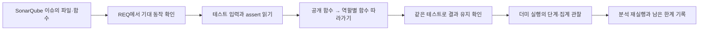
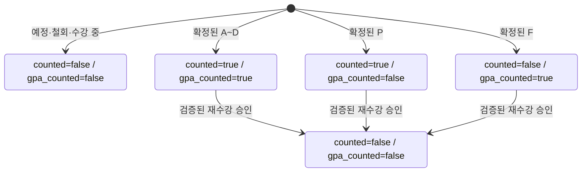
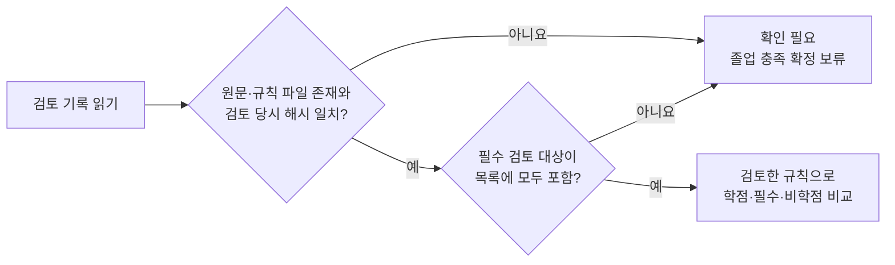
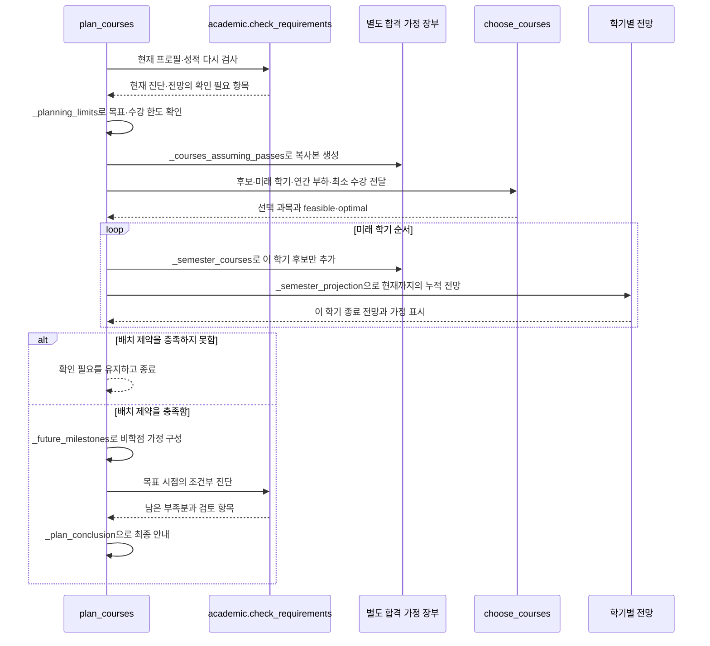
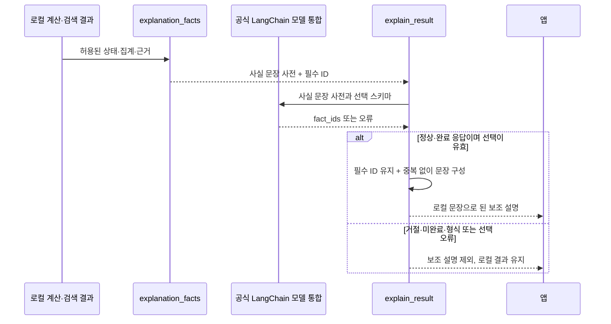
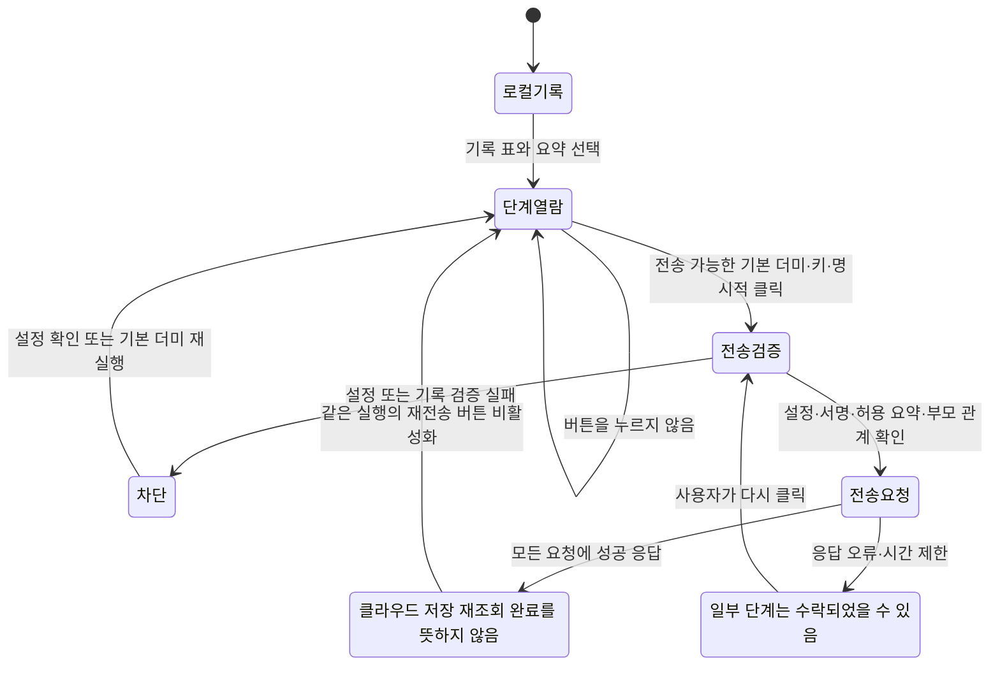

# SonarQube에서 발견한 위치를 테스트와 실행 기록까지 따라 읽기

이 문서는 **어려운 함수 하나를 골라, 그 함수가 지켜야 할 정답과 실제 실행 결과까지 연결하는 순서**를 설명한다. SonarQube 설치·실행은 [분석 운영 안내](SONARQUBE.md), 전체 기능의 테스트 순서는 [TDD 학습 가이드](TDD_학습가이드.md), 요구사항의 전체 목록은 [24개 추적표](tdd/추적표.md)에서 확인한다.

**2026-10-23 10:19에 보존한 첫 리팩터링 분석에서는 기존 복잡성 경고 9개가 해소되고 20개가 남았으며, 당시 357개 검사가 통과했다.** 이 문서의 후반 수치표는 그때의 전후 비교다. 이후 추가한 API·테스트·공식 LangChain 통합까지 포함한 현재 측정은 [검증결과](검증결과.md)에서 시점·대상과 함께 확인한다. 아래 연결표와 5절은 현재 코드의 읽기 순서다. 함수의 줄 수·분리한 함수 개수를 복잡도 점수로 대신하지 않는다.

## 1. 이슈를 발견하면 바로 코드를 고치지 말고 정답부터 찾는다

먼저 `reports/quality/profile.json`에서 Python `Sonar way extended`와 `python:S3776` 임계값15의 활성 검증을 확인한다. 이번 서버의 기본 core 프로필은 이 규칙을 끈 상태였다. 따라서 초기 core 분석의 복잡성 경고 0개는 검사를 통과했다는 뜻이 아니다. 프로필 연결과 재분석은 [운영 안내](SONARQUBE.md)의 `bootstrap → profile → prepare → scan/report` 순서로 진행한다.

분석 화면에서 복잡성 이슈를 선택하면 파일·함수·조건문 위치를 확인한다. “이 함수가 어떤 입력을 받아 어떤 결과를 내야 하는가?”를 먼저 한 문장으로 적고, 아래 연결표에서 요구사항과 테스트를 찾는다. 테스트의 `assert`가 기대 결과다. 그 뒤에 구현의 각 단계가 그 기대 결과를 어떻게 만드는지 읽는다.



| 분석에서 찾을 위치와 읽기 질문 | 연결 요구사항 | 먼저 읽을 대표 테스트 | 이어서 볼 구현 | 로컬 기록·LangSmith에서 대응하는 단계 |
|---|---|---|---|---|
| 재수강 조건이 여러 번 겹치는 이유는? | REQ-003·004·008 | [test_academic_review.py](../tests/test_academic_review.py)의 `test_approved_retake_replaces_old_earned_credit_instead_of_adding_it`, `test_retake_cumulative_thirty_credit_boundary` | [academic.py](../jolup/academic.py)의 `_calculate` → `_review_retake` → `_replace_accepted_attempt` → `_credit_totals` | `check_requirements`: 현재 학점과 수강 중 합격 전망 |
| 미래 학점을 현재 기록에 더하지 않는가? | REQ-008·012 | 같은 테스트 파일의 `test_each_semester_diagnosis_is_cumulative_and_keeps_unconfirmed_noncredit_values` | [planner.py](../jolup/planner.py)의 `_courses_assuming_passes` → `_semester_courses` → `_semester_projection` | `plan_courses`: 현재·목표 합계와 학기별 누적 합계 |
| 최소 수강과 상한을 함께 지키는가? | REQ-010·011·013 | 같은 테스트 파일의 `test_preferred_eight_credit_cap_cannot_bypass_senior_nine_credit_minimum`, `test_valid_time_limited_incumbent_is_distinct_from_infeasible_assignment` | `plan_courses` → `_planning_limits` → `_select_future_courses` → [course_solver.py](../jolup/course_solver.py)의 `choose_courses` | `plan_courses`: `solver.feasible`·`solver.optimal` |
| 규정 답변이 원문과 떨어져 나오는가? | REQ-014·015 | [test_rag.py](../tests/test_rag.py)의 `test_changed_source_number_requires_review_instead_of_stale_answer`, `test_replacement_table_requires_the_original_exemption_rule` | [rag.py](../jolup/rag.py)의 `KnowledgeBase.answer` → `_grounded_statements` → `_verified_facts` → `_append_grounded_fact` | `answer_regulations`: 상태·근거 출처·검색 방식 |
| API 응답을 어느 순서로 거절하는가? | REQ-016·017 | [test_llm.py](../tests/test_llm.py)의 `test_openai_message_completion_and_displayable_blocks`, `test_private_fields_and_raw_query_are_never_sent_and_result_not_mutated` | [llm.py](../jolup/llm.py)의 `explain_result` → `safe_explanation_input` → `generate` → `_structured_result` | `explain_result`: 성공 여부·사용량 등 허용된 요약. 설명 문장 원문은 기록하지 않음 |
| 검증되지 않은 실행 기록도 전송되는가? | REQ-021·022 | [test_observability.py](../tests/test_observability.py)의 `test_modified_trace_is_blocked_without_network`, `test_reallowlist_blocks_unknown_field_even_with_valid_process_signature` | [observability.py](../jolup/observability.py)의 `export_study_trace` → `_validated_trace` → `_export_payloads` → `_send_export_payloads` | 로컬 실행 트리와 전송한 트리의 실행 ID·부모 관계 |
| 화면이 자동으로 전송하거나 중복 전송하는가? | REQ-019·022·023 | [test_app_study.py](../tests/test_app_study.py)의 `test_settings_and_question_do_not_export_and_leave_model_key_unchanged`, `test_explicit_export_once_and_success_prevents_duplicate` | [app.py](../app.py)의 `_render_study_trace` → `_render_study_steps`·`_render_study_export` | 앱의 단계 표·선택 단계 요약·전송 상태 |

표의 LangSmith 열은 **공개 실행 단계와 코드의 연결**이다. 이번에 분리한 모든 내부 함수가 독립된 LangSmith 단계로 표시되지는 않는다. 예를 들어 `_review_retake`는 `check_requirements` 내부 코드에서 읽으며, 현재 기록 화면은 재수강 조건을 한 줄씩 실행한 내역까지 보여 주지 않는다. 로컬 단계 확인에는 LangSmith 키가 필요하지 않다.

## 2. academic: 인정할 성적을 고른 다음 합산한다

공개 입력과 출력부터 읽는다. `parse_transcript(CSV)`는 검증한 과목 목록 또는 오류를 반환한다. `search_scores(courses)`는 인정 학점·인정/제외 이유·학기별 평점을 반환한다. `check_requirements(profile, courses)`는 현재 진단표와 수강 중 합격을 가정한 별도 `projection`을 반환한다.

CSV 입력은 `_transcript_content`(크기·인코딩) → `_transcript_header`(필수 열·별칭) → `_transcript_rows`와 `_validate_csv_row`(행 구조·학적 범위) → `validate_courses`(과목 값) 순서다. `parse_transcript`에서는 이 순서와 전체 승인·전체 거부만 읽는다. 학적은 `_profile_scope_issues`, `_profile_semester_issues`, `_profile_course_term_issues`로 나누고 `_profile_issues`가 검토 사유를 모은다. 진단표는 `_diagnostic_row`의 공통 비교와 `_required_course_rows`의 필수 과목 확인을 구분한다. 이 역할 분리는 실제 Sonar 함수 점수와 별도로 코드를 읽는 기준이며 최신 점수는 재분석 결과를 따른다.

기존 `_calculate`에는 재수강 검증, 원행 제거, F·중복 처리, 합계가 한 루프 안에 모여 있었다. 현재도 과목을 학기·행번호 순서로 처리하지만, 재수강과 합계의 역할을 아래 함수에서 구분해 읽을 수 있다.

| 읽는 순서 | 함수 | 입력에서 확인할 것 | 반환값 또는 바뀌는 것 |
|---|---|---|---|
| 1 | `_normalize` | 과목 행의 학점·성적·상태·승인 값 | `_normalized_credits`, `_normalized_grade`, `_normalized_retake_approval`을 거친 한 행. 잘못된 값은 오류 |
| 2 | `_calculate` | 정규화한 과목들, `include_in_progress` | 현재 인정 대상과 제외 사유를 결정하는 전체 순서 |
| 3 | `_retake_link_issue` | 승인, 원행, 과거 학기, 성적, 이미 대체된 행, 인정 과목 충돌 | 먼저 발견한 검토 사유와 제외 문구 또는 `None` |
| 4 | `_review_retake` | 앞 검사 결과, 재수강 누계, 과목 연결 | 다음 누계와 검토 사유. 여기서는 원행을 제거하지 않음 |
| 5 | `_replace_accepted_attempt` | 모든 검사를 통과한 원행 | 내부 인정 목록에서 원행을 빼고 대체 이유를 남김 |
| 6 | `_credit_totals` | 최종 인정 목록과 별도 수강 중 학점 | 총학점·영역별 합계·현재 수강 중 학점 |
| 7 | `_diagnostic_rows`, `check_requirements` | 인정 결과와 프로필·검토된 규칙 | 필요·이수·부족·상태, 근거와 메타데이터 |

첫 실습은 원래 3학점 과목과 승인된 재수강 3학점 과목을 넣었을 때 **합계가 3인지** 확인하는 것이다. 테스트의 입력을 읽고 `_review_retake`가 통과한 다음에만 `_replace_accepted_attempt`가 실행되는지 찾는다. 원행 제거 전에 검증하는 순서가 중요하다.

```bash
.venv/bin/python -m pytest tests/test_academic_review.py -q -k "retake or in_progress_final_course or f_and_p"
```

재수강 30학점 경계도 별도 특성화 테스트로 고정했다. 기존 구현은 연결·충돌 검사를 통과한 시도의 학점을 누계에 먼저 반영한 뒤, 누계 초과와 나머지 원행 연결을 검사한다. 뒤쪽 검사에서 확인 필요가 되어도 그 누계를 되돌리지 않는다. 이번 작업은 이 동작을 바꾸지 않았다. 이 정책 자체를 고치려면 별도의 근거 확인과 기대값 변경 검토가 필요하다.

이 부분을 설명할 수 있다면 다음 질문에 답해 본다. **“이 과목이 제외된 이유를 보려면 합계 함수와 재수강 검토 함수 중 어디를 열어야 하는가?”** 합계는 이미 결정된 인정 목록만 더하므로, 판단 이유는 `_calculate`와 `_review_retake`에서 찾는다.

### 2.1 취득 학점과 평점 인정 상태를 따로 읽는다

현재 `trace.counted`는 취득 학점 인정, `trace.gpa_counted`는 평점 계산 포함 여부다. F는 학점을 얻지 못해도 확정된 평점에는 포함되고, P는 취득 학점에는 포함되지만 평점에는 포함되지 않는다. 승인 재수강으로 대체된 원행은 두 값이 모두 `false`다. 이제 `search_scores`는 `gpa_counted`를 읽으며 한국어 제외 사유 문구를 해석해 계산하지 않는다.



그림은 현재 성적 집계의 인정 상태다. 합격 가정 전망은 별도 장부이며 실제 상태를 바꾸지 않는다. 먼저 `test_retake_chain_does_not_restore_the_first_failed_grade_to_gpa`의 **F → D0 재수강 → A0 재수강**을 손으로 계산한다. 정답은 현재 취득3학점, 마지막 학기만 평점4.0·평점대상3학점이다. `_replace_accepted_attempt`가 이전 F의 `gpa_counted`도 해제하는지 확인한다. 미승인·연결 누락·한도 초과는 `test_unverified_retake_is_excluded_from_gpa_as_well_as_earned_credit`와 `test_retake_over_limit_does_not_add_unrecognized_gpa_credits`에서 비교한다.

### 2.2 근거의 해시와 검토 목록의 완전성을 함께 확인한다

파일 해시가 맞더라도 검토 목록에서 계산 규칙이나 원문 자체를 빼면 충분한 검토가 아니다. [evidence.py](../jolup/evidence.py)의 `validate_rule_bundle`은 각 파일 존재·해시뿐 아니라 규칙 JSON, 출처 목록, 선언된 원문 파일이 검토 목록에 포함되는지도 확인한다. 학생 자료의 진위를 인증하거나 학교의 공식 졸업사정을 대신하는 검사는 아니다.



[test_domain_guard.py](../tests/test_domain_guard.py)의 `test_review_manifest_cannot_silently_omit_required_evidence`에서 빈 목록·규칙 누락·학교 안내문 누락을 각각 읽는다. 셋 모두 ‘충족’이 아닌 ‘확인 필요’가 정답이다. 실제 원문이나 검토 해시를 바꾸지 않고 테스트에서만 목록을 변경한다.

## 3. planner: 현재 기록에서 별도 가정 장부를 만들어 학기마다 누적한다

`plan_courses(profile, courses, diagnosis=None, preferences=None)`의 공개 인터페이스는 유지했다. 전달받은 `diagnosis`를 그대로 믿지 않고 현재 입력으로 다시 검사한다. 출력의 `current_totals`는 현재 값, `semesters`는 학기별 계획과 누적 전망, `projected_totals`는 목표 시점의 조건부 합계다.

이전 `plan_courses`에 모여 있던 입력 검사·후보 선택·추천 이유·재수강 가정·최종 판단을 단계별 함수로 나눴다. 아래 호출 순서와 함께 [planner.py](../jolup/planner.py)를 읽는다.

진입 시 **현재와 합격 가정 전망의 검토 사유**를 함께 확인한다. `check_requirements`의 `projection.review_items`는 현재 검토 사유와 전망에서 추가로 발견한 사유를 보존한다. 예를 들어 기존3학점은 확인돼도 현재 수강 중 재수강 승인이 없다면 계획을 계산하기 전에 ‘확인 필요’로 돌아간다. 이 경우를 ‘학점 부족 위험’으로 바꾸거나 승인 사유를 숨기지 않는다. `test_unreviewed_in_progress_retake_blocks_the_plan_with_an_actionable_reason`을 먼저 읽는다. 아래 시퀀스는 이 초기 확인을 통과한 경로다.



`_annual_workload`는 취득 학점과 수강 부담이 다름을 보여 준다. F와 재수강 시도도 연간 부담에는 반영한다. `_select_future_courses`는 이미 인정한 과목을 제외하고 미래 학기를 함께 계산하도록 `choose_courses`에 전달한다. solver 내부를 읽을 때는 [course_solver.py](../jolup/course_solver.py)의 공개 함수 `choose_courses`에서 시작한다.

`_semester_courses`는 후보마다 `_candidate_reason`으로 보완 이유를 구하고 `_planned_course`로 표시용 후보와 계산용 가정 행을 만든다. 이전 F 과목을 다시 듣는 후보에는 ‘공식 재수강 신청·승인 필요’라는 조건이 붙는다. 실제 성적표에 합격이나 승인 사실을 저장하는 작업은 아니다.

정상 더미를 손으로 따라가면 **현재 90 → 수강 중 합격 가정 105 → 2027-1 후보 포함 114 → 2027-2 후보 포함 123**이다. `_semester_projection`은 해당 학기까지 추가한 과목만 읽는다. 채플·작품의 학기별 진단은 현재 확인값을 유지하며, `_future_milestones`가 만드는 목표 시점의 조건부 추정과 구분한다.

```bash
.venv/bin/python scripts/tdd_study.py show REQ-012
.venv/bin/python scripts/tdd_study.py run REQ-010 REQ-012 REQ-013
```

앱에서 기본 더미 ‘목표까지 준비 가능한 사례’를 실행한 다음 `plan_courses` 요약을 연다. 현재90, 계획 학기당9, 누적114·123, `feasible`과 `optimal`을 코드 반환값과 대조한다. **“유효한 계획을 찾았지만 최적 탐색은 끝나지 않은 경우”**와 **“수강 제약을 만족하지 못한 경우”**가 서로 다른 결과임을 설명할 수 있으면 이 단계를 이해한 것이다.

## 4. RAG: 규정 문구와 그 문구를 말할 수 있는 원문 조건을 함께 읽는다

`KnowledgeBase.answer(query, profile)`는 질문과 지원 범위에 따라 상태·답변·근거·메타데이터를 반환한다. 원래 `_grounded_statements`에는 주제별 `if/elif`와 각 원문 확인 조건, 답변 문구가 길게 나열되어 있었다. 현재는 같은 내용을 `GROUNDED_FACTS`의 `GroundedFact` 항목으로 읽고, 공통 검증 순서를 별도 함수에서 읽는다.

| 읽는 위치 | 질문 |
|---|---|
| `GROUNDED_FACTS["major"]` 등 | 허용 출처·쪽수·원문 필수 표현·답변 문구가 한 항목에 어떻게 연결되어 있는가? |
| `GroundedFact.matches` | `all_of`는 전부 있어야 하고, `any_of`는 지정되었을 때 하나 이상 있어야 하는가? |
| `_fact_context` | 검색된 일부 문장만으로 부족할 때 허용된 쪽의 원문 맥락을 어떻게 모으는가? |
| `_verified_facts` | 부모 규정의 원문 조건을 확인한 뒤에만 `followups`를 검토하는가? |
| `_select_citation` | 원문 표현 일치와 출처 우선순위를 적용하고, 동점이면 원래 순서를 지키는가? |
| `_append_grounded_fact` | 인용할 근거가 없으면 문장을 추가하지 않고, 새 근거 5개 제한도 지키는가? |

교양 면제 규정과 대체과목표가 좋은 읽기 예다. 대체과목표만 남아 있고 적용 대상 면제 규정이 빠졌다면 후속 설명을 독립적으로 확정해서는 안 된다. `test_replacement_table_requires_the_original_exemption_rule`의 두 입력을 비교한 뒤 `general_exemption.followups`와 `_verified_facts`를 읽는다.

```bash
.venv/bin/python -m pytest tests/test_rag.py -q -k "changed_source_number or replacement_table or compound_question"
```

기본 실행의 검색 방식과 실제 벡터 검증은 구분한다. 아래 동등성 보고서의 21개 질문 비교는 `lexical_explicit` 모드다. 별도로 첫 리팩터링 당시의 전체 357개 검사는 `--vector`로 실행해 실제 캐시 임베딩 모델과 로컬 Chroma도 검증했다. 두 실행 모두 실시간 학교 규정 재확인을 의미하지 않는다. 현재 전체 검사 범위는 [검증결과](검증결과.md)를 따른다. 실행 기록에서는 `answer_regulations`의 상태와 출처를 확인하고, 문장·쪽수의 자세한 검토는 앱 근거 표와 원문에서 한다.

## 5. LLM: 사실을 계산하는 코드와 문장을 선택하는 모델을 구별한다

현재 `generate(system, user, config, client=..., response_schema=...)`는 공식 LangChain `ChatOpenAI`·`ChatAnthropic` 통합에 모델 요청을 맡긴다. `langchain-openai`·`langchain-anthropic`과 `langchain-core`를 사용하며 버전은 [requirements.lock](../requirements.lock)에 고정한다. 상위 `langchain` 패키지를 추가해야만 공식 통합이 되는 것은 아니다. `IntentDecision`은 허용된 의도 다섯 개 중 하나, 앱 설명의 `ExplanationSelection`은 로컬에서 제공한 사실 문장의 ID 목록을 정의한다. 범용 `generate`의 기본 `ExplanationOutput`은 호환용 문자열 계약이며 앱 설명 경로에는 사용하지 않는다.

**Pydantic은 필드와 타입을 검증한다. 문장이 학사 사실과 같은지는 별도 문제다.** 앱은 `safe_explanation_input`으로 허용 집계와 공개 근거만 추린 뒤 `explanation_facts`에서 판정·수강 중 학점·조건부 계획·누락 경고 문장을 로컬로 만든다. 모델은 제공된 ID를 선택할 뿐 새 학점·졸업 판정·URL을 작성하지 않는다. `explain_result`가 선택을 다시 검사하고 필수 문장을 붙여 표시하므로, 모델이 근거 문장만 골라도 현재 판정과 조건부 경고가 사라지지 않는다. 규정·일정 조회에는 학생 개인의 졸업 판정을 만들지 않는다.

| 읽는 순서 | 코드 | 확인할 계약 |
|---|---|---|
| 출력 계약 | `ExplanationSelection`, `IntentDecision` | 허용 ID·의도 enum과 필드·타입 검증. 앱 설명은 자유문장 대신 ID 목록 |
| 사실 구성 | `safe_explanation_input` → `_personal_facts` → `explanation_facts` | 현재와 수강 중·목표 전망을 구별. 개인 판정은 진단·계획 질문에만 구성 |
| 설정 | `_resolve` → `_configured_key`·`_credential_provider`·`_model_setting` | 키 선택, 공급자 일치, 모델 설정의 실패 이유를 각각 읽기 |
| 공식 요청 | `_chat_model` → `with_structured_output` → `generate` | 공식 공급자 통합의 JSON Schema 구조화 출력. OpenAI에는 `strict=True`도 적용 |
| 공급자 응답 | `_CompletionGuard`, `_output_error`, `_structured_result` | 거절·미완료·빈 출력·파싱 실패를 구분하고 실패 시 로컬 결과 유지 |
| 앱 표시 | `explain_result`의 선택 검증과 `mandatory` 결합 | 중복·현재 facts에 없는 ID는 거절. 필수 판정·누락·범위 문장을 유지하고 로컬 문장만 표시 |



첫 실습은 [test_explanation_facts.py](../tests/test_explanation_facts.py)의 `test_model_cannot_replace_current_result_or_omit_conditional_warning`이다. 모델이 `evidence`만 선택해도 현재 미충족·목표 조건부 가능·수강 중 학점 제외 문구가 유지되는지 확인한다. `test_nonpersonal_lookup_never_invents_a_student_diagnosis`에서는 같은 ‘확인 필요’ 상태라도 규정·일정 조회를 개인 졸업 진단으로 바꾸지 않는지 비교한다. `test_unknown_duplicate_or_malformed_fact_selection_is_not_displayed`는 ID 중복·임의 문장·잘못된 타입을 거절하는 계약이다.

```bash
.venv/bin/python -m pytest tests/test_explanation_facts.py tests/test_llm.py tests/test_llm_routing.py -q
```

공급자 통합 테스트는 공식 LangChain과 SDK를 실행하고 마지막 HTTP 응답을 모의 처리한다. 실제 계정 권한·모델 응답 검증과 구분한다. 과거 `reports/langchain_live_validation.json`은 이전 설명 계약의 실호출 기록이므로 현행 사실 선택 계약을 검증했다는 근거로 쓰지 않는다. 최신 실호출의 시점·대상·제약은 [검증결과](검증결과.md)에 기록한다. 모델이 새 사실을 쓰지 못해도 입력·규칙·로컬 계산의 정확성까지 자동 보장되지는 않으므로 학사 회귀시험과 원문 검토를 함께 읽는다.

## 6. observability와 UI: 기록을 보는 동작과 밖으로 보내는 동작을 구분한다

`StudyRecorder`와 `observe_call`은 허용된 실행 단계·시간·요약을 기록한다. `export_study_trace(trace, config, client=...)`는 명시적 전송 요청을 받았을 때만 연결 설정과 기록을 검증하고 전송 결과 상태를 반환한다.

기존 `_validated_trace`에 함께 있던 스키마·서명·부모 관계 검사를 분리했다. 읽는 순서는 **`_has_valid_trace_integrity` → `_validated_root_interval` → `_validated_step_interval`**이다. 필드가 늘어나거나 기록이 바뀌었을 때 검증을 빠져나갈 경로가 있는지 살핀다. 검증을 통과한 기록을 복사한 뒤 `_export_payloads`가 허용 요약만 전송 형식으로 조립하고 `_send_export_payloads`가 한 번의 전송 흐름을 수행한다.



UI는 `_render_study_trace`에서 시작한다. `_render_study_steps`는 표와 선택한 단계의 요약을 보여 주고, `_render_study_export`는 전송 버튼과 중복 방지를 맡는다. `_study_export_status`는 원시 예외가 포함할 수 있는 비밀값을 화면에 내보내지 않도록 정해진 상태만 반환한다. `_render_study_export_feedback`은 수락·차단·비활성·오류를 구분해 안내한다.

```bash
.venv/bin/python -m pytest tests/test_observability.py tests/test_app_study.py -q
```

이 검사는 실제 LangSmith로 전송하지 않는 모의·로컬 검사다. 학습 중 클라우드에 기록을 보내려면 앱에서 해당 기본 더미 실행의 전송 버튼을 직접 누른다. 이번 리팩터링이 새 내부 함수를 모두 외부 추적에 추가하거나 원문 수집 범위를 넓힌 것은 아니다.

## 7. 결과가 유지됐다는 증거와 아직 측정하지 않은 것을 구분한다

첫 리팩터링에서는 학사 규칙·답변 원문 조건을 바꾸는 대신, 같은 판단을 읽기 쉬운 역할로 나누었다. 아래 표는 **2026-10-23 오전에 보존한 그 작업의 검증 요약**이다. 이후 검사를 더한 현재 총수·커버리지와 혼동하지 않는다. `reports/`의 원본 보고서는 작업 폴더 전용 기록이며 팀 공유 ZIP에는 포함하지 않는다. **동등성은 수정 전과 같다는 뜻이며, 학교의 공식 졸업사정을 새로 인증했다는 뜻은 아니다.**

| 확인한 범위 | 결과 | 실제 기록 |
|---|---|---|
| 학점·재수강·계획·지원 범위 검사 | 신규 특성화 10개를 포함한 79개가 수정 전 통과 | `reports/sonar_academic_before.xml` |
| academic 분리 후 같은 검사 | 79개 통과 | `reports/sonar_academic_after.xml` |
| planner 분리 후 같은 검사 | 79개 통과 | `reports/sonar_planner_after.xml` |
| 동결 원본과 11개 더미의 전체 결과 | CSV 파싱·성적 집계·졸업 진단·수강 계획·입력 불변성의 55개 비교 모두 동일. 사례별 전후 SHA256 저장 | `reports/sonar_academic_planner_equivalence.json` |
| RAG 질문의 전후 결과 | `lexical_explicit` 모드 21개 질문 모두 동일 | `reports/sonarqube_rag_contract_equivalence.json` |
| 당시 전체 회귀·측정 | 357개 통과, 실패·오류·건너뜀 0개. `--vector`, 검사 중 입력 변경 없음 | [보존한 실측 요약](quality/실측요약.json) |
| 당시 TDD 학습 실습 | Red 21개 의도된 실패, Green·Refactor 각각 21개 통과. 동일 검사 ID 확인 | `reports/tdd_study/20261023_093335_776152/summary.json` |

동결 원본은 이 작업 폴더의 `.build/sonar-baseline/`에 있다. 이 작업용 복사본은 일반 팀 공유 ZIP의 필수 구성 파일이 아니다. 학습자는 현재 코드·관련 테스트·위 결과 기록을 먼저 읽으면 된다. 소스 구조가 같았다는 근거가 필요하면 작업자가 보관한 원본과 실제 분석 결과를 함께 확인한다.

아래는 **첫 리팩터링의 10:19 분석까지 확인한 실제 전후 결과**다. 초기 core에서는 S3776이 비활성이었으므로 동일한 extended 프로필로 두 소스를 다시 분석했다. 이 비교는 [공유용 실측 요약](quality/실측요약.json)에 보존했다. 새 분석 도구가 추가된 전체 총계와 공통 파일의 변화를 분리한다. 현재 공식 LangChain 통합의 복잡도나 최신 전체 커버리지 수치로 인용하지 않는다.

| 실측 항목 | 수정 전 | 수정 후 | 결과를 읽는 기준 |
|---|---|---|---|
| SonarQube 분석 | extended, 10:02 수집 | extended, 10:19 수집 | 분석 ID·프로필·원본 보고서 해시는 실측 요약에 보존 |
| 기존 코드 S3776 경고 | 29 | 20 | 기존 함수9개 해소. 모든 경고를 해결한 것은 아님 |
| 공통20파일 인지 복잡도 | 1,319 | 1,194 | 숫자가 없는 상수 파일은 `null` 유지 |
| 전체 제품 인지 복잡도 | 1,319 | 1,418 | after의 새 분석 도구 2개 합계 224 포함. 공통 범위와 구분 |
| 전체 S3776 경고 | 29 | 20 | 기존 코드 20개가 남음. 새 도구 경고는 해소 확인 |
| 실행문 커버리지 | 미측정 | 2,923/3,478 · 84.04% | 테스트가 지나간 실행문 비율 |
| 분기 커버리지 | 미측정 | 991/1,290 · 76.82% | 테스트가 지나간 분기 비율 |
| coverage.py 결합값 | 미측정 | 82.09% | 실행문·분기 기회를 함께 계산. SonarQube 점수가 아님 |
| 당시 전체 회귀 검사·실제 벡터 검증 | 이전 날짜별 검사와 범위가 다름 | 357/357 통과, 실제 벡터·MCP HTTP 포함 | 실패·오류·건너뜀 0, 검사 중 입력 변경 없음 |
| 하위 프로세스 측정 | 이번 측정 전에는 없음 | 2개 측정 파일 결합. `mcp_server.py` 실행문 43/52 · 82.69% | 하위 프로세스 측정 반영 확인. 해당 파일 분기는 2/4 · 50.00% |
| 남은 이슈와 다음 읽을 함수 | 분석 후 기록 | 분석 후 기록 | 우선순위와 동작 변경 필요 여부를 명시 |

측정 결과를 공부할 때는 `reports/quality/html/index.html`에서 미실행 분기를 고르고, 연결된 테스트의 입력을 읽는다. 높은 커버리지 자체가 모든 학사 조건의 정답이나 SonarQube 경고 해소를 보장하지 않는다. 파일별 측정 요약과 서버 설치 상태는 [운영 안내의 실행 상태](SONARQUBE.md)에 있다.

## 8. 실제 경고가 해소된 함수와 다음 학습 순서

첫 리팩터링의 10:19 분석에서는 같은 S3776 규칙·임계값15에서 다음9개 함수의 초과 경고가 사라졌다. ‘15이하’는 당시 함수가 남아 있고 활성 규칙의 초과 경고가 없음을 확인한 범위다. **after의 정확한 함수 점수는 API 결과에 없으므로0점으로 쓰거나 임의의 점수를 만들지 않는다.** 이후 바뀐 `llm.py` 등의 현재 점수는 새 분석 결과와 대조해야 한다.

| 함수 | before 점수 | after에서 확인한 것 | 분리한 책임 |
|---|---:|---|---|
| `academic._normalize` | 17 | 15이하, 초과 경고 없음 | 학점·성적·재수강 승인 값 검증 |
| `academic._calculate` | 44 | 15이하, 초과 경고 없음 | 재수강 검토·승인 대체·합계 |
| `course_solver.choose_courses` | 28 | 15이하, 초과 경고 없음 | 제약 행·목적함수·선택 검증 |
| `llm.generate` | 56 | 15이하, 초과 경고 없음 | 요청 변환·응답 해석 |
| `observability._validated_trace` | 29 | 15이하, 초과 경고 없음 | 서명·루트·자식 단계 검증 |
| `observability.export_study_trace` | 38 | 15이하, 초과 경고 없음 | 연결 설정·payload·한 번의 전송 |
| `planner.plan_courses` | 58 | 15이하, 초과 경고 없음 | 한도·후보·학기 전망·결론 |
| `rag.KnowledgeBase._grounded_statements` | 87 | 15이하, 초과 경고 없음 | 주제별 원문 조건과 공통 근거 검증 |
| `app._render_study_trace` | 20 | 15이하, 초과 경고 없음 | 단계 표·명시 전송·상태 안내 |

당시 파일 합계도 함께 보면 해석이 더 정확하다. `academic`172→158, `planner`71→63, `llm`171→141, `rag`224→160, `observability`149→138, `app`156→154였다. 반면 `course_solver` 파일 합계는28→32로 늘었다. 공개 함수 하나가 모든 제약을 처리하던 구조를 역할 함수로 나눈 결과이며, `choose_courses` 자체의 경고가 사라졌다는 사실과 파일 합계 증가를 둘 다 기록한다.

당시 남은 기존20개 함수는 다음 순서로 공부할 수 있다. 순서는 이 프로젝트의 학습 우선순위이며 SonarQube가 자동으로 부여한 우선순위가 아니다. 숫자는 10:19 after에서 실제 경고로 반환된 인지 복잡도이며 현재 점수 목록이 아니다.

| 학습 순서 | 남은 함수와 점수 | 연결해서 확인할 질문 |
|---|---|---|
| 1 · 학사 입력과 판정 | `academic.parse_transcript`28, `_profile_issues`19, `_diagnostic_rows`30 | 잘못된 입력을 부분 채택하지 않는가? 누락을0으로 바꾸지 않는가? REQ-001·002·005·007 |
| 2 · 외부로 보낼 요약 | `llm.safe_explanation_input`24, `observability._plan_summary`28, `_summary`33 | 필드 허용 목록과 원문 제외가 어떻게 연결되는가? REQ-017·021·022 |
| 3 · 공개 근거 검색 | `rag.KnowledgeBase._load_sources`34, `search`31, `answer`19 | 자료 범위·검색 순위·확인 필요 결과를 어떻게 구분하는가? REQ-014·015 |
| 4 · 모델 설정 | `llm._resolve`34, `list_available_models`26 | 잘못된 키·설정·응답에서 무엇을 호출하지 않아야 하는가? REQ-016 |
| 5 · 분기와 표시 | `agent._route`21, `app._sources`25, `_render_plan`17 | 질문 분기와 출처·학기 표시가 계산 결과를 바꾸지 않는가? REQ-018·019 |
| 6 · 일정 승인 | `calendar.create_calendar_event`18 | 선택·승인·원본 일정 검증이 모두 필요한 이유는? REQ-020 |
| 7 · 자료와 공유본 | `package_project.selected_files`32, `prepare_data.main`30 | 공유 허용 파일과 원문 자료의 경계를 어떻게 확인하는가? REQ-014·024 |
| 8 · 학습 실행 도구 | `tdd_study.validate_requirements`25, `read_junit`19, `main`44 | 설정 오류를 의도된 Red로 오인하지 않는가? TDD 실행 계약 |

당시 새 분석 도구의 `_verify_hashes` 17점 경고는 기존 20개와 별도였다. 파일 단위 검증을 `_verify_source_file`로 분리한 뒤 10:19 분석에서 `CLOSED/FIXED`를 확인했다. `planner.plan_courses`의 호환용 `diagnosis` 인자를 재할당하던 S1226도 `current_diagnosis`로 분리해 같은 상태를 확인했다.

당시 Quality Gate는 before·10:19 after 모두 OK였다. before는 새 이슈 조건을 평가했고, after는 `PREVIOUS_VERSION` 방식의 **당시 서버가 새 코드로 지정한 범위(기준 2026-10-23 10:04:17 KST)**에서 커버리지 100%(기준 80% 이상), 중복률 0%(기준 3% 이하), 새 이슈 0개 조건을 통과했다. 이 값은 그 변경 범위에 적용되므로 전체 앱의 커버리지·무경고 증거로 읽지 않는다. ‘OK’만 읽지 말고 분석 기간·규칙·조건·전체 이슈를 함께 읽는다. 비밀번호 상태 표시의 S2068 오탐 검토와 정규식 성능 S8786 3건은 [운영 안내](SONARQUBE.md)에 남겨 두었다.

학습을 마칠 때는 한 기능에 대해 **“입력은 무엇이고, 어떤 테스트가 정답을 지키며, 어떤 함수가 판단하고, 실행 기록에서는 무엇을 볼 수 있는가?”**를 네 문장으로 설명해 본다. 이 네 가지가 연결되면 SonarQube 이슈를 실제 코드 이해와 개선의 출발점으로 사용할 수 있다.
