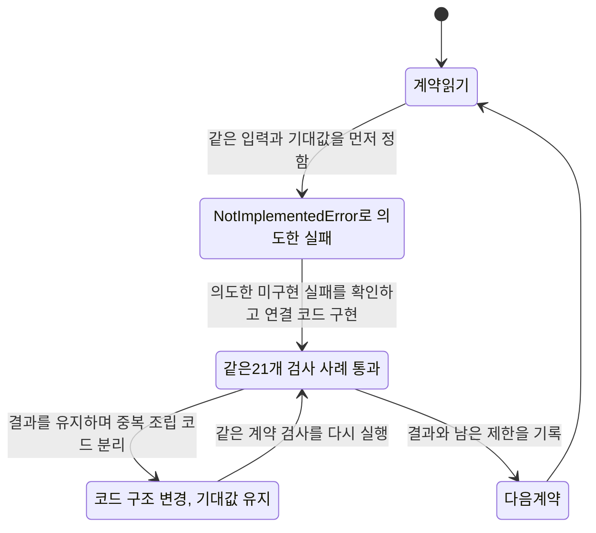
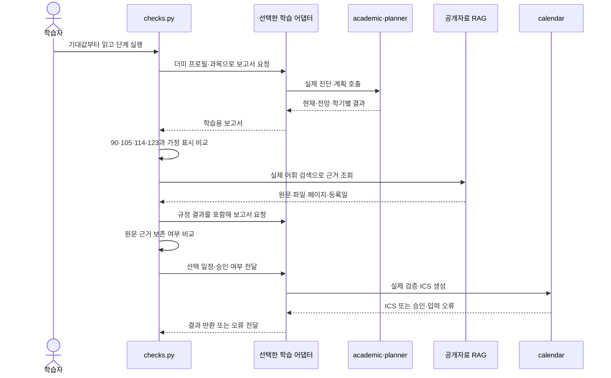
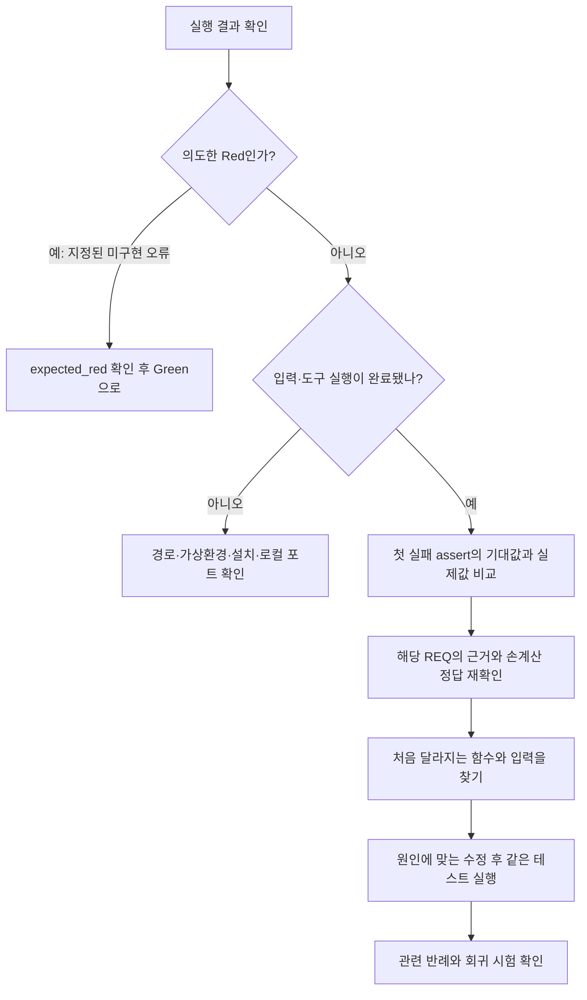

# 졸업로드맵을 테스트부터 이해하는 학습 가이드

이 문서의 목표는 **정답을 먼저 설명하고, 그 정답을 검사하는 테스트를 읽은 뒤, 실제 구현과 실행 기록을 연결하는 것**이다. 처음부터 모든 코드를 읽을 필요는 없다. 한 기능에서 “어떤 입력이면 어떤 결과가 나와야 하는가?”를 답하고 다음 기능으로 넘어간다.

이번 자료에는 서로 다른 두 작업이 있다.

| 구분 | 실제로 한 일 | 이 자료로 말할 수 있는 것 |
|---|---|---|
| 기존 완성 앱 | 기존 기능을24개 요구사항으로 정리하고 기존 테스트·구현에 연결 | 완료 앱을 테스트부터 읽을 수 있다. 과거 전체 개발이 TDD였다는 증거는 아니다. |
| 이번에 추가한 학습 어댑터 | 같은21개 검사 사례를 먼저 작성하고 Red 실패 확인 → Green 구현 → Refactor 정리를 진행 | 새 학습 어댑터에는 실제 테스트 우선 개발을 적용했다. 기존 앱의 계산·검색·일정 함수를 재사용한다. |

어댑터는 결과를 학습하기 쉽게 묶는 작은 연결 코드다. 학교 규칙을 새로 계산하거나 정답90·105·123을 반환하도록 외워 둔 코드가 아니다. 기존 앱의 과거 개발 순서를 재현한 것처럼 날짜나 실패 기록을 꾸미지 않았다.

CSTS·ISTQB 관점의 테스트 학습과 TDD 개발 순서도 구분한다. 전자는 무엇을 검증하고 어떤 입력·조건·위험을 선택할지에 관한 넓은 관점이며, TDD는 테스트를 먼저 작성해 구현과 정리를 이끄는 개발 방식이다. 이 자료의 추적성·동등분할·경계값·결정표·상태전이 설명은 [ISTQB CTFL v4.0.1 공식 실러버스](https://www.istqb.org/wp-content/uploads/2024/11/ISTQB_CTFL_Syllabus_v4.0.1.pdf)의1.4.4·2.1.3·4장을 참고한다. 공식 CSTS·ISTQB 인증 적합성 심사를 했다는 뜻은 아니다.

같이 열어 둘 문서는 [전체 요구사항 추적표](tdd/추적표.md), [다이어그램·코드 학습 가이드](학습_가이드.md), [학습 어댑터 설명](../learning/tdd/README.md)다. 이 문서는 시작점과 실행 순서, 추적표는 정확한 요구사항·테스트 연결, 기존 학습 가이드는 기능별 그림과 화면 실습을 맡는다.

## 1. 터미널과 파일을 준비한다

공유 ZIP을 받았다면 먼저 완전히 압축을 풀고 [팀원 실행 안내](RUN.md)에 따라 Python3.12와 프로젝트의 `.venv`를 준비한다. 이미 앱을 실행한 현재 작업 폴더에는 그 환경이 있다. 이 학습을 위해 실행 중인 앱을 종료하거나 화면에 입력한 키를 다시 발급할 필요는 없다.

명령은 **`app.py`·`jolup`·`tests`·`scripts`가 보이는 프로젝트 루트**에서 실행한다. 현재 검증 대상은 Mac 터미널이다. 남겨 둔 Windows 명령은 참고용이며 사용자 요청에 따라 Windows 실기 검증은 범위에서 제외한다. 코드 블록 앞의 운영체제 표기를 확인하고 자기 환경의 명령만 실행한다.

Mac:

```bash
# ZIP을 푼 폴더 이름에 맞춰 이동합니다.
cd "$HOME/Downloads/jolup-graduation-agent-main"
.venv/bin/python scripts/tdd_study.py list
.venv/bin/python scripts/tdd_study.py show REQ-008
```

Windows 명령 프롬프트:

```bat
cd /d "C:\공유 ZIP을 푼 경로\jolup_team"
.venv\Scripts\python.exe scripts\tdd_study.py list
.venv\Scripts\python.exe scripts\tdd_study.py show REQ-008
```

Mac·Windows 모두 `cd` 뒤의 경로는 본인의 프로젝트 폴더로 바꾼다. 위 Mac 경로는 현재 작업 폴더의 예시다. 아래 단계의 명령은 Mac 형식으로 통일한다. Windows에서는 시작 부분 `.venv/bin/python`을 `.venv\Scripts\python.exe`로, 스크립트 경로를 `scripts\tdd_study.py`로 바꾸면 된다. 요구사항 ID와 옵션은 같다.

`list`는26개 요구사항의 이름과 연결된 테스트 함수 수를 보여 준다. `show REQ-008`은 **근거 → 테스트 설계 → 실패 영향 → 기대 결과 → 테스트 함수 → 구현 함수 → 범위 제한**을 출력한다. 이 두 명령은 테스트를 실행하지 않는다.

테스트 파일을 열었을 때 `def test_...`를 찾는다. 그 안을 다음 순서로 읽는다.

1. **입력 준비:** 어떤 가상 학생·과목·상태를 만들었는가?
2. **실행:** 어떤 함수를 어떤 인수로 호출했는가?
3. **단정(`assert`):** 실제 결과가 어떤 값이어야 한다고 검사하는가?

`assert result["current"]["credits"] == 90`은 “결과의 현재 학점이90이어야 한다”는 검사다. 왼쪽은 실제 실행 결과, 오른쪽은 독립적으로 정한 기대값이다. 두 값이 다르면 그 테스트가 실패한다. 기대값을 무조건 실제 결과에 맞춰 고치는 것이 해결은 아니다.

## 2. 첫 실습: 같은 정답으로 Red → Green → Refactor를 실행한다

먼저 [checks.py](../learning/tdd/checks.py)의 `test_current_and_pass_projection_are_separate`와 `test_timeline_uses_each_real_semester_and_labels_assumptions`를 읽는다. 처음 실습의 정답은 다음과 같다.

| 구분 | 기준 학기 | 기대 학점 | 확정인가? |
|---|---|---:|---|
| 현재 확정 | 2026-2 | 90 | 현재 이수 자료 기준 |
| 수강 중 과목 합격 전망 | 2026-2 | 105 | 현재90 + 수강중15 모두 합격 가정 |
| 첫 계획 학기 종료 전망 | 2027-1 | 114 | 앞선105 + 후보9 합격 가정 |
| 마지막 계획 학기 종료 전망 | 2027-2 | 123 | 앞선114 + 후보9 합격 가정 |

현재 판정은 **미충족**, 목표까지 준비 상태는 **조건부 가능**이다. 미래 학점뿐 아니라 채플·등록·작품 심사를 별도로 완료하고 실제 개설을 확인해야 한다. 학기별 표에서 현재 채플5학기와 작품미완료를 임의로 통과 처리하지 않는다. 미래123이라는 숫자만으로 지금 졸업요건을 충족한 것은 아니다.



**Red 파일을 먼저 열고 실행한다.** [red.py](../learning/tdd/stages/red.py)의 `build_learning_report()`·`export_reviewed_events()`는 아직 구현하지 않았다는 뜻으로 `NotImplementedError("TDD_REPLAY_RED")`를 발생시킨다.

```bash
.venv/bin/python scripts/tdd_study.py replay --stage red
```

기대 결과는 검사21개가 이 미구현 표식으로 실패하고, 실행 도구가 `status: "expected_red"`로 요약하는 것이다. 이는 의도한 Red를 재현했다는 뜻이다. 모듈을 못 찾거나 설정이 잘못돼 실패하는 것은 올바른 Red가 아니다. 도구는 실패 개수뿐 아니라 각 실패의 종류도 확인한다.

**Green에서는 최초 구현을 읽는다.** [green.py](../learning/tdd/stages/green.py)의 `build_learning_report()`가 실제 `check_requirements()`·`plan_courses()`를 호출한 다음 현재·전망·시간순 결과·근거를 조립한다. 일정 함수도 실제 `create_calendar_event()`에 위임한다.

```bash
.venv/bin/python scripts/tdd_study.py replay --stage green
```

기대 결과는 같은21개 검사 사례의 `status: "passed"`다. 테스트에서90을 요구하므로 함수가90을 그냥 반환하는 방식이 아니라, 실제 더미 성적과 앱 계산을 연결해90이 되는지 확인한다. 정상 외에도 부족·누락·필수과목·원본 보존·근거·일정 승인 사례가 함께 있다.

**Refactor에서는 출력은 같고 구조만 어떻게 달라졌는지 비교한다.** [refactor.py](../learning/tdd/stages/refactor.py)의 `_snapshot()`·`_timeline()`·`_source_cards()`·`_unique_records()`가 Green에 반복되던 결과 조립을 나눠 맡는다.

```bash
.venv/bin/python scripts/tdd_study.py replay --stage refactor
```

기대 결과는 여전히 같은21개 검사 사례의 `status: "passed"`다. 세 단계를 한 번에 재현하려면 다음을 쓴다.

```bash
.venv/bin/python scripts/tdd_study.py replay --stage all
```

Windows에서 세 단계를 한 번에 실행하는 명령은 다음과 같다.

```bat
.venv\Scripts\python.exe scripts\tdd_study.py replay --stage all
```

각 실행은 `reports/tdd_study/한국시간_실행시각/`에 `summary.json`과 단계별 `.xml`·`.txt`를 만든다. 마지막 출력의 결과 경로를 연다. `summary.json`은 상태 요약, XML은 개별 검사 결과, TXT는 원래 pytest 출력이다. `replay --stage all`의 전체 `status: "verified"`는 Red가 의도대로 실패하고 Green·Refactor가 통과했다는 뜻이다. 기존 앱의 모든 요구사항 검증을 의미하지 않는다.

한 단계만 실행하면 그 단계의 결과만 확인한다. 세 단계가 동일한 사례를 실행했는지의 비교는 `--stage all`에서 확인하며, 단독 실행은 `same_contract_verified: null`과 “단계별 검사 목록 비교: 미실시”로 표시한다.

도구의 종료 코드와 내부 pytest 종료 코드는 다를 수 있다. 의도한 Red에서 pytest는 실패를 뜻하는1을 반환하지만, 학습 도구는 정확한 실패를 확인했으므로 재현 성공으로 종료한다. 코드를 찾지 못하는 오류를 Red 성공으로 해석하지 않는다.

**자기확인:** 테스트 파일을 그대로 두고 단계만 바꿨는데 결과가 왜 달라지는지 설명해 본다. 현재90과 전망105를 조립하는 줄, 학기별114·123을 가져오는 줄, 원본과 분리하기 위해 `deepcopy`를 사용하는 줄을 각각 찾으면 첫 실습을 마친 것이다.

학습 단계 선택은 [checks.py](../learning/tdd/checks.py)의 `adapter` fixture가 처리한다. 실행 도구가 `JOLUP_TDD_STAGE`를 설정하면 해당 모듈을 불러온다. **기존 `app.py`나 `jolup` 코드를 Red로 바꾸거나 덮어쓰지 않는다.** `checks.py`는 일반 pytest가 자동 수집하는 `test_*.py` 이름이 아니므로 기본 전체 시험에 의도된 Red가 섞이지 않는다. `replay`가 이 파일을 명시적으로 실행한다.

## 3. 학습 어댑터와 실제 앱의 연결을 따라간다

학습 어댑터가 읽기 편한 결과를 묶는 곳이고, 학교 규칙과 계산은 실제 앱 모듈이 담당한다. 실제 RAG 시험은 공개 자료를 명시적 어휘 검색으로 읽어 얻은 결과를 어댑터에 전달한다. 어댑터 자체가 별도 검색 엔진이나 AI 호출을 구현하지 않는다.



새 검사21개는5가지 계약을 다룬다. 현재·전망 분리, 진단 이유 보존, 학기별 경로, 출처 보존, 승인된 일정 파일이다. AI 공통 연결·Agent·화면·LangSmith의 모든 행동을 이21개가 새로 검증하는 것은 아니다. 그 기능들은 다음 절의 기존 테스트로 내려가 읽는다.

숫자가 다른 다음 두 사례를 혼동하지 않는다.

| 사례의 위치 | 현재 | 수강 중 | 전망 | 다른 이유 |
|---|---:|---:|---:|---|
| 내장 `in_progress` 더미, 새 `test_three_in_progress_credits_do_not_create_current_pass` | 120 | 3 | 123 | 내장 성적표의 마지막3학점을 수강 중으로 만든 사례 |
| 기존 `test_in_progress_final_course_counts_only_in_projection` | 121 | 2 | 123 | 독립 경계 성적표의 마지막2학점을 수강 중으로 만든 사례 |

둘 다 “수강 중 학점은 현재에서 제외하고 합격 전망에서만 더한다”는 같은 요구사항을 검사한다.120과121 중 하나가 오타인 것이 아니다. 첫 정상 재학 실습의90→105와도 학생 입력이 다르다.

## 4. 전체 앱을 기능별로 읽고 실행한다

각 단계에서는 **기대 결과를 먼저 말하기 → 테스트의 입력·실행·assert 찾기 → 구현 함수 따라가기 → 명령 실행 → 자기확인**을 반복한다. 아래 `run`은 요구사항에 연결된 기존 테스트를 실행하는 명령이다. `replay`와 달리 이전 기능을 일부러 미구현 상태로 바꾸지 않는다.

### A. 입력과 학점 인정: REQ-001·002·003·004·009

**기대 결과:** 지원 범위가 아닌 학생은 확인 필요다. CSV 오류를 부분 채택하지 않고 이름·학번을 제거한다. F·예정·철회는 취득 학점에서 제외하고 P는 평점에서 제외한다. `counted`와 `gpa_counted`를 따로 읽는다. 미확인 재수강은 평점에도 추가하지 않으며 승인된 연속 대체가 이전 F를 되살리지 않는다. 검토 근거가 바뀌거나 필수 목록에서 빠지면 재확인한다.

**읽을 테스트:** [test_academic_review.py](../tests/test_academic_review.py)에서 `test_f_and_p_and_zero_credit_rows_have_hand_calculated_gpa`, `test_approved_retake_replaces_old_earned_credit_instead_of_adding_it`, `test_invalid_credit_input_is_not_silently_accepted`를 읽는다. [test_domain_guard.py](../tests/test_domain_guard.py)에서 학교·학번·근거 변경 반례를 확인한다. 연속 재수강 반례 `test_retake_chain_does_not_restore_the_first_failed_grade_to_gpa`와 필수 자료 누락 `test_review_manifest_cannot_silently_omit_required_evidence`도 읽는다. 전체 연결 목록은 `show`로 확인한다.

**읽을 구현:** [academic.py](../jolup/academic.py)의 `parse_transcript → _normalize·validate_courses → _calculate → search_scores`, [evidence.py](../jolup/evidence.py)의 `validate_rule_bundle` 순서다. `trace`는 각 과목의 취득 인정·평점 반영 이유다. `_review_retake → _replace_accepted_attempt`에서 대체된 행의 두 플래그가 바뀌고 `search_scores`가 `gpa_counted`를 사용하는 부분을 찾는다. 이는 모델의 숨은 생각을 기록한 것이 아니다.

```bash
.venv/bin/python scripts/tdd_study.py show REQ-001 REQ-002 REQ-003 REQ-004 REQ-009
.venv/bin/python scripts/tdd_study.py run REQ-001 REQ-002 REQ-003 REQ-004 REQ-009
```

**자기확인:** 3학점 D0·3학점 F·3학점 P·0학점 A+에서 취득 학점6과 평점0.5가 나오는 이유를 손으로 계산한다. 재수강 두 행이 있어도3학점 한 번만 인정되는 이유를 `retake_of`와 `retake_approved`로 설명한다.

### B. 현재 졸업 진단: REQ-005·006·007·008

**기대 결과:** 다른 모든 조건이 충족되어도122학점은1 부족이며123학점은 자료 기준 충족이다. 총123이어도 필수과목·채플·등록·작품이 부족하면 미충족이다. 채플 기록 누락은0이 아니라 `None`·확인 필요다. 수강 중 학점은 현재와 별도 전망으로 둔다. 수강 중 재수강 승인이 확인되지 않으면 `projection.review_items`에 사유가 남고 전망은 확인 필요다.

**읽을 테스트:** [test_academic_review.py](../tests/test_academic_review.py)의 `test_122_credits_is_one_short_even_when_all_other_areas_pass`, `test_exact_123_boundary_with_seven_required_general_courses_and_two_design_courses`, `test_same_area_credit_total_cannot_replace_a_missing_required_course`, `test_noncredit_requirement_cannot_be_paid_for_with_extra_credits`, `test_in_progress_final_course_counts_only_in_projection`을 찾는다. 정상90/105와 누락 더미는 [test_academic.py](../tests/test_academic.py)의 `test_independent_scenario_answers`로 이어진다.

**읽을 구현:** [academic.py](../jolup/academic.py)의 `_diagnostic_rows`와 `check_requirements`. [규칙 JSON](../data/rules/sungkyul_cs_2024.json)의123·14·20·63, 필수과목 목록, 채플6·등록8을 비교한다. 검토된 규칙 파일을 실습 목적으로 바꾸지는 않는다.

```bash
.venv/bin/python scripts/tdd_study.py show REQ-005 REQ-006 REQ-007 REQ-008
.venv/bin/python scripts/tdd_study.py run REQ-005 REQ-006 REQ-007 REQ-008
```

**자기확인:** “충족/미충족/확인 필요”의 세 갈래를 결정하는 순서를 설명한다. 총학점·영역학점은 학점, 필수과목은 과목, 채플·등록은 학기, 작품은 심사 통과라는 다른 단위임을 말할 수 있어야 한다. [추적표의 결정표](tdd/추적표.md)를 보고 서로 더하면 안 되는 값을 짚는다.

### C. 미래 수강 계획: REQ-010·011·012·013

**기대 결과:** 정상 더미는 합격 전망105에서 미래 학기별9학점씩114·123으로 누적한다. 현재 성적표는 바뀌지 않는다. 학기·연간 상한,4학년 최소9, 학사경고 시 최대15를 함께 고려한다. 희망상한8과 최소9의 충돌을 성공으로 바꾸지 않는다. 탐색 완료와 유효한 배치 여부는 다른 상태다. 전망의 `review_items`가 있으면 확인 필요 사유를 보여 주고 그 학점을 기초로 미래 배치를 만들지 않는다.

**읽을 테스트:** [test_academic_review.py](../tests/test_academic_review.py)의 `test_on_track_plan_uses_nine_each_senior_term_and_finishes_at_123`, `test_preferred_eight_credit_cap_cannot_bypass_senior_nine_credit_minimum`, `test_planning_does_not_mutate_original_student_record`, `test_each_semester_diagnosis_is_cumulative_and_keeps_unconfirmed_noncredit_values`, `test_valid_time_limited_incumbent_is_distinct_from_infeasible_assignment`를 읽는다.

`test_unreviewed_in_progress_retake_blocks_the_plan_with_an_actionable_reason`에서는 현재·전망·계획 상태가 서로 어떻게 다른지도 확인한다.

**읽을 구현:** [planner.py](../jolup/planner.py)의 `plan_courses → _semester_projection`과 [course_solver.py](../jolup/course_solver.py)의 `choose_courses`. 먼저 `deepcopy(clean)`을 찾고, 후보를 복사본에 누적하는 곳과 학기별 전망을 저장하는 곳을 찾는다. 그 다음 선택 제약으로 내려간다.

```bash
.venv/bin/python scripts/tdd_study.py show REQ-010 REQ-011 REQ-012 REQ-013
.venv/bin/python scripts/tdd_study.py run REQ-010 REQ-011 REQ-012 REQ-013
```

**자기확인:** `feasible=True`가 수강 제약을 지키는 배치라는 뜻이지 졸업 확정은 아닌 이유, `optimal=True`가 실제 개설·여석 보장이 아닌 이유를 설명한다. 설계(1) 다음(2) 배치는 프로젝트의 보수적 정책이며 학교가 공지한 선수과목 제한으로 단정하지 않는다.

### D. 규정 검색과 근거: REQ-014·015

**기대 결과:** 공개 학교 자료만 색인한다. 검색 결과는 최대5개로 제한하며 파일명·주소·페이지·알려진 등록일을 보존한다. 학칙의 등록일을 모르면 `None`으로 남긴다. 필요한 학과 공지가 없거나 원문이 변경되면 관련 없는 자료로 답을 확정하지 않는다. 벡터 청크는 실제 모델의 토큰 한도를 지키고, 검색 청크와 페이지 전체 `context_text`를 함께 반환해 표 머리글과 예외를 보존한다.

**읽을 테스트:** [test_rag.py](../tests/test_rag.py)의 `test_path_and_student_data_isolation`, `test_twenty_regulatory_questions`, `test_original_metadata_and_unknown_dates_are_preserved`, `test_missing_authoritative_notice_cannot_reuse_unrelated_evidence`, `test_retrieval_contains_ranked_real_vector_results`를 읽는다. `REGULATION_CASES`의 질문·기대 문구·출처ID·페이지를 먼저 본다. [test_chunking.py](../tests/test_chunking.py)의 `test_split_respects_real_budget_including_special_tokens_without_changing_model`에서 실제 토큰 예산과 원문 보존을, [test_rag_edges.py](../tests/test_rag_edges.py)의 `test_token_chunks_and_page_context_replace_legacy_cache`에서 캐시 전환·페이지 문맥을 확인한다.

**읽을 구현:** [chunking.py](../jolup/chunking.py)의 `TokenChunker.count → split`, [rag.py](../jolup/rag.py)의 `_append_page_chunks → build_index → search → _select_pages → answer → _grounded_statements`. 검색에 쓰는 작은 조각과 답변 검토에 쓰는 페이지 문맥을 구분한다. 출처 원본은 [sources.json](../data/sources.json)이다.

```bash
.venv/bin/python scripts/tdd_study.py show REQ-014 REQ-015
.venv/bin/python scripts/tdd_study.py run REQ-014 REQ-015
```

기본 실행은 명시적 어휘 검색(`lexical`)이다. 실제 임베딩·Chroma 경로를 확인할 때만 다음으로 실행한다. 최초 모델 준비에는 다운로드가 필요할 수 있다.

```bash
.venv/bin/python scripts/tdd_study.py run REQ-014 REQ-015 --vector
```

**자기확인:** 같은 질문의 정답 검사와 실제 벡터 검색 경로 검사가 다른 이유를 설명한다. 테스트 이름에 `vector`가 있어도 실행 옵션이 없으면 실제 벡터 부분까지 검증한 것으로 보고하지 않는다. 학생 업로드 CSV가 공개 규정 색인에 들어가지 않는 위치를 찾는다.

### E. 공통 AI 연결과 판정 권한: REQ-016·017

**기대 결과:** 공식 LangChain `ChatOpenAI`·`ChatAnthropic` 통합을 공통 설정으로 사용한다. `ExplanationSelection.fact_ids`는 로컬에서 검증된 문장 ID만 선택한다. 현재 판정·위험·확인 조건은 선택에서 빠져도 유지하며, 임의 ID·중복·잘못된 형식은 거절한다. 키·질문 원문·학생 식별정보를 입력과 오류에 노출하지 않는다. 모델 목록 조회와 생성은 별도 동작이다.

**읽을 테스트:** [test_llm.py](../tests/test_llm.py)의 `test_common_interface_uses_correct_transport`, `test_private_fields_and_raw_query_are_never_sent_and_result_not_mutated`, `test_model_catalog_is_one_read_only_get_without_model_selection`; [test_llm_routing.py](../tests/test_llm_routing.py)의 고정 의도·임의 도구 차단 검사를 읽는다. [test_agent.py](../tests/test_agent.py)의 `test_graph_keeps_current_and_projection_separate_and_ai_cannot_replace`도 연결한다. [test_explanation_facts.py](../tests/test_explanation_facts.py)의 `test_model_cannot_replace_current_result_or_omit_conditional_warning`과 `test_unknown_duplicate_or_malformed_fact_selection_is_not_displayed`에서 모델의 잘못된 문장 선택을 읽는다.

**읽을 구현:** [llm.py](../jolup/llm.py)의 `_resolve → generate`, `safe_explanation_input → explanation_facts → explain_result`, `classify_intent`; [agent.py](../jolup/agent.py)의 `_route`·`_explain`이다.

```bash
.venv/bin/python scripts/tdd_study.py show REQ-016 REQ-017
.venv/bin/python scripts/tdd_study.py run REQ-016 REQ-017
```

**자기확인:** JSON 형식이 맞다는 사실과 내용이 근거에 맞다는 사실은 다르다. 앱이 자유문장을 표시하지 않고 로컬 문장을 렌더링하는 위치, 해당 사례의 필수 문장을 다시 포함하는 위치를 찾는다. 규정·일정 조회에 학생 졸업 진단을 붙이지 않는 반례는 `test_nonpersonal_lookup_never_invents_a_student_diagnosis`다. 일반 `generate()`의 기본 `ExplanationOutput`과 앱의 `ExplanationSelection`을 구분한다. 여기 연결된 HTTP 시험은 모의 응답 계약을 확인한다. 본인의 키가 없어도 실행할 수 있으며, 이 통과를 실제 OpenAI·Claude 계정 호출 성공으로 보고하지 않는다.

### F. Agent·MCP·화면·세션: REQ-018·019·023

**기대 결과:** LangGraph의 질문 분기가 도메인 함수를 호출하고, 화면에는 답변·reason·근거·meta가 나온다. “나 졸업 괜찮아?”는 목표 준비와 현재 진단을 함께 설명하고, “지금 충족했어?”는 현재 진단을 먼저 보여 준다. 근거 카드에서는 페이지 문맥을 펼치고, 과목 추적 표에서는 취득 인정과 평점 반영을 구분한다. 전망 확인 필요 사유도 계획 전에 보인다. 새로운 업로드와 세션 초기화는 이전 대화·키·승인을 남기지 않는다.

**읽을 테스트:** [test_agent.py](../tests/test_agent.py)의 `test_actual_langgraph_has_four_domain_branches`, `test_readiness_question_explains_target_and_current_but_current_question_leads_with_current`; [test_app.py](../tests/test_app.py)의 `test_diagnosis_chat_has_four_sections_and_keeps_current_separate`, `test_session_reset_discards_uploaded_file_key_chat_and_calendar_approval`; [test_calendar.py](../tests/test_calendar.py)의 실제 MCP stdio·HTTP 검사를 읽는다. [test_app_edges.py](../tests/test_app_edges.py)의 `test_source_page_context_and_gpa_decision_are_visible`·`test_projection_review_is_shown_before_planning`으로 화면과 새 계산 계약을 연결한다.

**읽을 구현:** [agent.py](../jolup/agent.py)의 `respond → build_graph → _route → 선택된 도메인 → _explain`, [mcp_client.py](../jolup/mcp_client.py)의 `call_domain`, [mcp_server.py](../jolup/mcp_server.py)의 도구 함수를 따라간다. [app.py](../app.py)는 관련 탭과 업로드·초기화 실행문을 읽는다. 모든 UI 로직이 이름 있는 함수 안에만 있는 것은 아니다.

```bash
.venv/bin/python scripts/tdd_study.py show REQ-018 REQ-019 REQ-023
.venv/bin/python scripts/tdd_study.py run REQ-018 REQ-019 REQ-023
```

**자기확인:** LangGraph가 흐름, Python 함수가 계산, MCP가 호출 통로, Streamlit이 화면을 담당한다는 것을 하나의 질문으로 설명한다. 실제 MCP HTTP 검사는 로컬 서버 포트 사용이 필요하다. 포트 권한 때문에 실행하지 못한 경우 테스트 성공으로 바꾸지 말고 환경 제한을 기록한다.

### G. 일정 승인과 ICS: REQ-020

**기대 결과:** 명시적 승인 전에는 만들지 않고 선택 일정이 바뀌면 재승인이 필요하다.12월31일까지인 종일 일정의 ICS 종료일은 다음 날1월1일이다. 조작한 날짜·일정ID는 거부하고, 동일 일정의 반복 생성은 안정적인 UID와 중복 제거를 유지한다. ‘2028년’처럼 요청한 연도에 자료가 없으면 2026년 일정을 대신 반환하지 않는다.

**읽을 테스트:** [test_calendar.py](../tests/test_calendar.py)의 `test_no_export_without_explicit_approval`, `test_inclusive_final_day_becomes_exclusive_ics_end`, `test_cannot_export_modified_or_invented_dates`, `test_repeat_export_stable_and_no_duplicates`; [test_app.py](../tests/test_app.py)의 `test_calendar_preview_requires_approval_and_selection_change_resets_it`를 읽는다.

[test_agent.py](../tests/test_agent.py)의 `test_korean_year_suffix_uses_requested_calendar_year`에서 한글 연도 표현도 확인한다.

**읽을 구현:** [calendar.py](../jolup/calendar.py)의 `search_events → preview_events → create_calendar_event`, [app.py](../app.py)의 일정 탭. [추적표의 상태전이](tdd/추적표.md)와 버튼 상태를 함께 본다.

```bash
.venv/bin/python scripts/tdd_study.py show REQ-020
.venv/bin/python scripts/tdd_study.py run REQ-020
```

**자기확인:** 승인 체크가 있었다는 사실과 지금 선택한 일정이 승인됐다는 사실을 구분한다. 결과는 ICS 파일이며 외부 Google Calendar에 실제 등록하는 기능은 이번 범위가 아니다.

### H. 실행 관찰과 LangSmith: REQ-021·022

**기대 결과:** 키 없이 실제 Graph 단계·함수·시간·허용된 계산 요약을 볼 수 있다. 실패한 단계의 예외 원문과 개인자료는 남기지 않는다. LangSmith는 별도 전용키·명시 버튼·변경하지 않은 기본 더미 조건에서만 전송하며, 성공 기록의 중복 전송을 막는다.

**읽을 테스트:** [test_study_agent.py](../tests/test_study_agent.py)의 `test_real_graph_study_records_nodes_and_nested_calculation_without_changing_results`, `test_failed_tool_keeps_a_sanitized_learning_record_without_partial_verdict`; [test_observability.py](../tests/test_observability.py)의 `test_modified_trace_is_blocked_without_network`, `test_partial_acceptance_is_honest_and_not_retried`; [test_app_study.py](../tests/test_app_study.py)의 `test_settings_and_question_do_not_export_and_leave_model_key_unchanged`를 읽는다.

로컬 함수 분석은 [test_profile_study.py](../tests/test_profile_study.py)의 `test_builtin_run_records_real_calls_without_student_values_or_network`와 `test_missing_cprofile_timing_does_not_remove_observed_call_graph`로 읽는다. Python `sys.monitoring`의 실제 호출 관찰과 `cProfile`의 시간 통계는 별개다.

**읽을 구현:** [observability.py](../jolup/observability.py)의 `StudyRecorder → observe_call → finish`, `_validated_trace → export_study_trace`; [agent.py](../jolup/agent.py)의 `_observed_node`·`respond`; [app.py](../app.py)의 `_render_study_trace`다. [profile_study.py](../scripts/profile_study.py)의 `CallObserver.on_start → run → summary`는 현재 스레드에서 실제 관찰한 코어 호출만 모으고, `run_profile → render_markdown`은 호출 그래프와 시간 표를 분리한다.

```bash
.venv/bin/python scripts/tdd_study.py show REQ-021 REQ-022
.venv/bin/python scripts/tdd_study.py run REQ-021 REQ-022
.venv/bin/python scripts/profile_study.py --action plan --sample on_track
```

**자기확인:** 실행 성공과 졸업요건 충족은 다른 결과다. 미충족을 정확히 계산한 실행은 정상 실행일 수 있다. 이 시험의 모의 전송과 실제 LangSmith 저장 확인은 별도다. 화면의 로컬 기록만으로도 학습할 수 있으며, 지금 실습하려고 더미를 다시 외부 전송할 필요는 없다. 필요할 때 [LangSmith 안내](LANGSMITH.md)의 전송 범위를 확인한다.

### I. 팀 공유와 전달: REQ-024

**기대 결과:** ZIP에는 허용된 코드·문서·공개 자료·더미·테스트만 들어간다. 비밀키·업로드·가상환경·캐시·기존 로그는 포함하지 않는다. 필수 파일과 예제 키를 확인하고 파일별 SHA-256과 ZIP CRC로 손상을 검사한다.

**읽을 테스트:** [test_release_scripts.py](../tests/test_release_scripts.py)의 `test_release_allowlist_omits_private_and_unknown_files`, `test_release_zip_crc_manifest_and_hashes_agree`, `test_release_detects_corrupted_archive`를 읽는다. 임시 프로젝트의 파일을 빼거나 ZIP을 손상시킨 반례와 [package_project.py](../scripts/package_project.py)의 `selected_files`·`package`를 연결한다.

```bash
.venv/bin/python scripts/tdd_study.py show REQ-024
.venv/bin/python scripts/tdd_study.py run REQ-024
.venv/bin/python scripts/package_project.py --check
```

`run REQ-024`는 연결된 자동 반례를 실행한다. 임시 자료의 테스트 통과와 현재 전달할 파일의 검증은 구분한다. 실제 공유본이 필요할 때 다음을 실행한다.

```bash
.venv/bin/python scripts/package_project.py
```

**자기확인:** 파일 무결성과 실제 앱 실행은 다른 검증임을 설명한다. Windows 실기 검증과 시연 영상은 제외한다. 실제 키가 든 `.env`의 명시적 별도 전달은 기본 ZIP의 제외 정책과 구분한다. 교수님 이론·실습 자료는 수령해 대조했다. 팀원 개별 자료 통합은 자료를 받은 뒤 진행한다. 팀원은 [실행·로컬 통합 안내](RUN.md)에 따라 자신의 가상환경을 만들고 담당 변경 파일·이유·실행 결과를 함께 전달한다.

### J. 혼합 질문·최근4턴·HTTP 채팅: REQ-025·026

**기대 결과:** 여러 영역을 한 번에 물어도 각 영역의 답변·상태·근거가 남는다. 기억은 세션별 최근4턴이고 학생·학교자료 변경으로 무효화된다. 로컬과 HTTP는 현재90학점/목표조건부가능을 동일하게 유지하지만 HTTP에서는 생성AI와 LangSmith 내보내기를 지원하지 않는다.

**테스트 → 코드:** [test_agent_conversation.py](../tests/test_agent_conversation.py)의 `test_mixed_request_preserves_regulation_diagnosis_and_calendar`, `test_student_and_school_changes_invalidate_previous_results`를 먼저 읽고 [agent.py](../jolup/agent.py)의 `_requested_intents → _compose`, [conversation.py](../jolup/conversation.py)의 `synchronize → replay → remember`를 따라간다. [test_chat_api.py](../tests/test_chat_api.py)의 `test_sessions_are_isolated_reused_and_reset_without_history_injection`와 [test_chat_client.py](../tests/test_chat_client.py)의 `test_http_adapter_sends_only_declared_fields_and_keeps_result_details`를 읽은 뒤 `respond_chat → /chat → respond`를 연결한다.

```bash
.venv/bin/python scripts/tdd_study.py show REQ-025 REQ-026
.venv/bin/python scripts/tdd_study.py run REQ-025 REQ-026
```

화면에서는 규정·진단·일정을 함께 묻고 “아까 진단 다시 보여줘”를 입력한다. 이어 프로필을 바꾸어 이전 결과를 그대로 가져오지 않는지 확인한다. [실행 안내](RUN.md)의 HTTP모드로 바꾸면 생성AI 선택은 비활성화되고 서버 단계만 열람한다. [Postman 실측](../reports/postman_validation_20261026.json)은 21요청·60검증 통과이며, 새로운 Docker구성 실행이나 외부LLM 검증과는 별개다.

**자기확인:** 화면의 전체 대화기록, 최근4턴의 검증결과 기억, 외부전송이 가능한 요약 실행기록은 서로 다르다. 최대64세션은 API프로세스의 임시 수용 범위이며 영구학생DB가 아니다. 삭제 실패가 표시돼도 UI가 이전ID를 재사용하지 않는 이유를 설명한다.

이번 기능은 실제 실패 테스트부터 진행했다. API의 8개 미구현 실패, client의 14개 모듈부재 실패, Postman확장의 3개 실패와 구현후64개 통과를 보관했다. 이 기록을 기존 전체개발의 TDD이력으로 확장하지 않는다. 원래 `replay`의21개 학습어댑터 검사도 그대로 유지한다.

## 5. 한 바퀴 읽은 뒤 묶어서 확인한다

기능별 기대값을 이해했다면26개 요구사항에 연결된 테스트를 한 번에 실행할 수 있다.

```bash
.venv/bin/python scripts/tdd_study.py run --all
```

실제 벡터 검색 경로까지 선택하려면 다음을 쓴다.

```bash
.venv/bin/python scripts/tdd_study.py run --all --vector
```

Windows 명령 프롬프트:

```bat
.venv\Scripts\python.exe scripts\tdd_study.py run --all
.venv\Scripts\python.exe scripts\tdd_study.py run --all --vector
```

두 명령을 무조건 연속 실행할 필요는 없다. 목적에 맞는 검색 모드를 골라 실행한다. 첫 명령의 성공이 두 번째 명령을 실행한 증거는 아니다.

`run --all`은 [requirements.json](tdd/requirements.json)에 연결된 테스트 함수를 중복 없이 선택한다. 현재 연결 수는 `list`로, 실행 사례 수는 결과 보고서로 확인한다. 매개변수 함수는 여러 사례로 펼쳐지므로 두 수는 다를 수 있다. REQ-024의 포장 반례도 포함하지만 저장소 전체 테스트나 실제 ZIP 검사를 대신하지 않는다. 통과 수·전체 조건·코드 분기 커버리지는 서로 다른 지표다.

원래 저장소의 기본 전체 회귀 시험은 별도 명령이다.

```bash
.venv/bin/python -m pytest -q
```

이 기본 수집에는 이름을 달리 둔 `learning/tdd/checks.py`가 포함되지 않는다. 새 학습 어댑터의21개 검사는 `replay`로 따로 실행한다. 특정 날짜의 실제 통과 결과는 [검증결과](검증결과.md)와 실행 보고서를 읽는다. 문서에 명령이 적혀 있다는 것만으로 실행 완료라고 보고하지 않는다.

## 6. 실패했을 때 정답부터 고치지 않는다

결과 폴더의 `summary.json`에서 전체 `status`를 본다. `run`이면 `result`, `replay`이면 `results`의 각 단계 안에 있는 `failed`·`errors`와 TXT·XML 경로를 읽는다. 테스트 이름과 첫 실패한 `assert`를 찾아 기대값과 실제값의 차이를 읽는다. 전체 로그를 처음부터 끝까지 모두 해석할 필요는 없다.



학점이 다르면 `_calculate`, 판정만 다르면 `_diagnostic_rows`·`check_requirements`, 미래 학기 누적이 다르면 `_semester_projection`, 근거가 다르면 `KnowledgeBase.answer`·`_source_cards`를 먼저 본다. AI 문장만 다르다면 고정 계산과 모델 설명을 나눠 본다. LangSmith에서 실행 경로를 볼 수 있어도 정답 여부는 요구사항·손계산·테스트로 다시 판단한다.

실습 기록에는 다음5개만 적어도 충분하다.

| 항목 | 적을 내용 |
|---|---|
| 요구사항 | 예: REQ-008, 현재와 전망 분리 |
| 입력과 기대값 | 정상 더미, 현재90·합격 전망105 |
| 실행 | 명령과 결과 폴더 경로 |
| 관찰 | 실제값, 통과/실패/환경 오류, 처음 다른 함수 |
| 다음 작업 | 수정 내용·재시험 결과 또는 미확인 사항 |

## 7. 다음 기능부터 실제 TDD로 이어간다

[SonarQube와 연결한 코드 읽기](SONARQUBE_코드읽기.md)에서는 복잡한 함수의 역할을 나눈 현재 구현을 따라갈 수 있다. 테스트가 동작을 지키는지 확인한 뒤, 복잡성 이슈와 실행되지 않은 분기를 함께 검토한다. 실제 분석 구성과 측정 상태는 [SonarQube 안내](SONARQUBE.md)에 구분해 기록한다.

이번에는 기존 앱을 보존한 채 새 학습 어댑터를 테스트 우선으로 만들었다. 앞으로 새 기능이나 수정에서는 다음을 반복한다.

1. 변경할 `REQ-ID`와 인수 기준을 먼저 적는다. 학교 규정, 사용자 요구, 프로젝트 정책을 구분한다.
2. 정상 사례 하나와 중요한 반례의 입력·기대값을 손으로 만든다. 구현에서 나온 결과를 그대로 기대값으로 복사하지 않는다.
3. 새 테스트를 실행해 의도한 동작이 없어서 실패하는지 확인한다. 설치 오류는 Red가 아니다.
4. 필요한 구현을 추가하고 같은 테스트를 통과시킨다.
5. 동작을 유지하며 코드를 정리하고 관련 테스트를 다시 실행한다.
6. 추적표와 실제 명령·결과·미검증 범위를 갱신한 뒤 팀원 변경을 통합한다.

처음 학습을 마쳤다면 **“왜 현재90인데 목표123이 가능한가?”, “총123이어도 왜 미충족인가?”, “기록 누락과0은 왜 다른가?”, “승인된 일정이 바뀌면 왜 다시 승인해야 하는가?”**를 해당 테스트와 함수 위치를 가리키며 설명해 본다. 이 네 질문을 입력·정답·검사·코드·실행 기록으로 연결할 수 있으면 앱의 핵심을 이해한 것이다.
