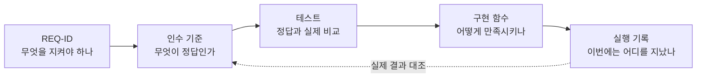
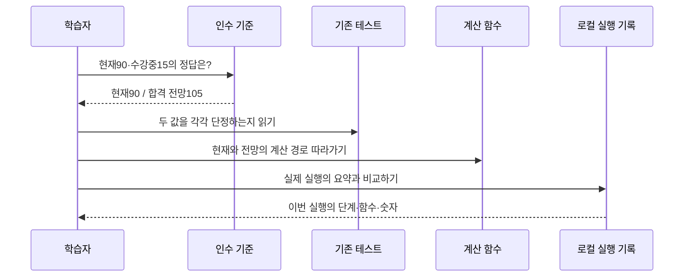
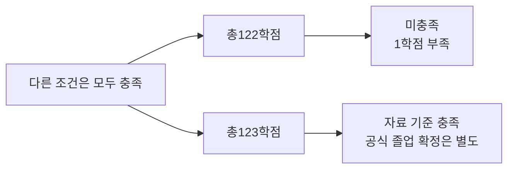
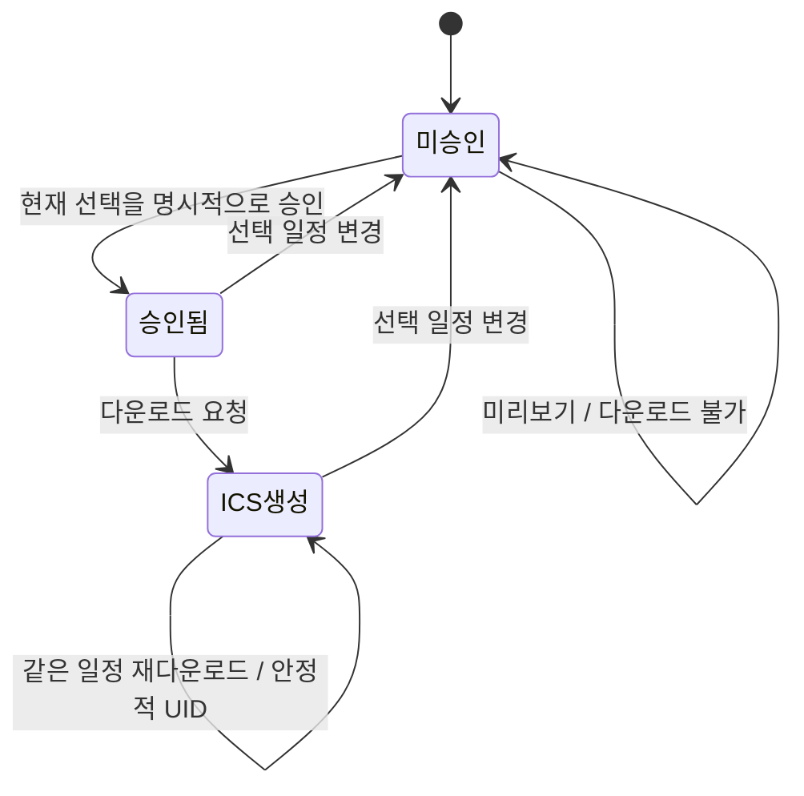
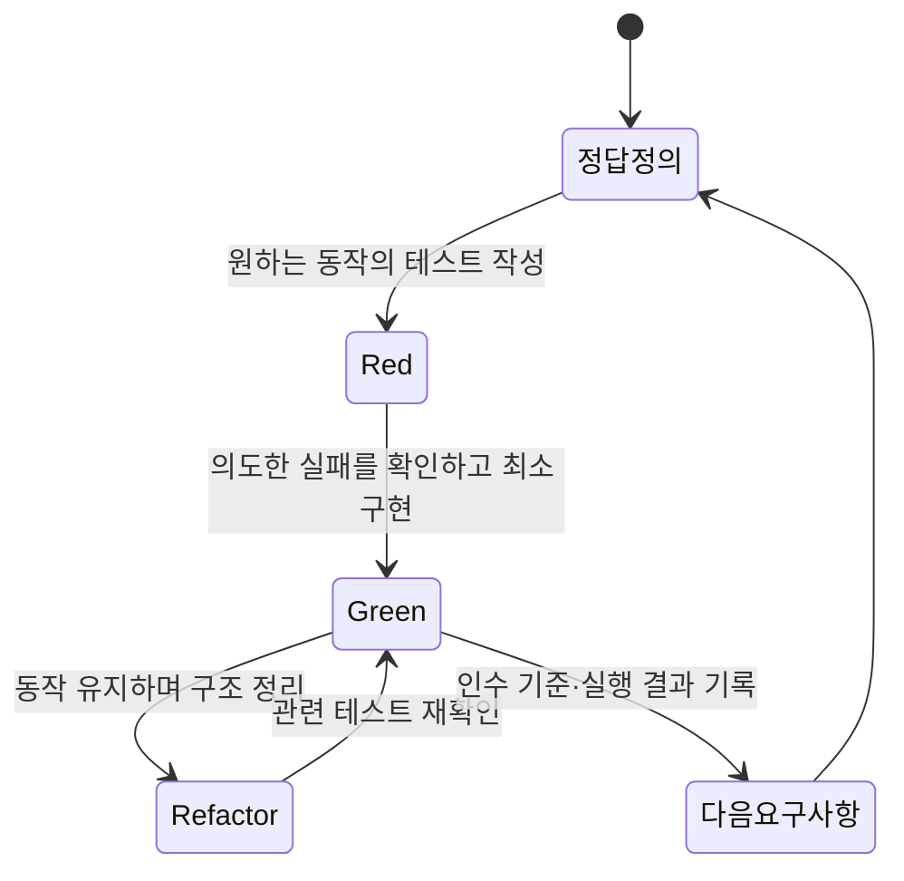
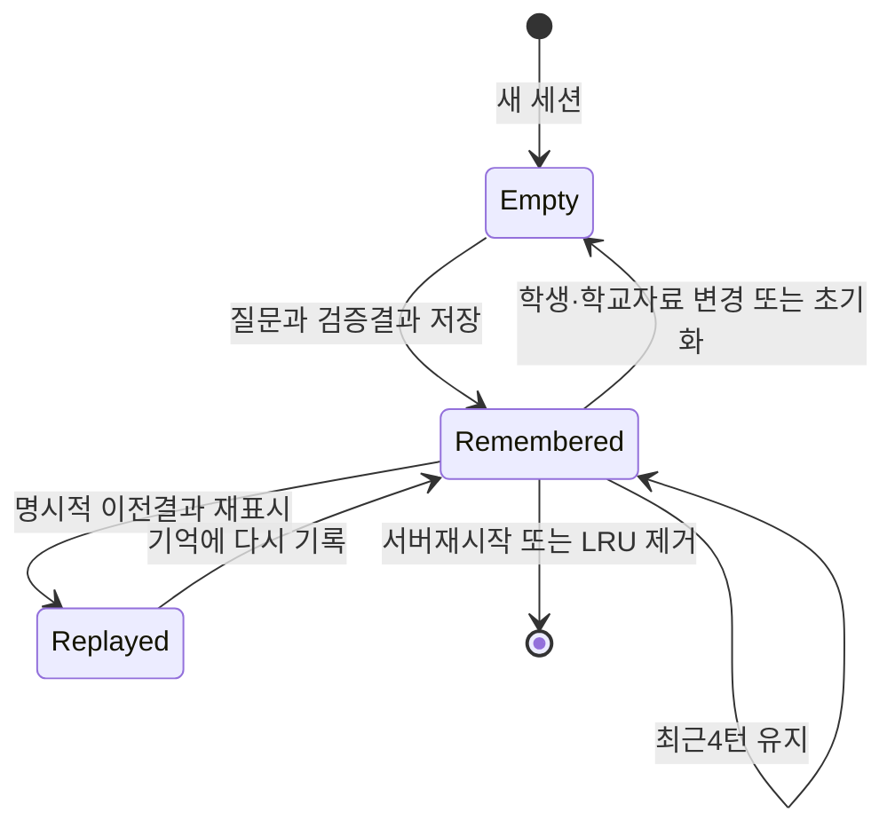

# 요구사항 → 테스트 → 구현 추적표

이 문서는 **현재 구현을 테스트부터 이해하도록 재구성한 학습 자료**다. 기존24개 요구사항의 전체 과거 개발 순서가 TDD였다고 설명하지 않는다. 추가된 REQ-025·026은 이번에 먼저 작성한 실패 테스트와 구현 후 통과 기록을 별도로 남겼다. `REQ-001`부터의 번호는 이번에 붙인 학습·추적 번호이며 개발 날짜나 커밋 순서가 아니다.

앱의 동작을 유지하면서, 요구사항의 정답을 먼저 읽은 뒤 연결된 테스트와 구현을 살펴본다. 새 기능을 만들 때는 별도 학습 공간에서 **실패하는 테스트 → 최소 구현 → 전체 동작을 유지하는 정리**를 실제로 실행하고 결과를 기록한다.



기계가 읽는 원본은 [requirements.json](requirements.json)이다. 각 항목은 `id`, `title`, `basis`, `technique`, `risk`, `acceptance_criteria`, `tests`, `implementation`, `scope_notes`를 가진다. `tests`에는 실제 존재하는 `파일::테스트함수`만 넣었고 매개변수별 실행 ID는 넣지 않았다. `implementation`은 `파일:함수` 또는 `파일:클래스.메서드`다.

이 추적표는 CSTS·ISTQB에서 다루는 명세 기반 테스트 관점을 학습에 활용한 것이다. 공식 인증 심사나 표준 준수 선언은 아니다. 테스트 수, 연결된 요구사항 수, 코드 커버리지, 모든 입력 조합의 검증은 서로 다른 지표다. 한 요구사항에 테스트가 연결되어 있다는 사실만으로 해당 요구사항의 모든 인수 기준이 자동 증명되는 것도 아니다.

## 1. 처음 읽을 순서

**REQ-008 → REQ-005 → REQ-006·007 → REQ-010·012 → REQ-015 → REQ-019 → REQ-020 → REQ-021·022** 순서로 시작하면 질문 하나가 전체 앱에 어떻게 연결되는지 볼 수 있다.

예를 들어 REQ-008에서는 코드를 먼저 보지 말고 “현재90 + 수강중15이면 지금 몇 학점인가?”를 답한다. 정답은 현재90, 모두 합격한 전망105다. 그 다음 [test_independent_scenario_answers](../../tests/test_academic.py)의 `totals`·`projection` 단정을 보고, [check_requirements](../../jolup/academic.py)가 현재 계산과 전망 계산을 두 번 호출하는 부분을 읽는다. 마지막으로 앱의 실행 단계에서 `check_requirements`를 찾아 같은90·105를 확인한다.



## 2. 전체 기능 추적표

아래 표는 탐색용 요약이다. **정확한 테스트 함수 목록·인수 기준·범위 제한은 각 ID에 대응하는 [JSON 항목](requirements.json)을 기준으로 읽는다.** 테스트 파일 링크는 같은 파일의 다른 테스트까지 모두 해당 요구사항의 증거로 간주하라는 뜻이 아니다.

| ID | 먼저 답할 인수 질문 | 관련 테스트 파일 | 구현에서 찾을 함수 |
|---|---|---|---|
| REQ-001 | 다른 학과·학번·편입 기록에도 졸업 판정을 해도 되는가? → 확인 필요 | [학적 범위](../../tests/test_academic_review.py), [CSV 범위](../../tests/test_domain_guard.py) | [academic.py](../../jolup/academic.py) `_profile_issues`, `parse_transcript` |
| REQ-002 | 오류가 있는 CSV 일부만 채택해도 되는가? → 거부, 식별정보 제거 | [파싱](../../tests/test_academic.py), [입력 검토](../../tests/test_academic_review.py), [업로드](../../tests/test_app.py) | [academic.py](../../jolup/academic.py) `_normalize`, `validate_courses`, `parse_transcript` |
| REQ-003 | F·P·미확인 재수강의 counted와 gpa_counted는 어떻게 다른가? | [독립 손계산](../../tests/test_academic_review.py) | [academic.py](../../jolup/academic.py) `_calculate`, `search_scores` |
| REQ-004 | 연속 재수강이 최초 F를 되살리는가? → 원행·승인·누적 한도 검토 후 대체 | [재수강](../../tests/test_academic_review.py) | [academic.py](../../jolup/academic.py) `_review_retake`, `_replace_accepted_attempt`, `_calculate` |
| REQ-005 | 나머지 요건이 같을 때122와123의 결과가 달라지는가? | [학점 경계](../../tests/test_academic_review.py) | [academic.py](../../jolup/academic.py) `_diagnostic_rows`, `check_requirements` |
| REQ-006 | 총123이면 필수과목 한 개가 빠져도 되는가? → 미충족 | [필수과목](../../tests/test_academic_review.py) | [academic.py](../../jolup/academic.py) `_diagnostic_rows` |
| REQ-007 | 남는3학점으로 채플1학기를 대신할 수 있는가? → 불가 | [비학점](../../tests/test_academic_review.py), [더미 정답](../../tests/test_academic.py) | [academic.py](../../jolup/academic.py) `_profile_issues`, `_diagnostic_rows` |
| REQ-008 | 현재90·수강중15이면 지금105인가? → 현재90, 전망105; 미승인 재수강 전망은 확인 필요 | [더미 정답](../../tests/test_academic.py), [전망 경계](../../tests/test_academic_review.py) | [academic.py](../../jolup/academic.py) `_calculate`, `check_requirements` |
| REQ-009 | 검토 근거가 바뀌거나 필수 파일이 목록에서 빠져도 되는가? → 재확인 | [무결성](../../tests/test_domain_guard.py), [캐시](../../tests/test_app.py) | [evidence.py](../../jolup/evidence.py) `validate_rule_bundle` |
| REQ-010 | 희망상한8·최소9 충돌 또는 전망 확인 필요를 성공 계획으로 바꾸는가? → 불가 | [수강 한도·최소](../../tests/test_academic_review.py) | [planner.py](../../jolup/planner.py) `plan_courses`, [course_solver.py](../../jolup/course_solver.py) `choose_courses` |
| REQ-011 | 봄에만 가능한 과목의 공간을 앞 학기에 남기는가? | [개설·순서](../../tests/test_academic_review.py) | [planner.py](../../jolup/planner.py) `search_courses`, [course_solver.py](../../jolup/course_solver.py) `choose_courses` |
| REQ-012 | 2027-1과2027-2 전망이114·123으로 각각 누적되는가? | [누적·원본 보존](../../tests/test_academic_review.py), [학기 표](../../tests/test_app.py) | [planner.py](../../jolup/planner.py) `_semester_projection`, `plan_courses` |
| REQ-013 | 탐색 시간 종료와 불가능한 배치를 구분하는가? | [solver 종료 상태](../../tests/test_academic_review.py) | [course_solver.py](../../jolup/course_solver.py) `choose_courses` |
| REQ-014 | 실제 토큰 한도 안에서 원문을 보존하고 공개 자료만 색인하는가? | [토큰 청크](../../tests/test_chunking.py), [검색·자료 격리](../../tests/test_rag.py), [캐시 전환](../../tests/test_rag_edges.py) | [chunking.py](../../jolup/chunking.py) `TokenChunker.split`; [rag.py](../../jolup/rag.py) `_append_page_chunks`, `build_index`, `search` |
| REQ-015 | 표 머리글·예외 문맥을 함께 읽고 모르는 근거·등록일은 남겨 두는가? | [근거·메타](../../tests/test_rag.py) | [rag.py](../../jolup/rag.py) `KnowledgeBase.answer`, `_grounded_statements` |
| REQ-016 | 공식 모델 통합이 구조화 출력 스키마를 보내고 잘못된 형식을 거절하는가? | [모의 API](../../tests/test_llm.py), [모델 UI](../../tests/test_app.py) | [llm.py](../../jolup/llm.py) `_resolve`, `generate`, `list_available_models` |
| REQ-017 | 모델이 허용 문장 ID를 벗어나거나 필수 조건을 생략할 수 있는가? → 거절·필수 문장 유지 | [문장 선택](../../tests/test_explanation_facts.py), [요약](../../tests/test_llm.py), [분류](../../tests/test_llm_routing.py) | [llm.py](../../jolup/llm.py) `explanation_facts`, `ExplanationSelection`, `explain_result`, `classify_intent` |
| REQ-018 | 실제 Graph·MCP를 지나도 계산·승인 계약이 유지되는가? | [Graph](../../tests/test_agent.py), [실제 MCP](../../tests/test_calendar.py) | [agent.py](../../jolup/agent.py) `build_graph`, `respond`; [mcp_client.py](../../jolup/mcp_client.py) `call_domain` |
| REQ-019 | 네 요소·현재/목표·원문 문맥·평점 반영·전망 경고를 읽을 수 있는가? | [네 요소 화면](../../tests/test_app.py), [문맥·평점·경고](../../tests/test_app_edges.py), [질문 의도](../../tests/test_agent.py) | [agent.py](../../jolup/agent.py) `_diagnose`; [app.py](../../app.py) `_diagnosis_table`, `_sources`, `_render_plan` |
| REQ-020 | 승인 변경은 해제되고, 요청한 연도에 자료가 없으면 빈 결과인가? | [ICS 계약](../../tests/test_calendar.py), [일정 연도](../../tests/test_agent.py), [승인 UI](../../tests/test_app.py) | [calendar.py](../../jolup/calendar.py) `preview_events`, `create_calendar_event` |
| REQ-021 | 앱 단계와 실제 코어 호출을 구분하고 관찰되지 않은 간선을 만들지 않는가? | [Agent 관찰](../../tests/test_study_agent.py), [실제 함수 호출](../../tests/test_profile_study.py), [학습 UI](../../tests/test_app_study.py) | [observability.py](../../jolup/observability.py) `StudyRecorder`, `observe_call`; [profile_study.py](../../scripts/profile_study.py) `CallObserver`, `run_profile` |
| REQ-022 | LangSmith 키 입력만으로 자료가 전송되는가? → 명시 버튼 필요 | [전송 제한](../../tests/test_observability.py), [전송 UI](../../tests/test_app_study.py) | [observability.py](../../jolup/observability.py) `_validated_trace`, `export_study_trace` |
| REQ-023 | 새 자료·세션 초기화 후 예전 대화·키·승인이 남는가? → 제거 | [세션 초기화](../../tests/test_app.py), [관찰 설정 초기화](../../tests/test_app_study.py) | [app.py](../../app.py) `_load`와 최상위 업로드·초기화 실행문 |
| REQ-024 | 공유 ZIP에 비밀값이 들어가거나 필수 자료가 빠지는가? → 허용 목록·해시 확인 | [포장·누락·손상 반례](../../tests/test_release_scripts.py); 실제 ZIP은 별도 확인 | [package_project.py](../../scripts/package_project.py) `selected_files`, `package` |
| REQ-025 | 여러 질문 영역과 최근4턴의 사실을 보존하고 자료 변경 시 무효화하는가? | [혼합·기억](../../tests/test_agent_conversation.py), [화면](../../tests/test_app_conversation.py) | [agent.py](../../jolup/agent.py) `_requested_intents`, `_compose`; [conversation.py](../../jolup/conversation.py) `synchronize`, `replay`, `remember` |
| REQ-026 | local/HTTP 결과·세션·오류 계약을 보존하고 HTTP에서 AI·전송을 끄는가? | [API](../../tests/test_chat_api.py), [client](../../tests/test_chat_client.py), [화면](../../tests/test_app_conversation.py) | [chat_client.py](../../jolup/chat_client.py) `respond_chat`; [study_api.py](../../jolup/study_api.py) `chat`, `_conversation`, `reset_session` |

REQ-001~024 번호는 유지하고 두 요구사항을 추가해 현재 총26개다. 새 API의 테스트 우선 기록은 `reports/practice_chat_api_red.xml`, `practice_chat_client_red.xml`, `practice_postman_red.xml`과 구현 후 `practice_api_green.xml`이다. 전체 프로젝트가 처음부터 TDD로 작성됐다는 뜻은 아니다.

## 3. 동등분할: 입력을 의미가 같은 그룹으로 나누기

REQ-002의 성적표 학점 필드로 시작한다. 한 과목의 `credits`를 정상 숫자, 범위 밖, 유한하지 않은 숫자, 허용 단위가 아닌 숫자, 숫자로 오인하기 쉬운 다른 자료형으로 나눈다. 다른 필드는 정상값으로 고정해야 실패 원인이 학점인지 알 수 있다.

| 분할 | 대표 입력 | 기대 동작 | 연결된 기존 테스트 |
|---|---|---|---|
| 정상 숫자 | `3` | 과목의 상태·성적이 적합하면 계산 가능 | `test_f_and_p_and_zero_credit_rows_have_hand_calculated_gpa` |
| 범위 밖 | `-1` | 확인 필요, 유효한 합계로 사용하지 않음 | `test_invalid_credit_input_is_not_silently_accepted` |
| 유한하지 않음 | `"nan"`, `"Infinity"` | 확인 필요 | 같은 함수의 매개변수 사례 |
| 허용 단위 밖 | `"2.25"` | 확인 필요 | 같은 함수의 매개변수 사례 |
| 다른 자료형 | `True` | 1학점으로 취급하지 않음 | 같은 함수의 매개변수 사례 |

위 함수들은 [test_academic_review.py](../../tests/test_academic_review.py)에 있다. 구현의 0~21·0.5단위 입력 제한은 파일 정규화 계약이다. 학교에서 모든 과목의 학점을 이 범위와 단위로 운영한다는 별도 사실 주장으로 읽지 않는다. 이 표는 대표 분할이며 CSV의 모든 가능한 오류를 열거하지 않는다.

## 4. 경계값: 정답이 바뀌는 지점만 고립하기

REQ-005에서 교필14·교선20·전공63학점, 필수7+2과목, 채플6학기·등록8학기·작품통과, 자료 완전성을 모두 고정한다. 마지막 일반선택 과목의 학점만1 줄인다.

| 총학점 | 다른 요건 | 기대 현재 판정 | 직접 읽을 테스트 |
|---:|---|---|---|
| 122 | 모두 충족 | 미충족, 총학점1 부족 | `test_122_credits_is_one_short_even_when_all_other_areas_pass` |
| 123 | 모두 충족 | 제공 자료 기준 충족 | `test_exact_123_boundary_with_seven_required_general_courses_and_two_design_courses` |

[test_academic_review.py](../../tests/test_academic_review.py)의 `finished_transcript()`는 경계 입력을 만들기 위해14·20·63·123을 독립적으로 고정한다. 테스트의 정답을 제품 계산 함수에서 가져오면 계산기가 잘못된 경우 테스트도 같은 오답을 기대할 수 있다. 그래서 **입력의 손계산 합계와 코드의 실제 결과를 따로 만든다.** 현재 표는122·123 두 점을 보여 준다. 모든 학점 간격이나 영역별 경계의 전체 검증을 뜻하지 않는다.



## 5. 결정표: 총학점만으로 졸업을 판정하지 않기

REQ-005·006·007·009를 하나의 결정표로 읽는다. 아래의 “필수과목”은 **개수와 각 과목의 인정 학점**을 모두 확인한다. 비학점은 채플·등록을 **학기**, 작품심사를 **통과 여부/건**으로 비교한다. 학점·과목·학기·심사 건수를 서로 더하지 않는다.

| 조건/결과 | D1 | D2 | D3 | D4 | D5 | D6 |
|---|---|---|---|---|---|---|
| 적용 범위·자료·검토 근거가 확인됨 | 예 | 예 | 예 | 예 | 예 | 아니오 |
| 총123학점 이상 | 예 | 아니오 | 예 | 예 | 예 | — |
| 교필14·교선20·전공63학점 이상 | 예 | 예 | 아니오 | 예 | 예 | — |
| 필수 교양7·설계2과목을 필요한 학점으로 이수 | 예 | 예 | 예 | 아니오 | 예 | — |
| 채플6학기·등록8학기·작품심사 통과 | 예 | 예 | 예 | 예 | 아니오 | — |
| **현재 판정** | **충족** | **미충족** | **미충족** | **미충족** | **미충족** | **확인 필요** |

`—`는 그 조건과 관계없이 확인 필요가 우선이라는 뜻이다. 실제 `check_requirements()`는 재검토 사유가 있으면 확인 필요, 없으면 모든 진단 행의 충족 여부를 비교한다. D2~D5가 함께 실패하는 복합 사례도 미충족이지만, 이 표는 원인 하나씩을 분리해 읽기 위한 축약표다.

- D1·D2: [test_academic_review.py](../../tests/test_academic_review.py)의123·122 경계 테스트.
- D3: [test_academic.py](../../tests/test_academic.py)의 `test_independent_scenario_answers` 중 전공 부족 더미. 정확한 사례 기대값은 [samples.py](../../jolup/samples.py)와 테스트 입력을 함께 확인한다.
- D4: `test_same_area_credit_total_cannot_replace_a_missing_required_course`와 `test_zero_credit_pass_does_not_fulfil_a_three_credit_required_design_course`.
- D5: `test_noncredit_requirement_cannot_be_paid_for_with_extra_credits`.
- D6: `test_invalid_or_unsupported_profile_never_returns_graduation_pass`, [test_domain_guard.py](../../tests/test_domain_guard.py)의 `test_changed_rules_are_not_treated_as_approved`.

독립 사례를 연결한 학습 결정표이며 모든 조합의 커버리지를 측정한 보고서가 아니다. D1의 충족도 학교가 졸업증명서를 발급했다는 뜻이 아니다.

## 6. 상태전이: 같은 버튼도 앞선 상태에 따라 결과가 달라진다

REQ-020은 “승인 값이 한 번이라도 참이었는가”보다 **현재 선택한 일정에 대한 승인이 있는가**가 중요하다. 일정A를 승인한 뒤 일정B로 바꾸면 다시 승인받아야 한다.



| 이전 상태 | 사건 | 기대 결과 | 기존 테스트 |
|---|---|---|---|
| 미승인 | 생성 함수 호출 | 승인 오류 | [test_calendar.py](../../tests/test_calendar.py) `test_no_export_without_explicit_approval` |
| 현재 일정 승인됨 | 일정 선택 변경 | 승인 해제, 다운로드 차단 | [test_app.py](../../tests/test_app.py) `test_calendar_preview_requires_approval_and_selection_change_resets_it` |
| 승인된 동일 일정 | 재생성 | 안정적인 UID·같은 결과·중복 없음 | [test_calendar.py](../../tests/test_calendar.py) `test_repeat_export_stable_and_no_duplicates` |

다이어그램의 ICS생성은 다운로드 가능한 파일 생성 상태를 뜻한다. 외부 Google Calendar 등록 상태를 뜻하지 않는다. LangSmith도 비슷하게 키 설정, 로컬 기록 생성, 명시 전송, 성공 기록의 중복 방지 상태를 나눠 REQ-022에서 읽을 수 있다.

## 7. 실행 방법과 결과의 해석

프로젝트 루트에서 특정 요구사항의 대표 테스트만 실행한다. 다음은 REQ-005의122 경계 한 개를 실행하는 예다.

```bash
.venv/bin/python -m pytest -q tests/test_academic_review.py::test_122_credits_is_one_short_even_when_all_other_areas_pass
```

REQ-020의 화면 상태전이는 다음으로 확인한다.

```bash
.venv/bin/python -m pytest -q tests/test_app.py::test_calendar_preview_requires_approval_and_selection_change_resets_it
```

여기 적은 명령은 실행 방법이다. **이 추적표를 작성하면서 테스트를 재실행했다는 기록은 아니다.** 실제 실행 날짜·명령·결과는 [검증결과](../검증결과.md)의 원래 기록이나 이번 실습 실행 보고서로 확인한다. 최신 통과 수와 커버리지도 모든 요구사항·입력 조합·자연어 답변의 정확성을 보증하지 않는다.

REQ-014의 벡터 검색 시험은 환경변수 `JOLUP_TEST_VECTOR=1`이 있어야 실제 Chroma·FastEmbed 경로를 검증한다. 기본 lexical 모드 통과를 벡터 검색 통과로 보고하지 않는다. REQ-018의 실제 MCP HTTP 시험은 로컬 포트를 열 권한이 필요하다. REQ-016·022의 모의 HTTP 통과와 실제 OpenAI·Claude·LangSmith 계정 연결 성공도 분리한다.

REQ-024는 임시 프로젝트에서 포장·필수 파일 누락·비어 있지 않은 예제 키·손상된 ZIP을 검사하는 pytest에 연결했다. 이는 실제 전달할 ZIP의 검사를 대신하지 않는다. 현재 작업 폴더의 허용 파일 목록은 다음으로 확인한다.

```bash
.venv/bin/python scripts/package_project.py --check
```

실제 공유 ZIP 생성은 같은 스크립트를 `--check` 없이 실행하면 된다. 생성 함수는 CRC와 MANIFEST의 파일별 SHA-256을 확인한다. 파일 검증과 실제 앱·외부 API 실행 검증은 구분한다. Windows 실기 검증과 시연 영상은 사용자 요청으로 제외하며, 팀원 자료 통합·교수님 수업자료 대조는 자료를 받은 뒤 진행할 후속 작업이다. 실제 값이 든 `.env`의 명시적 별도 전달은 기본 ZIP 제외 정책의 예외다.

## 8. 새 변경에서 실제 TDD로 이어가기

다음 수정부터는 ID를 정하고 기존 인수 기준과 달라지는 점을 먼저 쓴다. 독립적으로 정답을 계산한 실패 테스트를 만들고, 실패 원인이 의도한 미구현 동작인지 확인한다. 필요한 만큼 구현한 뒤 테스트를 통과시키고, 동작을 유지하며 코드를 정리한다. 요구사항·테스트·구현 연결과 실행 결과를 함께 갱신한다.



완성된 코드를 읽으며 기존 테스트부터 거꾸로 학습하는 것과, 새 실패 테스트를 먼저 쓰고 구현하는 것은 서로 다른 활동이다. 이 구분을 유지하면 과거 이력을 꾸미지 않고도 TDD가 설계와 이해에 주는 도움을 직접 경험할 수 있다.


## 8. 혼합 질문과 HTTP 세션 실습

1. `show REQ-025 REQ-026`으로 인수기준을 먼저 읽는다. “졸업 규정과 내 이수 상태, 2026년 성적 일정을 알려줘”에서 세 영역이 모두 남아야 한다.
2. `test_four_turn_memory_replays_evidence_without_search_and_isolated`에서 최근4턴과 세션분리를 읽고 `ConversationMemory`로 내려간다. “아까 진단 다시 보여줘”와 새로운 제한이 붙은 질문을 구분한다.
3. `test_sessions_are_isolated_reused_and_reset_without_history_injection`에서 첫 세션 발급→같은ID→다른ID→삭제를 따라간다. HTTP에 history/result·API키를 넣는 반례도 읽는다.
4. [Postman 21단계](../API_EXPLORER.md)를 실행하면 19번 첫채팅·20번 같은세션 계획·21번 삭제를 볼 수 있다. 로컬 HTTP 실측은 [21요청·60검증](../../reports/postman_validation_20261026.json)이다.



HTTP의 `memory`는 상태 집계다. 영구DB·모델 내부 추론·자유로운 대화 전체 전송으로 해석하지 않는다. 서버의 실행기록은 열람하되 HTTP모드에서 LangSmith 전송을 지원하지 않는다.
