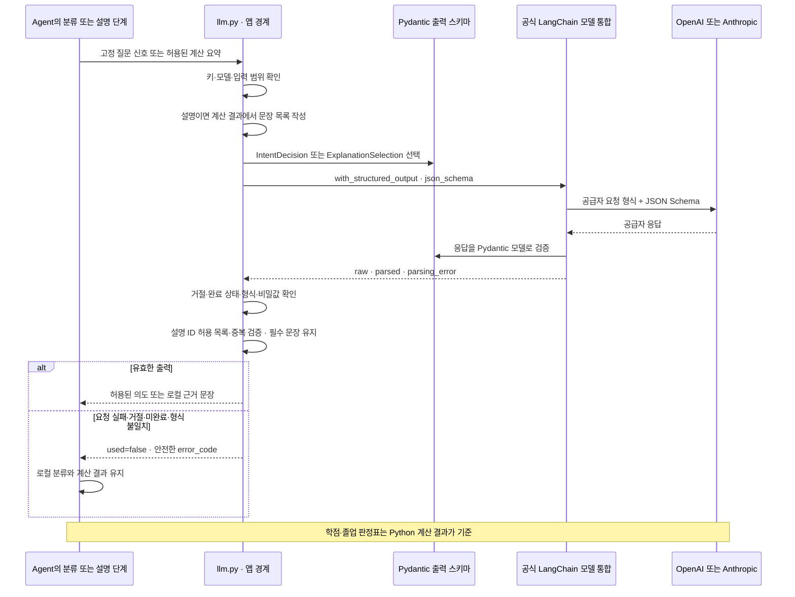
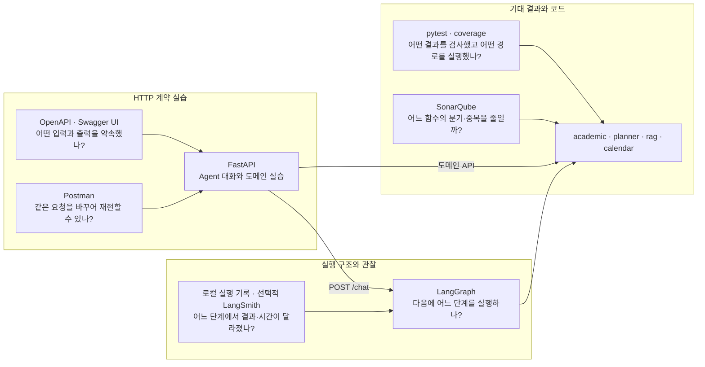
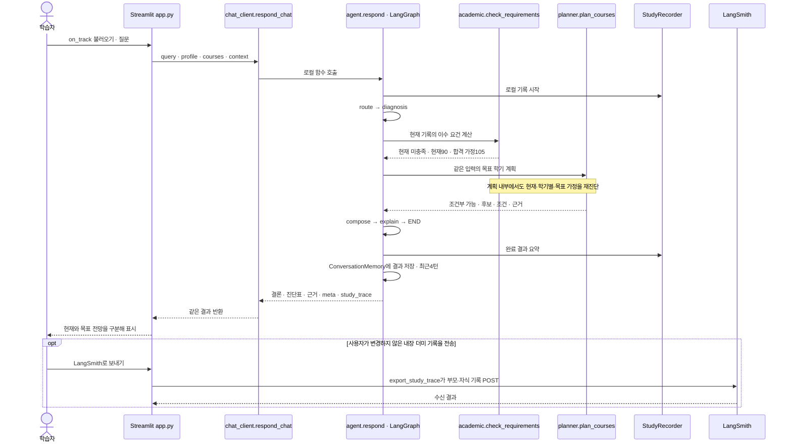
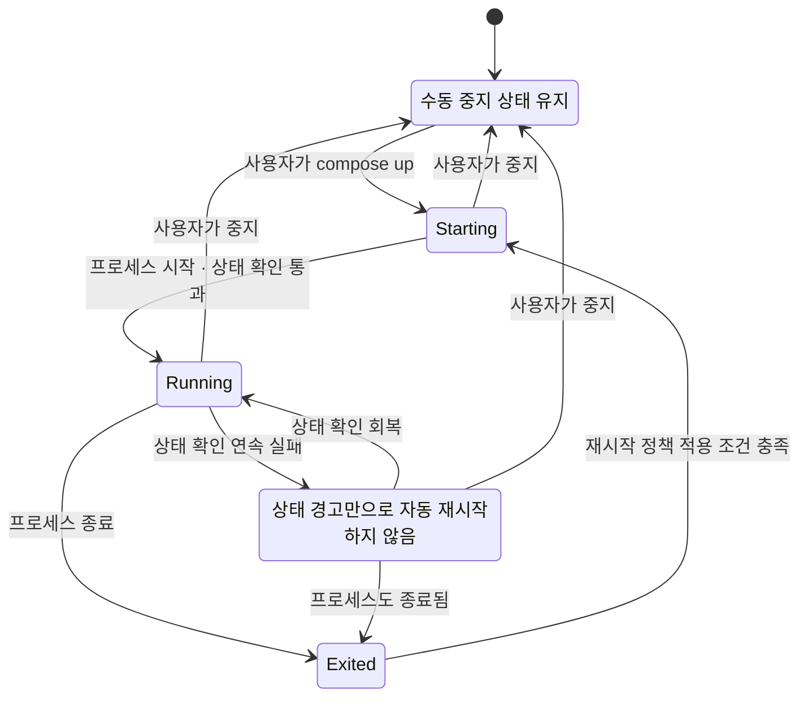

# 개발 도구에서 테스트와 코드까지 따라가는 지도

이 문서는 “도구를 설치했는가?”와 “어떤 문제를 해결하는 데 실제로 사용하는가?”를 구분한다. 코드 연결과 실행 흐름은 2026-10-26 변경을 반영했으며, 측정 결과는 [검증결과](검증결과.md)의 최신 실행 범위를 함께 확인한다. 새 도구를 추가했다고 과거 검사 결과가 새 코드까지 검증하는 것은 아니다.

## 1. LangChain·LangGraph·LangSmith의 실제 적용 범위

| 이름 | 실제 적용 | 코드에서 확인할 곳 | 아직 구현하지 않은 범위 |
|---|---|---|---|
| LangGraph | 적용. `StateGraph`의 순차 조건 분기·합성·재사용 경로를 `invoke(version="v2").value`로 실행 | [agent.py](../jolup/agent.py)의 `build_graph()`·`respond()`, [conversation.py](../jolup/conversation.py)의 `ConversationMemory` | 영구 체크포인트, 중단 후 자동 재개, 자율 도구 반복 |
| LangSmith | 적용. 로컬 단계 기록을 만든 뒤 사용자가 선택한 완료 더미 기록을 명시적으로 전송 | [observability.py](../jolup/observability.py)의 `StudyRecorder`·`observe_call()`·`export_study_trace()` | 모든 사용자 기록의 자동 추적, 자동 평가 데이터셋·정답 판정 |
| LangChain | 적용. 공식 `ChatOpenAI`·`ChatAnthropic` 모델 통합과 Pydantic 구조화 출력 사용 | [requirements.lock](../requirements.lock)의 `langchain-openai==1.7.2`·`langchain-anthropic==1.7.6`, [llm.py](../jolup/llm.py)의 출력 모델·`_chat_model()`·`generate()` | 상위 `langchain` 패키지는 미설치. 자체 RAG를 LangChain retriever로 바꾸거나 `create_agent` 자율 반복을 도입하지 않음 |

설치 이름 `langchain`과 LangChain의 공식 통합 패키지는 구분한다. 현재는 통합 패키지가 실제 공급자 요청·응답 변환을 수행한다. 프로젝트의 `llm.py`는 키·모델 설정, 외부로 보낼 정보, 실패 시 로컬 결과 유지 같은 앱 규칙을 맡는다. 이 분리로 공급자별 JSON 본문과 응답 파서를 직접 유지하는 범위를 줄였다. 모델 통합을 도입했다고 학점 계산까지 AI나 프레임워크에 넘기지는 않는다. [ChatOpenAI 공식 통합](https://docs.langchain.com/oss/python/integrations/chat/openai), [ChatAnthropic 공식 통합](https://docs.langchain.com/oss/python/integrations/chat/anthropic)

### 모델 출력 계약부터 읽는 순서

`IntentDecision`은 `diagnosis`·`planning`·`regulation`·`calendar`·`unsupported` 중 하나를 허용한다. 앱 설명은 `ExplanationSelection.fact_ids`로 로컬 문장 ID만 선택한다. `explanation_facts()`가 계산 결과에서 문장을 만들고 `explain_result()`가 허용 ID·중복 여부를 확인한 뒤 필수 조건과 함께 표시한다. 일반 `generate()`의 기본 `ExplanationOutput.explanation`은 별도 계약이며 앱의 설명 경로에서 자유문장 표시를 허용하지 않는다. 이것이 **출력 스키마와 내용 검증의 분리**다. `with_structured_output`은 이 계약을 모델 호출에 연결하며, 지금 구현은 공급자 고유 JSON Schema 기능을 지정한다. 그냥 “JSON으로 답해”라는 문장만 보내는 방식이 아니다.



그림의 `raw`는 SDK 반환값을 처리 중에 검사한다는 뜻이다. 원문을 저장하거나 LangSmith로 자동 전송한다는 뜻이 아니다. `tracing_context(enabled=False)`와 빈 callback 목록을 적용하고, 재시도·다른 공급자로 자동 전환도 하지 않는다. Anthropic에 HTTP 클라이언트를 주입하는 작은 호환 클래스는 있지만 요청 변환·구조화 출력 파싱은 공식 통합이 담당한다.

| 순서와 확인할 질문 | 먼저 읽을 테스트 | 그다음 코드 |
|---|---|---|
| 1. 허용된 답변 형식은 무엇인가? | [test_llm.py](../tests/test_llm.py)의 `test_provider_schema_mismatch_never_becomes_a_displayed_explanation` | `ExplanationOutput`, `IntentDecision`, `ExplanationSelection`의 타입·필드·`extra="forbid"` |
| 2. 공식 통합이 실제 JSON Schema를 보내는가? | 같은 파일의 `test_common_interface_uses_correct_transport` | `_chat_model()` → `generate()`의 `with_structured_output()` → `invoke()` |
| 3. 모델의 임의 도구 이름이 실행되는가? | [test_llm_routing.py](../tests/test_llm_routing.py)의 `test_unknown_llm_route_cannot_name_or_invoke_arbitrary_tool` | `classify_intent()`와 `IntentDecision.intent` |
| 4. 잘린 응답·거절도 설명으로 표시되는가? | `test_openai_message_completion_and_displayable_blocks` | `_CompletionGuard`·`_output_error()`·`_structured_result()` |
| 5. 이름·성적표 원문·질문 전체가 전송되는가? | `test_private_fields_and_raw_query_are_never_sent_and_result_not_mutated` | `safe_explanation_input()`·`classify_intent()`의 고정 신호 |
| 6. 모델이 현재 판정·위험·조건을 생략하거나 임의 문장을 넣는가? | [test_explanation_facts.py](../tests/test_explanation_facts.py)의 `test_model_cannot_replace_current_result_or_omit_conditional_warning`, `test_unknown_duplicate_or_malformed_fact_selection_is_not_displayed` | `explanation_facts()` → `explain_result()`의 허용 ID 검증·필수 문장 렌더링 |
| 7. 자동 추적이나 재호출이 숨어 있는가? | `test_sdk_owns_its_httpx2_client_and_disables_automatic_tracing`, `test_http_errors_do_not_echo_body_retry_or_follow_redirects` | `generate()`의 추적 설정, `_chat_model()`의 `max_retries=0` |

```bash
.venv/bin/python -m pytest tests/test_llm.py tests/test_llm_routing.py tests/test_explanation_facts.py -q
```

이 실습은 공식 LangChain 통합과 공급자 SDK를 실제로 실행하고, 마지막 HTTP 통신만 모의 응답으로 바꾼다. API 비용 없이 요청 형식·오류·검증을 공부할 수 있지만 계정의 모델 접근 권한이나 실제 생성 품질 검증을 대신하지 않는다. 실제 OpenAI·Claude 호출의 날짜·사례·스키마와 검증 여부는 [검증결과](검증결과.md)의 최신 기록을 따른다. 자유문장 계약 시기의 실호출 기록을 `ExplanationSelection` 변경 이후의 검증으로 간주하지 않는다. 형식 검증 통과도 학교 규정 해석과 계산 자체의 정답을 자동 보증하지 않는다.

LangSmith의 `tracing_context(enabled=False)`는 “LangSmith를 전혀 쓰지 않는다”는 뜻이 아니다. 원본 상태의 자동 전송을 끄고, 완료 후 허용 요약만 별도 전송하는 구현이다. 현재는 학습자가 한 기록씩 비교하기 위해 REST `POST /runs`를 사용한다. 대량 운영 추적에서는 SDK의 배치·백그라운드 전송이 더 적합한지 다시 검토한다. [LangSmith REST 추적](https://docs.langchain.com/langsmith/trace-with-api)

## 2. 도구마다 답하는 질문을 구분한다

아래 화살표는 **관찰·검사 대상**을 뜻한다. 앱의 실행 순서는 다음 절의 시퀀스 다이어그램으로 읽는다. FastAPI Agent·학습 API, Swagger UI, Postman 컬렉션이 같은 계약을 연결한다. 현재 요청·assertion 수와 실제 실행 결과는 [검증결과](검증결과.md)의 최신 기록을 확인한다. Desktop Import와 Postman의 직접 MCP 호출은 미검증이다. 실행법은 [API 실습](API_EXPLORER.md), 최신 코드의 테스트·커버리지 유효 범위는 [검증결과](검증결과.md)를 따른다.



커버리지 100%는 “측정 대상의 모든 줄·분기를 실행했다”는 범위의 지표다. 규정 해석의 정답, 모든 입력 조합, 실제 외부 API 연동 성공을 보증하지 않는다. 줄 커버리지와 분기 커버리지를 구분하고, 숫자를 올리기 위한 제외 설정보다 실제로 빠진 실패·경계 사례를 먼저 읽는다. 현재 수치는 [검증결과](검증결과.md)와 `reports/quality/coverage.json`의 측정 시점·대상 범위를 함께 확인한다.

## 3. 더미 하나를 실제 함수와 연결해서 읽는다

기본 사례 `on_track`의 질문은 “나 졸업 괜찮아?”다. AI 연결을 끄고 먼저 현재 90학점, 수강 중 합격 가정 105학점, 목표까지 조건부 가능이라는 결과를 이해한다. 아래는 `JOLUP_AGENT_API_URL`이 없는 로컬 모드의 진단 경로다.



이 그림은 **로컬 모드에서 AI 연결을 끈 정상 진단 사례**다. 로컬 모드에서 AI를 켜면 `classify_intent()`와 `explain_result()`가 추가될 수 있다. 혼합 질문은 필요한 분야만 `regulation → diagnosis 또는 planning → calendar` 순서로 실행한 뒤 `compose`로 합친다. 매번 모든 분야를 실행하지는 않는다. 기억에 남은 결과를 명시적으로 다시 요청하면 `route → reuse → explain → END`로 반환하며 추가 검색·계산·AI 호출이 없다. 학생 입력이나 학교 자료가 달라지면 재사용하지 않는다. 로컬 기록의 단계 수와 부모·자식 관계를 질문별로 비교한다.

| 이해할 질문 | 먼저 읽을 테스트 | 다음에 읽을 코드 |
|---|---|---|
| 진단·계획·규정·일정 분기는 실제 그래프인가? | [test_agent.py](../tests/test_agent.py)의 `test_actual_langgraph_has_four_domain_branches` | `agent.build_graph()`의 노드·조건부 간선 |
| 혼합 질문의 분야가 빠지거나 계산을 중복 호출하는가? | [test_agent_conversation.py](../tests/test_agent_conversation.py)의 `test_mixed_request_preserves_regulation_diagnosis_and_calendar`, `test_explicit_current_and_plan_calculate_only_once` | `_requested_intents()` → `_domain_node()` → `_compose()` |
| 이전 결과를 재사용해도 되는 조건은 무엇인가? | 같은 파일의 `test_four_turn_memory_replays_evidence_without_search_and_isolated`, `test_actual_source_content_and_profile_change_invalidate_memory` | `ConversationMemory.synchronize()`·`replay()` → `_reuse()` |
| 현재와 목표까지의 준비 상태는 왜 다른가? | [test_agent.py](../tests/test_agent.py)의 `test_readiness_question_explains_target_and_current_but_current_question_leads_with_current` | `agent._diagnose()`와 `academic.check_requirements()` |
| 계획은 원래 성적표를 바꾸는가? | [test_academic_review.py](../tests/test_academic_review.py)의 `test_planning_does_not_mutate_original_student_record` | `planner.plan_courses()`의 가정 장부와 학기별 누적 |
| 기록의 부모·자식 관계는 어느 호출을 뜻하는가? | [test_study_agent.py](../tests/test_study_agent.py)의 `test_real_graph_study_records_nodes_and_nested_calculation_without_changing_results` | `agent._observed_node()`·`_domain_node()` → `observability.observe_call()` |
| 키 없이도 실행 과정을 공부할 수 있는가? | [test_study_agent.py](../tests/test_study_agent.py)의 `test_local_study_does_not_require_export_permission_or_api_key` | `StudyRecorder.activate()`·`finish()` |
| 내보내기는 실제 HTTP 계약을 지키는가? | [test_observability.py](../tests/test_observability.py)의 `test_explicit_export_posts_complete_root_and_children_once` | `export_study_trace()` → `_export_payloads()`·`_send_export_payloads()` |
| 검색이 진짜 벡터 결과와 출처를 포함하는가? | [test_rag.py](../tests/test_rag.py)의 `test_retrieval_contains_ranked_real_vector_results` | `KnowledgeBase.search()`·`answer()` |
| 일정 승인이 없으면 어떤 결과인가? | [test_calendar.py](../tests/test_calendar.py)의 `test_no_export_without_explicit_approval` | `calendar.create_calendar_event()` |

한 번에 모든 파일을 읽지 않는다. 표의 한 행을 선택해 입력 → `assert` → 실제 함수 → 로컬 실행 기록 순서로 읽는다. 일반 pytest에서 RAG의 벡터 경로가 항상 실행되는 것은 아니므로 실제 벡터 검증 여부는 전체 검사 도구의 `--vector` 실행 기록을 확인한다.

## 4. Python에서도 목적별 프레임워크를 고른다

Spring은 애플리케이션 프레임워크이고 Swagger는 API 명세·문서 도구 계열이다. 같은 분류의 제품이 아니며 Swagger는 Node.js 전용도 아니다. Python에서는 UI·API·에이전트·프로세스 관리의 목적을 나눠 본다.

| 목적 | 현재 구조 또는 추가 연결 | 적용 판단 |
|---|---|---|
| 데이터·AI 화면 | Streamlit의 `app.py` | 이미 적용. 더미 선택·CSV·진단표·대화 학습 화면에 사용 |
| 화면과 Agent를 잇는 HTTP API | FastAPI·Pydantic·Uvicorn의 `jolup.study_api` | 적용. `/chat`이 Agent를 실행하고, 도메인 API는 계산·검색을 직접 위임. 입력 계약·OpenAPI 생성 |
| API 문서와 요청 실습 | Swagger UI 적용·Postman CLI 실행 완료 | 같은 API 계약의 명세와 사례를 연결. Desktop Import와 Postman 직접 MCP 호출은 미검증. 기능상 둘 다 필수인 것은 아니지만 이번 학습 목적에 각각 사용 |
| MCP 도구 인터페이스 | `mcp.server.fastmcp.FastMCP` | 이미 적용. AI 클라이언트의 도구 목록·호출 계약 유지 |
| 에이전트 단계 | LangGraph | 이미 적용. 명시적 분기와 유한한 실행 순서 |
| 과목 선택 제약 | SciPy MILP | 이미 적용. 학점·선수과목·중복·학기 배치의 제약 계산 |
| 웹사이트 전체·관리자·ORM | Django 등 | 현재 요구에는 추가하지 않음. 기존 화면·API에 별도 데이터 관리 요구가 생길 때 검토 |

FastAPI는 타입을 바탕으로 입력을 검증하고 OpenAPI 및 Swagger UI 문서를 제공한다. 현재는 기존 Agent와 계산 함수를 재사용하면서 HTTP 요청과 세션의 경계를 담당한다. Streamlit은 화면을 맡고 FastAPI는 `/chat` 및 도메인 API를 제공한다. [FastAPI 공식 기능](https://fastapi.tiangolo.com/features/), [Streamlit 공식 소개](https://docs.streamlit.io/)

[study_api.py](../jolup/study_api.py)의 제공 경로는 `POST /chat`, `DELETE /sessions/{session_id}`, `GET /health`, `GET /samples`, `GET /samples/{sample_id}`, `GET /events`, `POST /diagnosis`, `POST /plans`, `POST /regulations`, `POST /calendar/ics`다. Swagger UI는 `/docs`, 원본 OpenAPI 명세는 `/openapi.json`에 있다. `/health` 성공은 API 프로세스가 응답한다는 뜻이며, 외부 MCP나 RAG 인덱스까지 준비됐다는 보증은 아니다.

프로젝트 루트에서 `.venv/bin/python -m jolup.study_api`로 시작하면 기본 주소는 `http://127.0.0.1:8001`이다. `/diagnosis`·`/plans` 같은 도메인 API는 `call_domain()`으로 위임하고, `/chat`은 `agent.respond()`를 통해 LangGraph를 실행한다. HTTP `/chat`은 `use_llm=False`로 고정되므로 외부 LLM은 호출하지 않는다. [chat_client.py](../jolup/chat_client.py)의 `respond_chat()`은 `JOLUP_AGENT_API_URL`이 있으면 HTTP, 없으면 로컬 함수를 사용한다. HTTP 실패를 조용히 로컬 성공으로 바꾸지 않는다.

HTTP 요청에는 질문·학생 입력·선택적 `session_id`를 담으며, API키·로컬 메모리 객체·임의 과거 답변은 담지 않는다. API는 세션별 최근 4턴을 프로세스 메모리에 보관하고 최대 64세션을 유지한다. 초기화·재시작·세션 퇴출 시 사라지며 영구 저장소는 없다. [test_chat_api.py](../tests/test_chat_api.py)의 `test_sessions_are_isolated_reused_and_reset_without_history_injection`과 [test_chat_client.py](../tests/test_chat_client.py)의 `test_http_adapter_sends_only_declared_fields_and_keeps_result_details`부터 읽으면 경계가 보인다. 도메인 계약은 [test_study_api.py](../tests/test_study_api.py), Swagger·Postman 실행 순서는 [API 실습](API_EXPLORER.md)으로 이어진다.

### AppMap을 검토한 목적은 로컬 함수 분석으로 먼저 구현한다

현재 AppMap 패키지는 도입하지 않았다. 함수 호출 관계에는 Python3.12 표준 `sys.monitoring`, 시간 통계에는 `cProfile`을 사용하는 [profile_study.py](../scripts/profile_study.py)를 추가했다. 내장 더미로 계산·계획 함수를 직접 실행하고 `reports/profile_study/`에 JSON·Markdown을 만든다. Markdown에는 **`sys.monitoring` 이벤트로 실제 관찰한 코어 함수 호출 관계의 Mermaid Flowchart**와 별도의 `cProfile` 시간 표가 포함된다. `entry_observed`는 실제 진입 관찰이며 `timing_entry_observed`는 시간 통계에 진입 함수가 있는지를 뜻한다. 시간 통계가 누락돼도 호출 관계를 추정으로 채우거나 지우지 않는다. 도입 판단과 실제 측정 읽기는 [AppMap 검토·로컬 분석](APPMAP.md)에서 이어간다.

```bash
.venv/bin/python scripts/profile_study.py --action calculate --sample on_track
.venv/bin/python scripts/profile_study.py --action plan --sample on_track
```

`self_ms`는 함수 자체 시간, `cumulative_ms`는 하위 호출을 포함한 시간이다. 부모와 자식의 cumulative를 더하면 중복 집계되므로 합산하지 않는다. 이 도구는 준비 실행 1회 뒤 1회 측정한다. 호출 관찰은 현재 스레드의 허용된 코어 파일을 대상으로 하고 인수·반환값은 기록하지 않는다. 시간 통계는 선택한 상위 항목을 보여 준다. 호출 그래프는 집계이며 시간순 실행 시퀀스·모든 Python 함수·모든 스레드·네트워크 분산 추적이 아니다. [test_profile_study.py](../tests/test_profile_study.py)에서 관찰된 간선만 보존하고 실패 시 monitoring 슬롯을 반환하는 테스트를 읽는다. 단계 간 흐름은 기존 LangSmith/로컬 기록, 함수 내부 호출 관계는 이 보고서로 나눠 읽는다. [Python 3.12 cProfile 공식 문서](https://docs.python.org/3.12/library/profile.html)

## 5. PM2와 비슷한 운영 목적은 현재 Docker 설정으로 처리한다

[compose.yaml](../compose.yaml)의 기본 서비스는 `app`·`api`·`mcp`·`chroma`이며 모두 `restart: unless-stopped`다. `api`는 선택 프로필이 아니라 Streamlit 대화를 받는 기본 서비스다. 앱은 API와 MCP의 상태 확인을 기다리고, API는 MCP의 상태 확인을 기다린다. Chroma에는 별도 Compose `healthcheck`가 없고 MCP 상태 확인 과정에서 Chroma heartbeat를 확인한다. 최신 이미지 실행과 HTTP 통합 검증 범위는 [검증결과](검증결과.md)에서 확인한다.

아래 그림은 **Docker에서 상태 확인이 있는 컨테이너의 단순화한 수명주기**다. 로컬 `.command` 실행에는 이 자동 재시작 정책이 적용되지 않는다.



`healthcheck`는 상태를 표시하는 검사다. **unhealthy 표시만 생겼다고 `restart: unless-stopped`가 자동으로 다시 시작하는 것은 아니다.** 재시작 정책은 컨테이너 종료와 Docker 재시작 등에 적용되며, 수동 중지는 존중한다. Docker가 실행 중이어야 하고 재시작 정책의 적용 조건도 충족해야 한다. [Docker 재시작 정책](https://docs.docker.com/engine/containers/start-containers-automatically/)

컨테이너 안에 Supervisor 같은 프로세스 관리자를 더 넣으면 누가 재시작을 책임지는지 경로가 늘어난다. 현재는 Docker가 그 역할을 맡도록 유지한다. 추후 Docker 없이 서버에서 계속 운영할 요구가 생기면 해당 운영체제의 서비스 관리자 등을 따로 선택한다. Uvicorn의 개발용 `--reload` 역시 PM2의 운영 감시·복구 전체를 대신하는 기능이라고 설명하지 않는다.

## 6. Mermaid는 학습 질문에 맞는 곳에 적용한다

역할·순서·상태·집합·수치 비교처럼 읽으려는 질문에 따라 다이어그램을 고른다. 문서 개수나 그림 개수 자체가 이해도와 정확성을 보증하지 않는다. 현재 Mermaid 렌더링 검증 결과와 사용한 뷰어는 [검증결과](검증결과.md)의 최신 기록을 확인한다.

| 학습 질문 | 적합한 유형 | 기존 자료 |
|---|---|---|
| 담당·문서 역할을 크게 이해하기 | Mindmap | [프로젝트 구조도](프로젝트_구조도.md), [학습 가이드](학습_가이드.md) |
| 실제 파일 위치 찾기 | TreeView | [프로젝트 구조도](프로젝트_구조도.md)의 상세 파일 트리 |
| 서비스·데이터·선택 관계 이해하기 | Flowchart·Block | [아키텍처 의사결정](아키텍처_의사결정.md), 이 문서 2절 |
| 어떤 함수가 언제 호출되는가 | Sequence | 이 문서 3절, [LangSmith](LANGSMITH.md), [청크 점검](청크_품질점검.md) |
| 상태가 언제 바뀌는가 | State diagram | 이 문서 5절, [TDD 가이드](TDD_학습가이드.md) |
| 요건 교집합·학점 구성·미래 전망 | Venn·Pie·XY chart | [학습 가이드](학습_가이드.md)의 4~6단계 |

소스→테스트의 정확한 이름, 설치 명령, 환경변수 목록, 수치 측정 결과는 **표·코드 블록·실제 로그가 더 잘 맞는다.** 이런 부분까지 그림으로 바꾸면 이름을 복사하거나 값의 차이를 확인하기 어려워진다. “도움이 되는 모든 곳”을 객관적으로 완결할 수는 없지만, 현재의 구조·분기·순서·상태·집합·비교 질문에는 대응하는 그림이 있다. 앞으로 실제 API 계약·실행 분석 흐름이 바뀌면 그 변화에 필요한 그림과 코드 링크만 갱신한다.

TreeView의 대비 문제와 최신 Mermaid 문법의 뷰어 지원은 별도 확인 대상이다. [검증결과](검증결과.md)에 기록한 실제 렌더링 대상·성공·미검증 뷰어 범위를 구분한다. 다이어그램 소스를 추가한 것만으로 모든 뷰어 검증을 마쳤다고 보지 않는다. 코드 블록 안의 이름을 실제 파일·함수와 대조할 수 있어야 그림이 학습에 도움이 된다.
