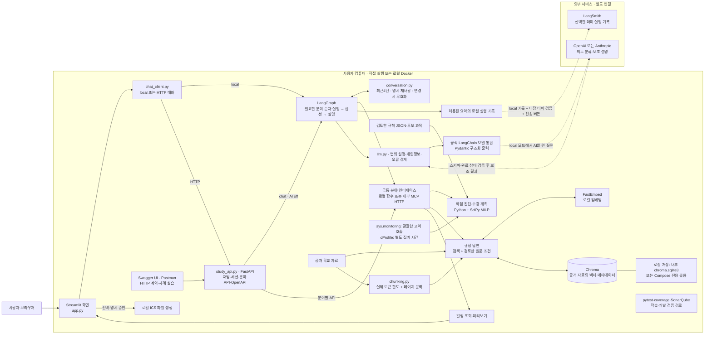
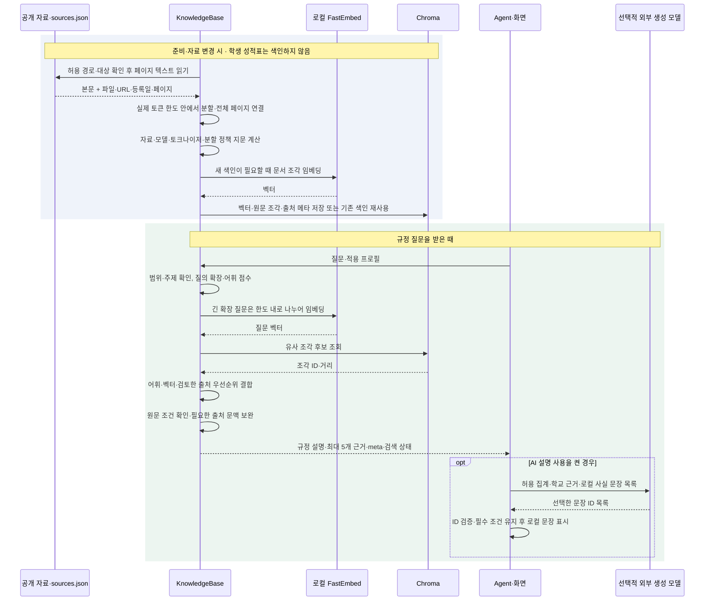
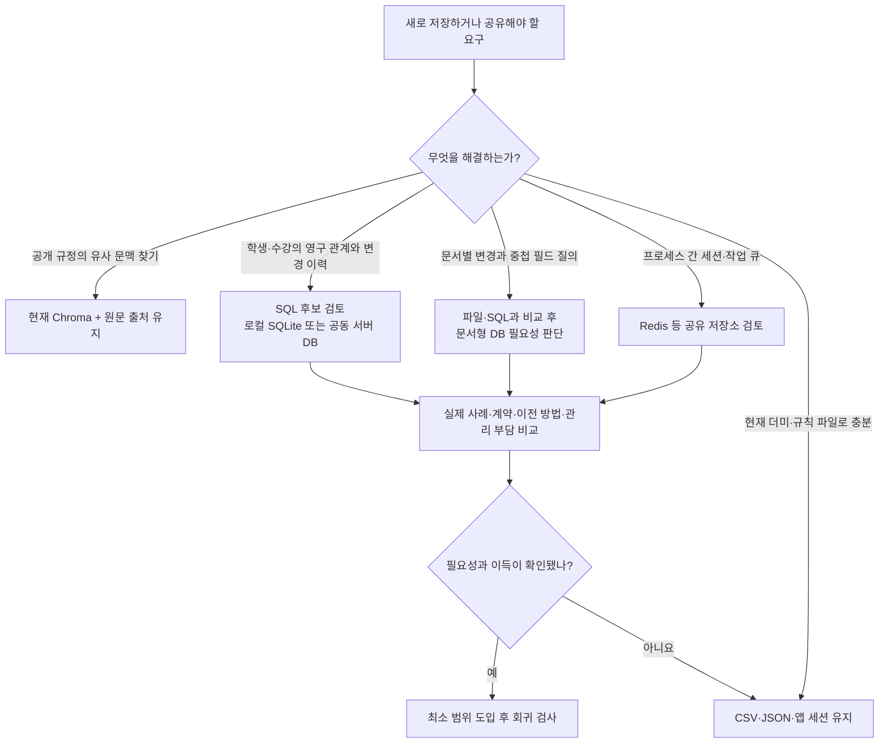
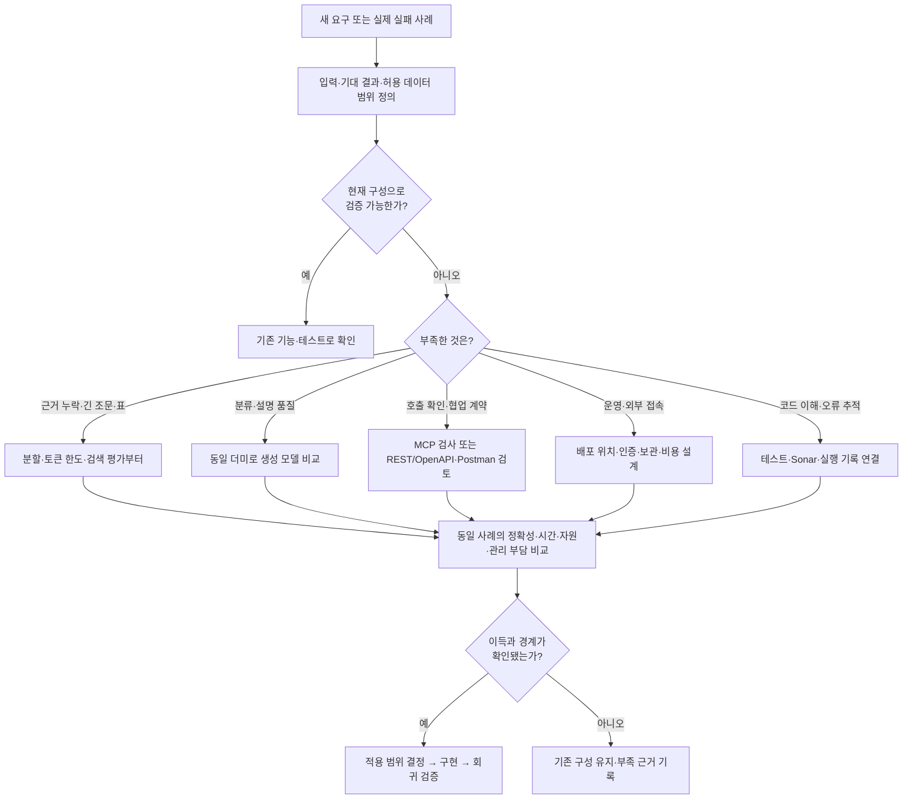

# 졸업로드맵 아키텍처와 선택 근거

이 앱은 **로컬에서 학사 규칙을 계산하고 공개 자료를 검색하며, 선택한 경우에만 외부 AI로 분류와 설명을 보완**한다. API 키 없이도 핵심 진단·수강 계획·규정 검색·일정 파일 생성이 가능하다. 클라우드에 앱을 배포한 상태는 아니다.

이 기록은 **2026-10-23의 판단과 개선을 2026-10-26 현재 코드에 맞춰 정리한 의사결정 기록**이다. 처음부터 모든 대안을 비교해 승인한 공식 의사결정 기록이 아니다. 구현 사실과 검증 상태는 코드·시험 기록을 따르고, 아래 선택 이유와 재검토 조건은 지금 구조를 이해하고 다음 변경을 판단하기 위한 설명이다. 공급자·모델 간 품질 비교 실험은 하지 않았으므로 현재 선택을 ‘최적’이라고 부르지 않는다.

적용 범위는 성결대학교 2024학번 컴퓨터공학과·일반 신입학·전공심화·공학인증 제외다. 학생 프로필과 성적표는 더미이며, 현재 충족 여부와 목표 학기까지의 조건부 전망을 구분한다.

교수 이론 PDF10개 버전·351쪽, PPT 양식2개와 실습 ZIP9개의 대조는 [수업자료 반영표](수업자료_반영대조표.md)·[실습 코드 비교](실습코드_비교보고서.md)에 정리했다. 그 비교로 혼합 질문·단기 결과 메모리·HTTP 채팅 경계를 보완했다. 수업의 모든 기술을 복제했다는 뜻은 아니며 팀원 산출물은 아직 자료 대기다. 기존17장 기획안과 새14장 결과 발표자료도 구분한다.

## 1. 무엇이 어디에서 실행되는가

그림의 실선은 로컬 기능 연결, 점선은 외부 전송 경계다. 최초 설치의 패키지·임베딩 모델 다운로드는 별도로 필요하다. SonarQube는 실행 중인 질문을 처리하는 구성 요소가 아니라 코드를 분석하는 개발 도구다.

| 실행 방식 | 실제 위치와 연결 | 현재 확인한 범위 |
|---|---|---|
| Python 직접 실행 | 브라우저 → 로컬 Streamlit → 공통 채팅 클라이언트 → LangGraph → 같은 프로세스의 분야 함수. Chroma는 `PersistentClient`로 `data/index/chroma/`에 저장 | 실제 벡터 검색·MCP HTTP 검사 기록 있음. 최신 전체 실행·커버리지 범위는 [검증결과](검증결과.md) 확인 |
| Agent·학습 HTTP API | Streamlit 채팅 또는 Swagger·Postman → FastAPI 기본 `127.0.0.1:8001`. `/chat`은 LangGraph, 분야 API는 `call_domain()`을 호출 | 최신 Postman CLI 21요청·60 assertions 통과(로컬 HTTP·lexical·AI off). Desktop Import·직접 MCP 호출과 구분. HTTP 생성AI·LangSmith 전송 없음 |
| Docker Compose | 기본 `app`·`api`·`mcp`·`chroma` 4컨테이너. 채팅은 내부 `http://api:8001`을 사용하고 API는 루프백 8001로도 노출. MCP·Chroma는 내부 연결 | 10/22 Linux arm64의 3서비스 실행 기록 있음. 새 4서비스 YAML 정적 검증과 아직 완료하지 못한 새 이미지 실제 실행은 구분하며 최신 상태는 [검증결과](검증결과.md) 확인 |
| 외부 API 사용 | 앱은 로컬에 남고 선택한 요청만 OpenAI·Anthropic 또는 LangSmith로 전송 | OpenAI·LangSmith의 실제 시험 기록 있음. Claude는 모의 검증 |
| 클라우드 앱 배포 | 원격 서버에 앱·저장소·접속 관리 배치 | 미구현·미배포. Docker 파일의 존재가 클라우드 배포 완료를 뜻하지 않음 |

[compose.yaml](../compose.yaml)은 앱 실행 묶음이고 [compose.quality.yaml](../compose.quality.yaml)은 로컬 SonarQube 분석 묶음이다. 전자는 재현 가능한 실행 환경을 포장한다. 어느 컴퓨터에서 실행할지는 별도 결정이다. 외부 공개 서비스로 바꾸려면 사용자 인증·학생 자료 보관·비밀값 관리·접속 경계를 다시 설계해야 한다.

## 2. 현재 선택과 대안

다음 표의 ‘이유’는 현재의 좁은 학사 범위, 짧은 개발 일정, GitHub 없이 로컬에서 취합하는 팀 방식, 테스트부터 읽는 학습 목적에 대한 판단이다. 실제 검증은 다음 절에서 따로 연결한다.

| 결정 | 현재 선택과 대안 | 현재 선택의 이유 | 비용·한계와 다시 선택할 조건 |
|---|---|---|---|
| D01 화면 | Streamlit. 대안: 별도 웹 프런트엔드·REST 서버 | Python 계산과 업로드·표·더미 시연을 한 프로젝트에서 연결 | 세션 중심 화면. 다중 사용자 권한·복잡한 UX·공개 운영이 필요하면 분리 검토 |
| D02 생성 모델 | 선택적 외부 API, 공통 `generate()` 아래 공식 LangChain OpenAI·Anthropic 통합. 대안: 자체 호스팅 생성 모델·단일 공급자 고정 | 짧은 일정에 생성 서버·GPU 운영 부담을 더하지 않고 사용 가능한 OpenAI 계정으로 시험한 경험을 활용. 공통 인터페이스로 공급자 설정 교체 | 인터넷·계정 권한·API 비용 필요. 과거 직접 호출의 성공을 새 통합의 실호출 검증으로 간주하지 않음. 외부 전송 금지·완전 오프라인·대규모 호출 요구가 생기면 자체 호스팅과 비교 |
| D03 임베딩 | 로컬 FastEmbed의 `sentence-transformers/paraphrase-multilingual-MiniLM-L12-v2`, 384차원. 대안: 다른 한국어·다국어 모델, 외부 임베딩 API | 공개 학교 자료의 색인·질의를 생성 API 키 없이 수행하고 로컬 재사용 | 최초 모델 다운로드와 CPU·메모리 비용. 토큰 길이·한국어 검색 품질을 평가해 긴 규정·표 검색에서 부족하면 교체 |
| D04 문서 분할 | 실제 임베딩 토크나이저의 128토큰 한도 안에서 페이지별 분할, `context_id`로 전체 페이지 연결. 대안: 조문·표 구조를 별도 추출하는 분할 | 실제 입력 잘림을 없애고 작은 검색 발췌와 읽을 때 필요한 표 머리글·예외 문맥을 함께 제공 | 여러 페이지의 표 의미를 자동 복원하지 않음. 새 자료에서 페이지 문맥만으로 부족하면 조문·표 단위 추출을 추가하고 동일 정답셋으로 비교 |
| D05 저장·검색 | Chroma + 어휘·벡터 점수 결합 + 검토한 주제·출처 우선순위. 대안: 어휘 검색만, 관계형 DB 검색, 다른 벡터 저장소 | 로컬 파일 저장과 Compose HTTP를 같은 코드로 전환하고 페이지 메타를 반환 | 수작업 주제 규칙이 포함되어 범위 확장 시 관리 필요. 대규모·동시성·권한 분리 요구가 생기면 저장소 비교 |
| D06 실행 흐름·메모리 | LangGraph로 요청 목적 수집 → 필요한 분야 순차 실행 → 합성 → 설명. 명시 재요청은 최근4턴 결과 재사용. 대안: 일반 분기·자율 ReAct·영구 checkpoint | 수업 Add-on step3의 예측 가능한 워크플로우 방향을 적용하고 학사 계산 책임·변경 무효화·종료를 시험하기 쉬움 | 관찰 후 LLM의 자율 재선택·반복 검색·전체 대화의 임의 문맥 추론은 없음. 최근4턴은 프로세스 메모리이며 새 입력/학교 자료 변경 때 무효화 |
| D07 학사 판정·계획 | Python 규칙 계산 + SciPy MILP 후보 배치 + 결과 재검증. 대안: LLM 판정·단순 순차 배치 | 학점·재수강·학기 상한을 기대 정답과 비교하고 현재·예상을 분리 | 규칙 JSON과 공개 과목 후보를 사람이 검토해야 함. 미래 시간표·여석은 보장하지 않으며 실제 자료가 생기면 제약 확장 |
| D08 모듈 연결·HTTP | `chat_client.respond_chat()`의 local/HTTP 계약, FastAPI `/chat`·세션 삭제·분야 API, `call_domain()`의 로컬/MCP 전환 | 수업의 UI→API→Agent 경계를 실제 연결하면서 기존 계산·검색 함수를 재사용 | HTTP는 생성AI off, 최대64개 메모리 세션, LangSmith 전송 없음. MCP는 요청마다 연결하며 수업 lifespan 영구 연결과 다름. Postman의 직접 MCP 호출 검증은 아님 |
| D09 일정 | 출처 있는 일정 미리보기 → 승인 → ICS 생성. 대안: Google/Outlook 계정에 직접 등록 | 파일로 결과를 확인하고 사용자가 가져오기 여부를 결정 | 현재 자동 일정 등록·계정 동기화는 없음. 직접 등록이 요구될 때 권한·중복·취소·재시도 정책 추가 |
| D10 실행 관찰 | 로컬 요약 기록, 선택적 LangSmith 전송. 대안: 자동 전체 상태 추적·로컬 기록만 | 입력 원문·키와 단계 학습 기록을 분리하면서 실행 흐름을 관찰 | 외부 계정·별도 키·서비스 정책 필요. 자동 평가 데이터셋이나 운영 모니터링은 별도 과제 |
| D11 품질·학습 | pytest·coverage·로컬 Docker SonarQube, 테스트→코드 학습 자료, 내장 더미의 `sys.monitoring` 호출 관찰과 cProfile 시간 분석. 대안: 테스트만·AppMap·클라우드 코드 검토 | 정답 계약, 미실행 분기, 복잡한 함수, 실제 관찰된 코어 호출·집계 시간을 서로 연결 | Sonar 운영과 계측 유지가 필요. 호출 관찰은 선택한 코어 파일·호출 스레드에 한정되고 cProfile 집계 시간과 구분. 전체 시간순 실행이나 학사 정답 보증이 아님 |
| D12 협업·배포 | 공유 ZIP·담당 파일 취합·로컬 실행. 대안: Git PR·클라우드 배포 | 현재 팀의 GitHub 미사용 조건을 충족 | 동시 수정 충돌을 수동 비교. 반복 통합 부담이 커지면 팀이 사용할 수 있는 버전 관리부터 재선택 |
| D13 모델 호출·출력 계약 | `ChatOpenAI`·`ChatAnthropic` 공식 통합, `with_structured_output(method="json_schema")`, Pydantic 출력 모델. 대안: 직접 HTTP 본문·응답 파서 유지, 프롬프트만으로 JSON 요청 | 공급자 변환을 공식 통합에 맡기고 앱에서는 허용 필드·거절·미완료·실패 처리를 읽도록 책임을 나눔. `IntentDecision`의 허용 의도와 `ExplanationSelection`의 문장 ID만 모델에서 받아 로컬 계산 문장을 표시 | 통합·SDK 버전 의존성과 작은 HTTP 호환 계층이 필요. 해당 모델이 native JSON Schema를 지원하지 않거나 형식이 틀리면 로컬 결과를 유지하며, 다른 모델로 몰래 우회하지 않음 |

**생성 모델과 임베딩 모델은 다른 계층이다.** 생성 모델은 분류·문장 설명을 맡고, 임베딩 모델은 자료와 질문을 검색용 벡터로 바꾼다. 임베딩을 로컬에서 돌리는 것은 자체 구축 대화 LLM을 운영한다는 뜻이 아니다. OpenAI로 설명을 생성한다고 OpenAI 임베딩을 사용해야 하는 것은 아니다. 현재 `text-embedding-3-small`·`text-embedding-3-large` 호출은 없으며, 이 모델들과의 비교 우월성도 검증하지 않았다.

`JOLUP_EMBED_MODEL`은 현재 FastEmbed가 지원하는 모델명을 바꾸는 설정이다. 이 값만 OpenAI 모델명으로 바꾸면 OpenAI 임베딩이 연결되는 것은 아니다. 외부 임베딩을 도입하려면 별도 API 어댑터를 만들고 문서·질의에 같은 모델을 적용하여 전체 색인을 다시 만들어야 한다. 차원 수가 같아도 서로 다른 모델의 벡터를 섞지 않는다. [FastEmbed 안내](https://qdrant.github.io/fastembed/Getting%20Started/), [OpenAI 임베딩 안내](https://developers.openai.com/api/docs/guides/embeddings)

현재 선택의 384차원은 검색 벡터의 길이다. 입력 길이와 다른 값이며, 해당 모델의 설정은 최대 128토큰이다. 캐시한 모델을 오프라인으로 확인한 실제 FastEmbed 토크나이저도 `max_length=128`, 오른쪽 잘림, `stride=0`이었다. Chroma의 `PersistentClient`는 로컬 저장, `HttpClient`는 서버 연결이며 클라우드 서비스 연결과 자동으로 같아지지 않는다. [모델 설정](https://huggingface.co/sentence-transformers/paraphrase-multilingual-MiniLM-L12-v2), [Chroma 클라이언트](https://docs.trychroma.com/reference/python/client)

LangChain은 공식 통합 패키지 `langchain-openai==1.7.2`·`langchain-anthropic==1.7.6`으로 실제 사용한다. 상위 `langchain` 패키지는 설치하지 않았고 `langchain-core==1.6.13`의 공통 모델·구조화 출력 계약을 사용한다. `llm.py`에는 앱의 설정·전송 허용 범위·실패 처리 경계가 남고, 공급자 본문 변환과 출력 모델 파싱은 공식 통합이 담당한다. 기존 RAG·학사 계산·LangGraph 분기 전체를 LangChain으로 다시 작성한 것은 아니다.

## 3. 파일에서 확인하고 시험으로 확인하기

| 결정 | 먼저 읽을 파일·함수 | 확인한 동작과 검증 상태 |
|---|---|---|
| D01 | [app.py](../app.py)의 대화 탭·`_render_plan()` | 더미·CSV·진단표·계획·학습 기록 화면. [test_app.py](../tests/test_app.py)·[test_app_study.py](../tests/test_app_study.py) 회귀 검사 |
| D02 | [llm.py](../jolup/llm.py) `detect_provider()` → `_resolve()` → `_chat_model()` → `generate()` | 공식 통합의 과거 OpenAI 실제 API 시험과 현재 `ExplanationSelection` 계약을 구분. 최신 계약의 실제 호출 여부는 [API 시험](API.md)과 [검증결과](검증결과.md) 확인. Claude 모의 시험을 실제 계정 성공으로 표시하지 않음 |
| D03·D04 | [chunking.py](../jolup/chunking.py) `TokenChunker.split()` → [rag.py](../jolup/rag.py) `_append_page_chunks()`·`build_index()` | 10/23 실제 FastEmbed·Chroma 재색인: 448개 모두 특수 토큰 포함 128토큰 이내, 잘림 0개. [청크 실측](quality/청크_실측요약.json)의 소스 해시·환경과 구분해 읽기 |
| D05 | [rag.py](../jolup/rag.py) `search()` → `answer()`·`_grounded_statements()` | 7개 공개 출처, 토큰 분할 후 448개 조각의 실행 기록. `--vector` 검증 기록과 최신 실행 범위는 [검증결과](검증결과.md) 확인. 모든 자연어 질문의 검색 품질을 보증하는 전수 평가는 아님 |
| D06 | [agent.py](../jolup/agent.py) `AgentState`·`build_graph()`·`respond()` | 실제 `StateGraph.invoke(version="v2").value` 실행. [test_agent_conversation.py](../tests/test_agent_conversation.py)에서 혼합·재사용·무효화 경계를 확인. 영구 체크포인트·자율 반복·자동 재개 없음 |
| D07 | [academic.py](../jolup/academic.py) `parse_transcript()`·`_calculate()`·`check_requirements()`; [planner.py](../jolup/planner.py) `plan_courses()`; [course_solver.py](../jolup/course_solver.py) `choose_courses()` | 11개 더미의 원본 대비 파싱·집계·진단·계획·입력 불변성 55개 비교 동일. 합격 가정은 전망에만 반영하며 현재 취득 학점과 구분 |
| D08 | [mcp_client.py](../jolup/mcp_client.py) `call_domain()`·`_remote()`; [mcp_server.py](../jolup/mcp_server.py) `@mcp.tool()`; [study_api.py](../jolup/study_api.py)의 요청 모델·`invoke()` | 기존 MCP HTTP 왕복 검사 유지. 새 HTTP 계약은 [test_study_api.py](../tests/test_study_api.py), OpenAPI·Postman 파일은 [API 실습](API_EXPLORER.md). 최신 Postman CLI 21요청·60 assertions 통과이며 FastAPI 경유 시험(lexical·AI off). [test_chat_api.py](../tests/test_chat_api.py)·[test_chat_client.py](../tests/test_chat_client.py)에서 채팅·세션 계약도 확인. 직접 MCP 호출·Desktop Import는 미검증 |
| D09 | [calendar.py](../jolup/calendar.py) `search_events()` → `preview_events()` → `create_calendar_event()` | 명시 승인, 출처 일정과의 일치, 중복 제거를 [test_calendar.py](../tests/test_calendar.py)에서 검사. 외부 계정 등록은 수행하지 않음 |
| D10 | [observability.py](../jolup/observability.py) `StudyRecorder`·`observe_call()`·`export_study_trace()` | 내장 더미 일치·요약 허용 필드·서명·계층 검증. 10/23 실제 정상 더미 전송·LangSmith 웹 저장 확인. 전체 상태 자동 외부 추적은 꺼짐 |
| D11 | [quality_check.py](../scripts/quality_check.py)·[sonar_local.py](../scripts/sonar_local.py)·[profile_study.py](../scripts/profile_study.py); [SonarQube 코드 읽기](SONARQUBE_코드읽기.md), [AppMap 검토·로컬 분석](APPMAP.md) | 최신 테스트·커버리지는 [검증결과](검증결과.md). 최신 Sonar 분석 ID·지적 수·소스 범위는 해당 검증 기록으로 확인. 과거 Gate OK를 이후 수정된 코드의 검증으로 사용하지 않음 |
| D12 | [RUN.md](RUN.md)·[INTERFACES.md](INTERFACES.md); [package_project.py](../scripts/package_project.py) `selected_files()` | 코드·공개 자료·더미·문서를 허용 목록으로 공유. 실제 비밀값·가상환경·캐시·원본 실행 보고서는 공유 대상 아님 |
| D13 | [llm.py](../jolup/llm.py)의 `ExplanationSelection`·`IntentDecision` → `generate()` → `_structured_result()` → `explain_result()` | [test_llm.py](../tests/test_llm.py)의 공식 통합 요청 형식·형식 불일치·거절·미완료·입력 불변성 검사, [test_explanation_facts.py](../tests/test_explanation_facts.py)의 고정 사실 문장·필수 조건 유지, [test_llm_routing.py](../tests/test_llm_routing.py)의 허용 의도 검사. 공식 모델 객체를 실행하고 HTTP 경계만 모의 처리 |

모델 설정의 기본 문자열과 실제 검증 모델은 다르다. 현재 코드의 기본값은 OpenAI `gpt-6-luna`, Anthropic `claude-haiku-5-5`다. OpenAI 기본값은 해당 시험 계정에서 접근 오류였으므로 실검증 성공으로 기록하지 않았고, 사용자가 접근 가능한 `gpt-4.1-mini`를 직접 지정해 시험했다. 모델을 바꾼 뒤에는 같은 더미 정답으로 다시 확인한다. [공통 API 연결과 시험 기록](API.md)

SonarQube의 Gate `OK`는 전체 경고가 없다는 뜻이 아니다. 당시 전체 after 복잡도에는 분석 도구가 추가됐으며 공통 파일 비교와 구분한다. 앞선 분석 범위는 [Sonar 실측 요약](quality/실측요약.json), 이번 도구 검증은 [개발 도구 검증 요약](quality/개발도구_검증요약.json), 최신 코드에 대한 유효 범위는 [검증 결과](검증결과.md)를 따른다.

## 4. 색인을 만드는 때와 질문하는 때

규정 답변은 검색된 텍스트를 그대로 LLM에 넘겨 자유롭게 생성하는 방식과 다르다. `_grounded_statements()`가 검토한 원문 조건을 확인하며, 필요한 출처 문맥을 보완한 인용은 `source_context`로 표시한다. 따라서 시험 통과에는 임베딩뿐 아니라 어휘 검색·출처 우선순위·검토한 조건의 효과가 함께 포함된다.

진단 질문은 위 검색 흐름을 반드시 거치지 않는다. [evidence.py](../jolup/evidence.py)가 검토한 [규칙 JSON](../data/rules/sungkyul_cs_2024.json)과 출처를 연결하고, `check_requirements()`가 학생 과목을 계산한다. AI가 질문마다 PDF에서 졸업 기준을 새로 만들어 계산하지 않는다. 계획은 [과목 후보](../data/courses.json)를 사용하며, 실제 미래 개설·시간표·여석은 확인 필요다.

벡터 구성 실패 시 `lexical_fallback`과 경고가 표시된다. 명시적 `--lexical`은 모델 없이 동작하는 문자 분할 경로이며 토큰·벡터 검증 통과로 표시하지 않는다. 벡터 경로의 분할 정책은 `6-token-page-context`이며, 모델·실제 토크나이저·한도·정책을 색인 지문에 포함한다. 기존 컬렉션은 삭제하지 않고 새 지문으로 분리한다.

2026-10-23 실제 캐시 모델 재색인에서 **한도 초과 청크가 178/208개에서 0/448개로 줄었다.** 검색 발췌에는 `context_id`가 있고 최종 근거에 전체 페이지 `context_text`가 붙는다. 작은 청크를 검색하더라도 표 머리글과 같은 페이지의 예외를 읽을 수 있도록 한 것이다. 여러 페이지에 걸친 표의 의미까지 자동 검증한 결과는 아니다.

| 토큰 분할 후 평가 | 실제 결과 | 해석 |
|---|---:|---|
| 전체 청크의 실제 입력 잘림 | 0/448 | 특수 토큰 포함 최대 128토큰 |
| 기존 질문의 기대 출처·페이지 hit@5 | 17/20 | 이전과 같음. 입력 잘림 해소와 검색 지표 향상을 혼동하지 않음 |
| 추가 표현 질문의 기대 출처·페이지 hit@5 | 11/12 | 같은 주제의 표현 변형이며 외부 독립 평가셋은 아님 |
| 기존 규정 답변의 기대 숫자·조건·출처 | 20/20 | 검색 밖의 검토된 원문 문맥 보완을 포함 |

검색 상위 5개의 지정 페이지 누락을 바로 오답으로 세지도, 원문 보완 후 답변 통과를 순수 벡터 검색의 성공으로 세지도 않는다. [`citation_origin=source_context`](청크_품질점검.md) 인용은 검색 결과와 구분한다. 다른 임베딩·저장소와의 우월성 비교는 하지 않았다. 사례·입력 해시·평가 한계는 [청크 품질 점검](청크_품질점검.md)과 [공유 실측 JSON](quality/청크_실측요약.json)에 있다.

## 5. SQL·NoSQL·Redis는 지금 필요한가

**별도 학사 업무 DB나 Redis는 도입하지 않았다. Chroma 내부에는 SQLite 저장 파일이 있다.** 이는 “SQL을 전혀 사용하지 않는다”와도 다르다. 벡터 DB는 유사도 검색의 역할을 말하고 SQL·문서·키값 저장 방식은 다른 구분이므로 서로 배타적인 선택지로 보지 않는다.

| 저장 대상·역할 | 현재 실제 구성 | 현재 도입 판단 | 다시 검토할 조건 |
|---|---|---|---|
| 학교 원문의 검색 색인 | Chroma. 로컬 `data/index/chroma/chroma.sqlite3` 파일과 벡터 세그먼트, 또는 Compose `public-chroma` 볼륨 | 유지. 코드가 Chroma API를 사용하며 SQLite를 직접 수정하지 않음 | 새로운 검색 정답셋에서 다른 저장소가 필요한 요구가 확인될 때 비교 |
| 학생·과목·수강 이력의 업무 SQL DB | 없음. 더미는 CSV/JSON, 업로드는 앱 세션, 대화는 local 또는 API 프로세스의 제한된 메모리 세션 | 현재 단일 사용자 학습·더미 시연에는 별도 DB 불필요 | 학생·수강·성적의 관계, 변경 이력, 저장·재접속, 여러 변경의 원자성이 실제 요구가 될 때 SQL 도입. 단일 로컬 저장은 SQLite, 공동 서버는 PostgreSQL 등을 비교 |
| 별도 문서형 NoSQL 서비스 | MongoDB 등 없음. **JSON 파일 자체는 NoSQL DB가 아님** | 현재 읽기 중심 규칙·후보 파일을 별도 서비스로 옮길 이유 없음 | 문서 단위 변경·중첩 필드 질의 등 구체적인 저장·조회 요구가 SQL/파일보다 적합할 때 비교 |
| 공유 세션·큐·캐시 | Redis 없음. 실행 기록은 로컬, API 최근 결과는 최대64개 메모리 세션 사용 | 현재 공동 작업 큐나 여러 서버의 공유 세션 요구가 없어 추가하지 않음 | 여러 프로세스의 공유 상태·작업 큐·만료 데이터가 필요할 때 검토. 단순히 도구를 늘리기 위한 도입은 하지 않음 |
| 코드 분석 도구 저장 | 별도 SonarQube 컨테이너의 로컬 평가용 H2 | 앱의 학사 데이터 저장과 별개 | 팀 공용 Sonar 운영으로 바뀔 때 도구의 지원 DB와 운영 범위를 별도 검토 |

Chroma의 공식 저장 구조 설명과 실제 파일 존재를 함께 확인했다. 저장 형식은 버전에 따라 바뀔 수 있으므로 파일이 있다는 이유로 앱의 학사 테이블이 구현돼 있다고 해석하지 않는다. [Chroma 저장 구조](https://cookbook.chromadb.dev/core/storage-layout/)

SQLite는 개별 앱·장치의 로컬 저장에 적합한 선택지이며, 중앙의 공동 저장소와 동시 변경이 필요하면 서버형 DB의 조건을 따로 비교한다. Redis는 캐시 외에도 메시지·다양한 자료구조를 제공하지만, 그런 요구가 현재 프로젝트에 생겼다는 뜻은 아니다. 위 재검토 조건은 이 프로젝트의 설계 판단이다. [SQLite 적용 상황](https://www.sqlite.org/whentouse.html), [Redis 역할](https://redis.io/docs/latest/get-started/)

현재 단계에서는 학생 DB·MongoDB·Redis를 더하면 스키마·동기화·초기화·오류 경로가 늘어난다. 복잡성과 분석성을 개선하려는 이번 목표에는 **현재 자료 경계를 명확히 하고 실제 필요가 생겼을 때 추가하는 것**이 적합하다.

## 6. 새 도구를 선택하는 순서

Swagger/OpenAPI와 Postman은 이제 **FastAPI Agent·학습 HTTP 계층**에 연결했다. Swagger는 입력·출력 계약과 요청 실행을, Postman은 같은 계약의 사례 재현을 맡는다. 최신 실제 CLI에서 21개 요청·60개 assertions를 실패 없이 실행했으며(lexical·AI off), 사용한 컬렉션·환경·실행법은 [API 실습](API_EXPLORER.md)에 있다. 이 검증은 HTTP API를 경유한 것으로 Postman의 MCP 프로토콜 호출 검증과 다르다. FastMCP 서버의 기존 도구 9개와 `stdio`·Streamable HTTP 지원은 유지한다. [MCP 전송 규약](https://modelcontextprotocol.io/specification/2025-11-25/basic/transports), [Postman MCP 요청](https://learning.postman.com/docs/use/send-requests/protocols/mcp-requests/create), [OpenAPI 설명](https://swagger.io/docs/specification/v3_0/about/)

현재 Compose의 MCP는 내부 `expose`만 있으므로 호스트의 Postman에서 `http://mcp:8000/mcp`로 바로 연결할 수 없다. 기본4서비스 구성에서는 호스트의 Postman → `127.0.0.1:8001` API → 내부 MCP 경로로 연결한다. 이 새 Compose 이미지의 실행 검증, Postman Desktop Import, Postman의 직접 MCP 연결은 CLI HTTP 시험과 별개다. CodeRabbit은 도입하지 않았다. CLI가 로컬 Git 저장소를 검토하는 방식은 있으나 Git 저장소·인증 조건이 있어 현재 팀 방식에 자동으로 추가할 도구는 아니다. [CodeRabbit CLI 안내](https://docs.coderabbit.ai/cli/)

클라우드 앱 배포·CodeRabbit 가입이나 설치는 수행하지 않았다. SonarQube와 별개로 사람이 학사 규칙·기대 정답을 검토해야 하며, 추가 AI 리뷰 서비스를 반드시 도입해야 하는 것은 아니다.

공부할 때는 **이 문서의 경계와 선택 → [테스트 학습 가이드](TDD_학습가이드.md)의 기대 결과 → 표에 연결한 함수 → 앱과 [LangSmith 실행 기록](LANGSMITH.md)** 순서로 한 기능씩 따라간다. 모델 교체, 분할 개선, 서버 배포를 한꺼번에 바꾸기보다 어떤 실패를 해결하는 변경인지 먼저 정하면 비교 결과를 설명하기 쉽다.
