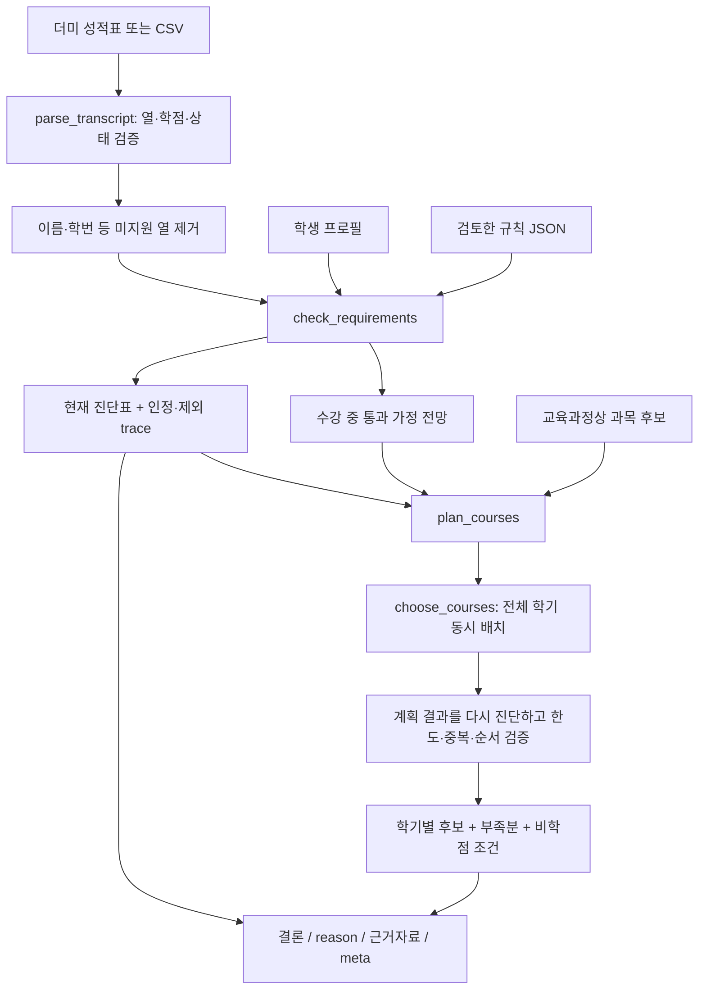

# 윤석현 담당: 이수 진단과 수강 계획 설명서

이 모듈의 핵심은 **AI가 말하기 전에 숫자와 조건을 코드로 확정하는 것**입니다. 성적표를 검증하고, 인정할 학점만 합산하고, 학교 요건과 비교한 뒤, 남은 학기에 가능한 과목 조합을 찾습니다. 같은 입력과 규칙이라면 모델이나 API 키를 바꿔도 진단 수치는 같습니다.

적용 대상은 성결대학교 2024학번 컴퓨터공학과, 일반 신입학·전공심화입니다. 기본 가상 학생은 2026년 3학년 2학기 재학이고 공학인증은 프로젝트 범위에서 제외합니다. 출력은 제공된 자료에 따른 진단이며 학교의 공식 졸업 확정이 아닙니다.

## 1. 먼저 설명할 수 있어야 하는 세 가지 결과

| 결과 | 사용하는 자료 | 답하는 질문 |
|---|---|---|
| 현재 진단 `check_requirements()` | 성적이 확정된 인정 과목 + 현재 학적 정보 | 지금 졸업요건을 모두 충족했나? |
| 수강 중 통과 전망 `diagnosis.projection` | 현재 자료 + 수강 중 과목의 합격 가정 | 지금 수강 중인 과목을 통과하면 학점은 어떻게 되나? |
| 목표까지 계획 `plan_courses()` | 수강 중 통과 가정 + 남은 학기 후보 + 비학점 조건 | 목표 마지막 학기까지 준비할 경로가 있나? |

3학년 학생에게 현재 `미충족`과 목표까지 `조건부 가능`이 함께 나오는 것은 정상입니다. 수강 중 학점이나 앞으로 추천한 학점을 현재 이수 학점에 더하지 않습니다.

현재 진단의 상태는 `충족 / 미충족 / 확인 필요`, 계획의 상태는 `충족 / 조건부 가능 / 위험 / 확인 필요`입니다. 자료 누락이나 미지원 조건의 `확인 필요`를 학점 부족인 `미충족`과 구별합니다.

## 2. 입력에서 답변까지 따라가기



학생 성적표는 RAG 벡터DB에 넣지 않습니다. RAG 담당은 공개 학교 규정과 출처를 제공하고, 이 모듈은 규칙 JSON과 학생 입력으로 계산합니다. UI·Agent 담당은 계산 결과를 표시하고 필요한 도구를 연결합니다.

### 주요 파일과 함수

| 위치 | 먼저 읽을 함수 | 책임 |
|---|---|---|
| `jolup/academic.py` | `parse_transcript()` | CSV를 표준 과목 목록으로 변환. 오류가 있으면 `ok=False`, 부분 자료를 정상 성적표로 넘기지 않음 |
| 같은 파일 | `_normalize()`, `validate_courses()` | 숫자·성적·학기·이수구분·행번호 검증 |
| 같은 파일 | `_calculate()` | 인정/제외, 중복·재수강 처리, 학점 합계와 `trace` 생성 |
| 같은 파일 | `_diagnostic_rows()` | 학점·지정 과목·채플·등록·작품심사를 개별 비교 |
| 같은 파일 | `check_requirements()` | 자료 확인 상태와 전체 결론, 현재·예상 결과, 근거를 묶어 반환 |
| 같은 파일 | `search_scores()` | 확정 성적의 합계와 학기별 평점 확인 |
| `jolup/planner.py` | `search_courses()` | 공개 교육과정에서 후보 검색. 실제 학수번호·개설 확정표와 구별 |
| 같은 파일 | `plan_courses()` | 재진단 → 수강 중 합격 가정 → 후보 추림 → 배치 → 재검증 |
| `jolup/course_solver.py` | `choose_courses()` | 전체 남은 학기의 과목 선택을 동시에 계산 |
| `jolup/samples.py` | `list_samples()`, `load_sample()` | 11개 가상 사례와 기대값, 더미 CSV 제공 |
| `data/rules/sungkyul_cs_2024.json` | 규칙과 `citations` | 수치·필수과목·적용 대상·근거 연결 |

## 3. 성적표를 읽을 때 지키는 규칙

CSV의 핵심 열은 `course_name, term, category, credits, grade, status`입니다. 재수강이면 이전 행의 ID인 `retake_of`와 확인된 승인 상태 `retake_approved`가 필요합니다. 한글 열 이름도 지원합니다. `row_id`가 없으면 생성하고, 실제 학수번호가 없는 더미는 내부 과목 ID를 사용합니다.

| 필드 | 예 | 잘못된 입력 처리 |
|---|---|---|
| `term` | `2026-2`, `2026-S`, `2026-W` | 형식이 다르면 오류. 현재보다 미래인 완료 기록도 확인 필요 |
| `category` | 교필·교선·전필·전선·일선 | 알 수 없는 구분을 임의로 전공 처리하지 않음 |
| `credits` | 0, 1, 2, 3, 0.5 | 음수·무한대·문자·0.5 단위가 아닌 숫자는 오류 |
| `status` | `completed`, `in_progress`, `planned`, `withdrawn` | 상태 누락·알 수 없는 값은 오류 |
| `grade` | A0, B+, D0, F, P | 완료인데 성적이 없거나 수강 중인데 확정 성적이 있으면 오류 |
| `retake_of` | `OLD_C_FAIL` | 승인 값만 있고 원행 연결이 없으면 오류 |

2MB 이하, 최대 2,000개 과목 행을 받습니다. UTF-8과 CP949를 지원합니다. 이름·학번 등 지원하지 않는 열은 제거합니다. 학교·학과·입학년도·과정 열에 다른 적용 대상이 명시돼 있으면 그 단서를 버리지 않고 입력을 거절합니다. 한 행이 잘못됐을 때 나머지만 정상으로 받아서 졸업 판정을 내리지 않습니다.

## 4. 무엇을 이수 학점으로 인정하는가

`_calculate()`는 과목을 학기순으로 처리하면서 각 행에 `counted`와 `reason`을 남깁니다. 화면의 **계산 과정·출처**에서 같은 내용을 확인할 수 있습니다. 이 표는 계산 기록이며 LLM의 내부 추론이 아닙니다.

| 행 상태 | 현재 인정 | 처리 이유 |
|---|---:|---|
| 완료 + A+~D0 | 해당 학점 | 확정된 급제 성적 |
| 완료 + P | 해당 학점 | 학점은 인정하되 평점 계산에서는 제외 |
| 완료 + F | 0 | 취득 학점 없음. 평점 계산에서는 0점 시도로 반영 |
| 수강 중 | 0 | 통과 여부가 확정되지 않음. 전망에서만 합격 가정 |
| 계획·철회 | 0 | 이수 완료가 아님 |
| 0학점 과목 + P | 0 | 통과 기록이 있어도 학점이 늘어나지 않음 |
| 같은 과목을 승인 연결 없이 다시 입력 | 나중 행 제외 | 중복·재수강 여부 확인 필요 |
| 승인된 재수강 + 유효한 이전 행 연결 | 최신 인정 시도만 | 원래 학점과 재수강 학점을 두 번 더하지 않음 |

### 재수강 예시

`OLD_C_FAIL`은 2024-1 C프로그래밍 3학점 F, 새 행은 2025-1 같은 과목 3학점 A0입니다. 새 행에 `retake_of="OLD_C_FAIL"`, `retake_approved=True`가 있으면 **학점은 3학점**입니다. 승인된 재수강이 이전 D0 등 이미 취득한 성적을 대체해도 합계는 6학점이 되지 않습니다.

원행을 두 재수강이 동시에 참조하거나, 재수강이 원행보다 빠르거나, 승인 여부가 없으면 추가 인정하지 않고 확인 필요로 돌립니다. 재수강 최고 A0와 재학 중 30학점 한도를 점검합니다. A+ 입력이나 재수강 실패 후 원성적 처리처럼 이 자료만으로 안전하게 확정하기 어려운 경우는 확인 필요입니다. 실제 승인 기록을 대신 만들어 주지 않습니다.

### P/F와 평점의 손계산

같은 학기에 D0 3학점, F 3학점, P 3학점, A+ 0학점이 있다고 가정합니다.

- 취득 학점: `3 + 0 + 3 + 0 = 6학점`
- 평점 분모: `D0 3 + F 3 = 6학점` — P는 제외
- 평점 분자: `3×1.0 + 3×0.0 = 3`
- 평점: `3÷6 = 0.5`

학점 합계와 평점은 서로 다른 계산입니다. 이 평점을 임의의 졸업 최저 평점 기준으로 사용하지 않습니다.

## 5. 졸업요건 비교에서 자주 틀리는 부분

| 조건 | 이 프로젝트 기준 | 구현에서 확인하는 것 |
|---|---|---|
| 총 졸업학점 | 123 | 인정된 전체 과목 합계 |
| 교양필수 | 14 | 교필 합계와 지정 7과목을 함께 확인 |
| 교양선택 | 20 | 교선 합계 |
| 전공심화 | 주전공 42 + 심화 21 = 63 | 전필·전선을 합친 전공 합계 |
| 필수 설계 | 설계(1)·(2), 각 3 | 해당 두 과목의 이수와 학점 확인 |
| 채플 | 6학기 | 실제 통과 확인값 |
| 등록 | 8학기 | 확인된 등록 학기 |
| 졸업작품 | 심사 통과 | 프로필의 심사 결과. 설계 학점으로 자동 대체하지 않음 |

진단표의 행은 서로 겹치는 조건입니다. **필요 학점 열을 전부 더하면 안 됩니다.** 총 123학점 안에 교양과 전공이 들어 있고, 필수 설계 두 과목도 전공 합계 안에 포함됩니다.

전필 39 + 전선 3이면 주전공 합계는 42입니다. 과거 전필로 분류된 초과학점을 빼고 전선 36을 별도로 다시 요구하지 않습니다. 전공심화라면 전공 총합이 63이어야 하므로 이 예시에는 추가 전공 21이 필요합니다. 총학점 표의 ‘기타 26’도 별도 일선 26학점 의무가 아닙니다. 영역 기준을 만족한 뒤 전공·교양의 초과학점 등으로 총 123을 채울 수 있습니다.

교필 합계가 맞아도 지정 과목이 빠지면 통과하지 않습니다. 설계 과목명과 같은 0학점 행으로 3학점 설계 이수를 대신할 수도 없습니다. 과거 과목명·대체 과목 인정은 승인 증빙을 확인해야 하며, 현재 버전은 임의의 유사한 이름을 자동 동등 인정하지 않습니다.

채플 값 `None`은 ‘자료 없음’입니다. 0으로 바꾸지 않습니다. `미완료`라는 명시적 작품 상태는 부족으로, 작품 결과 자체가 없으면 확인 필요로 구분합니다.

## 6. 기본 가상 학생의 정답표를 손으로 계산하기

기본 사례 `on_track`의 이름은 **김가온(가상)**입니다. 이름·학번·성적·학적 상태는 모두 더미이며 공식 성적증명서가 아닙니다.

### 현재 2026-2

`교필 14 + 교선 21 + 전공 45 + 일선 10 = 확정 90학점`

| 영역 | 필요 | 이수 | 부족 |
|---|---:|---:|---:|
| 총 졸업학점 | 123 | 90 | 33 |
| 교양필수 | 14 | 14 | 0 |
| 교양선택 | 20 | 21 | 0 |
| 전공 합계 | 63 | 45 | 18 |
| 필수 교양과목 | 7과목 | 7과목 | 0 |
| 필수 설계과목 | 2과목 | 0과목 | 2과목 |
| 채플 | 6학기 | 5학기 | 1학기 |
| 등록 학기 | 8학기 | 6학기 | 2학기 |
| 졸업작품 심사 | 1건 | 0건 | 1건 |

따라서 현재는 `미충족`입니다. 수강 중인 설계(1)·컴퓨터구조·운영체제·임베디드시스템·머신러닝 각 3학점은 **현재 합계에 들어가지 않습니다.**

### 수강 중 과목을 모두 통과한다고 가정

`90 + 15 = 예상 105학점`, 전공은 `45 + 15 = 예상 60학점`입니다. 총학점 18, 전공 합계 3, 설계(2)가 남습니다. 여기서는 채플·등록·작품 상태를 자동으로 올리지 않습니다.

### 목표 2027-2까지의 후보 계획

현재 자료의 계산 결과는 2027-1에 설계(2)·소프트웨어공학·인공지능 각 3학점, 2027-2에 자바프로그래밍응용·확률통계·정보보안 각 3학점으로 **9학점씩 두 학기**입니다. 4학년의 최소 수강 9학점도 함께 만족합니다. 후보를 모두 통과하면 `90 + 15 + 9 + 9 = 123학점`, 전공은 `45 + 15 + 9 + 9 = 78학점`이 됩니다. 총학점을 맞추기 위해 전공이 최소 63보다 많아져도 정상입니다. 후보 자료가 바뀌면 구체 과목 조합은 다시 계산합니다.

계획한 과목 외에도 **8학기 등록, 채플 추가 1학기 통과, 목표 연도의 작품 심사 통과**가 남습니다. 최소 수강 예외를 승인받았다는 자료가 없으므로 0학점 학기 등 최소 미만 계획을 성공으로 제시하지 않습니다. 목표 마지막 수학 학기 2027-2는 통상 2028년 2월 졸업을 준비하는 설정입니다. 실제 졸업일은 향후 공식 공지로 확인합니다.

### 학기별 졸업요건 진단표 읽기

각 계획 학기에는 `projected_totals`, `projected_rows`, `projected_status`가 있습니다. 현재 수강 중 과목과 **해당 학기까지**의 후보를 통과했다고 가정한 누적 결과입니다. 이후 학기의 후보는 앞 학기 표에 미리 더하지 않습니다.

| 기본 사례의 계획 시점 | 예상 총학점 | 예상 전공 | 등록 학기 | 채플·작품 표시 |
|---|---:|---:|---|---|
| 2027-1 말 | 90+15+9 = 114 | 45+15+9 = 69 | 계속 등록 가정 시 7학기 | 현재 확인값인 채플5·작품미완료 유지 |
| 2027-2 말 | 90+15+9+9 = 123 | 45+15+9+9 = 78 | 계속 등록 가정 시 8학기 | 현재 확인값인 채플5·작품미완료 유지 |

표의 `basis`는 각 값이 **학점 통과 가정 / 등록 시점 추정 / 현재 비학점 확인값** 중 무엇인지 설명합니다. `projection_assumptions`에도 이 조건을 적습니다. 등록 예상8은 실제 등록완료 기록이 아니며, 원본 프로필의 등록6을 변경하지 않습니다.

`milestone_estimates`는 별도의 조건부 준비 추정입니다. 기본 사례의 채플은 현재5, 필요한 추가 통과를 완료할 수 있다고 가정한 추정6으로 분리합니다. 작품심사가 아직 미완료라면 미래 결과 `estimated`는 `None`이고 통과1을 자동 배정하지 않습니다. 모든 추정에는 `is_actual_completion=False`가 붙습니다.

따라서 마지막 학기 학점이123이어도 학기별 표에는 현재 확인된 채플·작품 부족이 남을 수 있습니다. 전체 계획의 **조건부 가능**은 그 비학점 요건도 목표까지 실제로 완료해야 한다는 뜻입니다. 현재 학생이 이미 졸업조건을 충족했다는 뜻으로 읽으면 안 됩니다.

## 7. 수강 계획은 전체 남은 학기를 동시에 계산한다

한 학기씩 먼저 채우면, 봄에만 가능한 부족 교양을 놓쳐 가을에 해결할 수 없게 되는 문제가 있습니다. 그래서 `choose_courses()`는 **과목 × 학기**마다 0 또는 1을 정하는 혼합정수선형계획(MILP)을 사용합니다. `1`은 그 학기에 그 과목을 후보로 선택한다는 뜻입니다.

### 꼭 지키는 제약

| 제약 | 예 |
|---|---|
| 학기 최소 | 일반 1~3학년은 15학점, 4학년은 9학점. 승인되지 않은 예외는 적용하지 않음 |
| 학기 상한 | 해당 학기 선택 학점 합계 ≤ 18 또는 사용자가 정한 더 작은 상한 |
| 학사경고 제한 | 학사경고가 확인되면 최대 15학점. 제한 해제 승인은 별도 확인 |
| 연간 상한 | 해당 연도 기존 이수·수강 기록과 새 계획 합계 ≤ 36 |
| 중복 금지 | 같은 후보 과목은 전체 계획에서 최대 한 번 |
| 알려진 학기 | 교육과정상 제공 학기에만 배치 |
| 선행 순서 | 설계(1)를 이미 인정했거나 앞선 학기에 배치한 뒤 설계(2)를 배치 |
| 요건 보완 | 총학점·교필·교선·전공 부족분과 빠진 필수과목을 함께 다룸 |

설계(1)→(2)는 보수적인 계획 정책입니다. 공식 수강 제한으로 확인됐다고 단정하지 않으며 학과 확인이 필요합니다. 지금 설계(1)를 수강 중이면 그 과목을 통과한다는 가정이 붙습니다.

연간 한도 계산은 보수적으로 F와 반복 시도도 사용 학점에 포함합니다. 계절학기 기존 기록도 연간 한도에 포함하지만 새 계절학기 강좌를 자동으로 추천하지는 않습니다. 직전 학기 15학점·평점 4.2에 따른 초과 3학점 예외를 자동 적용하지 않고 기본 18학점 안에서 계획합니다. 입력의 `academic_warning=True`이면 15학점 상한을 적용하며, 명시적으로 `None`이면 여부 확인이 필요합니다. 희망 상한을 최소 수강학점보다 작게 지정하면 그 모순을 숨기고 계획을 만들지 않습니다.

### 최적화가 줄이는 것

먼저 남는 부족분의 비용을 크게 두고, 가능한 범위에서 부족을 줄입니다. 그다음 불필요한 추가 학점이 적고 상대적으로 앞선 학기에 배치하는 조합을 선호합니다. 계산 제한시간은 10초입니다. 불가능한 사례도 멈추거나 거짓 성공을 만들지 않도록 ‘남는 부족분’ 변수를 두어 보여 줍니다.

결과를 받은 뒤 중복·학기 최소·학기 상한·연간 36·설계 순서를 다시 검사합니다. `plan_courses()`는 선택한 과목을 별도 복사본에서 통과했다고 가정하고 `check_requirements()`로 전체 요건을 다시 검사합니다. 현재 원본 성적표는 바꾸지 않습니다.

`solver.feasible`과 `solver.optimal`은 서로 다른 값입니다.

| 값 | 의미 | 결과 처리 |
|---|---|---|
| `feasible=False` | 최소·최대학점, 연간한도, 중복, 순서를 만족하는 배치를 확보하지 못함 | 확인 필요. 학기별 전망을 성공 결과로 제시하지 않음 |
| `feasible=True`, `optimal=False` | 탐색은 제한됐지만 확보한 배치가 수강 제약을 통과함 | 졸업요건을 다시 계산. 모두 보완되면 조건부 경로로 제시할 수 있지만 최적이라고 말하지 않음 |
| `feasible=True`, `optimal=True` | 입력한 후보와 제약 안에서 탐색 완료 | 남는 학점·필수과목 부족분과 비학점 조건까지 별도 확인 |

`feasible=True`만으로 졸업 가능이라는 뜻은 아닙니다. 수강 한도를 지킨 계획이 있어도 총학점이 부족하면 `위험`입니다. 또한 `optimal=True`는 실제 시간 충돌, 교수, 여석, 분반, 미래 폐강을 검증했다는 뜻이 아닙니다.

예를 들어 이미123학점이고 등록7학기만 확인된 학생이 다음 학기의 희망 상한을8로 정하면 최소9와 충돌합니다. 이때 등록예상값만8학기로 올려서 조건부 가능으로 답하면 안 됩니다. 수강 제약을 만족하는 배치가 없다는 결과를 먼저 확인하여 판정을 보류합니다.

### 전체 학기 배치가 필요한 검증 사례

현재 87학점이고 전공 30, 교선 6, 합계 36학점이 부족하다고 가정합니다. 가을 교선 후보는 이미 이수했고, 남은 교선은 봄에만 가능하다면 **봄 전공 12 + 교선 6, 가을 전공 18**로 계획해야 합니다. 봄을 전공 18로 먼저 채우면 교선 6을 놓칩니다. `test_planner_keeps_spring_capacity_for_general_courses_unavailable_in_fall`이 이 상황을 검증합니다.

## 8. 실행해서 직접 따라가기

프로젝트 루트의 Python 대화형 환경에서 다음 순서로 확인합니다. 전체 설치·실행 방법은 README를 따릅니다.

```python
from jolup.samples import load_sample
from jolup.academic import parse_transcript, check_requirements, search_scores
from jolup.planner import plan_courses

s = load_sample("on_track")
parsed = parse_transcript(s["csv_bytes"])
print(parsed["ok"], parsed["removed_columns"])  # True, ['이름', '학번']

d = check_requirements(s["profile"], parsed["courses"])
print(d["status"], d["totals"]["total"])         # 미충족, 90
print(d["projection"]["totals"]["total"])       # 105
print(d["rows"])                               # 영역별 필요/이수/부족
print(d["trace"])                              # 과목별 인정/제외 이유

p = plan_courses(s["profile"], parsed["courses"])
print(p["status"])                             # 조건부 가능
print(p["projected_totals"]["total"])           # 123
print(p["semesters"], p["milestones"])
print(p["solver"])                             # 실제 배치 계산 상태
print(d["totals"]["total"])                    # 여전히 90
```

그다음 사례 ID를 `credit_shortfall`, `missing_core`, `missing_record`, `approved_retake`로 바꿔 봅니다. 계산 모듈은 AI API 키가 없어도 시험할 수 있습니다.

## 9. 오류를 찾는 순서

| 증상 | 먼저 볼 항목 | 수정할 방향 |
|---|---|---|
| CSV가 적용되지 않음 | `parsed.errors`, 행번호, 필수 열 | 원본 입력의 열·등급·상태를 수정. 실패 자료를 우회 적용하지 않음 |
| 학점이 예상보다 적음 | `trace`의 `counted=False`, `reason` | F, 수강 중, 중복, 승인 연결 문제를 구별 |
| 총 123인데 미충족 | `rows`, `missing_required_courses` | 교필·필수 설계·채플·등록·작품 중 어떤 조건인지 확인 |
| 합계는 맞는데 확인 필요 | `review_items`, 프로필 | 자료 누락·편입·미래 완료 기록·미승인 재수강 확인 |
| 계획이 위험 | `remaining_shortages`, 남은 학기·한도·후보 | 부족분이 실제로 남는지 수작업으로 확인. 목표 학기나 자료 검토 |
| 계획 계산이 끝나지 않음 | `solver.status`, `optimal`, `reason` | 계산 오류·시간 제한을 확인. 불완전 탐색을 졸업 불가로 단정하지 않음 |
| 최소·최대 학점이 충돌 | 학기 최소, 희망 상한, 학사경고, 연간 남은 한도 | 예외 승인·개설 자료를 확인. 최소 미만 결과를 정상 계획으로 바꾸지 않음 |
| 수치가 근거와 충돌 | 규칙 JSON과 원문 페이지 | 코드 숫자만 고치지 말고 적용 학번·공지 조건·정답 테스트까지 함께 수정 |

현재 학점은 수강 계획을 만든 뒤에도 같아야 합니다. API 응답 문장과 계산표가 충돌하면 계산표·규칙·원문부터 확인합니다. 모델에 ‘다시 계산하라’고 요청해서 해결하지 않습니다.

## 10. 원문 근거를 어디서 확인하는가

페이지 번호는 인쇄된 쪽수가 아니라 **PDF 파일의 실제 1부터 시작하는 페이지**입니다.

| 규칙 | 근거 | 위치 |
|---|---|---|
| 총 123학점 | `(2-1-1)성결대학교 학칙20260506.pdf` | PDF 6쪽 제35조, 9쪽 제50조 |
| 2024 컴공 교필14·교선20·주전공42·심화21 | `2026-2학기 강의시간표 안내문.pdf` | PDF 24쪽 컴퓨터공학과 2024 행 |
| 교필 지정 과목과 컴공 제외 조건 | 같은 안내문 | PDF 17·28쪽, 대체과목표 20쪽 |
| 주전공 외 심화 추가 이수·중복 이수 | 같은 안내문 | PDF 29쪽 |
| 전필 6·설계 두 과목·작품심사, 과거 전필 처리 | [학과 변경 공지](https://www.sungkyul.ac.kr/bbs/computer/1372/37225/artclView.do) | 등록일 2025-01-20, 2025년 2월 졸업생부터 적용되는 공지 |
| 학기 18·연간36·계절6·초과 이수 조건 | 학칙 | PDF 7쪽 제40조 |
| 1~3학년 최소15·4학년 최소9, 학사경고15상한·초과 신청 절차 | 안내문 | PDF 7~8쪽 |
| D0 이상·P/F | 학칙 | PDF 7~8쪽 제44조 |
| 재수강 A0·총30·대체 승인 | 안내문 | PDF 9쪽 |
| 8학기·채플6·작품·최종 졸업사정 | 학칙 | PDF 9쪽 제50조 |
| 학년별 후보 | [3학년 교육과정](https://www.sungkyul.ac.kr/computer/9782/subview.do), [4학년 교육과정](https://www.sungkyul.ac.kr/computer/9783/subview.do) | 실제 미래 시간표와 구별 |

학칙 파일명의 날짜를 등록일로 추정하지 않습니다. 사실 정리 TXT는 공식 웹페이지 자체가 아니므로 원문 URL도 함께 제공합니다. 가상 프로필·성적표는 실제 학적부나 증명서를 대체하지 않습니다.

## 11. 검증과 발표에서 사용할 설명

`tests/test_academic.py`와 `tests/test_academic_review.py`는 11개 더미 사례, 123/122 경계, 필수과목 누락, 비학점 조건, P/F, 재수강, 잘못된 입력, 전체 학기 배치, 최소9·학기18·연간36·학사경고15 제약, 원본 보존을 확인합니다. 학기별114/123 누적표와 비학점 현재값 유지, 제약을 만족하는 해와 탐색 완료 여부의 구별도 시험합니다. 독립 검토 테스트는 샘플 기대값을 그대로 믿지 않고 별도 과목·프로필을 만들어 손계산 값과 비교합니다. `tests/test_domain_guard.py`는 입력에 다른 학교·학번이 명시된 경우와 검토한 원문이 바뀐 경우를 검사합니다. 규칙 묶음의 검토 지문과 원문 파일이 달라지면 기존 검토를 그대로 신뢰하지 않고 다시 확인하도록 합니다.

```sh
.venv/bin/python -m pytest tests/test_academic.py tests/test_academic_review.py tests/test_domain_guard.py -q
```

테스트 수는 코드 추가에 따라 바뀔 수 있으므로 발표 때는 실제 실행 결과를 사용합니다. 이 검증을 학교의 공식 졸업 심사 통과로 설명하지 않습니다.

**1분 설명 예시**

> 저는 이수 진단과 수강 계획 계산을 맡았습니다. 먼저 CSV에서 학점·성적·상태를 검증하고, 수강 중 과목이나 F, 중복 기록을 현재 이수 학점에서 제외합니다. 그다음 총학점뿐 아니라 교양, 전공, 지정 과목, 채플과 작품 심사를 각각 비교합니다. 기본 가상 학생은 현재 90학점이라 아직 미충족이지만, 수강 중 15학점과 후보 18학점을 통과하면 총 123에 도달합니다. 다만 8학기 등록과 채플, 작품 심사는 별도 조건입니다. 수강 계획은 남은 모든 학기의 후보를 동시에 계산하고 한도와 순서를 다시 검증합니다. AI는 이 계산을 대신하지 않고 결과를 설명합니다.

**자주 나오는 질문**

| 질문 | 답변 요지 |
|---|---|
| AI에게 성적표를 주고 계산시키면 안 되나요? | 말투와 모델에 따라 숫자가 바뀌지 않도록 계산을 코드로 고정했습니다. 인정·제외 이유도 행별로 확인할 수 있습니다. |
| 123학점이면 졸업 아닌가요? | 지정 과목·영역별 기준·채플·등록·작품 심사도 필요합니다. 123이지만 사회봉사가 없는 사례가 이를 보여 줍니다. |
| 현재 미충족인데 왜 괜찮다고 하나요? | 현재와 목표까지 준비 상태를 구별합니다. ‘목표까지 조건부 가능’은 지금 졸업요건 충족이라는 뜻이 아닙니다. |
| 전공 78이면 너무 많이 들은 것 아닌가요? | 전공 최소63을 넘는 학점도 총123에 포함됩니다. 이 사례에서는 추가 후보로 총학점을 채웁니다. |
| 이 추천대로 수강신청하면 되나요? | 교육과정상 후보입니다. 실제 개설·시간표·여석과 학과 수강 자격 확인이 필요합니다. |
| 재수강은 최근 성적만 남기면 되나요? | 승인과 이전 성적 연결이 확인된 경우에만 대체합니다. 단순 중복이나 처리 규칙이 불명확하면 확인 필요입니다. |
| 자료가 빠지면 0으로 계산하나요? | 아닙니다. 확인 필요로 표시합니다. 채플 자료 누락 사례에서 확인할 수 있습니다. |
| 다른 학과나 편입생도 되나요? | 현재 버전은 지정한 범위만 지원합니다. 적용 규칙과 인정 자료를 추가 검토해야 합니다. |
| 이것이 학교 졸업 확정인가요? | 아닙니다. 제공된 자료 기준 진단이며 학교의 최종 졸업사정이 남습니다. |
