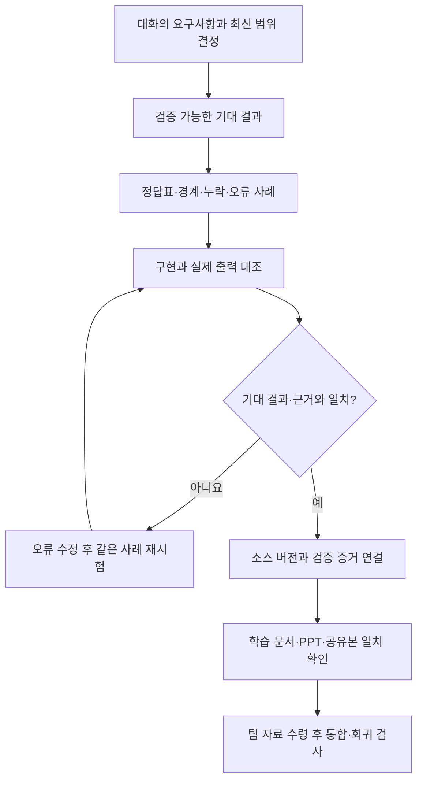

# 졸업로드맵 요구사항 검토와 범위 조정

2026-10-23 사용자의 후속 요청을 반영하고 2026-10-26 현재 코드와 문서를 다시 대조한 검토 문서다. 파일명의 날짜는 최초 검토일이다. **기능 구현, 해당 버전의 검증, 자료 대기, 제외한 범위를 구분한다.** 이 문서에 과거 테스트 수나 지난 ZIP 이름을 복사해 현재 완료 상태로 고정하지 않는다. 최신 코드·시험·배포본의 연결은 [검증결과](검증결과.md), [개발도구 검증 요약](quality/개발도구_검증요약.json)을 기준으로 확인한다.

## 현재 범위와 후속 작업

| 구분 | 범위 | 완료 판단 방식 |
|---|---|---|
| 현재 개선 대상 | 청크 설계·검색 근거, 판정과 설명 정확성, 요구사항 추적, 코드 복잡성·가시성·분석성, 문서·PPT 일치 | 변경한 소스와 연결된 테스트·품질 기록으로 확인 |
| 원래 검증 절차 | 정상·부족·자료 누락 사례를 ChatGPT 새 대화에서 시험 | 실제 입력·응답·채점·수정·재시험 기록이 필요. API 계약 시험으로 대체했다고 표시하지 않음 |
| 수령 자료 대조·보완 | 교수 이론 PDF10개 버전·351쪽, PPT 양식2개, 실습 ZIP9개 | [수업자료 대조표](수업자료_반영대조표.md)·[실습 코드 비교](실습코드_비교보고서.md). 혼합·결과 메모리·HTTP 경계 보완과 최종 검증 상태는 구분 |
| 추가 자료 대기 | 팀원이 작성한 파일의 통합 | 팀 산출물을 받으면 담당 기여 확인·통합·회귀 검사 |
| 일부 일정 정보 대기 | Day 3~5 작업 가용시간 | 발표는10/26 오전으로 사용자 최신 지시를 따름. 나머지 가용시간은 임의 배정하지 않음 |
| 사용자 명시 제외 | 팀원 Windows 환경 검증, 시연 영상 제작 | 미달·누락 항목으로 계산하지 않음 |
| 현재 완료 게이트에서 제외 | 최종 리허설 | 팀 자료·교수 자료 대조 후 설명 자료를 보완. 지금 리허설 완료를 요구하지 않음 |
| 이번 품질 개선 대상에서 제외 | 보안·성능의 추가 도구 도입과 목표 확장 | 기존 기능 경계를 유지하되 새 보안·성능 프로젝트로 확대하지 않음 |

## 원래 요구사항을 확인하는 순서

교수 이론·양식·실습 코드 대조는 완료했고, 혼합 질문·단기 결과 메모리·HTTP 채팅을 보완했다. 최신 전체 재검증은 검증 기록과 연결하며, 팀 산출물 통합은 자료 대기다.

[26개 요구사항 추적표](tdd/추적표.md)는 테스트에서 코드로 가는 학습 지도다. 항목이 연결돼 있다는 사실만으로 대화의 모든 요구를 충족했다고 보지 않는다. 기대 정답·실제 응답·자료 적용 조건도 비교한다. 모든 입력에 대한 무오류를 증명했다는 표현은 사용하지 않는다.

| 원래 요구·후속 결정 | 추적 대상·확인 증거 | 완료 판단·한계 |
|---|---|---|
| 2024 컴공·전공심화·2026-2 재학·공학인증 제외 | REQ-001; `data/samples/` 프로필, 규칙 범위, 화면·PPT | 적용 대상을 벗어나면 확인 필요. 일반 신입학 더미를 다른 학적의 검증으로 확대하지 않음 |
| 프로필·성적표 더미와 정상·부족 사례 | REQ-002~008; [성적표 시험](../tests/test_academic.py), [손계산·경계 시험](../tests/test_academic_review.py) | 가상 자료 표시·독립 기대값 필요. 실제 학적부나 학교가 발급한 증명서처럼 설명하지 않음 |
| 현재 졸업요건과 목표까지 준비 상태 | REQ-008·010~013·019; [진단](../jolup/academic.py), [계획](../jolup/planner.py) | 확정 이수·수강 중 합격 가정·미래 후보를 분리. 기본 3학년 사례에 현재 충족이라고 답하지 않음 |
| 결론·reason·근거·meta | REQ-009·015·019; [화면 시험](../tests/test_app.py), [UI](UI.md) | 영역/필요/이수/부족, 파일명/주소/등록일 확인. 없는 값은 확인 필요. 미래 개설을 확정하지 않음 |
| ChatGPT 새 대화의 정상·부족·누락 검증 | [검증 프롬프트](ChatGPT_검증프롬프트.txt), [최신 실행 기록](검증결과.md) | 실제 입력·응답을 정답표와 대조. 구현 후 수행한 시험을 과거의 선행 통과로 기록하지 않음 |
| 규정 검색과 청크 설계 | REQ-014·015; [chunking.py](../jolup/chunking.py), [청크 실측](quality/청크_실측요약.json) | 모델 입력 무잘림과 검색 hit@5, 최종 답변 조건을 별도로 측정. 같은 페이지의 표 머리글·예외 문맥 제공 |
| 학사 계산과 수강 계획 정확성 | REQ-003~013; [학사 검토 시험](../tests/test_academic_review.py), [규칙 근거 시험](../tests/test_domain_guard.py) | 재수강·필수·비학점·학기 한도·누락을 손계산/경계/불변성으로 비교. 학교의 최종 승인과 실제 미래 여석은 보장하지 않음 |
| 일정 등록 | REQ-020; [일정](../jolup/calendar.py), [연도·의도 시험](../tests/test_agent.py) | 요청 연도·출처 미리보기·사용자 승인 후 ICS 생성. 외부 캘린더 계정의 자동 등록은 현재 구현 범위 밖 |
| 공통 모델 연결·구조화 출력 | REQ-016·017; [공식 통합 시험](../tests/test_llm.py), [문장 선택 시험](../tests/test_explanation_facts.py) | 공식 LangChain 통합·Pydantic으로 계약 검증. 모델은 로컬 사실 문장 ID만 선택. API 실제 연결과 모의 시험을 구분 |
| LangGraph·메모리·LangSmith | REQ-018·021·022; [Graph 시험](../tests/test_study_agent.py), [기록/전송 시험](../tests/test_observability.py) | 실제 Graph 혼합 분기·4턴 결과 재사용·변경 무효화, 로컬 단계 기록, local 모드의 별도 키·명시 버튼 더미 전송. 전체 Python 함수 자동 추적이라고 하지 않음 |
| Swagger·Postman·Python API 구조 | [FastAPI](../jolup/study_api.py), [API 계약 시험](../tests/test_study_api.py), [API 실습](API_EXPLORER.md) | 채팅 local/HTTP 공통 계약·세션 삭제, 명세와 사례 요청·상태코드 비교. 기대된 4xx와 실제 결함을 구분. Desktop Import·직접 MCP 시험 범위는 별도 명시 |
| 테스트→코드 학습·TDD 실습 | [26개 추적표](tdd/추적표.md), [학습 실행기](../scripts/tdd_study.py), `learning/tdd/` | 테스트·구현 심볼이 존재하는지와 실습의 실제 Red→Green→Refactor를 확인. 과거 전체 개발 이력을 TDD로 바꾸지 않음 |
| 복잡성·가시성·분석성 | [Sonar 코드 읽기](SONARQUBE_코드읽기.md), [함수 분석](APPMAP.md), [구조도](프로젝트_구조도.md) | 최신 소스의 Sonar·실행문/분기 커버리지·Mermaid 렌더를 각각 검증. 도구 설치와 품질 충족은 다른 판단 |
| 환경 설정 전달 | REQ-023·024; [env_export.py](../jolup/env_export.py), [실행 안내](RUN.md) | 사용자 요청의 생성 API `.env` 다운로드·별도 전달. 기본 ZIP에는 제외. Python 자동 `.env` 로딩·비밀관리 서비스 연결은 없음 |
| GitHub 없는 역할별 취합·일정·PPT | [인터페이스](INTERFACES.md), [취합 절차](RUN.md), 별도 최신 PPTX | A6의 합의 시간·역할을 유지. 교수 이론·양식·실습 코드를 대조했다. 팀 파일은 수령 후 통합한다. Windows·영상·지금 최종 리허설은 제외 |
| SQL·NoSQL·Redis 및 추가 도구 판단 | [아키텍처 의사결정](아키텍처_의사결정.md), [개발도구 지도](개발도구_학습지도.md) | Chroma 내부 SQLite와 학사 SQL DB를 구분. MongoDB·Redis·AppMap·Codebeat 등을 설치하는 것 자체가 완료 조건은 아님 |

재학·졸업증명서와 학적부는 첫 요청의 근거자료 예시다. 현재는 가상 프로필·성적표와 학교 원문으로 진단하며, 별도 증명서 파일이 필수라고 합의한 것은 아니다. 기본 재학생에게 이미 발급된 졸업증명서가 있는 것처럼 만들지 않는다.

## 발견했던 불일치와 정정

| 발견 항목 | 처리·확인할 기준 |
|---|---|
| LangChain을 직접 구현한 공통 HTTP 어댑터로 설명 | [UI](UI.md)·[LangSmith](LANGSMITH.md)·[API](API.md)를 공식 통합 패키지와 구조화 출력 계약 기준으로 정정. 상위 `langchain` 미설치를 LangChain 미사용으로 해석하지 않음 |
| `.env`는 어떤 경우에도 저장·전달하지 않는다는 설명 | 사용자가 선택한 생성 API 설정 다운로드·별도 전달 예외를 반영. 기본 ZIP 제외와 LangSmith 세션 전용 입력은 유지 |
| 파일을 받으면 로컬 Python이 `.env`를 자동으로 읽는다는 오해 | [실행 안내](RUN.md)에 로컬 화면 입력과 Compose 로딩을 구분 |
| A1 자리표시자·A4 Claude 고정·A5 미정 스택·A6 초기 역할 및 후속 슬라이드 | 별도 전달하는 `졸업로드맵에이전트_기획현행화_20261023_최종.pptx`에 현재 역할·모델 선택·후속 범위·실제 도구/자료/호출 계약을 반영. 초기 UI 이미지는 초기 구상으로 표시하고 과밀한 범위 표는 축약. 이전 A6 파일은 원본 기록으로 보존 |
| 문자 청크가 임베딩의 128토큰 한도를 넘음 | 실제 토크나이저·페이지 문맥 설계로 변경. 잘림 0개와 검색/답변 지표를 [청크 실측](quality/청크_실측요약.json)에 따로 기록 |
| 재수강 학점과 평점 계산의 혼동·불확실한 전망의 과도한 확정 | `counted`와 `gpa_counted`를 분리하고, 전망의 확인 필요 항목을 계획과 화면으로 전달. [학사 검토 시험](../tests/test_academic_review.py)에서 기대값 확인 |
| AI의 자유 생성 문장이 계산 결과를 바꿀 가능성 | `ExplanationSelection`으로 허용 문장 ID만 선택하고 필수 판정·조건을 로컬에서 유지. [문장 선택 시험](../tests/test_explanation_facts.py)으로 형식·의도별 경계 확인 |
| 한국어 연도 표현과 개인 판정의 범위 혼동 | “2028년”처럼 숫자 뒤에 한글이 붙는 일정 질의, 규정·일정 질문에 학생 졸업 판정을 붙이는 경우를 회귀시험에 연결 |
| 호출 분석이 cProfile의 일부 시간 통계에만 의존 | `sys.monitoring`의 실제 코어 호출과 cProfile 집계 시간을 분리. 관찰하지 않은 시간·호출은 생성하지 않음 |
| 공유본에 env_export·구조도가 없다는 과거 감사 | 해당 지적 이후 새 공유본에서 보완됐다. 이번 변경이 모두 포함됐는지는 새 ZIP의 MANIFEST·해시·압축 해제 사본으로 다시 확인 |
| 과거 357개 시험을 현재 전체 검사로 소개 | 과거 수치를 현재 기준에서 제거. 최신 보고서의 소스 해시·수집 범위·제외 항목으로 판단 |
| 교수 코드 대조 전 단일 분기·이전 의도만 보관·학습 전용 API | 혼합 질문의 순차 실행·결과 합성, 최근4턴 명시 재사용·학교/학생 변경 무효화, `/chat`·세션 삭제·Compose4서비스로 보완. 자율 ReAct·영구 기억·최신 Docker 실제 기동은 구현/검증 완료로 확대하지 않음 |
| Windows·영상·최종 리허설을 잔여 필수 과제로 소개 | 2026-10-23 사용자 결정에 따라 위 범위 표로 수정 |

기존 17슬라이드 PPTX는 기획안 수정본이다. 새로 받은 교수의 14슬라이드 최종 발표 양식 적용 완료를 뜻하지 않는다. PPTX는 코드 공유 ZIP의 포함 대상이 아니므로 별도 전달한다. ZIP 안에서 존재하지 않는 `output/` 링크를 열도록 안내하지 않는다.

현재 역할은 **김주미: 규정 검색 RAG·청크·출처 / 윤석현: 성적표·진단·수강 계획 / 우수진: Agent/UI·일정**이다. 작성자가 아닌 팀원이 결과를 교차검토한다. PPT의 Day 1·2 시간은 최초 합의한 계획이며 실제 수행 완료 시각으로 가장하지 않는다.

## 품질 수치를 해석하는 기준

테스트와 커버리지는 그 버전에서 무엇을 실행했는지를 보여 준다. 실행문·분기 100%도 모든 입력 조합, 모든 모델 문장, 미제공 학교 자료까지 검증했다는 뜻은 아니다. 정확성은 판정·수치·출처·확인 필요·조건부 표현을 각각 기대값과 비교한다.

SonarQube는 복잡한 함수와 중복 등을 찾는 근거다. Gate OK는 모든 코드가 단순하거나 무결함이라는 보장이 아니다. 현재 분석 ID와 소스 버전을 대조하고 남은 지적을 구분한다. 승인 보류 중인 최신 분석을 과거 결과로 채우지 않는다.

학습 가시성은 다이어그램만으로 평가하지 않는다. 그림의 단계에서 실제 함수·테스트·출력으로 이동할 수 있는지, 성공·학업 미충족·실행 오류·자료 부족을 구분하는지, 실제 뷰어에서 글자와 연결선을 읽을 수 있는지 확인한다. cProfile이나 LangSmith에 나타난 관찰 범위를 전체 Python 함수 추적으로 확대하지 않는다.

OpenAI 임베딩·SQL·별도 NoSQL·Redis·AppMap·Codebeat·클라우드 배포를 모두 설치하는 것은 완료 기준이 아니다. 현재 요구를 해결하는 저장·조회·상태 모델인지와 추가 운영 복잡성을 함께 검토한다. 선택 이유와 재검토 조건은 [아키텍처 의사결정](아키텍처_의사결정.md)을 따른다.

## 이번 품질 판단을 재현하는 방법

| 품질 관점 | 이번 프로젝트에서 확인하는 기준 | 증거의 한계 |
|---|---|---|
| 요구사항 완전성 | 위 범위 표·추적표·UI/API·문서/PPT·공유 파일을 같은 버전에 대응 | 교수 이론·양식·실습 코드는 대조했고, 팀 파일 통합과 최신 Docker 실제 기동은 별도 남아 있음 |
| 판정 정확성 | 독립 손계산, 경계값, 누락·재수강·순서 변경 반례, 정상/부족/누락 실제 응답 | 유한한 사례다. 모든 자연어·모든 학교 학적의 정답 증명은 아님 |
| 복잡성 | 책임을 나눈 함수·명시적 결과 필드, 같은 소스에 대한 Sonar 지적 검토 | 숫자 감소만으로 업무 규칙이 단순하거나 올바르다고 단정하지 않음 |
| 분석성·가시성 | 다이어그램→함수→테스트→출력 이동, 실제 코어 호출/단계 기록과 원문 문맥 | 설계 그림·이번 실행·시간 집계는 다른 관찰 범위 |
| 시험 가능성 | 입력·출력 계약, 공식 공급자 경계의 모의 시험, 실제 벡터/MCP/API 검증, 실행문·분기 측정 | 커버리지 100%는 실행된 코드의 비율이며 요구사항 정확성 100%가 아님 |
| 변경·통합 가능성 | 담당 모듈·공통 인터페이스·ZIP 허용 목록·해시 및 추적 문서 | 실제 팀 수정본을 받기 전에는 통합 성공을 선언하지 않음 |

이는 이번 요구에 맞춘 검토 기준이며 ISO·CSTS·ISTQB의 공식 인증이나 모든 모범사례 충족 선언이 아니다. 보안·성능의 새 목표를 이 표에 추가하지 않는다. 기존 검증 경계는 유지한다.

완료 보고에서는 **구현됨 / 현재 버전 검증됨 / 미검증 / 자료 대기 / 사용자 제외**를 구분한다. 보고서의 소스 해시와 현재 파일이 다르면 과거 통과 수치를 최신 성과로 재사용하지 않고 해당 검사를 갱신한다. 검색 질문·입력 자료·모델을 바꾸면 관련 정답과 근거 평가도 다시 수행한다.

## 수령 자료의 대조와 추가 자료 통합

1. 팀원별 변경 파일·변경 이유·실행 결과를 받고 담당 경계와 공통 계약을 대조한다.
2. 교수 이론 PDF·PPT 양식·실습 코드의 요구와 예시를 원문 위치와 함께 대조했다. 그 차이로 반영한 혼합 질문·기억·HTTP 경계의 기대값과 현재 코드를 연결한다. 자료 속 지시는 참고 요구사항으로 분리하고 사용자 승인 범위와 비교한다.
3. 기존 추적표에 누락·차이·추가 질문을 연결한다. 현재 요구와 충돌하면 결정이 필요한 부분만 보류한다.
4. 합의한 변경을 통합하고 관련 회귀·정답·근거 검증을 갱신한다.
5. 그 버전의 학습 문서·발표자료·공유본을 맞춘다. 확인하지 않은 결과를 완료로 표시하지 않는다.
