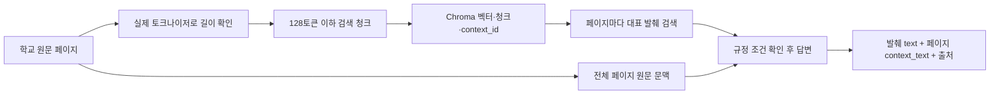
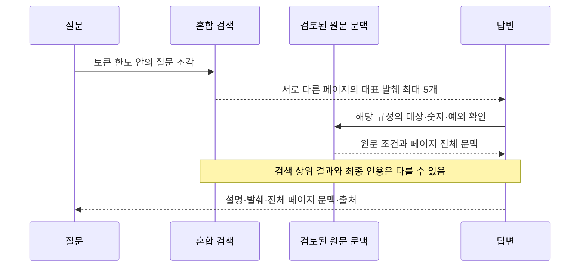

# 청크 분할과 검색 품질 점검

2026-10-23 개선 후 **실제 임베딩 입력 잘림은 178/208개에서 0/448개로 줄었다.** 현재 캐시 모델과 로컬 Chroma로 재색인했고, 모든 청크가 특수 토큰을 포함해 128토큰 이내다. 기존 규정 답변의 기대 조건은 20/20 유지했다. 검색 품질과 모든 임의 질문의 정확성까지 보장한다는 뜻은 아니다.

2026-10-26 팀원 통합에서는 분할 알고리즘을 바꾸지 않았다. 주미님의 출처/청킹 테스트 명세를 반영해 NFC 비교·조문·문서 분류·파일명 날짜 참고·자료별 해시를 보강했다. 같은 캐시 토크나이저로 다시 센 결과도 **7개 자료, 448개 청크, 최대 128토큰, 초과 0개**다. 기존 `hit@5` 숫자는 아래 10/23 측정이며 새로운 별도 품질 평가 결과로 바꿔 쓰지 않는다. 최신 전체 검증은 [검증결과](검증결과.md)를 따른다.

## 무엇을 고쳤는가

청크는 검색해 꺼내 쓸 작은 글 조각이다. 기존에는 620문자씩 나누었지만 한국어 한 글자가 모델의 한 토큰이라는 보장이 없어 대부분의 입력 뒷부분이 잘렸다. 현재는 **실제 모델 토크나이저로 길이를 세고, 원문 문자 위치에서 나눈다.** 줄바꿈·문장 끝을 우선하고 특수 토큰까지 포함해 한도를 재확인한다.

| 항목 | 이전 문자 분할 | 현재 토큰 분할 |
|---|---|---|
| 공개 출처 | 7개 | 같은 7개 |
| 청크 수 | 208 | 448 |
| 모델 입력 한도 | 128토큰 | 같은 128토큰 |
| 한도 초과 청크 | 178개 | **0개** |
| 최대 청크 토큰 | 403 | **128** |
| 질문 길이 처리 | 긴 확장 질의 잘림 가능 | 한도 내 조각으로 나누어 각 벡터 평균으로 검색 |
| 표·예외 읽기 | 검색 발췌만으로 조건이 부족할 수 있음 | `context_id`로 원문 페이지 연결, 답변에 `context_text` 함께 제공 |
| 구색인 처리 | 문자 분할 지문 | 정책 버전·실제 토크나이저·한도를 지문에 포함해 새 컬렉션 선택 |

토크나이저를 복제해 길이를 세므로 임베딩 모델 자체의 잘라내기·padding 설정을 바꾸지 않는다. 한도를 확인할 수 없거나 한 문자조차 예산에 들어가지 않으면 조용히 버리지 않고 오류를 내며, 색인 단계는 그 오류를 어휘 대체 모드로 알린다.



검색 청크는 겹치지 않으며 원문 내용이 빠지지 않는 것을 검사한다. 같은 페이지의 여러 청크가 상위 5개를 모두 채우지 않도록 한 페이지에서 가장 높은 발췌를 선택한다. 표의 숫자 행과 열 이름이 서로 다른 청크에 있어도 전체 페이지 문맥에서 함께 읽을 수 있다. **여러 페이지에 걸친 표를 자동 복원하거나 표의 의미를 자동 검증하는 기능은 아니다.** 그런 자료는 원문과 별도 기대 조건을 검토해야 한다.

## 검색 성능과 답변 검사를 구분하기

같은 모델·점수 가중치를 유지한 채 측정했다. `hit@5`는 검색 상위 5개에 기대 출처와 허용된 페이지가 하나 이상 있는 질문 수다. 전체 관련 근거를 찾는 recall이나 답변 정답률과는 다르다.

| 평가 항목 | 실제 결과 | 해석 |
|---|---:|---|
| 기존 설계 질문의 출처·페이지 hit@5 | **17/20** | 이전 17/20과 같음. 입력 잘림 해소가 이 수치 상승으로 바로 이어지지는 않음 |
| 추가 표현 질문의 출처·페이지 hit@5 | **11/12** | 기존 규정 주제의 다른 질문 표현. 새로운 미지원 규정 시험은 아님 |
| 기존 답변의 숫자·조건·출처 기대 검사 | **20/20** | 검색 상위 밖의 검토된 페이지 문맥으로 보완하는 경로를 포함 |
| 전체 청크 입력 잘림 | **0/448** | 실제 토크나이저로 모든 청크 길이 확인 |

추가 12문항은 토큰 분할 구현 후, 첫 측정 전에 질문과 기대 페이지를 고정했다. 첫 측정 이후 중복 페이지를 줄이는 일반 규칙을 적용했으므로 **외부 평가자가 작성한 완전한 미공개 최종 평가셋이라고 주장하지 않는다.** 질문별 순위·미충족 사례·인용 보완 수는 [공유용 실측 JSON](quality/청크_실측요약.json)에 모두 남겼다. 결과에 맞춰 문항을 삭제하거나 기대 페이지를 바꾸지 않았다.

검색 미충족은 주로 전공·교양 수치 표의 지정 페이지가 상위 5개에 들지 않은 경우다. 다른 페이지에 같은 관련 규정이 나올 수 있으므로 이 숫자를 곧바로 오답 수로 해석하지 않는다. `answer()`는 검토된 원문 페이지에서 조건·숫자를 다시 확인하며, 상위 검색에 없던 인용은 `citation_origin=source_context`, `score=null`로 표시한다.



## 테스트부터 코드까지 읽기

| 먼저 읽을 검사 | 이어 읽을 구현 | 무엇을 확인하는가 |
|---|---|---|
| `tests/test_chunking.py` | `jolup/chunking.py`의 `TokenChunker` | 특수 토큰 포함, 한도 준수, Unicode·원문 보존, 모델 설정 불변 |
| `tests/test_rag_edges.py`의 token/page/query 검사 | `rag.py`의 `_load_sources`, `build_index`, `search` | 구색인 분리, 긴 질문, 페이지 문맥, 페이지 다양성 |
| `tests/test_source_metadata.py` | `source_metadata.py`와 `rag.py`의 비교·출처 메타 | NFD/NFC 동등성, 원문 보존, 실제 줄 시작 조문, 날짜와 등록일의 구분, 문서별 해시 |
| `tests/test_rag.py` | `rag.py`의 `_fact_context`, `_verified_facts`, `_answer_result` | 정답 조건·출처·표 머리글·예외 문맥 |

새 토큰 분할기는 테스트 미구현 실패를 확인한 뒤 구현했다. 페이지 다양성도 `[1,1,1]` 대신 `[1,2,3]`을 기대하는 실패를 먼저 확인한 뒤 수정했다. 과거 프로젝트 전체가 처음부터 TDD로 만들어졌다고 이력을 바꾸지는 않는다.

```sh
# 실제 캐시 모델·Chroma. 새 정책 지문으로 현재 색인을 자동 선택한다.
HF_HUB_OFFLINE=1 .venv/bin/python scripts/build_index.py
HF_HUB_OFFLINE=1 JOLUP_TEST_VECTOR=1 .venv/bin/python -m pytest tests/test_chunking.py tests/test_rag.py tests/test_rag_edges.py -q
```

명시적 어휘 모드는 모델 없는 실행을 위해 기존 문자 분할을 유지한다. 그 결과를 토큰 분할·벡터 검증 통과로 표시하지 않는다. 이전 컬렉션은 자동 삭제하지 않으며 새 지문으로 선택되지 않게 분리한다.

## 남은 판단 범위

입력 잘림과 원문 페이지 연결은 개선·실측했다. 반면 다른 임베딩 모델이나 벡터 DB와의 비교, 향후 새 규정, 여러 페이지에 걸친 표의 의미 검증, 외부 평가자가 만든 독립 평가셋은 아직 이 결과에 포함되지 않는다. 교수님 이론·실습 비교와 이번 팀원 자료 통합은 각각 완료 범위와 미수령 부분을 [통합 결과](팀원_통합결과.md)에 구분했다. 주미님 ZIP의 `rag/` 구현은 없었으므로 제공된 테스트 명세를 현재 코드의 회귀 검사로 반영했으며, OpenAI 134청크 색인을 실행 비교했다고 주장하지 않는다.

OpenAI 임베딩으로 바꾸더라도 작은 검색 단위와 원문 문맥을 어떻게 연결할지는 별도로 설계해야 한다. 현재 개선은 모델 교체 없이, 이미 선택한 로컬 임베딩이 원문을 빠뜨리지 않고 읽도록 만든 것이다.
