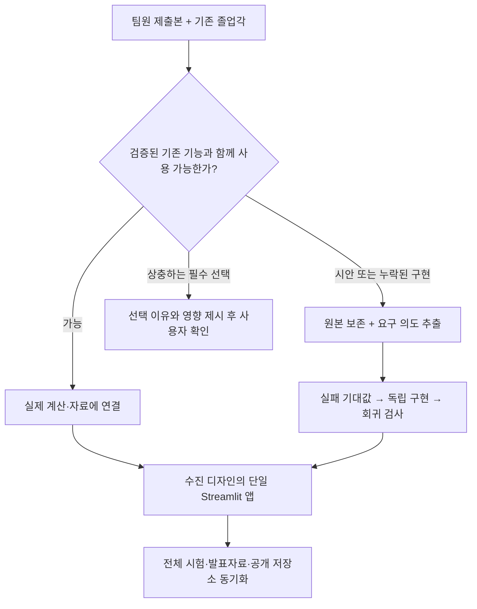

# 팀원 제출본 통합 · 2026-10-26

우수진의 화면 디자인·상호작용과 김주미의 RAG 시험 명세를 기존 졸업각에 반영했다. 제출 파일을 그대로 연결했다고 주장하지 않는다. 수진의 HTML은 시안이며, 주미의 ZIP에는 `main.py`가 가져오는 `rag/` 구현 폴더가 없었다. 실제 제품에서 연결한 내용과 원본 보존 범위를 아래에 구분한다.

## 무엇을 합쳤나

| 기여·기존 기능 | 통합 결과 | 읽을 파일·검증 |
|---|---|---|
| 수진: 크림·노랑/검정선/그림자·토끼 | 실제 PNG 두 개와 CSS를 분리하여 Streamlit에 적용 | `assets/sujin/`, `jolup/ui_design.py`, `.streamlit/config.toml` |
| 수진: 대화와 대시보드 | 대화 탭은 좌 5 : 우 7. 기존 진단·대화·일정·계산/출처 4탭 유지 | `app.py`, `tests/test_app_conversation.py` |
| 수진: 영역별 진행 카드·이용 안내 | 선택한 더미 또는 검증된 CSV의 실제 계산값 사용. FAQ는 실제 지원 범위 설명 | `jolup/ui_design.py`, `tests/test_ui_design.py` |
| 수진: 월간 달력·D-day·상세 일정 | 학교 자료의 일정으로 월 격자 생성, 서울 오늘 날짜 기준 남은 일수/진행 중/종료 표시 | `jolup/ui_calendar.py`, `tests/test_ui_design.py` |
| 수진: 후보 과목 담기 | 교육과정 후보 검색·필터·관심 목록과 실제 학점 합계. 졸업 판정·자동 계획과 분리 | `app.py`, `jolup/ui_design.py` |
| 주미: 한글 정규화 | NFC/NFD로 저장된 같은 한글의 검색·범위 판정을 동일하게 처리 | `jolup/rag.py`, `tests/test_source_metadata.py` |
| 주미: 출처 종류·조문·날짜 | 문서 종류와 원문의 실제 조문 표제, 파일명 날짜 참고값 추가. 확인되지 않은 등록일은 계속 미확인 | `jolup/source_metadata.py`, `app.py`의 meta 표시 |
| 주미: 색인 매니페스트 | 현재 모델·정책을 유지하면서 문서별 SHA-256·청크 수를 기록 | `jolup/rag.py`의 색인 경로 |
| 기존: 학사 계산·추천·Agent·AI·추적 | 123학점 규칙, 현재/전망 분리, LangGraph·LangChain·LangSmith·MCP·API·학습자료 유지 | 기존 회귀 시험 전체 |
| 기존: 승인 후 일정 파일 | 월간 달력에서 보더라도 일정 미리보기·명시적 승인·ICS 다운로드 경계 유지 | `jolup/calendar.py`, `tests/test_calendar.py` |
| 통합 검토: 학교 자료 변경 | 같은 학생이라도 교육과정·학교 근거 내용이 바뀌면 진단 캐시와 관심 목록을 초기화 | `conversation.school_revision()`, `app.py`, UI 회귀 시험 |

각 원본의 위치와 보존상태는 [제출본 폴더](../team_contributions/README.md)를 따른다. 담당 역할표는 실제 개인별 구현 완료 인증이 아니다. 제출물의 기여와 AI를 이용한 통합·재구현을 구분한다.

## 왜 그대로 합치지 않은 부분이 있나

| 항목 | 결정·이유 | 보존·후속 조건 |
|---|---|---|
| 시안의 85/130학점·Alex·고정 응답 | 학교자료의 123학점 규칙 및 실제 선택 자료로 대체 | HTML 시안은 원본 보존 |
| 시안의 PDF/XLSX 업로드 문구 | 파일명만 읽는 시안이라 자동 파싱을 지원한다고 표시하지 않음. 제품 CSV 검증을 유지 | 새 파서의 표/행 검증·오류 기대값을 준비한 뒤 확장 가능 |
| 시안의 고정 날짜·다운로드 성공 문구 | 출처 있는 일정·실제 파일 생성으로 연결 | 승인 전 파일 생성 금지, 일정 변경 시 재승인 |
| 주미의 OpenAI 134청크 Chroma 캐시 | 기존 448청크·로컬 MiniLM과 임베딩 공간·분할이 달라 직접 연결하지 않음 | 원본 매니페스트 보존. 캐시는 같은 모델/분할로 재생성해야 함 |
| 주미의 누락된 `rag/` 구현 | 동작을 추정하지 않고 제공된 시험의 의도를 현재 구현에 재현 | 추후 해당 폴더를 받으면 구현 수준의 추가 비교 가능 |
| 파일명 날짜 | 등록일·작성일의 확정 근거로 격상하지 않음 | `version_date_hint`로 별도 표시 |
| 중복 학교 PDF 두 개 | 기존 파일과 SHA-256이 같아서 `data/sources/`를 재사용 | 첨부 원본 ZIP은 수정하지 않음 |
| `.DS_Store`·벡터 캐시·개인 절대경로 | 제품 공개 실행 파일에 불필요. 캐시를 제품 DB로 오인하지 않도록 분리 | 코드·시안·시험·매니페스트는 공개 보존, 래퍼 경로만 상대경로로 변환 |

디자인은 사용자 합의대로 수진의 안을 적용했다. 임베딩 공급자를 바꾸거나 웹 프런트엔드를 별도 앱으로 교체할 필요 없이 기여를 반영할 수 있어서 추가 양자택일을 요구하지 않았다.



## 테스트 → 코드로 확인하기

1. `tests/test_source_metadata.py`에서 같은 한글의 NFC/NFD 질문, 인용문 안의 조문 번호, 유효하지 않은 파일명 날짜, 원문 보존 기대값을 읽는다. `source_metadata.py`의 비교용 정규화와 `rag.py`의 질의·출처 경계를 이어서 본다.
2. `tests/test_ui_design.py`에서 시작 전/당일/기간 중/종료, 월·연도 경계를 읽고 `ui_calendar.py`의 날짜별 표시를 따라간다. 실제 ICS의 승인·해시 무효화는 기존 `test_calendar.py`가 맡는다.
3. `tests/test_ui_design.py`와 `tests/test_app_conversation.py`에서 실제 학점 표시와 사용자 입력 경계를 읽고 `app.py`의 화면 연결을 확인한다. 관심 목록의 학점은 선택 요약일 뿐 취득 학점이 아니다.
4. 전체 회귀 검사는 [검증 결과](검증결과.md)를 따른다. 새 코드가 들어간 뒤 과거 777개·100% 수치를 그대로 최신 수치로 사용하지 않는다.

```bash
python -m pytest -q tests/test_source_metadata.py tests/test_ui_design.py
python -m pytest -q tests/test_app.py tests/test_app_conversation.py tests/test_calendar.py
python scripts/quality_check.py coverage --vector
python scripts/package_project.py --check
```

한글 정규화·출처 메타 추가는 실제 실패 시험을 먼저 실행한 뒤 고쳤다. 나머지 전체 프로젝트의 과거 개발을 소급해서 TDD라고 표현하지 않는다. UI 자동 시험은 브라우저 픽셀·모바일 표시까지 검증하는 도구가 아니므로 화면 렌더 검토와 구분한다.
