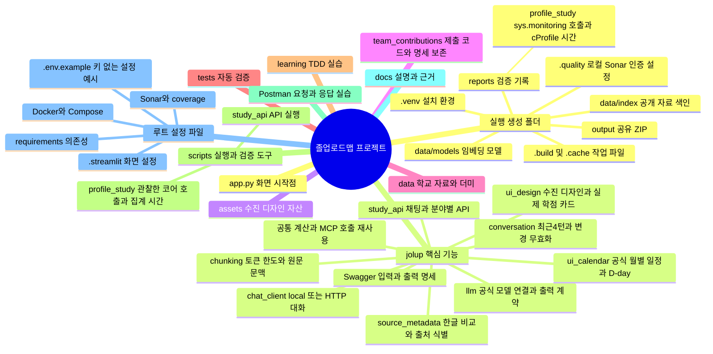
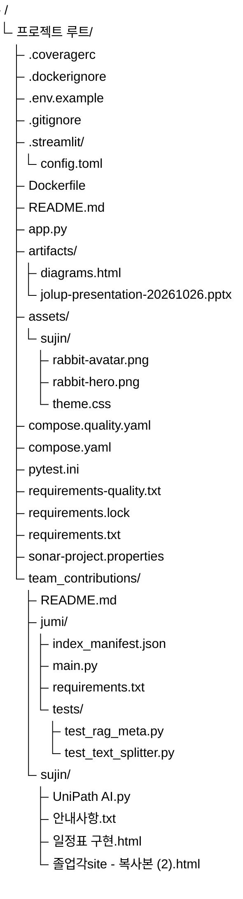
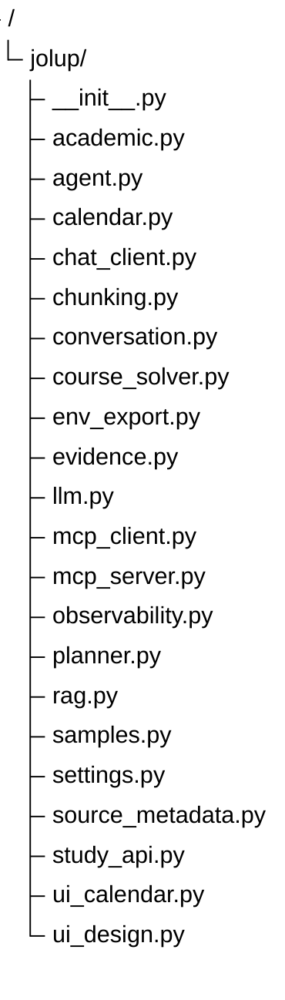
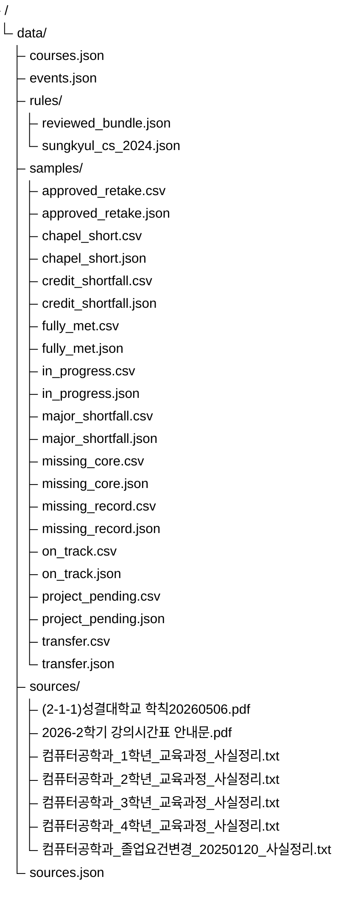
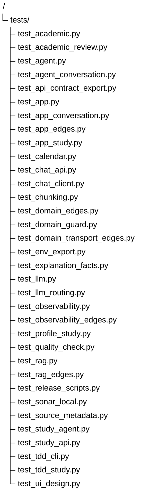
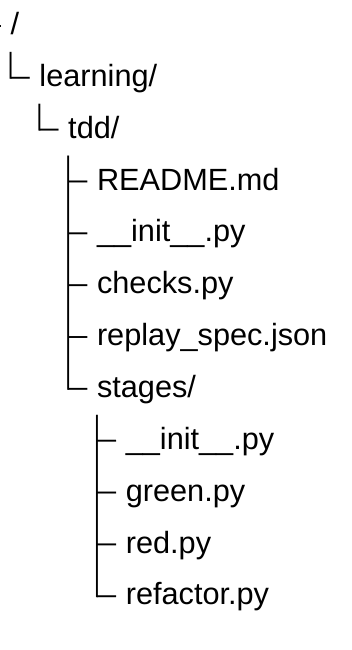
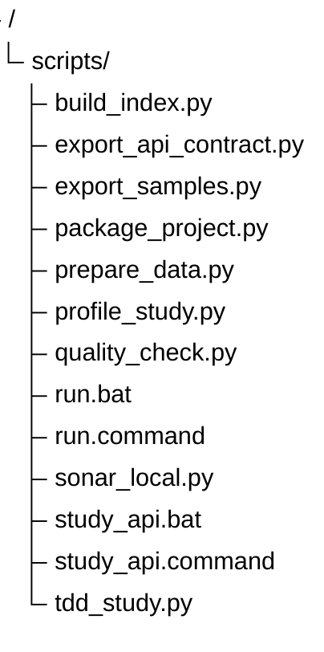
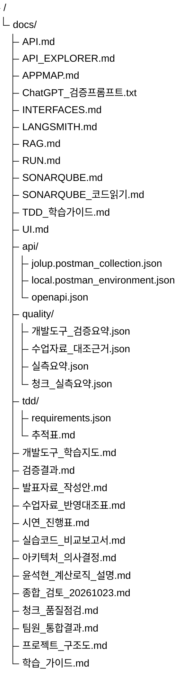

# 졸업로드맵 프로젝트 파일과 시스템 구조

파일 트리는 **어디에 코드와 자료가 있는지**, 시스템 구성도는 **어떤 구성 요소가 데이터를 주고받는지**를 보여준다. 읽는 순서는 역할 개요 → 시스템 구성도 → 담당 폴더의 파일 → 연결된 테스트다. 선택 이유와 대안은 [아키텍처 의사결정](아키텍처_의사결정.md), 기능별 실습은 [TDD 학습 가이드](TDD_학습가이드.md), 개발 도구의 실제 적용 범위는 [개발 도구 학습 지도](개발도구_학습지도.md)를 따른다.

2026-10-26 팀원 통합본 기준이다. 아래 상세 트리는 패키징 허용 목록과 대조한 코드·설정·공개 자료·문서·디자인 자산·기여 원본을 포함한다. 실제 키가 있는 `.env`는 공개·공유 트리에 넣지 않으며 `.env.example`만 제공한다. 실행하면서 생기는 보고서·색인·패키지·캐시·설치 라이브러리는 폴더 수준으로 구분한다. 수많은 라이브러리 내부 파일은 우리 팀이 작성한 소스 트리에 포함하지 않는다.

교수 이론 PDF10개 버전·351쪽, PPT 양식2개와 실습 ZIP9개를 대조해 혼합 질문·단기 결과 메모리·HTTP Agent 경계를 보완했다. [실습 코드 비교보고서](실습코드_비교보고서.md)는 개념·구현·제외 이유를 구분한다. 교수 원문은 아래 제품 공유 트리에 포함하지 않는다. 팀원 제출본은 이번 통합에 반영했고 원본 코드·테스트·manifest는 `team_contributions/`에 보존한다. 주미님 제출 ZIP에 `rag/` 구현이 없어 제공 테스트 명세를 현재 코드로 구현한 범위와 미수령 부분은 [팀원 통합 결과](팀원_통합결과.md)에 명시했다.

## 1. 전체 역할 개요

마인드맵은 각 부분이 맡는 역할을 빠르게 훑기 위한 개요다. 위 그림의 ‘루트 설정 파일’과 ‘실행 생성 폴더’는 설명용 묶음 이름이다. 실제 폴더 이름과 파일 계층은 3절의 상세 트리로 확인한다. `.env`와 `.quality` 안의 비밀값은 문서나 기본 공유 ZIP에 넣지 않는다.

## 2. 전체 시스템 아키텍처

```mermaid
flowchart TB
    USER["사용자 브라우저"] <--> UI
    subgraph LOCAL["사용자 컴퓨터 · Python 직접 실행 또는 로컬 Docker"]
        UI["Streamlit · app.py<br/>사례·CSV·질문·결과 화면"]
        DESIGN["ui_design.py + assets/sujin<br/>수진 디자인·실제 학점 카드"] --> UI
        UI --> INTEREST["관심 과목 목록<br/>검색·분류·추가·삭제·학점 합계"]
        STUDENT["더미 프로필·성적표<br/>현재 앱 세션"] --> UI
        UI --> CHAT["chat_client.py<br/>local 또는 HTTP 대화"]
        CHAT -->|local| GRAPH["agent.py · LangGraph<br/>필요 분야 순차 실행 → 합성 → 설명"]
        CHAT -->|HTTP| API
        GRAPH <--> MEMORY["conversation.py<br/>최근4턴 · 명시 재사용 · 변경 무효화"]
        UI -->|진단·계획 탭의 직접 요청| BRIDGE
        API["study_api.py · FastAPI<br/>채팅·세션·분야 API · 기본 8001"] -->|분야 API| BRIDGE
        API -->|chat · 생성AI off| GRAPH
        SWAGGER["Swagger UI · /docs<br/>OpenAPI · /openapi.json"] -->|요청 계약 확인·직접 호출| API
        POSTMAN["Postman<br/>준비된 사례의 요청·응답 비교"] -->|같은 HTTP 계약| API
        GRAPH --> BRIDGE["mcp_client.py<br/>공통 분야 호출"]
        BRIDGE -->|MCP_URL 없음| DOMAIN
        BRIDGE -->|MCP_URL 설정| MCP["mcp_server.py · FastMCP<br/>로컬 또는 Compose 내부 HTTP"]
        MCP --> DOMAIN
        subgraph DOMAIN["분야별 Python 기능"]
            ACADEMIC["academic.py<br/>CSV 정규화·이수 진단"]
            PLAN["planner.py + course_solver.py<br/>후보 계획·MILP 배치·전망 재검증"]
            RAG["rag.py + chunking.py<br/>토큰 분할·페이지 문맥·근거 답변"]
            CAL["calendar.py<br/>일정 조회·미리보기·ICS"]
            PLAN --> ACADEMIC
        end
        RULES["검토한 규칙 JSON<br/>data/rules + courses.json"] --> ACADEMIC
        RULES --> PLAN
        SOURCES["공개 PDF·학과 사실정리<br/>data/sources"] --> RAG
        SOURCES --> META["source_metadata.py<br/>NFC 비교·문서종류·조문·날짜 참고"] --> RAG
        RULES --> INTEREST
        RAG <--> EMB["FastEmbed · 로컬 모델<br/>문서·질문을 벡터로 변환"]
        RAG <--> CHROMA[("Chroma<br/>벡터·문단·출처 메타")]
        CHROMA --- STORE["로컬 내부 chroma.sqlite3<br/>또는 Compose 저장 볼륨"]
        EVIDENCE["evidence.py + sources.json<br/>근거·출처·검토 무결성"] --> ACADEMIC
        EVIDENCE --> RAG
        EVENTS["events.json<br/>학사 일정"] --> CAL
        CAL --> MONTH["ui_calendar.py<br/>실제 요일·공식 일정·D-day"] --> UI
        CAL -->|미리보기 결과| UI
        UI -->|일정 선택·승인 후 요청| ICS["ICS 파일 다운로드"]
        GRAPH --> TRACE["observability.py<br/>단계·시간·허용 집계 기록"]
        TRACE -->|키 없이 보기| UI
        GRAPH -. local 모드에서 AI를 켠 질문 .-> ADAPTER["llm.py<br/>설정·전송 허용 범위·실패 처리"]
        ADAPTER --> LC["공식 LangChain 모델 통합<br/>ChatOpenAI · ChatAnthropic<br/>의도·허용 문장 ID 스키마"]
        UI -->|명시적으로 다운로드 요청| ENV["env_export.py<br/>키 포함 .env 파일"]
    end
    subgraph CLOUD["외부 서비스"]
        LLM["OpenAI 또는 Anthropic API<br/>의도 분류·보조 문장 선택"]
        SMITH["LangSmith<br/>더미 실행 관찰"]
    end
    LC -. 구조화 출력 요청·보조 결과 .-> LLM
    TRACE -. local 기록 + 내장 더미 + 전송 버튼 + 별도 키 .-> SMITH
    subgraph QUALITY["개발·학습 경로 · 질문 처리와 별개"]
        TESTS["tests + learning/tdd<br/>기대 정답·Red Green Refactor"] --> COVER["pytest + coverage"]
        COVER --> SONAR["로컬 Docker SonarQube<br/>정적 분석·복잡성·커버리지"]
        PROFILE["scripts/profile_study.py<br/>sys.monitoring 호출 + cProfile 시간"] -->|계산·계획 직접 호출| ACADEMIC
        PROFILE -->|계획 실행 선택| PLAN
        PROFILE --> PROFRESULT["reports/profile_study<br/>실제 코어 호출·별도 집계 시간·Mermaid"]
    end
```

실선은 로컬 기능과 자료 연결, 점선은 조건부 외부 호출이다. 결과는 공통 인터페이스와 Agent를 거쳐 화면으로 돌아오며, 반복되는 반환 화살표는 생략했다. 학습 API 응답은 FastAPI를 통해 Swagger·Postman으로 돌아온다. MCP는 선택적인 모듈 연결 경로이고, Chroma는 로컬 파일 또는 Compose 내부 서비스다. 앱을 클라우드에 배포한 상태는 아니다. ‘로컬 임베딩 모델’과 ‘외부 답변 생성 LLM’을 구별한다.

FastAPI는 `/chat`을 통한 Agent 실행과 기존 분야 API를 제공한다. `JOLUP_AGENT_API_URL`이 없으면 대화도 local로 실행하고, 설정하면 Streamlit 대화가 HTTP를 통과한다. Compose는 `http://api:8001`을 기본 설정한다. HTTP의 최대64개 세션은 각4턴 결과를 메모리에 저장하며, 삭제·재시작·LRU 축출 시 사라진다. HTTP에서는 생성AI를 끄고 키를 보내지 않는다. 실행 기록은 화면에서 읽을 수 있지만 LangSmith 전송은 local 기록에만 제공한다.

최신 Postman CLI21요청·60assertion은 로컬HTTP·lexical·AI off 조건에서 통과했다. 이전17단계 실행과 구분하며 Desktop Import·직접 MCP 연결·최신Docker4서비스 기동까지 검증했다는 뜻은 아니다. 실행법은 [API 실습](API_EXPLORER.md), 최신 코드에 대한 전체 시험 범위는 [검증결과](검증결과.md)를 확인한다.

로컬 분석 도구는 공개 내장 더미의 계산·계획만 직접 실행한다. Python `sys.monitoring`은 지정한 코어 파일과 호출 스레드의 실제 함수 진입·직접 호출을 관찰하고 cProfile은 집계 시간·횟수를 따로 남긴다. 어느 쪽도 전체 앱의 시간순 시퀀스나 모든 가능한 경로가 아니다. [로컬 함수 분석](APPMAP.md)

LangGraph의 지원 밖 질문 분기는 사용 안내를 반환한다. 혼합 질문은 요청한 분야만 규정→학사→일정 순서로 실행한다. 계획에 포함된 진단을 중복하지 않고 결과를 합친다. 명시적 이전 결과 재요청은 최근4턴에서 재사용하며 학생·성적·학교 자료가 바뀌면 무효화한다. 모든 요청이 모든 분야를 실행하는 구조는 아니며, 화면의 진단·계획 탭은 Agent를 거치지 않고 분야 함수를 요청할 수도 있다. 그림의 ‘ICS 파일 다운로드’는 `calendar.py`에서 만든 파일을 화면이 제공하는 결과이며 다른 캘린더 계정에 자동 등록하지 않는다.

LangChain은 `langchain-openai==1.7.2`·`langchain-anthropic==1.7.6`의 공식 모델 통합으로 사용한다. 상위 `langchain` 패키지는 설치하지 않았다. `ExplanationSelection`과 `IntentDecision`의 Pydantic 스키마를 `with_structured_output(method="json_schema")`에 전달한다. 실제 앱 설명은 모델이 고른 문장 ID를 검증한 뒤 로컬 계산 사실 문장으로 표시한다. 현재 판정·조건부 전망·확인 필요 같은 필수 문장은 모델이 생략할 수 없다. `ExplanationOutput`은 일반 호출의 기본 형식으로 남아 있으나 앱의 `explain_result()` 계약과 구분한다. 실제 요청 순서와 실패 사례를 따라 읽는 그림은 [개발도구 학습지도](개발도구_학습지도.md)의 ‘모델 출력 계약부터 읽는 순서’에 있다.

학생·학사 관계를 저장하는 별도 SQL DB, MongoDB 같은 별도 NoSQL 서비스, Redis는 없다. Chroma의 내부 SQLite는 공개 검색 색인용이고 학생 성적 이력 테이블이 아니다. 더미 CSV/JSON과 세션 상태를 JSON 데이터베이스라고 부르지 않는다. 추가 도입 조건은 [SQL·NoSQL·Redis 의사결정](아키텍처_의사결정.md#5-sqlnosqlredis는-지금-필요한가)에 정리했다.

### 키가 필요한 경계

| 기능 | OpenAI·Claude 키 | LangSmith 키 | 현재 설정 위치 |
|---|---|---|---|
| 이수 진단·수강 계획·로컬 RAG·ICS | 불필요 | 불필요 | 학교 자료·규칙·더미 |
| local AI 의도 분류·보조 문장 선택 | 필요 | 불필요 | 앱 입력 또는 프로세스 환경변수. HTTP는 사용하지 않음 |
| 앱 안의 실행 단계·시간 확인 | 불필요 | 불필요 | 로컬 실행 기록 |
| local 기록의 LangSmith 전송 | 불필요 | 필요 | 앱의 별도 비밀번호 입력란. HTTP 기록은 열람만 |

`.env`는 OpenAI·Claude 연결 설정을 전달하는 파일이다. Docker Compose는 읽지만 Python 직접 실행은 자동으로 읽지 않는다. `python-dotenv==1.2.4`가 설치되어 있어도 앱이 `load_dotenv()`를 호출하지 않으므로 자동 로딩 기능을 적용한 상태는 아니다. `pydantic-settings==2.16.1`도 의존성으로 설치되어 있지만 앱의 `BaseSettings` 설정 모델은 만들지 않았고, Doppler·Infisical 서비스도 연결하지 않았다. **현재 LangSmith 설정은 앱 세션에서만 읽으므로 `.env`에 키 한 줄을 추가해도 자동 연결되지 않는다.** `LANGSMITH_TRACING=true`만 추가해 전체 상태를 자동 전송하는 구조도 아니다. [LangSmith 연결 안내](LANGSMITH.md)

Tracing Only 키는 선택한 워크스페이스에 기록을 쓰는 용도이며, 현재 `POST /runs` 전송 방식에 필요한 권한 범위와 맞는다. 저장된 기록 조회·관리·평가 작업용 API 권한은 포함하지 않는다. 팀원이 웹 화면에서 기록을 읽으려면 해당 계정의 워크스페이스 접근 권한도 필요하다. [LangSmith 공식 키 안내](https://docs.langchain.com/langsmith/create-account-api-key#tracing-keys)

## 3. 실제 파일 상세 트리

실제 디렉터리 계층은 Mermaid **TreeView**로 표시하고, 이름을 읽을 수 있도록 최상위 폴더별로 나눴다. `/`로 끝나는 항목은 폴더이고, 들여쓰기는 그 폴더에 속한다는 뜻이다. 각 하위 폴더에서 동일한 파일명이 보여도 서로 다른 경로의 파일이다.

TreeView는 Mermaid **11.14.0 이상**에서 지원한다. 구버전 뷰어에서는 그림이 표시되지 않을 수 있으며, 이때는 원문의 들여쓰기로 계층을 읽거나 지원 버전의 뷰어를 사용한다. [Mermaid TreeView 공식 문법](https://mermaid.js.org/syntax/treeView.html)

글자가 배경에 묻히는 경우는 뷰어의 테마와 TreeView 색상 설정도 확인해야 한다. [다이어그램 전체보기 HTML](../artifacts/diagrams.html)은 밝은·어두운 배경, 문서·유형 선택, 원문과 화면 폭 맞추기를 제공한다. 과거 렌더 통과 기록은 그때의 소스에만 유효하다. 이번 팀원 디자인·출처 메타·기여 원본 추가로 바뀐 그림은 파일 목록 정적 대조와 실제 브라우저 렌더를 별도로 기록한다. 최신 렌더 여부는 [검증결과](검증결과.md)를 따른다. 공개 저장소의 HTML은 다운로드해서 브라우저로 열며 첫 렌더에는 인터넷 연결이 필요하다. 다른 Markdown 뷰어의 Mermaid 버전·테마까지 보장하는 검사는 아니다.

### 루트·화면 설정·디자인·기여 원본

### 핵심 기능 jolup

### 자료 data

### 검증 tests

### 실습 learning

### 운영 도구 scripts

### 설명 docs

## 4. 그림에서 코드와 테스트로 이동하기

| 그림의 구성 요소 | 코드에서 먼저 찾을 곳 | 연결된 테스트·실습 |
|---|---|---|
| 화면·입력·결과·수진 디자인 | [app.py](../app.py), [ui_design.py](../jolup/ui_design.py), [CSS·자산](../assets/sujin/theme.css) | [test_app.py](../tests/test_app.py), [디자인·관심 과목](../tests/test_ui_design.py) |
| HTTP 채팅·분야 계약·Swagger·Postman | [chat_client.py](../jolup/chat_client.py)의 local/HTTP 선택 → [study_api.py](../jolup/study_api.py)의 `ChatRequest`·`chat()`·`ChatResponse` | [test_chat_client.py](../tests/test_chat_client.py), [test_chat_api.py](../tests/test_chat_api.py), [API 실습](API_EXPLORER.md) |
| LangGraph 혼합 분기·결과 기억 | [agent.py](../jolup/agent.py)의 `respond()`·`build_graph()`·`_compose()`; [conversation.py](../jolup/conversation.py)의 `replay()`·`synchronize()` | [test_agent_conversation.py](../tests/test_agent_conversation.py), [test_app_conversation.py](../tests/test_app_conversation.py) |
| 현재 이수 진단 | [academic.py](../jolup/academic.py)의 `parse_transcript()`·`check_requirements()` | [test_academic.py](../tests/test_academic.py), [test_academic_review.py](../tests/test_academic_review.py) |
| 목표까지 수강 계획 | [planner.py](../jolup/planner.py)의 `plan_courses()`, [course_solver.py](../jolup/course_solver.py)의 `choose_courses()` | [test_domain_guard.py](../tests/test_domain_guard.py), [test_academic_review.py](../tests/test_academic_review.py) |
| 문서 분할·검색 | [chunking.py](../jolup/chunking.py)의 `TokenChunker.split()` → [rag.py](../jolup/rag.py)의 `_append_page_chunks()`·`KnowledgeBase.search()` | [test_chunking.py](../tests/test_chunking.py), [test_rag.py](../tests/test_rag.py), [청크 품질점검](청크_품질점검.md) |
| 한글 질의·출처 메타 | [source_metadata.py](../jolup/source_metadata.py)의 `normalize_text`, `section_for_chunk`, `filename_date_hint`; [rag.py](../jolup/rag.py)의 `_report` | [test_source_metadata.py](../tests/test_source_metadata.py) |
| 출처와 검토한 규칙 | [evidence.py](../jolup/evidence.py), [규칙 JSON](../data/rules/sungkyul_cs_2024.json) | [test_domain_guard.py](../tests/test_domain_guard.py) |
| 로컬 또는 MCP 호출 | [mcp_client.py](../jolup/mcp_client.py)의 `call_domain()`, [mcp_server.py](../jolup/mcp_server.py) | [test_domain_guard.py](../tests/test_domain_guard.py) |
| 일정·월별 달력·ICS | [calendar.py](../jolup/calendar.py)의 `search_events()`·`create_calendar_event()`, [ui_calendar.py](../jolup/ui_calendar.py)의 `month_events`·`event_status` | [test_calendar.py](../tests/test_calendar.py), [달력·D-day](../tests/test_ui_design.py) |
| AI 연결·출력 계약 | [llm.py](../jolup/llm.py)의 `ExplanationSelection`·`IntentDecision` → `_chat_model()`·`generate()` → `_structured_result()`·`explain_result()` | [test_llm.py](../tests/test_llm.py), [test_explanation_facts.py](../tests/test_explanation_facts.py), [test_llm_routing.py](../tests/test_llm_routing.py) |
| 실행 기록·LangSmith | [observability.py](../jolup/observability.py)의 `StudyRecorder`·`export_study_trace()` | [test_observability.py](../tests/test_observability.py), [test_app_study.py](../tests/test_app_study.py) |
| 명시적 환경파일 다운로드 | [env_export.py](../jolup/env_export.py)의 `export_dotenv()` | [test_env_export.py](../tests/test_env_export.py) |
| 테스트부터 코드 읽기 | [TDD 학습 가이드](TDD_학습가이드.md), [요구사항 추적표](tdd/추적표.md) | [scripts/tdd_study.py](../scripts/tdd_study.py) |
| 함수별 호출·시간 분석 | [profile_study.py](../scripts/profile_study.py)의 `CallObserver`·`run_profile()`·`summarize_stats()` | [test_profile_study.py](../tests/test_profile_study.py), [로컬 분석 실습](APPMAP.md), `reports/profile_study`의 실제 측정 결과 |

학습의 첫 경로는 `test_academic.py`의 기대값 → `academic.py`의 현재 학점 계산 → `planner.py`의 미래 계획 → `agent.py`의 분기 → `app.py`의 표시다. 그다음 규정 검색과 실행 기록을 붙이면 ‘어떤 답을 내야 하는가’와 ‘어떤 경로로 답을 만들었는가’를 함께 설명할 수 있다.
