# 그림에서 실제 실행까지 따라가는 학습 가이드

요청과 응답을 직접 바꾸는 실습은 [Swagger·Postman](API_EXPLORER.md), 도구·프레임워크의 적용 범위는 [개발도구 학습지도](개발도구_학습지도.md), 함수 호출과 시간을 읽는 실습은 [sys.monitoring·cProfile과 AppMap 검토](APPMAP.md)를 함께 사용합니다.

[전체 파일 트리와 시스템 구성도](프로젝트_구조도.md)에서 실제 파일 위치를 찾고, [전체 아키텍처와 의사결정](아키텍처_의사결정.md)에서 외부 LLM, 로컬 임베딩, 벡터 DB, 청크 분할, 실행 환경을 구별하고 선택 이유부터 확인할 수 있습니다.

테스트를 먼저 읽으며 공부하려면 [TDD 학습 가이드](TDD_학습가이드.md)부터 시작하세요. 이 문서는 구조를 찾는 지도이며, 새 가이드는 각 기능의 기대 결과·실제 테스트·구현·실행 실습을 순서대로 연결합니다. [요구사항 추적표](tdd/추적표.md)에서 필요한 기능을 바로 찾을 수도 있습니다.

다이어그램은 전체 구조를 찾는 지도입니다. **그림의 요소 → 실제 함수 → 입력과 출력 → 더미 사례의 확인 결과**를 연결해야 구현을 이해했다고 말할 수 있습니다. 이 문서는 앞서 본 10개 그림에 그 연결을 붙였습니다. 3~7단계가 윤석현 담당인 이수 진단·수강 계획의 핵심입니다.

첫 실습은 앱에서 **01 · 목표까지 준비 가능한 사례 → 사례 불러오기**를 누르고 시작합니다. 기본 학생은 2024학번 컴퓨터공학과·전공심화, 2026-2 재학, 공학인증 제외입니다. 목표 `2027-2`는 마지막 재학 학기이며 통상 2028년 2월 졸업 심사를 목표로 한다는 뜻입니다. 이름·성적·학적 상태는 모두 더미입니다.

이 문서에서 **개념도**는 포함·관계·수치 비교를 설명하고, **실행도**는 실제 호출 또는 조건 분기를 설명합니다. 모든 그림의 화살표를 프로그램 실행 순서로 읽지 마세요. 줄 번호는 코드 수정으로 달라질 수 있으므로 링크로 파일을 연 뒤 표시한 함수 이름을 검색합니다.

## 먼저 LangChain·LangGraph·LangSmith를 구별하기

| 도구 | 맡는 일 | 이 프로젝트에서의 반영 | 꼭 필요한가? |
|---|---|---|---|
| LangChain | 모델 호출·응답 형식을 공통 계약으로 연결 | 공식 `ChatOpenAI`·`ChatAnthropic` 통합과 `with_structured_output`을 실제 사용. 상위 `langchain` 패키지는 미설치 | 공급자별 본문·파서를 직접 유지하는 부담을 줄이고 출력 스키마부터 읽는 데 도움. 학점 계산에는 사용하지 않음 |
| LangGraph | 상태와 단계, 다음 단계로 가는 분기를 명시 | `agent.py`의 `StateGraph`를 실제 실행 | 같은 기능을 `if/else`로 만들 수 있지만, 분기 연결과 실행 경계를 배우고 검토하기에 유용 |
| LangSmith | 실행 단계·시간·결과를 관찰하고 비교 | 로컬 실행 기록을 만들고, 선택한 더미 기록만 버튼으로 클라우드에 보낼 수 있게 추가 | 계산 기능에는 필수 아님. 어느 단계가 실행됐고 어디서 결과가 달라졌는지 공부할 때 도움 |

현재는 **LangChain이 모델 호출, LangGraph가 실행 순서, LangSmith가 선택한 실행의 관찰**을 담당합니다. LangGraph는 **필요한 분야 선택 → 규정·진단 또는 계획·일정 순차 처리 → 결과 합성 → 선택적 설명**으로 실행합니다. 최근 4턴의 검증 결과를 다시 요청하면 `reuse` 경로로 반환합니다. 영구 체크포인트, 자동 재개, 자율 도구 반복, LangSmith 자동 평가 데이터셋까지 구축한 것은 아닙니다. 설치 버전과 테스트→코드 학습 순서는 [개발도구 학습지도](개발도구_학습지도.md)에 있습니다.

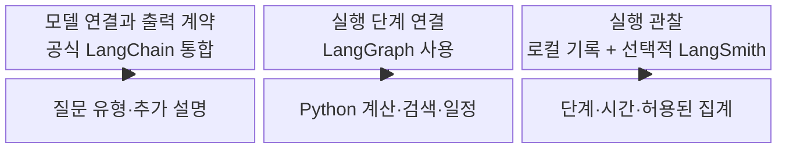

읽을 곳: [공통 AI 연결](../jolup/llm.py)의 `ExplanationSelection`·`IntentDecision` → `_chat_model()` → `generate()` → `explanation_facts()`·`explain_result()`, [그래프](../jolup/agent.py)의 `build_graph()`·`respond()`, [관찰 모듈](../jolup/observability.py)의 `StudyRecorder`·`observe_call()`. LangSmith 사용법은 [별도 안내](LANGSMITH.md)에 있습니다.

## 1. 담당 범위 — 마인드맵 / 개념도

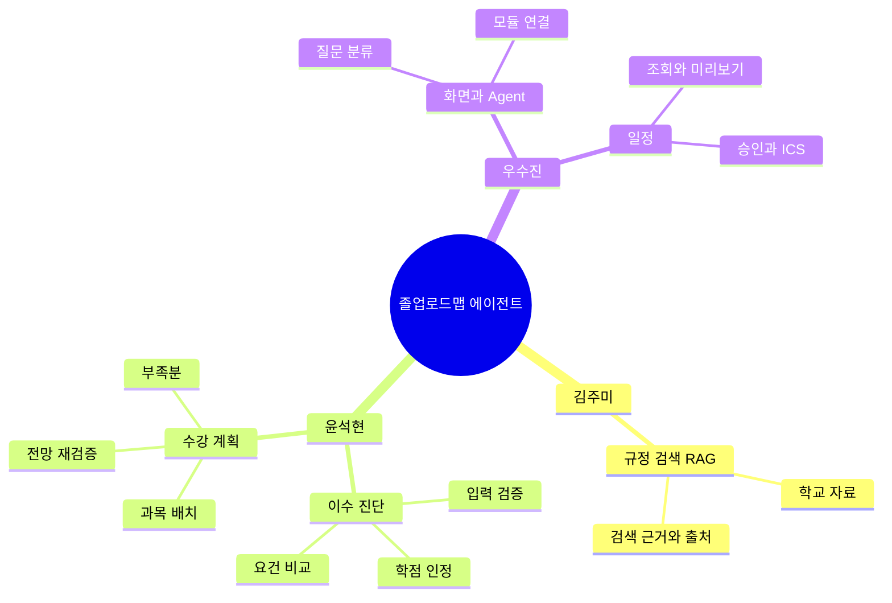

| 그림에서 볼 가지 | 파일에서 볼 곳 | 입력 → 출력 |
|---|---|---|
| 규정 검색 | [rag.py](../jolup/rag.py), `KnowledgeBase.search()`·`answer()` | 규정 질문 → 근거 문단·출처·답변 |
| 이수 진단 | [academic.py](../jolup/academic.py), `check_requirements()` | 프로필·과목 목록 → 상태·학점·진단표 |
| 수강 계획 | [planner.py](../jolup/planner.py), `plan_courses()` | 프로필·과목 목록·희망 조건 → 학기별 후보·부족분 |
| 화면·질문 연결 | [app.py](../app.py), `with chat_tab:`; [chat_client.py](../jolup/chat_client.py), `respond_chat()`; [agent.py](../jolup/agent.py), `respond()` | 질문·학생 상태 → 로컬 또는 HTTP Agent → 답변 묶음 |
| 일정 | [calendar.py](../jolup/calendar.py), `search_events()`·`create_calendar_event()` | 검색 조건 또는 승인한 일정 → 일정 목록 또는 ICS 바이트 |

**직접 해보기:** 앱의 네 탭을 열어 위 담당 가지와 연결합니다. **확인 기준:** ‘계산 과정·출처’에 보이는 과목별 인정 사유가 윤석현의 계산 결과이고, 그 결과를 표시하는 화면은 우수진 담당임을 구별할 수 있습니다.

## 2. 자료가 연결되는 곳 — 흐름도 / 자료 연결 개념도

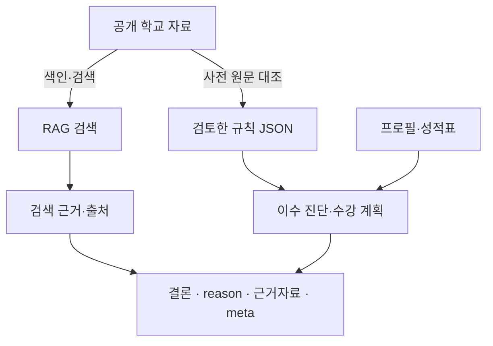

학교 자료에서 규칙 JSON으로 가는 화살표는 **사전에 원문을 대조해 정리한 관계**입니다. 질문할 때마다 AI가 규칙 JSON을 새로 쓰는 실행 단계가 아닙니다. RAG 역시 모든 진단 질문에서 반드시 실행되는 것은 아닙니다.

| 그림에서 볼 부분 | 파일에서 볼 곳 | 입력 → 출력 |
|---|---|---|
| 규칙 JSON | [sungkyul_cs_2024.json](../data/rules/sungkyul_cs_2024.json), `total_credits`, `major_total`, `citations` | 검토한 기준 → 숫자와 근거 연결 |
| 출처 | [sources.json](../data/sources.json); [evidence.py](../jolup/evidence.py), `evidence_for()`·`metadata()` | 근거 그룹 → 파일명·URL·등록일·페이지 |
| 검토 후 변경 탐지 | [evidence.py](../jolup/evidence.py), `validate_rule_bundle()` | 원문·규칙과 검토 해시 → 재검토 필요 항목 |
| 학생 입력 | [samples.py](../jolup/samples.py), `load_sample()` | 사례 ID → 프로필·과목·더미 CSV·기대값 |

**직접 해보기:** 진단표의 전공 합계 63을 JSON의 `major_total`과 연결하고 `citations`의 근거를 따라갑니다. **확인 기준:** 학생 성적표는 검색용 벡터 DB에 들어가지 않으며, 출처에 없는 등록일은 미확인이라는 점을 설명할 수 있습니다. 실습을 위해 검토된 규칙 파일을 임의로 고치지는 않습니다.

## 3. 과목 한 행의 학점 인정 — 의사결정 흐름도 / 실행도

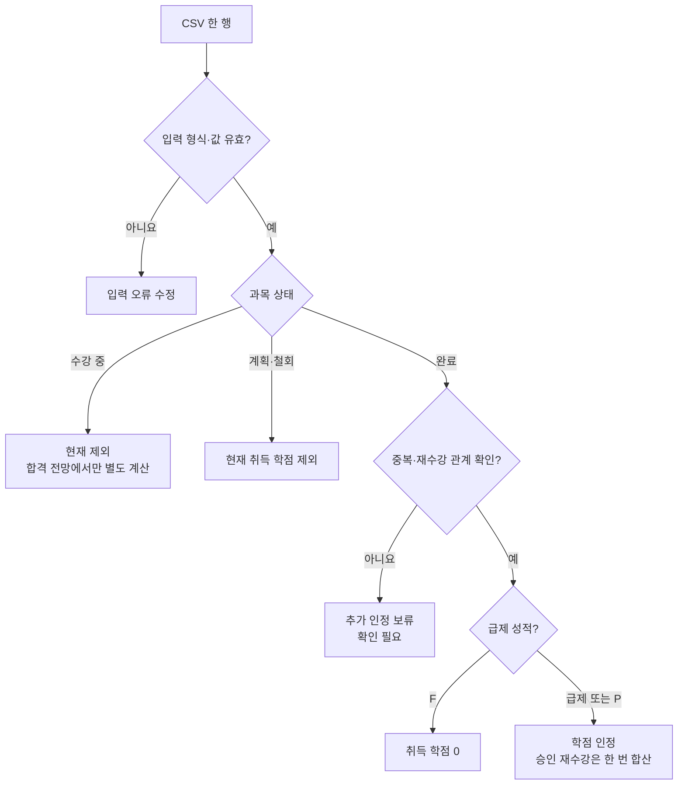

읽는 순서는 [academic.py](../jolup/academic.py)의 **`parse_transcript()` → `_normalize()`·`validate_courses()` → `_calculate()`**입니다.

- `parse_transcript(data)`는 CSV 내용(bytes 또는 문자열)을 받고 `{ok, courses, errors, warnings, removed_columns}`를 반환합니다. 파일 경로를 받는 함수가 아닙니다. 잘못된 행을 뺀 나머지만 정상 성적표로 확정하지 않습니다.
- `_normalize()`는 한 행을 표준 키와 숫자로 바꿉니다. 예를 들어 `이수완료`는 `completed`, `교양필수`는 `교필`로 통일됩니다.
- `_calculate()`는 표준 과목 목록으로 `{totals, trace, review_items, accepted}`를 만듭니다. `trace`는 행별 인정 사유이며 AI 내부 생각이 아닙니다.
- `accepted`는 실제 인정된 과목 목록입니다. `totals`만 보고 중복 원인을 찾기 어렵다면 `trace`와 `accepted`를 함께 봅니다.

**직접 해보기:** 사례09를 불러오고 ‘계산 과정·출처’에서 C프로그래밍 F 원행과 A0 재수강 행을 찾습니다. **확인 기준:** 행은 두 개지만 취득 학점은 3이며, `retake_of`가 원행을 가리키고 `retake_approved`가 확인됐다는 이유를 말할 수 있습니다. 이어 사례08에서는 수강 중 3학점이 현재 120에 포함되지 않는지 확인합니다.

연결 테스트: [test_academic_review.py](../tests/test_academic_review.py)의 `test_approved_retake_replaces_old_earned_credit_instead_of_adding_it()`·`test_in_progress_final_course_counts_only_in_projection()`.

## 4. 현재 90학점의 구성 — 파이 차트 / 수치 비교

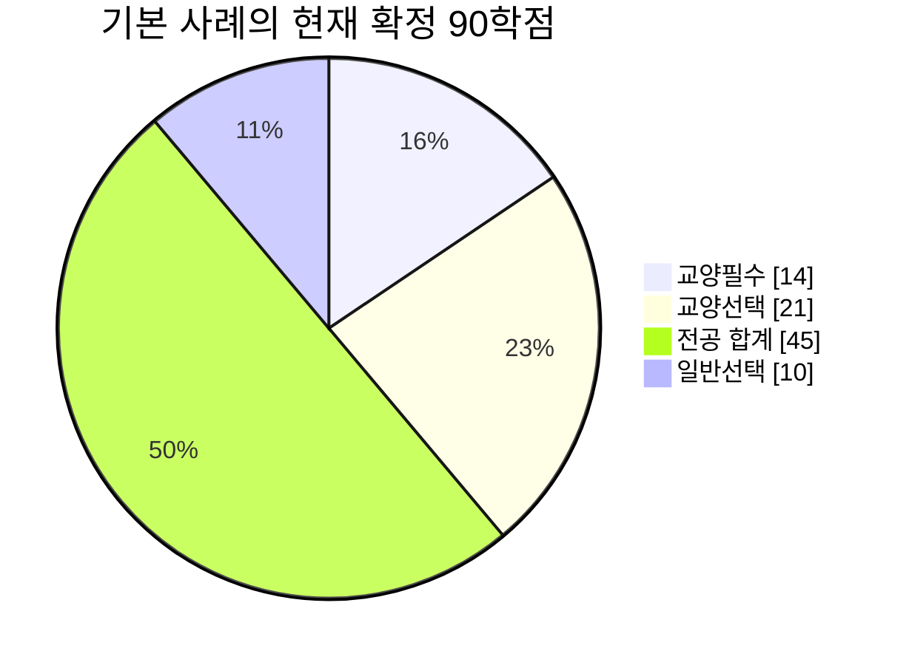

읽을 곳은 [academic.py](../jolup/academic.py)의 `_calculate()` 마지막 합계 부분입니다. `교필`, `교선`, `전필`, `전선`, `일선`을 묶어 `general_required`, `general_elective`, `major_total`, `other`를 만듭니다. 전필과 전선은 전공 합계에 함께 들어갑니다.

입력은 `accepted`에 들어간 확정 급제 과목, 출력은 `totals`입니다. 기본 사례의 기대값은 다음과 같습니다.

```text
totals.total            = 90
totals.general_required = 14
totals.general_elective = 21
totals.major_total      = 45
totals.other            = 10
totals.in_progress      = 15  # 90에 더하지 않은 별도 값
```

**직접 해보기:** 사례01로 돌아와 `14 + 21 + 45 + 10 = 90`을 계산합니다. **확인 기준:** 파이는 현재 학점의 구성이고 ‘진단표의 필요 학점’을 모두 더하는 표가 아니라는 점을 설명할 수 있습니다. 총학점 안에 전공·교양 학점이 이미 포함됩니다.

## 5. 모든 졸업요건의 동시 충족 — 벤다이어그램 / 집합 개념도

각 원은 해당 조건을 충족한 **학생의 집합**입니다. 학점 자체의 집합이나 코드 실행 흐름을 뜻하지 않습니다. 원 크기는 실제 학생 수를 나타내지 않습니다. Mermaid의 `venn-beta`는 11.12.3 이상 렌더러가 필요합니다. [공식 Venn 문법](https://mermaid.js.org/syntax/venn.html)

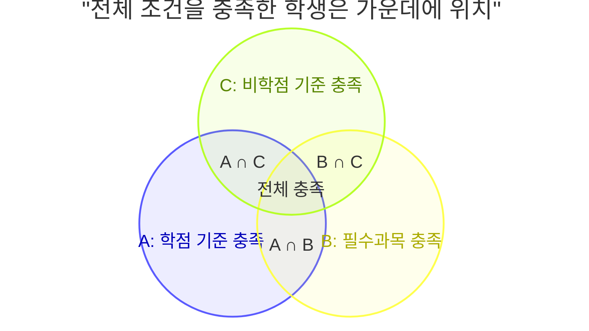

읽을 곳은 [academic.py](../jolup/academic.py)의 `_diagnostic_rows()`와 `check_requirements()`입니다. Venn이 표시되지 않는 뷰어에서는 아래 조건표와 `all(...)` 표현을 같은 의미로 읽으면 됩니다.

| 집합 | `_diagnostic_rows()`가 비교하는 것 | 기본 학생 |
|---|---|---|
| 학점 A | 총123·교필14·교선20·전공63 | 총90·교필14·교선21·전공45 |
| 필수 B | 지정 교양 7과목·설계 2과목 | 교양7·설계0 |
| 비학점 C | 채플6·등록8·작품심사1 | 채플5·등록6·작품0 |

입력은 프로필과 학점 집계, 출력은 `rows`와 `missing_required_courses`입니다. 각 행에는 `area, required, earned, shortage, unit, status, source_ids`가 있습니다. `check_requirements()`는 확인할 문제가 없고 **`all(row["status"] == "충족" for row in rows)`**일 때만 현재 충족을 반환합니다.

자료가 누락된 학생을 원 밖에 확정 배치하면 안 됩니다. `review_items`가 있으면 전체 판정은 확인 필요입니다. 예를 들어 채플 `None`은 0학기가 아니며, 부족분도 임의의 6학기로 채우지 않습니다.

**직접 해보기:** 사례02(모두 충족), 사례07(작품 미완료), 사례10(채플 자료 누락)을 비교합니다. **확인 기준:** ‘총123인데도 미충족’과 ‘자료가 없어 확인 필요’가 다른 이유를 설명할 수 있습니다. 사례02·07은 미래 완료 시점의 별도 더미이며 기본 3학년 학생의 현재 기록이 아닙니다.

연결 테스트: [test_academic_review.py](../tests/test_academic_review.py)의 `test_noncredit_requirement_cannot_be_paid_for_with_extra_credits()`.

## 6. 현재와 미래 전망 — 막대·기준선 / 수치 비교

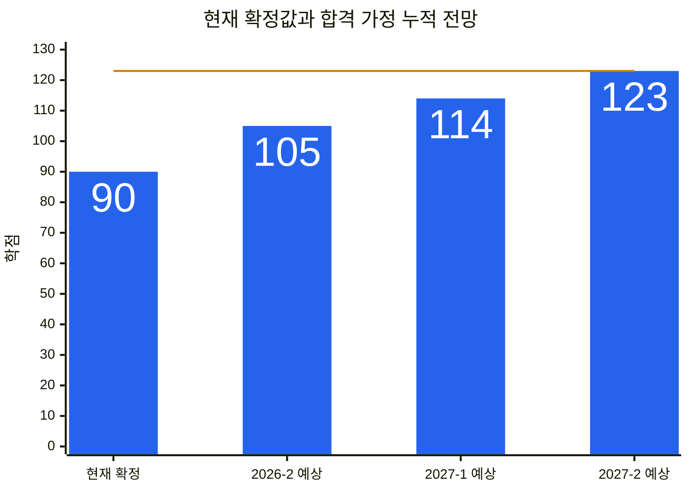

막대는 학점, 수평선은 총학점 기준 123입니다. **첫 막대만 현재 확정값**이며 나머지는 각각의 가정이 성립할 때의 전망입니다.

| 그림의 막대 | 코드와 결과 필드 | 계산 |
|---|---|---|
| 현재90 | [academic.py](../jolup/academic.py), `check_requirements().totals` | 확정 급제만 |
| 2026-2 예상105 | 같은 함수의 `projection.totals` | 현재90 + 수강 중15 합격 가정 |
| 2027-1 예상114 | [planner.py](../jolup/planner.py), `_semester_projection()`; `semesters[0].projected_totals` | 예상105 + 해당 학기 후보9 |
| 2027-2 예상123 | 같은 함수; `semesters[1].projected_totals` | 이전 전망114 + 해당 학기 후보9 |

`plan_courses()`가 호출하는 `_courses_assuming_passes()`에서 `assumed = deepcopy(clean)`를 찾으세요. 복사본의 수강 중 과목에만 합격을 가정합니다. 학기별 후보 역시 복사본에 추가합니다. 원래 `courses`와 현재 `profile`은 바꾸지 않습니다.

학기별 진단표는 **그 학기까지의 후보만 누적**합니다. 채플·작품은 현재 확인값을 유지하고, 등록학기는 계속 등록한다는 추정임을 `basis`에 표시합니다. 별도의 전체 계획에서는 채플·등록·작품도 목표까지 완료하는 조건을 붙여 `조건부 가능`을 계산합니다. 그래서 학기 말 표의 작품 부족과 전체 계획의 조건부 가능이 함께 보일 수 있습니다.

**직접 해보기:** ‘진단·수강 계획’에서 수강 중 전망과 두 학기 말 예상 진단표를 모두 펼칩니다. **확인 기준:** 총학점 `90/105/114/123`, 전공 `45/60/69/78`을 연결하고, 현재 학점이 여전히90임을 확인합니다.

연결 테스트: [test_academic_review.py](../tests/test_academic_review.py)의 `test_each_semester_diagnosis_is_cumulative_and_keeps_unconfirmed_noncredit_values()`·`test_planning_does_not_mutate_original_student_record()`.

## 7. 과목 배치의 동시 제약 — 블록 다이어그램 / 제약 개념도

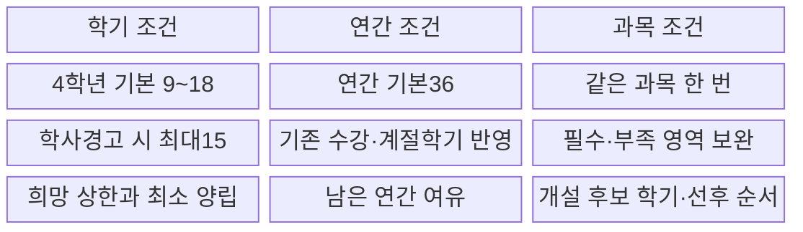

읽는 순서는 [planner.py](../jolup/planner.py)의 `plan_courses()` → [course_solver.py](../jolup/course_solver.py)의 `choose_courses()` → 다시 `plan_courses()`의 결과 재검증입니다.

`plan_courses()`에 이전 진단 결과를 넘겨도 처음에 다시 진단합니다. 화면에 남은 오래된 진단이나 잘못 전달된 진단을 그대로 믿지 않기 위해서입니다. 현재 확인 필요 자료가 있으면 먼저 보완하도록 반환합니다. 후보 목록에서는 이미 인정된 과목 ID·이름을 제외합니다.

`choose_courses()`의 입력을 다음처럼 읽습니다.

| 인수 | 뜻 |
|---|---|
| `candidates`, `future` | 아직 인정되지 않은 후보와 남은 정규학기 |
| `cap`, `minimums`, `annual` | 학기 상한·학기 최소·이미 사용한 연간 학점 |
| `base_totals`, `missing`, `known_ids` | 수강 중 합격 전망의 학점·빠진 필수·이미 인정될 과목 |
| `requirements` | 검토된 졸업 규칙 |

함수 안의 `choices`에서 한 선택지는 **‘이 과목을 이 학기에 듣는다’**입니다. MILP는 이 선택지를 0 또는1로 결정하며, 남은 모든 학기를 함께 검토합니다. `_model_constraints()`는 `_credit_limit_rows()`·`_one_attempt_rows()`·`_prerequisite_rows()`·`_shortfall_rows()`를 모아 학기 최소·최대, 연간 한도, 중복 금지, 선행과목 순서와 부족분 조건을 만듭니다. 부족분을 남기는 변수도 있어, ‘졸업요건을 채우지 못하는 배치’의 부족량을 표시할 수 있습니다.

출력은 `(selected, solver)`입니다. `selected`는 학기별 후보, `solver`는 계산 상태와 남은 부족분입니다.

- `feasible=True`: 수강의 강제 제약을 지키는 배치를 얻었다는 뜻입니다. 졸업 가능과 동일하지 않습니다.
- `optimal=True`: 정해진 목적함수의 최적 탐색을 완료했다는 뜻입니다. 실제 개설·여석 확정이나 학교 졸업 승인을 뜻하지 않습니다.
- `feasible=False`: 현재 조건에서 사용할 수 있는 배치를 확인하지 못했습니다. 이후 비학점 완료 가정으로 이 실패를 덮지 않습니다.
- 수강 배치를 얻었어도 최종 요건을 다시 비교합니다. 보완 경로가 확인되면 조건부 가능, 완료된 탐색에도 부족하면 위험, 미완료 탐색으로 판단할 수 없으면 확인 필요입니다.

**직접 해보기:** 사례03을 불러와 `38 + 15 + 18 + 18 = 89`, `123 - 89 = 34`를 계산하고 계획의 부족분과 비교합니다. **확인 기준:** ‘학기별 최대치를 다 써도 부족’과 ‘최소 수강학점에 맞는 배치 자체를 확인하지 못함’을 구분합니다.

추가 코드 실습은 [test_academic_review.py](../tests/test_academic_review.py)의 `test_preferred_eight_credit_cap_cannot_bypass_senior_nine_credit_minimum()`을 읽습니다. 현재 UI에는 희망 최대학점 입력이 없으므로 화면에서 8학점으로 바꾸라고 안내하지 않습니다. 설계(1) 다음에 설계(2)를 배치하는 규칙은 프로젝트의 보수적 계획 정책이며 공식 선수과목 제한 확정과 구별합니다.

## 8. 질문에서 답변까지 — 시퀀스 다이어그램 / 실행도

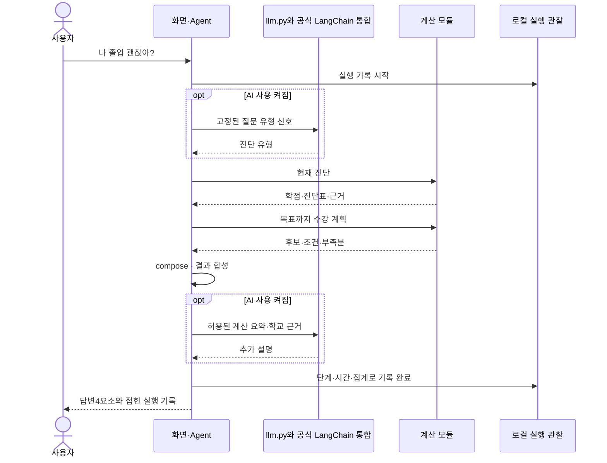

이 그림은 로컬 실행 모드의 진단 질문을 보여 줍니다. 읽을 곳은 [app.py](../app.py)의 `with chat_tab:` → [chat_client.py](../jolup/chat_client.py)의 `respond_chat()` → [agent.py](../jolup/agent.py)의 `respond()`·`build_graph()`입니다. 진단 질문은 `START → route → diagnosis → compose → explain → END`로 진행하며 `diagnosis` 안에서 현재 진단과 계획을 호출합니다. 혼합 질문에서는 `_requested_intents()`가 요청한 분야만 `regulation → diagnosis 또는 planning → calendar` 순서로 고르고 `_compose()`가 결과를 합칩니다. `planning`이 선택되면 별도 `diagnosis` 노드를 다시 실행하지 않습니다. 계획 내부의 재검증은 그대로 수행합니다.

입력은 `query, profile, courses, context`, 출력은 `answer, status, rows, evidence, meta, intent, requested_intents, timings, study_trace` 및 선택적인 `plan, ai_explanation, sections, partial_failure, memory`입니다. 혼합 응답의 `sections`는 분야별 결과이고, `partial_failure`는 일부 처리 오류를 뜻합니다. 전체 `status`는 주된 학사 판정이므로 분야별 상태도 함께 읽습니다. LangGraph의 `AgentState`는 실행 중 데이터를 전달하는 묶음이며 영구 학생 데이터베이스가 아닙니다. 그래프는 `invoke(version="v2").value`로 결과를 받습니다.

최근 결과는 [conversation.py](../jolup/conversation.py)의 `ConversationMemory`에서 읽습니다. `synchronize()`는 학생 입력·학교 자료가 달라졌으면 기억을 비우고, `replay()`는 ‘아까 규정 다시 보여줘’ 같은 명시 요청에 검증한 결과를 복사해 반환합니다. 이때 `route → reuse → explain → END`이며 검색·계산·AI를 추가 호출하지 않습니다. 새로운 조건은 다시 계산합니다. 실제 보관은 세션별 최근 4턴이고 `clear()`로 비웁니다. 전체 대화를 다음 LLM 프롬프트에 넣거나 임의 대명사를 모두 이해하는 메모리는 아닙니다.

`JOLUP_AGENT_API_URL`을 설정하면 `respond_chat()`이 [study_api.py](../jolup/study_api.py)의 `POST /chat`을 통해 같은 Agent를 실행합니다. 이 HTTP 모드는 서버의 `session_id`로 기억을 분리하고 외부 LLM 호출을 끕니다. 키·로컬 메모리 객체를 요청 본문에 보내지 않습니다. Compose는 이 HTTP 경로를 사용하며, 환경변수가 없는 로컬 실행에서는 직접 함수 호출과 선택적 AI 연결을 사용합니다.

OpenAI·Claude 연결은 [llm.py](../jolup/llm.py)의 `_chat_model()` → `generate()`, 질문 분류는 `classify_intent()`, 앱 설명은 `safe_explanation_input()` → `explanation_facts()` → `explain_result()`에서 읽습니다. 앱은 `ExplanationSelection.fact_ids`로 제공된 문장 ID만 선택하고, `IntentDecision`으로 허용된 의도 다섯 개 중 하나만 받습니다. `with_structured_output(..., method="json_schema")`가 이 Pydantic 계약을 공급자 요청과 반환값 검증에 연결합니다. 설명 단계는 선택 ID의 유효성과 중복을 다시 확인하고, 해당 사례의 현재 판정·수강 중 학점·목표 조건·확인 필요 경고를 필수 문장으로 유지한 뒤 로컬 문장을 조립합니다. 규정·일정 조회에는 학생 졸업 판정 문장을 만들지 않습니다. `ExplanationOutput.explanation` 문자열 계약은 일반 `generate()`를 기본 인수로 직접 호출할 때 남아 있는 계약이며, 앱 설명 경로의 반환 계약이 아닙니다. `answer/status/rows`는 계산이 만들고 조립된 설명은 별도 `ai_explanation` 필드에 붙습니다. MCP 경로는 [mcp_client.py](../jolup/mcp_client.py)의 `call_domain()`에서 확인합니다. `MCP_URL`이 없으면 같은 함수를 직접 호출하고, 설정돼 있으면 허용한 MCP 서버를 경유합니다.

**출력 형식 실습:** [test_explanation_facts.py](../tests/test_explanation_facts.py)의 `test_model_cannot_replace_current_result_or_omit_conditional_warning()`과 `test_unknown_duplicate_or_malformed_fact_selection_is_not_displayed()`를 먼저 읽습니다. 모델이 필수 조건을 선택하지 않아도 유지되는지, 허용되지 않은 ID·중복·잘못된 형식이 `used=false`·`schema_mismatch`·빈 표시 문장이 되는지 확인합니다. `test_nonpersonal_lookup_never_invents_a_student_diagnosis()`는 규정·일정 조회에 개인 판정을 붙이지 않는 반례입니다. 이어 `explanation_facts()`·`explain_result()`의 필수 ID와 문장 조립을 찾습니다. 일반 `generate()` 기본 문자열 계약의 형식 오류는 [test_llm.py](../tests/test_llm.py)의 `test_provider_schema_mismatch_never_becomes_a_displayed_explanation()`와 `_structured_result()`에서 별도로 읽습니다. JSON 형식 검증과 앱의 근거 문장 선택은 서로 다른 검사입니다. 공급자 호출부터 검증·실패 처리까지의 상세 시퀀스는 [개발도구 학습지도](개발도구_학습지도.md)의 ‘모델 출력 계약부터 읽는 순서’에서 연결합니다.

**직접 해보기:** 기본 사례에서 AI 설명을 끈 상태로 질문하고 마지막 답변 아래 **실행 과정 살펴보기**를 엽니다. 단계 표의 `route → diagnosis → compose → explain`와 진단·계획의 자식 호출을 코드 함수와 연결합니다. 이어 ‘졸업 규정과 내 부족 학점, 2026년 졸업식 일정 알려줘’로 분야별 결과를 보고 ‘아까 규정 다시 보여줘’로 `route → reuse → explain`을 확인합니다. **확인 기준:** 재사용 때 도메인·AI 호출이 없고, 학생 조건을 바꾸면 재사용하지 않음을 설명합니다. 로컬 모드에서 AI를 켠 새 질문은 실제 API를 호출할 수 있습니다. 연결 테스트는 [test_agent_conversation.py](../tests/test_agent_conversation.py)의 `test_mixed_request_preserves_regulation_diagnosis_and_calendar()`·`test_four_turn_memory_replays_evidence_without_search_and_isolated()`·`test_student_and_school_changes_invalidate_previous_results()`입니다.

## 9. 일정 승인 — 상태 다이어그램 / 실행 상태

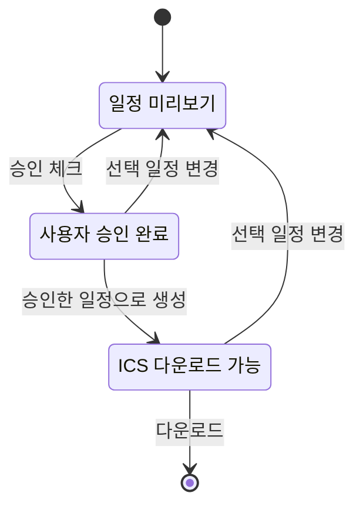

읽을 곳은 [calendar.py](../jolup/calendar.py)의 `search_events()`·`preview_events()`·`create_calendar_event()`, [app.py](../app.py)의 `with calendar_tab:`입니다. 입력은 선택한 공식 일정과 `approved`, 출력은 ICS 파일 바이트입니다. 일정 승인 키에 선택 내용의 해시가 들어갑니다.

**직접 해보기:** 학사일정 하나를 골라 승인 전·후 다운로드 상태를 확인한 다음 다른 일정으로 바꿉니다. **확인 기준:** 이전 승인으로 새 일정을 내려받을 수 없어야 합니다. 생성한 ICS를 외부 캘린더로 가져오는 일은 사용자가 합니다. 원문에 없는 미래 일정은 생성하지 않습니다.

연결 테스트: [test_calendar.py](../tests/test_calendar.py)의 `test_no_export_without_explicit_approval()`·`test_cannot_export_modified_or_invented_dates()`.

## 10. 결과가 다를 때 — 원인 진단 흐름도 / 분석 절차

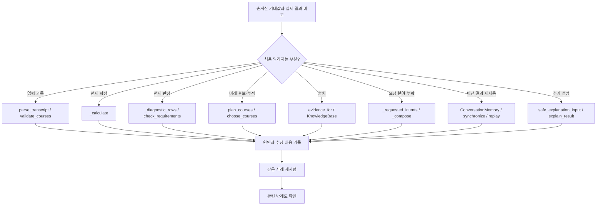

학습 기록은 [observability.py](../jolup/observability.py)의 `StudyRecorder`·`observe_call()`이 만듭니다. **실행 성공**은 관찰된 예외나 허용된 오류 코드가 없는 실행이며 **졸업 충족**을 뜻하지 않습니다. 위험 판정을 정상적으로 반환한 실행도 실행 상태는 성공일 수 있습니다.

| 비교할 사례 | 손계산·기대 판단 | 처음 볼 코드 |
|---|---|---|
| 01 정상 준비 | 현재90·수강 중 포함105·후보 포함123 | `check_requirements`, `plan_courses` |
| 03 총학점 부족 | 최대89, 총34 부족 | `choose_courses`, 최종 재진단 |
| 04 전공 부족 | 현재 전공9 + 수강 중15 + 남은 최대36 = 60 | 전공 합계 행 |
| 07 작품 미완료 | 총123이어도 미충족 | 비학점 진단 행 |
| 09 승인 재수강 | 원행과 재수강을 중복 합산하지 않음 | `_calculate` |
| 10 자료 누락 | 채플을0으로 바꾸지 않고 확인 필요 | `_profile_issues` |

**직접 해보기:** 사례01과03에서 각각 질문한 뒤 단계 요약의 현재 학점·목표 전망·계획 상태를 기대값과 대조합니다. 사례 교체는 이전 대화를 지우므로 비교 값은 자신의 실습 기록에 남깁니다. **확인 기준:** 어느 함수에서 결과가 처음 달라졌는지 지목하고, 그 입력과 출력을 설명할 수 있습니다.

LangSmith로 옮겨 보면 동일한 실행의 부모·자식 관계와 시간을 비교하기 쉽습니다. 그러나 기록이 보인다는 사실만으로 정답이 검증되지는 않습니다. [독립 기대값 테스트](../tests/test_academic.py)와 [계산 반례 테스트](../tests/test_academic_review.py), [검증결과](검증결과.md)를 함께 봅니다. 기존 버전의 테스트 통과 수와 관찰 기능을 추가한 뒤의 검증을 구별합니다.

## 학습을 마쳤는지 확인할 질문

1. 현재90과 목표123이 함께 나오는 이유를 입력·복사본·결과 필드로 설명할 수 있는가?
2. 총123이어도 작품 또는 필수과목 때문에 미충족인 코드를 찾을 수 있는가?
3. 채플 누락과 채플0을 구분하는 줄을 찾을 수 있는가?
4. `feasible=True`여도 목표까지 위험할 수 있는 이유를 설명할 수 있는가?
5. AI 설명·LangGraph 단계·Python 계산·LangSmith 기록의 역할을 구분할 수 있는가?
6. 실행 기록의 시간과 상태를 보고 실패한 함수 위치를 찾되, 정답 여부는 기대값으로 별도 검증할 수 있는가?

발표 연습은 [시연 진행표](시연_진행표.md), 계산의 더 깊은 설명은 [윤석현 계산 로직 설명서](윤석현_계산로직_설명.md), 선택적 클라우드 관찰은 [LangSmith 안내](LANGSMITH.md)로 이어집니다.
