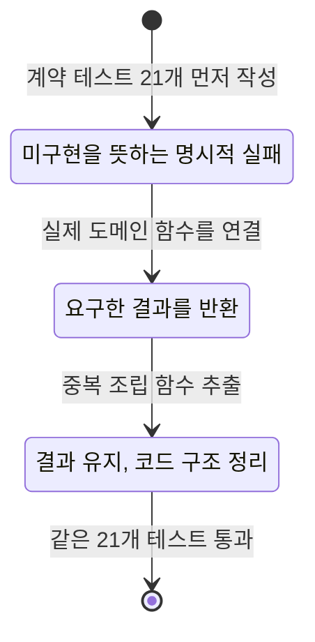

# 완료 앱을 바탕으로 배우는 TDD

이 폴더는 **2026-10-23에 새로 만든 학습용 어댑터**입니다. 먼저 동일 계약 테스트를 작성하고, 미구현 상태의 실패를 확인한 뒤 구현·정리했습니다. 완료 앱의 과거 개발 이력을 바꾼 자료가 아니며, 기존 전체 기능이 TDD로 개발되었다고 주장하지 않습니다.

기존 계산기·계획기·규정 검색·일정 함수를 그대로 사용합니다. 학습 어댑터가 별도의 졸업 규칙을 계산하거나 사례별 정답을 하드코딩하지 않습니다. 학습 실행에 모델 API 키나 LangSmith 키는 필요하지 않습니다. 규정 검색 시험은 제공된 자료를 사용하는 명시적 어휘 검색(`lexical`)이며, 벡터 모델이나 외부 API를 호출하지 않습니다.

## 먼저 읽을 순서

1. [계약 테스트](checks.py)에서 입력과 기대값을 읽습니다. `90 → 105 → 114 → 123`은 더미에 대한 손계산 기대값이며, 구현 코드의 상수가 아닙니다.
2. [Red](stages/red.py)의 두 공개 함수가 미구현이어서 어떤 테스트가 실패하는지 봅니다.
3. [Green](stages/green.py)이 실제 앱 함수를 호출해 결과를 조립하는 과정을 읽습니다.
4. [Refactor](stages/refactor.py)의 `_snapshot`, `_timeline`, `_source_cards`로 중복을 분리한 결과를 비교합니다. 계약 테스트는 수정하지 않습니다.
5. 아래 표의 실제 앱 코드와 기존 테스트로 내려가 더 자세한 계산·검색·일정 규칙을 공부합니다.



## 다섯 계약과 실제 코드

| 계약 | 확인할 결과 | 새 테스트 함수 | 실제 앱 코드·기존 검증 |
|---|---|---|---|
| 현재와 전망 분리 | 현재 90·수강 중 통과 가정 105; 120/123 경계도 구분 | `test_current_and_pass_projection_are_separate`, `test_three_in_progress_credits_do_not_create_current_pass` | [academic.py](../../jolup/academic.py)의 `check_requirements`; [test_academic_review.py](../../tests/test_academic_review.py)의 `test_in_progress_final_course_counts_only_in_projection` |
| 진단 이유 보존 | 자료 누락은 `None`·확인 필요; 123학점이어도 필수과목 부족; 비학점 요건 자동 통과 금지 | `test_missing_record_stays_unknown_instead_of_zero`, `test_total_123_does_not_replace_a_required_course`, `test_noncredit_values_are_not_automatically_completed` | `academic._diagnostic_rows`; 같은 기존 테스트 파일의 `test_same_area_credit_total_cannot_replace_a_missing_required_course`, `test_noncredit_requirement_cannot_be_paid_for_with_extra_credits` |
| 학기별 경로 | 90→105→114→123, 2027년 각 학기 9학점; 원본 불변; 위험 사례 유지 | `test_timeline_uses_each_real_semester_and_labels_assumptions`, `test_large_shortfall_does_not_become_a_positive_plan`, `test_report_does_not_mutate_or_alias_student_inputs` | [planner.py](../../jolup/planner.py)의 `plan_courses`, `_semester_projection`; 기존 `test_on_track_plan_uses_nine_each_senior_term_and_finishes_at_123` |
| 출처 보존 | 실제 어휘 검색 결과의 파일·주소·페이지 유지, 미확인 등록일은 `None`, 검색 근거가 없으면 확인 필요 | `test_real_lexical_rag_citations_and_unknown_dates_are_preserved`, `test_missing_rag_sources_remain_unconfirmed` | [rag.py](../../jolup/rag.py)의 `KnowledgeBase.answer`; [test_rag.py](../../tests/test_rag.py)의 `test_original_metadata_and_unknown_dates_are_preserved`, `test_no_sources_means_no_confirmed_answer` |
| 승인된 일정 파일 | `True`만 승인, 변조·미등록 일정·빈 선택 차단, 12/31까지인 일정의 ICS 종료는 1/1 | `test_calendar_requires_explicit_boolean_approval`, `test_calendar_inclusive_last_day_has_exclusive_ics_end`, `test_calendar_rejects_modified_or_unknown_events` | [calendar.py](../../jolup/calendar.py)의 `create_calendar_event`; [test_calendar.py](../../tests/test_calendar.py)의 승인·날짜·중복 테스트 |

테스트 함수는 16개이며 매개변수 사례를 펼치면 **21개 검사**입니다. 일반 `pytest` 실행에 의도된 Red가 섞이지 않도록 파일명을 `checks.py`로 두었습니다. 아래처럼 명시적으로 실행합니다.

## 같은 테스트로 세 단계 실행

프로젝트 루트에서 실행하세요. `JOLUP_TDD_STAGE`를 생략하면 최종 `refactor`를 선택합니다.

```bash
JOLUP_TDD_STAGE=red .venv/bin/python -m pytest -q learning/tdd/checks.py --junitxml=reports/tdd_adapter_red.xml
JOLUP_TDD_STAGE=green .venv/bin/python -m pytest -q learning/tdd/checks.py --junitxml=reports/tdd_adapter_green.xml
JOLUP_TDD_STAGE=refactor .venv/bin/python -m pytest -q learning/tdd/checks.py --junitxml=reports/tdd_adapter_refactor.xml
```

- Red의 예상 결과는 `NotImplementedError: TDD_REPLAY_RED`에 의한 **21개 실패·설정 오류 0개**이며 종료 코드는 1입니다. 실패 횟수만 맞고 import·설정 오류로 실패한 경우는 올바른 Red가 아닙니다.
- Green과 Refactor의 예상 결과는 각각 **21개 통과**이며 종료 코드는 0입니다.
- 이 로그는 현재 실행한 학습 어댑터의 기록입니다. 과거 앱 개발 당시의 실패 기록이 아닙니다.
- [replay_spec.json](replay_spec.json)은 실행 도구가 사용할 테스트 경로·환경 변수·Red 표식·공개 함수 정보를 담습니다.

## 반환 자료를 읽는 법

`build_learning_report(profile, courses, regulation_result=None)`은 다음 자료를 반환합니다.

| 필드 | 의미 |
|---|---|
| `answer`, `reason` | 현재 자료 기준 결론과 영역별 진단표. 공식 졸업 확정이 아님 |
| `current` | 현재 확정 학점·상태·진단표, `is_assumption=False` |
| `projection` | 수강 중 과목 합격 가정 학점·상태·진단표, `is_assumption=True` |
| `readiness` | 기존 계획기의 전체 결과. 조건부 가능·위험·확인 필요와 가정·부족분 보존 |
| `timeline` | 현재, 수강 중 합격 가정, 계획 학기별 누적 결과. 계산 불가능한 학기의 학점은 `None` |
| `evidence`, `meta` | 현재 진단·수강 계획·제공된 규정 응답의 근거. 페이지를 유지하고 동일 출처를 정리 |
| `regulation` | 호출자가 전달한 실제 규정 검색 결과의 복사본. 전달하지 않으면 `None` |
| `official_graduation_confirmed` | 기존 진단의 공식 졸업 확정 여부. 현재 앱에서는 `False` |

`export_reviewed_events(events, approved=False)`는 기존 일정 함수에 검증과 ICS 변환을 맡깁니다. 외부 캘린더에 등록하지 않습니다. 테스트용 일정은 임시 폴더의 가상 자료이며 실제 학교 일정을 덮어쓰지 않습니다.

## 직접 바꾸며 배우기

Green·Refactor를 고칠 때는 공개 함수의 서명과 테스트를 유지하세요. 예를 들어 `_snapshot`의 `assumed`를 항상 `False`로 바꾸면 현재와 전망 분리 테스트가 실패해야 합니다. 학기별 누적값 대신 최종 학점만 반복하면 경로 테스트가 실패해야 합니다. 실습 후 해당 변경을 되돌려 같은 테스트가 다시 통과하는지 확인합니다.

이 실습은 **새 어댑터의 TDD와 기존 앱 코드 연결**을 다룹니다. 기존 앱 전체의 요구사항·계약·테스트를 순서대로 공부하는 자료는 상위 학습 안내를 함께 사용하세요. 화면·API·LangGraph·LangSmith까지 이 두 함수가 새로 구현하거나 전부 검증하는 것은 아닙니다.
